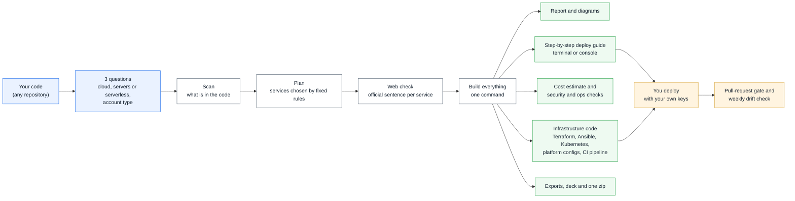

<p align="center"></p>

# SolsArch Early Cloud Architect

**Website: [solsarch.com](https://solsarch.com/)**

**Cloud architect, DevOps and AIOps for your team. Early architecture from your codebase and your company's rules. Not from a prompt.**

Most tools ask you to describe your system to an AI and then draw what it imagines: prompt to architecture, prompt to diagram, prompt to Terraform. The answer changes with the wording, nobody can check where it came from, and it has never read your company's standards.

SolsArch starts from two things you already have:

- **Your codebase.** It reads the files and picks services with fixed rules. Every choice points to the file and line that caused it.
- **Your rules.** Attach the standards you already write (approved clouds, regions, tags, budgets, encryption, retention, compliance) as docs, PDFs, Markdown or JSON beside the code. They limit the choices, appear in the generated Terraform, and every rule is checked and reported with the sentence it came from.

The same inputs give the same files, byte for byte, whichever AI agent runs it.

| | Prompt to architecture, diagram or IaC | SolsArch |
| :--- | :--- | :--- |
| Starts from | A description you type | Your repository and the rules you attach |
| Same input, same output | Changes with the wording and the model | Identical files on every run, on every agent |
| Where a choice came from | Not shown | File and line for the code; document and sentence for the rule |
| Company policy | Pasted into a prompt and hoped for | Read from your documents, enforced, checked, exceptions need a reason and an expiry date |
| What you get | A picture or a snippet | Report, diagrams, Terraform, Kubernetes, Ansible, CI, cost estimate, deploy guide, ops scorecard, quality score, in one zip |
| Where | One vendor | 40 clouds and platforms, side by side |
| Your credentials | Often requested | Never seen; you deploy with your own keys |

**Who it is for:** platform and DevOps teams that want a first architecture that already follows house rules; consultancies that need comparable proposals across clouds; startups on a free tier who need a design that will not surprise them with a bill; security and compliance leads who want every rule traced to evidence; and teams that run AI services and want DevOps, DevSecOps, MLOps, AIOps, LLMOps and AgentOps maturity scored from their own files.

In detail, it is an Agent Skill that turns a code repository into a cloud architecture **and everything needed to deploy it**. Ask your AI agent to design the cloud setup for a project and it will:

1. ask three questions: **which cloud or platform** (40 are supported), **servers or serverless**, and **what kind of account you have** (free trial, always-free tier, pay as you go, or standard paid);
2. scan the code and choose services with fixed rules, each tied to the file and line that caused it, and read the company rules you attached;
3. check the chosen services against the vendor's own documentation by web search (by hand, or automatically with any search API);
4. draw the diagrams: an icon picture of your cloud layout, a service sheet, and Mermaid diagrams (C4 levels, frontend, backend, database schema, sequences);
5. write the **infrastructure code**: Terraform, Ansible, Kubernetes manifests, a Helm chart, Dockerfiles, the platform's own config file (Render, Fly, Vercel ...) and a CI pipeline with a pull-request gate;
6. estimate the monthly cost with honest labels (live vendor price, estimate, unpriced), score operations maturity, and run pre-deployment security checks;
7. write a **step-by-step deploy guide for someone who has never deployed**, for your account type, with terminal and console paths;
8. **verify** the report against the scan (no invented evidence, no leaked secrets, no broken diagrams) and put everything in **one zip**.

It works the same in **Claude Code, Codex, Cursor, Gemini CLI, GitHub Copilot, Windsurf, any MCP-capable agent, and custom agents**. The decisions come from scripts, not from the model, so every agent produces the same plan, and running it twice gives the same files byte for byte. Python 3.8 or newer is all it needs.

It prepares everything and hands you the guide. It never deploys for you and never holds your cloud credentials.

## In one picture



## What it can do

| Capability | What you get |
| :--- | :--- |
| **Understand the code** | Frameworks, databases, queues, services, ports and health paths; monorepos and several repos in one folder |
| **Follow your rules** | Approved clouds, regions, budgets, tags, encryption, retention and compliance names read from the documents you attach (docs, PDF, Markdown, JSON, YAML); enforced, checked and traced to the sentence they came from |
| **Choose services** | Fixed rules across 40 clouds and platforms; every choice points to the file that caused it; AWS, Azure and GCP side by side |
| **Check on the web** | One official sentence per service from the vendor's own site, with a hash you can re-check later |
| **Draw** | C4 diagrams, frontend, backend and database-schema diagrams, sequences, and an icon picture of the cloud layout |
| **Write the infrastructure code** | Terraform for 17 clouds, Kubernetes, Helm, Ansible, Dockerfiles, platform config files, GitHub Actions pipeline, pull-request gate, weekly drift check |
| **Estimate cost** | Monthly estimate, range and 12-month view; each line labelled live price, estimate or unpriced |
| **Check quality and risk** | Pre-deployment security checks (including secrets left in git history), design rules, end-of-life runtimes, an operations maturity score, real-tool checks (Terraform, Trivy, Checkov, kubectl), and a **quality score out of 100** from seven gates, plus an eighth for your company rules (`docs/solsarch-quality.md`) |
| **Explain how to deploy** | A beginner-friendly guide for your account type, with terminal and console paths |
| **Hand off** | Exports for Backstage, Structurizr, PlantUML, LikeC4, draw.io, Score and Port; an executive deck and PDF; everything in one zip |

## Bring your company rules

Put your standards next to the code, or point to them. SolsArch looks in `.solsarch/rules/`, `docs/policies/`, `policies/` and `solsarch.rules.*`, or you pass `--rules PATH` (a file or a folder, repeatable) to `plan`, `run` and `finish`.

| Attach as | How it is read |
| :--- | :--- |
| JSON or YAML | Exact. A `rules` list, or the rule names as keys. Values are validated before they reach any generated file |
| Markdown, text, HTML | Lines such as `rule: allowed_clouds = aws, azure ; level=blocking` are exact. Plain sentences ("All customer data must stay in the EU.") are picked out by fixed patterns |
| Word (.docx), PDF | The text is extracted with the standard library. A scanned PDF has no text layer and is reported as such |

No language model decides what a sentence means. A sentence that sounds like a rule but is not understood is listed under **Attached but not enforced** in `docs/solsarch-rules.md`, never dropped silently. Your agent can read it and write it as a `rule:` line.

| Rule | What it does |
| :--- | :--- |
| Approved, denied or preferred clouds | `plan` refuses a forbidden cloud and lists the allowed ones; `compare` marks blocked clouds; `run` picks only an allowed one |
| Data residency and allowed regions | Picks a region inside the area (for example `eu-central-1`, `germanywestcentral`, `europe-west3`) and checks every region in the generated code |
| Budget, recovery objectives, compliance names | Fill the profile; the budget is checked against the cost estimate. A framework name (SOC 2, ISO 27001, HIPAA, PCI DSS, GDPR, DORA, NIS2 ...) adds the checks it maps to. It is a mapping, not a certification |
| Required tags and name prefix | Added to the generated Terraform (merged into AWS default tags, Azure tags and Google labels) |
| Log retention | Raised or lowered to meet the rule (rounded to a value CloudWatch accepts) |
| Forbidden services, public databases or storage, encryption, customer-managed keys | Checked against the plan and every generated file; a failure names the file |
| Serverless-first, Terraform or OpenTofu, GitHub Actions | Checked against the plan and the generated files |

Each rule has a level: `advisory` (a warning), `required` (a failed check) or `blocking` (a failed check that stops "deploy ready"). An exception needs a reason, an owner and an expiry date; after the date the rule applies again.

```yaml
# .solsarch/rules/company.yaml
rules:
  - kind: allowed_clouds
    value: [aws, azure]
    level: blocking
  - kind: data_residency
    value: [eu]
  - kind: required_tags
    value: [owner, cost-center]
exceptions:
  - rule: R-denied-services-1a2b3c
    reason: Legacy batch job, ends in Q3
    owner: platform-team
    expires: 2027-03-31
```

You get `docs/solsarch-rules.md` (every rule with its source, result and the unread sentences), gate 8 "Company rules" in the quality report, `adr/`, one architecture decision record per service (evidence, alternatives, the rules that apply), and `policy/solsarch-company.rego`, an OPA policy for the rules that can be tested on a Terraform plan, so the pipeline keeps enforcing them after the first architecture. If the design breaks a rule (for example a private network that needs a NAT gateway when the rules forbid one), the report says so and names the file; it does not quietly change the design.

## The user journey

1. **Install** once for your agent, or register the MCP server (see below).
2. **Ask in plain words**, for example "Design and deploy this to Render" or "I have an Azure free trial, show me how".
3. **Answer three questions:** which cloud or platform, servers or serverless, and what kind of account you have (free trial, always-free, pay as you go, or paid). A free account gets a smaller, cheaper design.
4. **It scans and plans.** You see the chosen services and why each was chosen.
5. **Web check.** Automatic if you set a search key; otherwise your agent searches, or the step is skipped and the report says so.
6. **One command builds everything** (`finish`): report, diagrams, cost estimate, infrastructure code, deploy guide, scorecard, exports, deck and the zip. A check rejects invented evidence, leaked secrets and broken diagrams.
7. **You get a short summary:** the verdict, any blockers, anything that changed, and where the zip and guide are.
8. **Optional checks:** `validate` runs the real tools over the generated code, `gate` gives a pass or fail for pull requests, `eol` lists runtimes past end of life.
9. **You deploy with the guide.** Your agent can walk you through it one step at a time. You set your own keys in your own terminal; the skill never sees them.
10. **After launch**, the generated pipeline runs the checks on every pull request and asks a person to approve before it applies anything. The weekly drift check opens an issue if the cloud stops matching the code. Re-run the skill after big changes.

## Add-ons (all optional)

The skill works with nothing but Python. These make it better when you have them; anything missing is reported as "not run", never as passed.

| Add-on | What it adds | How to turn it on |
| :--- | :--- | :--- |
| Search API | Automatic web check (`facts auto`) | Set `TAVILY_API_KEY`, `BRAVE_API_KEY`, `SERPER_API_KEY` or `GOOGLE_CSE_KEY` |
| Language model | Helps choose among sentences taken from the page (checked afterwards) | Set `OPENAI_API_KEY` (or `SOLSARCH_LLM_BASE_URL` for Ollama, vLLM and others), `ANTHROPIC_API_KEY` or `GEMINI_API_KEY`; pass `--llm` |
| Terraform or OpenTofu | Real `init`, `validate`, `fmt` on the generated code | Install either; run `solsarch.py validate` |
| TFLint, Checkov, Trivy | Lint and security scans of the generated code | Install them; `validate` uses them |
| kubectl, ansible-lint | Checks Kubernetes and Ansible output | Install them |
| Docker | Build and push images as the guide shows | Install Docker Desktop |
| Infracost | Cost change on every pull request | Add `INFRACOST_API_KEY` as a repository secret |
| Backstage, Port, Humanitec | Service catalog entries with the maturity level | Import files from `exports/` |
| Structurizr, PlantUML, LikeC4, draw.io | Editable architecture diagrams | Open files from `exports/` |
| Provider MCP servers | Live lookups through each cloud's own MCP server | `solsarch.py mcp tools` lists them |
| Price book | Live vendor prices, saved so repeat runs match | `solsarch.py costs` (set `SOLSARCH_OFFLINE=1` to stay offline) |

## Install

Clone this repository, then run the line for your agent from the folder you want to design:

| Agent | Command | What it does |
| :--- | :--- | :--- |
| Claude Code | `python install.py` (or `--target project`) | Copies the skill to `~/.claude/skills` (or `./.claude/skills`) |
| Codex | `python install.py --agent codex` (or `--target project`) | Copies the skill to `~/.agents/skills` (or `./.agents/skills`) |
| Cursor | `python install.py --agent cursor` | Skill in `./.agents/skills` and a rule in `.cursor/rules/solsarch.mdc` |
| Gemini CLI | `python install.py --agent gemini` | Skill in `./.agents/skills` and a block in `GEMINI.md` |
| GitHub Copilot | `python install.py --agent copilot` | Skill in `./.agents/skills` and a block in `.github/copilot-instructions.md` |
| Windsurf | `python install.py --agent windsurf` | Skill in `./.agents/skills` and a rule in `.windsurf/rules/solsarch.md` |
| Any other agent | `python install.py --agent generic` | Skill in `./.agents/skills` and a block in `AGENTS.md` |
| Claude.ai | `python install.py --zip dist/solsarch.zip` | Zip to upload under Settings, Capabilities, Skills |
| MCP client | register `scripts/mcp_server.py` (see below) | Tools over the Model Context Protocol |
| Custom agent | `scripts/agent_tools.py schema --format openai` | Function-calling schemas and a JSON dispatcher |

An existing instruction file is extended, never replaced, and running the installer twice changes nothing. An existing skill install is only replaced with `--force`. `python install.py --list-agents` shows every target. Start a new agent session afterwards.

### MCP server (any MCP-capable agent)

```bash
claude mcp add solsarch -- python /path/to/solsarch-early-cloud-architect/scripts/mcp_server.py   # Claude Code
```

Other hosts: add a stdio server with command `python` and the argument `/path/to/solsarch-early-cloud-architect/scripts/mcp_server.py`. It exposes 22 tools: `solsarch_run`, `solsarch_questions`, `solsarch_profile`, `solsarch_rules`, `solsarch_scan`, `solsarch_plan`, `solsarch_compare`, `solsarch_facts`, `solsarch_finish`, `solsarch_verify`, `solsarch_costs`, `solsarch_iac`, `solsarch_deploy_guide`, `solsarch_validate`, `solsarch_gate`, `solsarch_scorecard`, `solsarch_export`, `solsarch_executive`, `solsarch_knowledge`, `solsarch_eol`, `solsarch_mcp` and `solsarch_guide`.

### Custom agents and scripts

```bash
python solsarch-early-cloud-architect/scripts/solsarch.py run --repo . --cloud aws --compute server   # one command, JSON out
python solsarch-early-cloud-architect/scripts/solsarch.py guide                                       # the workflow as JSON
python solsarch-early-cloud-architect/scripts/agent_tools.py schema --format openai|anthropic|mcp     # tool definitions
```

Exit codes: 0 done, 1 failed, 2 earlier step missing or bad input, 3 needs the user to describe the system.

## Use

Open your agent in a repository and ask in plain words:

- "Design the cloud architecture for this project and give me the Terraform."
- "I have a free trial on Azure. Show me how to deploy this step by step."
- "Deploy this to Render" (or Vercel, Railway, Fly.io, Hetzner ...).
- "Design this for AWS and follow our policies in `docs/policies`." Or point to any file: "Use the standards in `~/Downloads/cloud-policy.pdf`."
- "Which clouds does our policy allow for this project?" (`compare` marks the blocked ones.)

To try the rules feature, copy `examples/company-rules/` into your repository's `policies/` folder (or run with `--rules examples/company-rules`), then run `solsarch.py run --repo . --cloud aws --compute server` and open `docs/solsarch-rules.md`.
- "Are there deployment blockers in this repo?" / "Which cloud fits best?"

The agent asks the three questions, runs the steps, and walks you through `docs/solsarch-deploy-guide.md`.

## Same result with any model

Scripts choose the services, draw the diagrams, write the infrastructure files and the report from the scan and your answers. Claude, Codex and ChatGPT agents produce the same plan, the same files and the same zip. Each plan carries a fingerprint you can compare, and no generated file holds a timestamp or a random value.

Web searches are controlled the same way: the script supplies the exact query, accepts only https pages on the vendor's own domain, requires a quote that names the service, stores a SHA-256 of the sentence, and sets the date itself. `facts recheck` fetches the pages again and tells you if a recorded sentence has disappeared. A search API (Tavily, Brave, Serper or Google) and any language model (OpenAI or any OpenAI-compatible server, Anthropic, Gemini) can do the searching with `facts auto`; a model is only allowed to choose among sentences taken from the page, and the same checks apply.

## What you get

All outputs are in `docs/solsarch-output.zip`, and also written into your repository:

| In the zip | Contents |
| :--- | :--- |
| `solsarch-report.md`, `report.html` | Verdict, summary, why each service was chosen, every diagram explained, security findings, web checks, cost drivers |
| `solsarch-deploy-guide.md`, `deploy-guide.html` | The step-by-step guide for non-technical people: account setup for your account type, spending alert, tool install on Windows, Mac and Linux, sign-in, terminal commands with what you should see, the same by clicking in the console, checks, domain and HTTPS, teardown, troubleshooting, glossary |
| `solsarch-rules.md`, `policy/solsarch-company.rego`, `adr/` | Your company rules with their source sentences and results, an OPA policy for the pipeline, and one decision record per service (only when you attached rules; `adr/` always) |
| `infrastructure/` | Terraform (17 clouds), Ansible, Kubernetes, Helm, Dockerfiles, platform config files, GitHub Actions deploy pipeline, pull-request gate and drift check |
| `solsarch-iac.md` | What was written and the 17-point capability checklist, run the same way for every provider |
| `solsarch-costs.md` | Monthly estimate, range, 12-month view, commitment options, optimisations; each line labelled live, estimate or unpriced |
| `solsarch-ops-scorecard.md` | Maturity (level 0 to 4) across DevOps, DevSecOps, MLOps, AIOps, LLMOps and AgentOps, counted from files |
| `solsarch-validation.md` | Results of terraform/tofu, TFLint, Trivy, Checkov, kubectl and ansible-lint (after `validate`); tools not installed are listed as not run |
| `solsarch-executive-deck.pptx` / `.html`, `solsarch-executive-summary.pdf` | A short deck and a two-page summary for leaders |
| `exports/` | The architecture for Structurizr, PlantUML C4, LikeC4, draw.io, Backstage (with the maturity level), Score and Port |
| `diagrams/` | Icon pictures (SVG), Mermaid sources and an HTML viewer; every picture carries the SolsArch mark |
| `data/` | Plan, scan, evidence, placements, web checks, decisions |

## What it supports

| Kind | Providers | What is written |
| :--- | :--- | :--- |
| Major clouds | AWS, Azure, Google Cloud | Terraform (containers or functions, private data tier, WAF, secrets, alarms; a static-site layout when there is no running service; the same on Oracle, Alibaba, Tencent, Huawei, IBM, Scaleway and DigitalOcean) |
| Other clouds | Hetzner, DigitalOcean, Linode and Akamai, Vultr, Scaleway, OVHcloud, Civo, UpCloud, Exoscale, Oracle, Alibaba, Tencent, Huawei, IBM | Terraform, plus Kubernetes and Helm where the cloud runs Kubernetes, plus Ansible for plain servers |
| Application platforms | Render, Fly.io, Railway, Heroku, Vercel, Netlify, Koyeb, Hugging Face Spaces, Cloud Foundry | The platform's config file (checked against the vendor schema where one is published), a deploy script, and the guide |
| Edge, data and AI | Cloudflare, Deno Deploy, Fastly, Firebase, Supabase, Neon, MongoDB Atlas, Databricks, Snowflake, CoreWeave, Lambda, RunPod, Together AI | Config files or Terraform modules, and the guide |
| Mixed stacks | any hosting provider plus overlays such as Neon, MongoDB Atlas, Cloudflare, Supabase | `--also neon,cloudflare` |

Terraform output is checked with the real `terraform init`, `validate` and `fmt -check` for every cloud in several repository shapes before each release.

## Works with the tools you already use

SolsArch does not replace them; it feeds them.

- **Pull requests:** `gate` gives pass or fail with thresholds in `solsarch.gate.json`, SARIF annotations and a comment. The generated pipeline also runs Checkov and Trivy, and Infracost when you add its key.
- **Catalogs and diagramming:** the exports open in Backstage, Port, Humanitec (Score), Structurizr, IcePanel-style C4 tools, LikeC4, PlantUML and diagrams.net.
- **Infrastructure runners:** the Terraform runs under Terraform or OpenTofu, and in env0, Spacelift, Atlantis or plain GitHub Actions.
- **Agents and MCP:** provider MCP servers and open-source infrastructure servers are listed by `solsarch.py mcp tools`; the reference library (16 chapters, 7 specialist playbooks) is searchable with `solsarch.py knowledge search`.

## The five checks, and more

Pre-deployment: SEC-001 CDN straight to private compute, SEC-002 database exposed to the internet, SEC-003 SQLite or LMDB on containers, SEC-004 proxy settings that cut streaming responses, SEC-005 hardcoded credentials or wildcard IAM. Design rules DR-01 to DR-13 (including runtimes past end of life and, for an always-free AWS account, any service that bills without a free allowance). Operations rules OPS-DOCKER-001/002, OPS-LLM-001, OPS-AGENT-001. Secret values are never printed.

## Commands

```bash
S=solsarch-early-cloud-architect/scripts/solsarch.py
python $S questions --repo REPO                       # three questions
python $S profile   --repo REPO --set account_type=free_trial
python $S scan      --repo REPO
python $S rules ingest --repo REPO [--rules PATH]     # read your company standards (docs, pdf, md, json, yaml); also: rules show / rules check
python $S plan      --repo REPO --cloud aws --compute server [--also neon] [--rules PATH]
python $S facts auto --repo REPO [--llm]              # or: facts queue / facts add / facts skip / facts recheck
python $S finish    --repo REPO                       # report, diagrams, costs, infrastructure, guide, scorecard, exports, deck, zip
python $S validate  --repo REPO                       # run the real tools over the generated code
python $S gate      --repo REPO --sarif out.sarif --comment out.md
python $S compare   --repo REPO                       # AWS vs Azure vs GCP, or --clouds all (clouds your rules block are marked)
python $S adr       --repo REPO                       # one decision record per service in docs/adr (also written by finish)
python $S knowledge search "terraform state locking"
python $S eol --repo REPO ; python $S mcp tools ; python $S run --repo REPO --cloud aws --compute server
python solsarch-early-cloud-architect/scripts/eval_harness.py run --suite quick   # self-check of the whole pipeline
```

## Branding

Every SVG diagram, HTML viewer, deck, PDF and Markdown document carries the SolsArch mark or the line "Prepared with SolsArch Early Cloud Architect", and every generated infrastructure file starts with a header naming the plan that produced it. The skill embeds a small mark in `scripts/brand.py`; the full-size logos in `assets/branding/` are for this repository only.

## What is inside

```
solsarch-early-cloud-architect/
  SKILL.md                         the instructions the agent follows
  references/
    knowledge/                     16-chapter architecture reference library (searchable)
    agents/                        7 specialist playbooks (IaC, Ansible, security, cost, cloud decision, validation, orchestration)
    providers/                     40 hosting providers and 7 enterprise platforms as data
    deploy-guides.json             per provider: sign-up, credentials, budget alerts, console steps, teardown
    service-catalog.json, placement-rules.json, eol.json, mcp-sources.json, policies/baseline.rego, eval/
  scripts/
    solsarch.py                    the one command the agent uses
    recommend.py, architect.py     the plan engine and the principal-architect design review
    iac.py, iac_*.py               infrastructure generators and the orchestrator; iac_parity.py is the capability checklist
    deploy_guide.py                the step-by-step guide
    toolchain.py, gate.py          real-tool checks with a repair loop; the pull-request gate
    ops_scorecard.py, exporters.py, executive.py, costs.py
    web_tools.py, facts.py         search and model adapters; the strict source logger
    agent_tools.py, mcp_server.py  function-calling schemas, dispatcher and MCP server
    eval_harness.py                self-check
tests/                             unit, determinism, neutrality and end-to-end tests
install.py                         installer for every agent, and the zip builder
```

## Develop

```bash
python -m pytest tests                       # about 5 minutes; add -k "not every_repo_shape" for a quick run
SOLSARCH_TEST_TERRAFORM=1 python -m pytest tests/test_iac.py   # also run terraform validate on every cloud (needs terraform and network)
python solsarch-early-cloud-architect/scripts/validate_skill.py solsarch-early-cloud-architect
```

Scripts use only the Python standard library. Tests set `SOLSARCH_OFFLINE=1` so no price lookup uses the network.

## The quality report

Every run ends with `docs/solsarch-quality.md`, the first file in the zip. It scores the generated architecture out of 100 with fixed checks (no language model judges it) and shows the evidence for each point:

| Gate | Question |
| :--- | :--- |
| 1 Repository evidence | Were the start command, ports, settings and workload types found in the code? |
| 2 Architecture compatibility | Can the chosen services run this app (streaming, schedulers, the database driver)? |
| 3 Constraint enforcement | Does the plan respect the account type, budget and region? An always-free account gets nothing that bills by the hour. |
| 4 Infrastructure validation | Did real validators pass? A built-in check runs when they are not installed and earns half credit. |
| 5 Cost reconciliation | Does every billable generated resource have a priced line, a free note or a named unpriced item? |
| 6 Security and reliability | Wildcard permissions, secrets, log retention, health checks, backups. |
| 7 Cross-artifact consistency | Do the plan, the code, the costs and the reports describe the same deployment? |
| 8 Company rules | Does the result follow every rule you attached? (only when you attached rules) |

Each check is PASS, FAIL, WARNING or NOT VERIFIED; a check that could not run never counts as passed. A score above 85 needs every acceptance criterion; otherwise it is capped at 84 and the report says which one is missing. A blocking finding stops "deploy ready" whatever the number. Limits and free allowances are kept as sourced records (`references/capabilities.json`) that name the official page and the exact sentence, and are re-read when older than 30 days (`solsarch.py capabilities check|refresh|add`).

## Limits

What this tool can and cannot know, stated plainly. Where a limit was lowered, the change is named.

- **Live accounts.** It reads code and files; it does not log in to a cloud account, because it never holds your credentials. The generated weekly drift workflow compares your code with your cloud inside your own pipeline, using your own access.
- **Clean results.** A clean result means nothing was found in the files read, not that the system is secure. The scanner now also reads the newest 300 commits for secrets that were committed and later removed (finding SEC-006; values are never shown). It reports `not_run` with the reason when git or the repository is missing, and it does not read the contents of binary files.
- **Prices and terms.** Provider plan names, sizes, engine versions and free-offer terms change. Limits and free allowances the checks depend on are kept as sourced records (official page, the exact sentence, the day it was read, a hash) and are re-read when older than 30 days; a record that is stale, changed or unsourced earns no points and is listed in `docs/solsarch-quality.md`. The guide never quotes a price. Some provider values (database plans, object-storage tiers) cannot be validated without an account; they are variables with common defaults and a note.
- **Terraform.** It is validated against the real provider schemas (`terraform validate`), not applied to live accounts. Run `plan` before `apply`.
- **Tools that are not installed** (TFLint, Checkov, ansible-lint on Windows ...) are reported as not run, never as passed. The validation report now says how to install each one, and a built-in check of the generated files runs without any of them; it earns half credit, and the quality score stays at 84 or below until a real validator has run.
- **Diagrams** show the standard pattern for the chosen services; they are derived from files, not from tracing calls. Icons are simple glyphs, not the vendors' official packs, which cannot be redistributed; pass `--icon-dir` with the packs you downloaded to use them.
- **Region** is no longer an open question: when the profile names none, the plan states the region the generated code uses as an assumption (for example `us-east-1`), tells you how to change it, and reminds you to check data-residency rules.
- **Company rules** written as sentences are read with fixed patterns, so some are reported as not understood; write them as `rule:` lines or JSON to be sure. A rule is checked against the generated files, not against a live account, and a compliance name is a mapping to checks, not a certification.
- **The quality score** measures this output under fixed checks. It is not a promise about what an outside reviewer will say, and no real deployment is run.

## Security

The repository you point SolsArch at is treated as untrusted. Names and paths from it are slugged or quoted before they reach a script, a Terraform string or a file path; git history is read with git's own hooks, filters and pager switched off; web requests are https only; and the tool starts programs only with argument lists, never a shell. The generated pipelines pin every third-party action to a commit and download SolsArch at a release tag. The generated Terraform, Dockerfiles, Kubernetes files and workflows are checked with Checkov and Trivy and carry a one-line reason next to each deliberate exception. `tests/test_security.py` builds a hostile repository and checks all of this. To report a vulnerability, see [SECURITY.md](SECURITY.md).

## License

Dual-licensed: you may use it under the MIT License (`LICENSE`, also `LICENSE-MIT`) **or** the Apache License 2.0 (`LICENSE-APACHE`), at your option.
