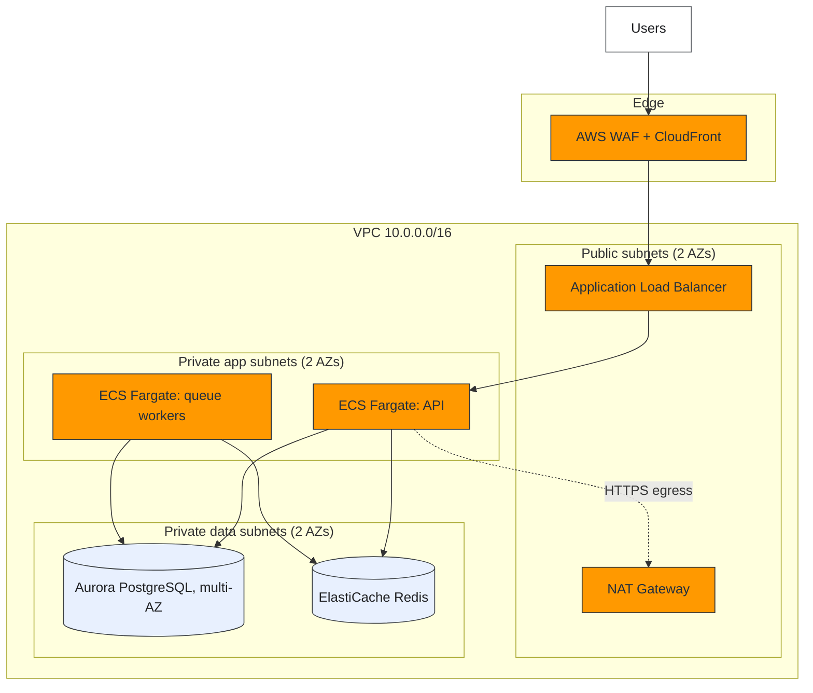
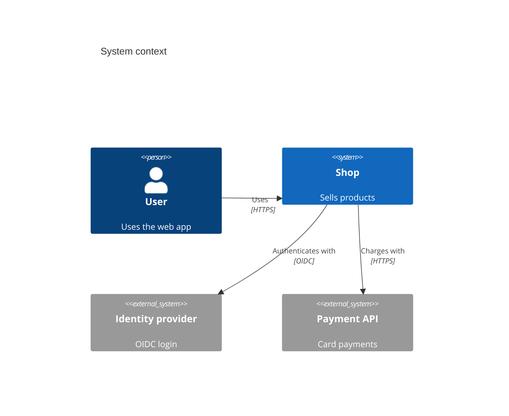
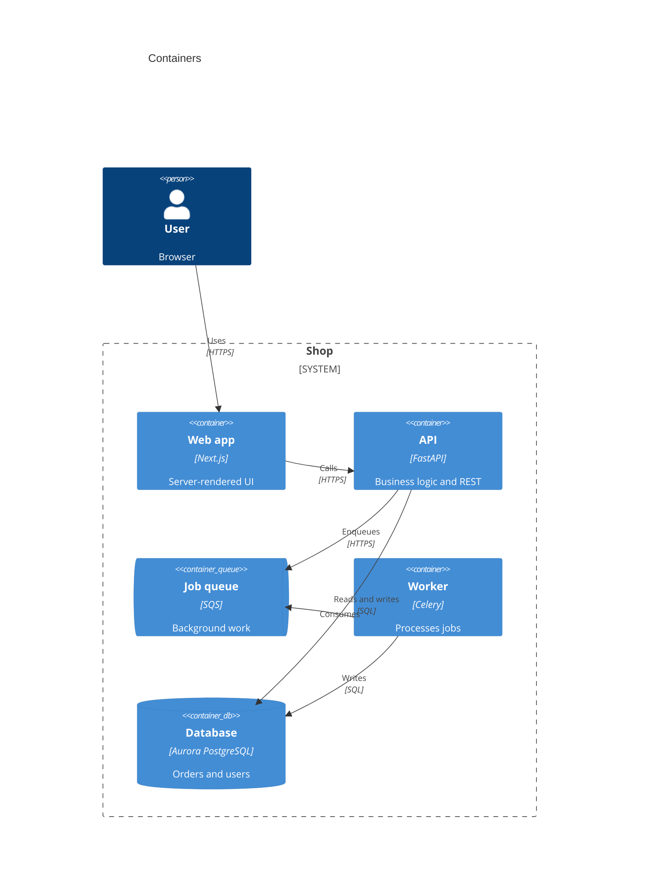
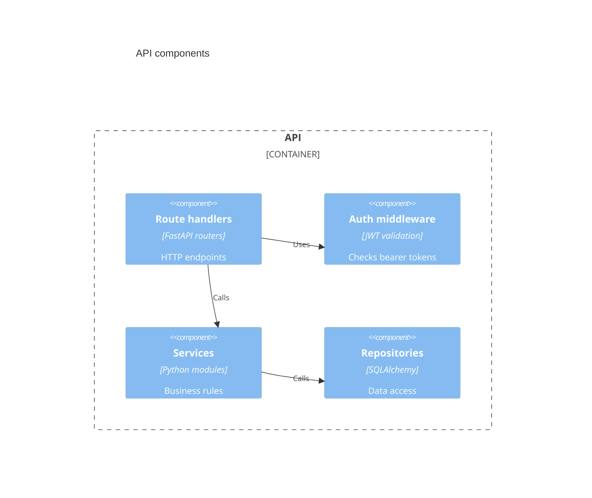
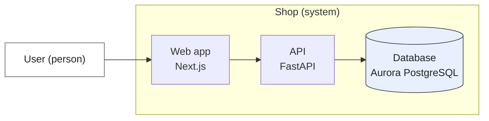
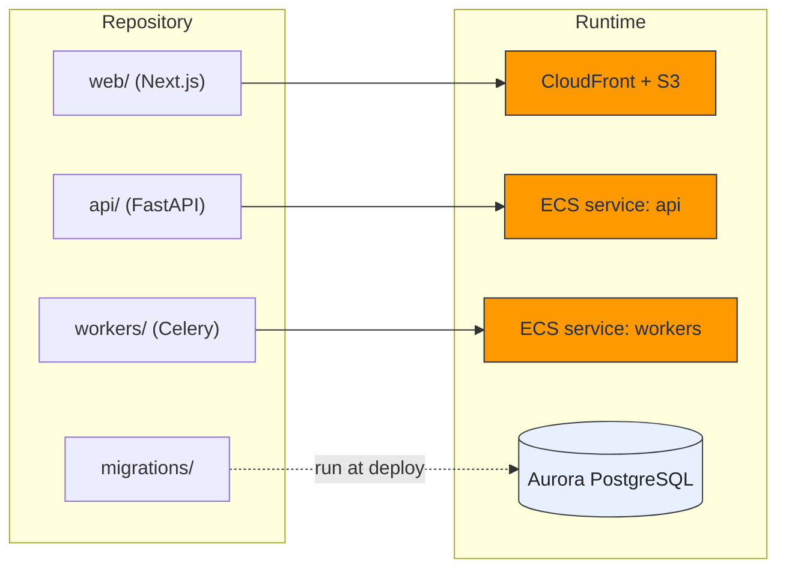

# Diagram standards

Four diagrams, all Mermaid, all in one markdown file. After writing, run
`python scripts/diagram_sanitizer.py --markdown FILE --in-place` and fix anything it reports.

## Rules

- Quote every node label: `api["API (FastAPI)"]`. Never leave parentheses, slashes or colons unquoted.
- Node ids use letters, digits and underscores only. Do not name a node `end`.
- One idea per diagram. If a diagram passes about 20 nodes, split it.
- Use `<br/>` for line breaks inside a label. Do not use other HTML.
- Name nodes by what the repo calls them (service, folder, package), then the cloud service in brackets.
- Every box in diagram 1 and 2 that is a cloud service must be a row in the decision table.
- Add a one-line caption under each diagram saying what it shows.
- Default to flowcharts for the C4 levels. Native C4 blocks in Mermaid are experimental and many viewers (GitHub included) do not render them. Use the native blocks below only when the user's viewer supports them.

## Colour classes

Take hex values from `assets/cloud-vendor-palette.json`. A class only colours a diagram if its `classDef` line is in the same Mermaid block, so paste the lines you use at the bottom of every flowchart:

```text
classDef aws fill:#FF9900,stroke:#232F3E,color:#232F3E
classDef azure fill:#0078D4,stroke:#003A6C,color:#FFFFFF
classDef gcp fill:#4285F4,stroke:#174EA6,color:#FFFFFF
classDef data fill:#E8F0FE,stroke:#3C4043,color:#202124
classDef user fill:#FFFFFF,stroke:#5F6368,color:#202124
classDef risk fill:#FDE7E9,stroke:#A3262A,color:#A3262A
```

Use `:::risk` on any node tied to an open blocker so the diagram shows it.

## 1. Cloud infrastructure



Show: zones or subnets, what is public, what is private, the path from user to data, egress.

## 2. C4 model

Context (people and external systems):



Container (deployable units):



Component (inside one container, only for the container that matters most):



Flowchart fallback for any C4 level:



## 3. Runtime sequences

See `references/sequence-flow-patterns.md`. Two diagrams: authentication, and the core data path.

## 4. Code topology

Map repository folders to the runtime that hosts them, citing the scan.



Rules: every top-level folder with code appears once; shared libraries are drawn as one
box with arrows to each user; folders that are not deployed (docs, scripts) are omitted.
