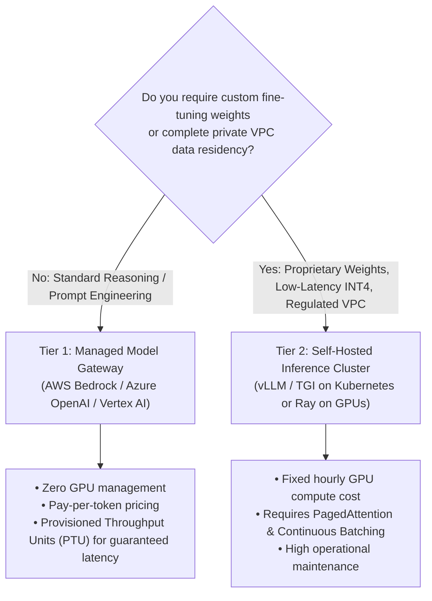

# SolsBrain — Chapter 9: AI Architecting, LLMOps & Multi-Agent Systems

**Domain:** Generative AI Infrastructure, Retrieval-Augmented Generation (RAG), Agentic Systems & LLMOps  
**Target Clouds:** AWS (Bedrock, SageMaker), Azure (Azure OpenAI, AI Search), GCP (Vertex AI), Specialized AI Clouds (CoreWeave, Together AI, Pinecone)  
**Target Engine:** SolsArch Analyzer (Agent 6 Cloud Decider, Agent 1 Code Reader, Ops Evaluator `ops.py`)  
**Version:** 2.0 (Exhaustive Technical Specification)

---

## 1. AI Infrastructure & Model Serving Architecture

### 1.1 Managed Foundation Model APIs vs. Self-Hosted Open Weights
When designing an AI architecture, the primary decision gate is **Managed API Gateway** vs. **Self-Hosted Infrastructure (vLLM / Triton)**:



### 1.2 GPU Sizing, VRAM Sizing & Quantization Mathematics
To calculate whether an open-source model can fit in GPU memory:

$$\text{VRAM Required (GB)} \approx \left(\frac{\text{Parameters in Billions} \times \text{Bytes per Parameter}}{\text{Model Precision Factor}}\right) \times 1.20 \text{ (KV Cache & Activations Overhead)}$$

| Precision Mode | Bytes / Param | 8B Model (Llama-3-8B) | 70B Model (Llama-3-70B) | Minimum Recommended Hardware |
|---|:---:|:---:|:---:|---|
| **FP16 / BF16** | 2.0 Bytes | ~19.2 GB VRAM | ~168 GB VRAM | 8B: 1x NVIDIA A10G (24GB) or L4<br>70B: 4x–8x A100/H100 (80GB) |
| **INT8 (Quantized)** | 1.0 Byte | ~9.6 GB VRAM | ~84 GB VRAM | 8B: 1x RTX 4090 (24GB) or T4<br>70B: 2x A100 (80GB) |
| **INT4 (AWQ / GPTQ)** | 0.5 Bytes | ~5.8 GB VRAM | ~42 GB VRAM | 8B: 1x Consumer GPU (12GB)<br>70B: 1x A100 (80GB) or 2x A10G |

---

## 2. Advanced Retrieval-Augmented Generation (RAG) Systems

### 2.1 The Production Hybrid RAG Pipeline
Naive vector search fails in production due to lack of keyword precision. SolsArch architectures mandate a **Hybrid Retrieval + Re-ranking Pipeline**:

```
                       [ User Query ]
                             │
     ┌───────────────────────┴───────────────────────┐
     │                                               │
     ▼                                               ▼
[ Dense Vector Search ]                     [ Sparse Lexical Search ]
• Embedding Model (bge-small / text-emb-3) • BM25 / Full-Text Engine
• Cosine Similarity over HNSW Index         • Exact keyword & SKU matching
     │                                               │
     └───────────────────────┬───────────────────────┘
                             │
                             ▼
              [ Reciprocal Rank Fusion (RRF) ]
              Combines dense + sparse rankings:
              Score = Σ 1 / (60 + rank_i)
                             │
                             ▼ (Top 25 Candidates)
                [ Cross-Encoder Re-Ranker ]
                (Cohere Re-rank / BGE-Reranker-Large)
                Scores deep cross-attention relevance
                             │
                             ▼ (Top 5 In-Context Chunks)
                 [ Context Injector & LLM ]
```

### 2.2 Vector Database Selection Matrix
| Vector Database | Hosting Model | Indexing Algorithms | Metadata Filtering | SolsArch Architectural Fit |
|---|---|---|---|---|
| **PostgreSQL (`pgvector`)** | Relational Add-on (RDS, Supabase, Neon) | **HNSW** (Fast, high recall), **IVFFlat** (Lower RAM) | ACID relational joins with application data | **Default Choice**: Eliminates secondary database operational overhead for workloads < 2M vectors |
| **Pinecone** | Serverless Cloud | Proprietary HNSW variant | Fast payload filtering | High-scale, zero-maintenance managed SaaS |
| **Qdrant** | Self-hosted or Cloud (Rust) | Custom HNSW with payload quantization | Real-time payload filtering during search | High performance, memory-efficient vector search with payload payload filters |
| **Milvus** | Distributed Cluster (K8s) | HNSW, DiskANN, SCaNN | Complex distributed filtering | Massive enterprise scale (> 50M vectors) |
| **AWS OpenSearch Vector** | Managed Engine | k-NN plugin (NMSLIB, FAISS, Lucene) | Integrated with log/text search | Existing OpenSearch / ELK enterprise stacks |

---

## 3. Agentic Systems & Multi-Agent Orchestration (AgentOps)

### 3.1 The ReAct Loop & State Machine Topology
Modern AI applications move beyond single prompt-response calls to **Agentic Workflows** (implemented via LangGraph, Semantic Kernel, or AutoGen):

```
              ┌───────────────────────────┐
              │      Current State        │
              │  (Memory + Conversation)  │
              └─────────────┬─────────────┘
                            │
                            ▼
              ┌───────────────────────────┐
              │    Reasoning (Planner)    │
              │    LLM Decides Next Step  │
              └─────────────┬─────────────┘
                            │
             ┌──────────────┴──────────────┐
             │                             │
    [ Action Required ]            [ Final Response ]
             │                             │
             ▼                             ▼
   [ Tool Execution Gate ]          [ Stream to User ]
   • Code Sandbox (Wasm/Docker)
   • SQL Database Query
   • Web Search / API Call
             │
             ▼
   [ Observation Fed to State ]
```

### 3.2 Agent Memory Architecture (3-Tier Model)
1. **Working Memory (In-Context / Scratchpad)**:
   - Lives entirely within the active LLM context window.
   - Cleared and trimmed after each completed goal.
2. **Short-Term Session Memory (Redis / ElastiCache)**:
   - Stores session turns, recent tool outputs, and in-flight variables.
   - Configured with a TTL (e.g., 2 to 24 hours).
3. **Long-Term Episodic & Semantic Memory (Vector Store + Relational)**:
   - Stores user preferences, historical project facts, and consolidated decisions.
   - Retrieved dynamically via hybrid search and injected into the prompt.

### 3.3 Sandboxing & Tool-Execution Guardrails
- **Risk**: Agents executing unconstrained code or SQL queries can cause data exfiltration or catastrophic state mutation.
- **Mandatory Guardrails**:
  - **Read-Only Enforced Credentials**: Databases connected to agent tools must use read-only database roles (`GRANT SELECT ON ...`).
  - **Network Isolation**: Ephemeral code execution engines (Python/Node interpreters) must run inside unprivileged **Wasm runtimes** or **isolated Firecracker microVMs** with zero outbound internet access.
  - **Human-in-the-Loop (HITL) Gate**: Actions that delete data, initiate financial transactions, or deploy production infrastructure must emit an approval request and pause execution until signed off.

---

## 4. LLMOps, Telemetry & Cost Governance

### 4.1 Production Telemetry Stack
Every LLM call in an enterprise deployment must capture structured telemetry:
- **Trace Context**: User ID, Session ID, Prompt Version, Model ID (`claude-3-5-sonnet`, `gpt-4o`).
- **Token Accounting**: Prompt tokens, Completion tokens, Cached tokens (Prompt Caching hit rate).
- **Latency Breakdown**: Time-To-First-Token (TTFT), Inter-Token Latency (ITL), Total Duration.
- **Cost Accumulation**: Real-time USD cost computed per call based on published provider pricing.
- **Recommended Telemetry Tools**: **Langfuse** (Self-hosted or cloud OpenTelemetry-native), **Arize Phoenix**, **LangSmith**.

### 4.2 Semantic Caching (Cost & Latency Optimization)
- Before querying an LLM, the request embedding is compared against a **Semantic Cache** (Redis / GPTCache).
- If the cosine similarity between the incoming query and a cached query exceeds **0.95**, the cached response is returned immediately.
- **Impact**: Drops latency from 2,000ms to < 25ms; reduces LLM API spend by 30% to 60% on repetitive user queries.

---

## 5. Security & Safety Guardrails for AI Systems

```
[ Incoming User Input ]
            │
            ▼
┌────────────────────────────────────────┐
│ 1. Prompt Injection Defense            │
│    • Isolate text in <data> tags       │
│    • Fast pre-classifier (Llama Guard) │
└───────────────────┬────────────────────┘
                    │ (Passed)
                    ▼
┌────────────────────────────────────────┐
│ 2. PII & Secret Redaction              │
│    • Scan for SSNs, emails, API keys   │
│    • Mask sensitive tokens with [MASK] │
└───────────────────┬────────────────────┘
                    │ (Sanitized)
                    ▼
          [ Model Processing ]
                    │
                    ▼
┌────────────────────────────────────────┐
│ 3. Output Hallucination & Factuality   │
│    • Check citations against RAG docs  │
│    • Scan for toxic / unsafe content   │
└───────────────────┬────────────────────┘
                    │ (Approved)
                    ▼
           [ Stream to Client ]
```

---

## 6. Formal SolsArch AI Architecture Validation Rules

| Rule Code | Severity | Trigger Condition | Remediation Guidance |
|---|:---:|---|---|
| `AI-SEC-001` | **CRITICAL** | Raw un-sanitized user input is concatenated directly into system prompt strings | Parameterize prompts and wrap user inputs in structured XML data boundaries |
| `AI-SEC-002` | **CRITICAL** | Agent tool execution engine runs with unconstrained host shell or write DB privileges | Enforce read-only tool connections and execute code inside isolated Wasm/Docker sandboxes |
| `AI-OPS-001` | **HIGH** | LLM API calls are initiated without centralized observability / tracing middleware | Instrument all LLM gateway clients with OpenTelemetry / Langfuse spans to track tokens and cost |
| `AI-PERF-001` | **HIGH** | User-facing HTTP endpoint performs synchronous LLM generation without SSE streaming | Implement Server-Sent Events (SSE) streaming (`stream: true`) to deliver acceptable Time-To-First-Token |
| `AI-RAG-001` | **MEDIUM** | Production vector database indexes > 50,000 embeddings using brute-force flat search | Migrate to an HNSW (Hierarchical Navigable Small World) index to preserve sub-50ms search latency |
| `AI-RAG-002` | **MEDIUM** | RAG retrieval relies solely on semantic dense search for code or alphanumeric identifiers | Implement Hybrid Search combining BM25 keyword matching with dense embeddings fused via RRF |
---

## 4. Production AI Architecture & Bedrock Best Cases (from SolsRef)

### Best Case 9.1: Enterprise Production RAG: Bedrock Knowledge Bases + OpenSearch Serverless
- **Context & Problem**: Naive vector search architectures suffer from context fragmentation, high ingestion latency, and security exposure of sensitive internal knowledge bases.
- **Architecture Blueprint**:
```
[ Document Data Lake (S3 Bucket) ]
  ├── PDF manuals, technical specs, policy docs
  └── SSE-KMS Encrypted, S3 Event Notification
        │
        ▼ (Scheduled / Triggered Ingestion Sync)
[ Amazon Bedrock Knowledge Bases ]
  ├── Data Preprocessing & Chunking (Hierarchical / Semantic Chunking: 512 tokens, 20% overlap)
  └── Amazon Titan Text Embeddings V2 / Cohere Embed v3 (Output: 1024-dim dense vectors)
        │
        ▼
[ Amazon OpenSearch Serverless (AOSS) Vector Engine ]
  └── Hybrid Index: k-NN Vector Search (HNSW algorithm) + BM25 Lexical Keyword Matching
        ▲
        │ (Hybrid Search Query + Cohere Rerank Top-5 Chunks)
[ Retrieval Engine ]
        │
        ▼
[ Amazon Bedrock Runtime (Claude 3.5 Sonnet / Llama 3 70B) ]
  ├── Augmented Prompt with Source Chunks & Citation Anchors
  └── Amazon Bedrock Guardrails:
      ├── PII Masking (SSNs, Credit Cards, API Keys)
      ├── Content Filtering (Hate, Violence, Misconduct)
      └── Hallucination Prevention (Grounding & Context Relevance Scoring)
        │
        ▼
[ Verified Enterprise Answer with Exact Document Citations ]
```

### Best Case 9.2: Multi-Agent Tool Orchestration with Bedrock Action Groups & Model Context Protocol (MCP)
- **Architecture**: Bedrock Agents decompose user objectives into deterministic steps, selecting and executing OpenAPI-compliant Lambda Action Groups or standardized MCP server tools with parameter validation and automated error retries.
---

## 8. Prompt Engineering, ReAct Loops, Evaluation Metrics & AWS AI Portfolio (from SolsRef)

### 8.1 Prompt Engineering Paradigms & Reasoning Loops
- **Zero-Shot Prompting**: Supplying instructions and context with zero demonstration examples.
- **Few-Shot Prompting**: Providing 2 to 5 canonical input-output examples within the prompt context, dramatically improving formatting compliance and domain terminology.
- **Chain-of-Thought (CoT)**: Instructing the model to *"Think step-by-step before answering"*, forcing intermediate token reasoning for arithmetic, logic, and multi-step tasks.
- **ReAct (Reason + Act) Loop**:
```
[ User Goal ] ──► [ Model Reason: "I need to check customer order status" ]
                         │
                         ▼ [ Model Action: call_tool("getOrder", { id: "9921" }) ]
                  [ Tool Execution: Returns JSON payload ]
                         │
                         ▼ [ Model Observation: "Order shipped via FedEx tracking #123" ]
                  [ Model Reason: "I have the answer" ]
                         │
                         ▼
                  [ Final Output to User ]
```

### 8.2 Foundation Model Hyperparameters Tuning
- **Temperature ($0.0 - 1.0$)**: Controls randomness. Low temperature ($0.0 - 0.2$) produces deterministic, focused outputs (coding, data extraction). High temperature ($0.7 - 1.0$) produces creative, diverse outputs (brainstorming).
- **Top-P (Nucleus Sampling, $0.0 - 1.0$)**: Evaluates tokens comprising the top $P$ cumulative probability mass. Setting Top-P to $0.9$ considers only the top 90% most probable next tokens.
- **Top-K (Integer $1 - 500$)**: Restricts token selection strictly to the $K$ highest-probability candidates.

### 8.3 GenAI Evaluation Metrics
- **ROUGE (Recall-Oriented Understudy for Gesticulation Evaluation)**: Measures overlap of n-grams between model output and ground truth references (**ROUGE-1** for unigrams, **ROUGE-2** for bigrams, **ROUGE-L** for longest common subsequence).
- **BLEU (Bilingual Evaluation Understudy)**: Measures precision of n-grams, common in translation tasks.
- **BERTScore**: Evaluates semantic similarity between generated text and reference text using contextual embeddings rather than exact keyword matches.

### 8.4 AWS Traditional AI Services Portfolio
| AWS AI Service | Core Machine Learning Capability | Typical Enterprise Use Case |
|---|---|---|
| **Amazon Rekognition** | Computer vision, object detection, facial analysis, text in image, content moderation. | Automating video metadata tagging, KYC identity verification, scanning uploaded imagery for inappropriate content. |
| **Amazon Transcribe** | Speech-to-Text with speaker identification, channel identification, custom vocabularies. | Customer service call transcription, audio subtitle generation, compliance audio archiving. |
| **Amazon Polly** | Text-to-Speech with neural lifelike voices, Speech Synthesis Markup Language (SSML). | Voiceovers, interactive voice response (IVR) systems, accessibility readers. |
| **Amazon Comprehend** | Natural Language Processing (NLP): sentiment analysis, entity extraction, key phrase detection, PII redaction. | Analyzing customer review sentiment, classifying support tickets, redacting PII from transcripts. |
| **Amazon Lex** | Conversational AI engine powering chatbots (same technology as Amazon Alexa). | Automated customer support chatbots, voice-activated service desks. |
| **Amazon Textract** | Intelligent Document Processing (IDP): extracts text, forms, tables, key-value pairs from PDFs/scans. | Automating invoice processing, medical claims extraction, loan application processing. |
| **Amazon Kendra** | Machine learning enterprise search engine indexing SharePoint, S3, Salesforce, Confluence. | Internal corporate knowledge search engine with natural language question answering. |
---

## 9. Complete Amazon SageMaker MLOps Architecture & Lifecycle Framework (from SolsRef)

### 9.1 End-to-End Enterprise MLOps Pipeline
```
[ 1. PREPARATION ]             [ 2. TRAINING & TUNING ]           [ 3. GOVERNANCE & DEPLOY ]
┌─────────────────────────┐    ┌─────────────────────────┐        ┌─────────────────────────┐
│ SageMaker Ground Truth  │    │ Managed Spot Training   │        │ SageMaker Model Registry│
│ (Human-in-the-Loop)     │    │ (Up to 90% cost savings)│        │ (Versioning & Lineage)  │
│           │             │    │           │             │        │           │             │
│           ▼             │    │           ▼             │        │           ▼             │
│ SageMaker Data Wrangler │───►│ Hyperparameter Tuning   │───────►│ SageMaker Clarify       │
│ (Feature Engineering)   │    │ (Automatic Model Tuning)│        │ (Bias & Explainability) │
│           │             │    │           │             │        │           │             │
│           ▼             │    │           ▼             │        │           ▼             │
│ SageMaker Feature Store │    │ Distributed Training    │        │ SageMaker Endpoints     │
│ (Online / Offline Store)│    │ (Data & Model Parallel) │        │ (Real-Time / Serverless)│
└─────────────────────────┘    └─────────────────────────┘        └─────────────────────────┘
```

### 9.2 SageMaker Feature Store: Online vs Offline Storage
| Feature Store Layer | Storage Technology | Latency | Primary Operational Use Case |
|---|---|---|---|
| **Online Store** | Ultra-low latency key-value database (DynamoDB / in-memory). | **< 10 Milliseconds** | Real-time feature lookup during live inference (e.g. customer credit score, recent transaction counts). |
| **Offline Store** | Amazon S3 (Parquet format) + AWS Glue Data Catalog. | Minutes / Batch queries | Historical feature archives for model training, backtesting, and exploratory data analysis via Athena. |

### 9.3 SageMaker Model Deployment Options Decision Matrix
| Deployment Option | Instance Availability | Billing Model | Latency Profile | Maximum Payload | Recommended Production Fit |
|---|---|---|---|---|---|
| **Real-Time Endpoints** | Persistent dedicated instances (Multi-AZ). | Per-instance-hour | **Single-digit milliseconds** | 6 MB | Interactive user-facing APIs, fraud detection, recommendation engines. |
| **Serverless Inference** | Ephemeral compute; scales to zero when idle. | Per invocation duration + memory | 100ms - 2s (Cold start possible) | 4 MB | Intermittent, bursty, or low-frequency inference workloads with tolerance for cold starts. |
| **Asynchronous Inference** | Queued requests backed by internal Amazon S3 and SQS. | Per active instance hour; scales to zero on empty queue | Seconds to minutes | **Up to 1 GB** | Heavy inference jobs (large audio/video transcription, deep LLM batch inference up to 1-hour execution). |
| **Batch Transform** | Dedicated offline compute cluster; automatically tears down. | Per batch job duration | Non-interactive (batch) | Terabytes (S3 datasets) | Nightly offline score generation, batch document sentiment processing. |

### 9.4 SageMaker Model Governance & Explainability
- **SageMaker Model Registry**: Catalogs model versions, associates metadata and training lineage (source datasets, training code, algorithms), and manages formal approval states (`Approved`, `PendingManualApproval`, `Rejected`) before deployment to production.
- **SageMaker Clarify**: Detects bias across datasets and model outputs (e.g. demographic disparity across age or gender groups) and generates feature importance explainability reports using SHAP (Shapley Additive exPlanations) values.
- **SageMaker Neo**: Compiles pre-trained models into optimized machine-code binaries tailored for target hardware architectures (Intel, ARM, NVIDIA, Apple Silicon, Ambarella), reducing memory footprint by up to $10\times$ and accelerating inference speed without accuracy loss.

---

## 10. Amazon Bedrock Agentic Execution Tracing & Multi-Agent Collaboration (from SolsRef)

### 10.1 Bedrock Agent Tracing Architecture
Every response returned by an Amazon Bedrock Agent includes an internal trace broken down into three observable phases:
1. **Pre-Processing Trace**: Evaluates the raw user input against safety filters and determines if the request requires multi-step agent reasoning or can be answered directly.
2. **Orchestration Trace**:
   - The reasoning loop: inspects available tools and OpenAPI Action Group schemas.
   - Evaluates: *"Which knowledge base should I search?"* and *"What action parameters must I extract?"*.
   - Emits intermediate thoughts, tool invocation inputs, and raw tool output observations.
3. **Post-Processing Trace**: Formulates the final natural language answer, cross-references source citations, and applies Bedrock Guardrails grounding filters to ensure zero hallucination.
---

## 11. Amazon Q Enterprise Generative AI Suite (from SolsRef)

### 11.1 Amazon Q Business Architecture
- **Functionality**: Fully managed, secure Generative AI assistant built for enterprise employees, utilizing corporate knowledge bases.
- **Enterprise Integrations**: Native connectors for 40+ enterprise data repositories:
  - Atlassian Confluence, Jira, Microsoft SharePoint, Salesforce, Google Drive, Amazon S3, ServiceNow, Zendesk.
- **Native Access Control (ACL) Enforcement**:
  - Respects source document permissions: If Employee A does not have access to an internal HR salary spreadsheet in SharePoint, Amazon Q Business will strictly omit that content when generating answers for Employee A.
- **Enterprise Plugins & Actions**: Executes routine business workflows (submitting Jira tickets, updating Salesforce CRM opportunities, scheduling calendar meetings) via pre-authenticated API plugins.

### 11.2 Amazon Q Developer
- **IDE & Console AI Assistant**:
  - Generates full code blocks, unit tests, and documentation from natural language comments across Python, Java, TypeScript, and Go.
  - **Vulnerability Scanning & Remediation**: Automatically scans code for security vulnerabilities (hardcoded secrets, SQL injection, CWE vulnerabilities) and suggests 1-click code patches.
  - **Agentic Code Transformation**: Upgrades legacy applications automatically (e.g. migrating Java 8 or Java 11 codebases directly to Java 17 and Java 21, resolving library deprecations and compiling clean builds).
---

## 12. Amazon SageMaker Inference Modes & Bedrock Autonomous Systems (from SolsRef)

### 12.1 SageMaker Inference Architecture Selection Matrix
| Inference Mode | Latency SLA | Max Payload Size | Max Timeout | Scale-to-Zero? | Cost Architecture & Best Fit |
|---|---|---|---|---|---|
| **Real-Time Inference** | **Milliseconds** (interactive) | 6 MB | 60 seconds | No (minimum 1 instance per AZ) | Continuous interactive web/mobile traffic; dedicated GPU/CPU instances. |
| **Serverless Inference** | **Milliseconds to seconds** (cold starts) | 4 MB | 60 seconds | **Yes** (scales to 0) | Intermittent or unpredictable traffic; pay only for compute duration per millisecond and processed data. |
| **Asynchronous Inference** | **Near real-time** (seconds to minutes) | **1 GB** (S3 payload) | **1 hour** | **Yes** (scales to 0) | Large payload processing (high-res images, video frames, bulk audio); automatic request queuing via managed S3 and SNS. |
| **Batch Transform** | **Offline batch** (hours) | Entire dataset (GB to TBs) | Multiple days | **Yes** (cluster destroyed on completion) | Offline scoring of entire datasets (e.g. daily customer churn scoring, overnight risk evaluations). |

### 12.2 Amazon Bedrock Autonomous Agents & Knowledge Bases (RAG)
```
                                 [ User Natural Language Prompt ]
                                                │
                                                ▼
                                   ┌──────────────────────────┐
                                   │  Amazon Bedrock Agent    │
                                   │  (ReAct Reasoning Loop)  │
                                   └──────────────────────────┘
                                         │              │
                   ┌─────────────────────┘              └─────────────────────┐
                   ▼                                                          ▼
    ┌──────────────────────────────┐                           ┌──────────────────────────────┐
    │     Knowledge Base (RAG)     │                           │        Action Groups         │
    │  Retrieves contextual facts  │                           │  Executes business actions   │
    │  from Vector DB:             │                           │  via OpenAPI Schema +        │
    │  ├── OpenSearch Serverless   │                           │  AWS Lambda functions:       │
    │  ├── Aurora pgvector         │                           │  ├── Query ERP Database      │
    │  └── Pinecone                │                           │  ├── Cancel Customer Order   │
    └──────────────────────────────┘                           │  └── Provision EC2 Resource  │
                                                               └──────────────────────────────┘
```
- **Bedrock Guardrails**:
  - **Denied Topics**: Defines natural language policies to block sensitive conversation domains (e.g. financial advice, legal counseling).
  - **Content Filters**: Multi-tier threshold filters for Hate Speech, Insults, Sexual content, and Violence.
  - **Sensitive Information Filters (PII Protection)**: Uses regex and NLP to detect and automatically mask or block Social Security Numbers, Credit Card Numbers, Email addresses, and Phone numbers in both user prompts and model responses.
  - **Contextual Grounding Check**: Evaluates model responses against source knowledge base documents to detect and block model hallucinations before returning text to users.
