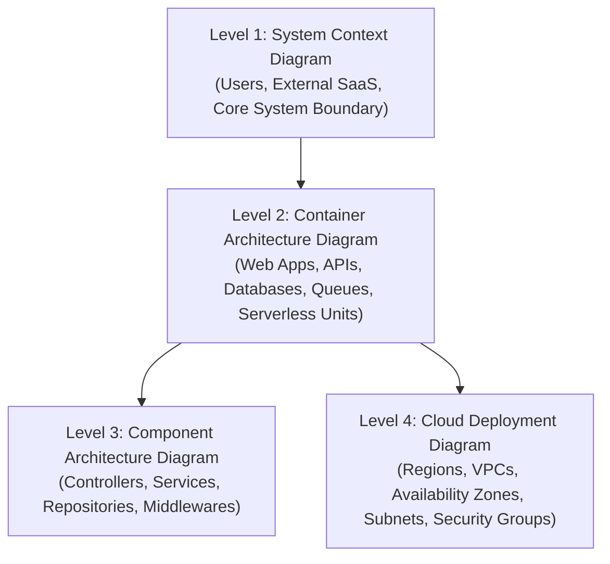

# SolsBrain — Chapter 12: Enterprise Diagramming & C4 Visualization Standards

**Domain:** Architectural Modeling, C4 Abstraction Layers, Iconography Rules & Layout Mathematics  
**Target Clouds:** AWS, Microsoft Azure, Google Cloud Platform (GCP), Multi-Cloud  
**Target Engine:** SolsArch Analyzer (Agent 8 Diagrammer, Browser ELK.js Canvas, Export Engine)  
**Version:** 2.0 (Exhaustive Technical Specification)

---

## 1. The C4 Model for Cloud Architectures

SolsArch rejects chaotic "box-and-line" diagrams in favor of the structured **C4 Abstraction Hierarchy**:



### 1.1 SolsArch Abstraction Mapping
| C4 Layer | Architectural Scope | Primary Audience | SolsArch Visual Representation |
|---|---|---|---|
| **Level 1: Context** | Highest-level ecosystem view | CTO, Product Managers, Auditors | Single central system box with human actors and external third-party SaaS services |
| **Level 2: Container** | High-level deployable units | Lead Architects, Engineering Managers | Microservices, web frontends, databases, messaging buses, and caches |
| **Level 3: Component** | Internal service modularity | Developers, Code Reviewers | Internal AST modules, controllers, and background task workers |
| **Level 4: Deployment** | Physical cloud infrastructure | Cloud Engineers, DevOps, SREs | Nested compound boundaries: Cloud Account -> Region -> VPC -> AZ -> Subnet -> Nodes |

---

## 2. Official Cloud Iconography & Tiered Standards

### 2.1 Multi-Cloud Icon Resolution Rules
1. **Tier A (Official Vector Icon Sets)**:
   - **AWS**: AWS Architecture Icons 2026 (Asset guidelines: purple compute, blue database, orange storage, red security).
   - **Azure**: Microsoft Azure Public Service Icons V24.
   - **Google Cloud**: Google Cloud Core and Product architecture icons.
2. **Tier B (Brand Logo + Canonical Glyphs)**:
   - For platforms without official per-service diagram libraries (Vercel, Supabase, Neon, Cloudflare, Databricks, Redis Cloud, MongoDB Atlas).
   - Displays the provider brand logo badge in the upper corner paired with the canonical service symbol (e.g., database cylinder, container box).
3. **Tier C (Neutral Canonical Glyphs)**:
   - Standardized SVG vector glyphs for generic actors (Users, Mobile clients, External APIs, On-Premises data centers).

---

## 3. Containment & Boundary Hierarchy Rules

To ensure diagrams remain readable and structurally valid, SolsArch enforces strict compound containment:

```
┌── CLOUD BOUNDARY: AWS (eu-west-1) ─────────────────────────────────────────┐
│                                                                            │
│  ┌── VIRTUAL PRIVATE CLOUD (10.0.0.0/16) ────────────────────────────────┐ │
│  │                                                                       │ │
│  │  ┌── AVAILABILITY ZONE A ──────────┐  ┌── AVAILABILITY ZONE B ─────┐  │ │
│  │  │  ┌── PUBLIC SUBNET ──────────┐  │  │  ┌── PUBLIC SUBNET ─────┐  │  │ │
│  │  │  │  [ ALB Ingress Node ]     │  │  │  │  [ ALB Ingress Node ]│  │  │ │
│  │  │  └───────────────────────────┘  │  │  └───────────────────────┘  │  │ │
│  │  │  ┌── PRIVATE APP SUBNET ─────┐  │  │  ┌── PRIVATE APP SUBNET ──┐ │  │ │
│  │  │  │  [ ECS Fargate Task ]     │  │  │  │  [ ECS Fargate Task ]│  │ │  │ │
│  │  │  └───────────────────────────┘  │  │  └───────────────────────┘ │  │ │
│  │  │  ┌── ISOLATED DATA SUBNET ───┐  │  │  ┌── ISOLATED DATA SUBNET ┐ │  │ │
│  │  │  │  [ Aurora Primary (W/R) ] │  │  │  │  [ Aurora Standby (R) ]│ │  │ │
│  │  │  └───────────────────────────┘  │  │  └────────────────────────┘ │  │ │
│  │  └─────────────────────────────────┘  └────────────────────────────┘  │ │
│  └───────────────────────────────────────────────────────────────────────┘ │
└────────────────────────────────────────────────────────────────────────────┘
```

#### Containment Invariants:
1. **Edge Services Stay Outside**: Route 53, CloudFront, and AWS WAF must sit **outside** the VPC boundary box.
2. **Subnet Homogeneity**: A subnet box must belong strictly to one Availability Zone; subnets cannot span across AZs.
3. **Multi-Cloud Swimlanes**: When architecture spans multiple providers (e.g., Vercel Frontend + AWS Backend + Neon Database), each provider is isolated in its own top-level swimlane boundary.

---

## 4. Edge Directionality & Protocol Annotations

### 4.1 Strict Dependency Flow
- **Rule**: Edges must point in the direction of the **connection initiator (Source -> Target)**, NOT the direction of return data packets.
  - *Correct*: `[Web Browser] --( HTTPS:443 )--> [ALB]`
  - *Incorrect*: `[ALB] --( HTTP Data )--> [Web Browser]`

### 4.2 Mandatory Protocol & Port Labeling
Every diagram edge connecting two nodes must carry an explicit technical label:
- Protocol: `HTTPS`, `gRPC`, `WebSocket (WSS)`, `PostgreSQL`, `MySQL`, `Redis`, `AMQP`.
- Port Number: `:443`, `:5432`, `:6379`, `:9092`.
- Security State: Encryption in transit (`TLS 1.3`, `mTLS`, `Plaintext`).

---

## 5. Formal SolsArch Diagramming Validation Rules

| Rule Code | Severity | Trigger Condition | Remediation Guidance |
|---|:---:|---|---|
| `DIA-CNT-001` | **HIGH** | CDN, WAF, or DNS nodes placed inside a private VPC boundary | Relocate edge services outside the private network boundary |
| `DIA-EDG-001` | **HIGH** | Edge connection connects two nodes without a protocol label | Add protocol and port metadata (e.g., `HTTPS:443`, `PostgreSQL:5432`) |
| `DIA-LAY-001` | **MEDIUM** | Node bounding boxes overlap or collide on the canvas | Re-run ELK.js layout engine with expanded node padding (minimum 40px) |
| `DIA-ICN-001` | **MEDIUM** | Diagram node uses an icon from Cloud A inside a boundary for Cloud B | Resolve icon via Tier A/B cascade matching the parent boundary provider |
---

## 6. Canonical Production Architecture Blueprint Visual Catalog (from SolsRef)

### Blueprint 1: High-Availability Serverless Web Application
```
[ Global Users ]
       │
       ▼ (HTTPS)
[ Amazon Route 53 (Latency Routing + Health Checks) ]
       │
       ▼
[ Amazon CloudFront CDN (Edge Caching + Origin Access Control) ]
   ├── AWS WAF WebACL (Rate Limiting, SQLi/XSS inspection)
   │
   ├── Path: /static/* ──────────────────────────► [ Amazon S3 Static Bucket (Encrypted) ]
   │
   └── Path: /api/* ─────────────────────────────► [ Amazon API Gateway (Regional HTTP API) ]
                                                            │
                                                            ▼ (Private VPC Integration)
                                                   [ AWS Lambda Compute Fleet ]
                                                            │
                                                            ▼ (IAM Database Authentication)
                                                   [ Amazon DynamoDB Global Tables ]
                                                   (Multi-Region Active-Active)
```

### Blueprint 2: Enterprise Hybrid Multi-Tier Microservices
```
[ On-Premises Corporate DC ] ──► [ Direct Connect (DX) + Backup VPN ]
                                               │
                                               ▼
                              [ AWS Transit Gateway (TGW) ]
                                               │
                                               ▼
     ┌───────────────────────────────────────────────────────────────────┐
     │ Enterprise Multi-AZ Virtual Private Cloud (VPC: 10.100.0.0/16)    │
     │                                                                   │
     │ Public Subnets:     [ Application Load Balancer (Multi-AZ) ]      │
     │                                    │                              │
     │ Private Subnets:    [ Amazon EKS Cluster with Karpenter Nodes ]   │
     │                                    │                              │
     │ Database Subnets:   [ Amazon Aurora PostgreSQL Multi-AZ ]         │
     │                     └── In-Memory Cache: [ ElastiCache Redis ]    │
     │                                                                   │
     │ Async Tier:         [ SQS FIFO Queues ] ──► [ Worker Pods ]       │
     └───────────────────────────────────────────────────────────────────┘
```
