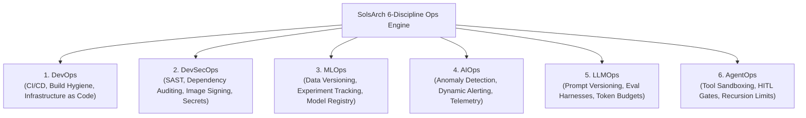

# SolsBrain — Chapter 13: 6-Discipline Ops Engineering

**Domain:** Operational Maturity, DevSecOps, MLOps, AIOps, LLMOps & AgentOps  
**Target Clouds:** Cross-Cloud, GitHub Actions, GitLab CI, Kubernetes, Container Registries  
**Target Engine:** SolsArch Analyzer (Ops Evaluator `core/scan/ops.py`, `pipeline/ops.py`)  
**Version:** 2.0 (Exhaustive Technical Specification)

---

## 1. The 6-Discipline Operational Maturity Framework

SolsArch evaluates source code repositories across **six core operational disciplines**, assigning a quantitative maturity grade from **Level 0 (Ad-hoc) to Level 4 (Optimizing)**:



---

## 2. Discipline Deep-Dives & Evaluation Criteria

### 2.1 Discipline 1: DevOps (Continuous Delivery & Hygiene)
- **Container Build Hygiene**:
  - Multi-stage Docker builds (separating compiler/build dependencies from runtime image).
  - Enforce non-root execution (`USER 1001` or `USER nonroot`).
  - Base image selection: Minimal distroless or Alpine Linux to minimize attack surface.
- **Git & Branching Workflow**:
  - Trunk-based development with short-lived feature branches (< 48 hours).
  - Automated CI test gates enforcing passing unit/integration suites prior to merge.
- **Infrastructure as Code (IaC) Enforcement**:
  - Zero manual console configurations; all cloud resources defined via Terraform, CloudFormation, or CDK.

### 2.2 Discipline 2: DevSecOps (Shift-Left Security)
- **Static Application Security Testing (SAST)**:
  - Automated scanning in CI pipeline (e.g., Bandit for Python, Semgrep for polyglot ASTs).
- **Software Composition Analysis (SCA) & CVEs**:
  - Scanning manifests (`package-lock.json`, `requirements.txt`, `go.sum`) with Trivy or Snyk.
  - Automated blocking of pull requests introducing `HIGH` or `CRITICAL` CVSS vulnerabilities.
- **Container Image Signing & Provenance**:
  - Cryptographic attestation of container images via **Cosign / Sigstore**.
  - Admission controllers (e.g., Kyverno) in Kubernetes rejecting unsigned container images.

### 2.3 Discipline 3: MLOps (Machine Learning Operations)
- **Data Versioning & Lineage**:
  - Tracking dataset versions and feature pipelines via **DVC (Data Version Control)** or Delta Lake.
- **Experiment Tracking & Model Registry**:
  - Systematic logging of hyperparameters, loss curves, and evaluation metrics using **MLflow** or **Weights & Biases**.
  - Production model staging: Explicit lifecycle transitions (`Staging -> Production -> Archived`).

### 2.4 Discipline 4: AIOps (Intelligent Observability)
- **Algorithmic Anomaly Detection**:
  - Moving from static metric thresholds (e.g., "CPU > 80%") to dynamic percentile baselines (e.g., CloudWatch Anomaly Detection).
- **Automated Self-Healing**:
  - EventBridge rules detecting unhealthy service states and automatically invoking remediation runbooks.

### 2.5 Discipline 5: LLMOps (Foundation Model Operations)
- **Prompt Version Control**:
  - Storing prompts as versioned code artifacts in Git or dedicated registries (Langfuse / Promptfoo).
- **Automated Evaluation Harnesses**:
  - Running continuous regression tests on prompt changes to measure:
    - Faithfulness & Hallucination Rate.
    - Context Relevance & Toxicity.
- **Model Fallbacks & Circuit Breakers**:
  - Ingress gateways automatically falling back to secondary providers (e.g., Claude -> GPT-4o -> Groq) on rate-limiting (HTTP 429) or outage (HTTP 503).

### 2.6 Discipline 6: AgentOps (Autonomous Multi-Agent Governance)
- **Tool-Call Execution Sandboxing**:
  - Isolating untrusted code execution inside unprivileged Wasm runtimes or Firecracker microVMs.
- **Recursion Limits & Loop Termination**:
  - Hard limit on agentic decision cycles (e.g., maximum 10 ReAct iterations per user query).
- **Human-in-the-Loop (HITL) Gateways**:
  - Enforced approval step before executing destructive mutations, financial transactions, or infrastructure provisioning.

---

## 3. Maturity Scoring Matrix (Level 0 to Level 4)

| Level | Classification | Operational Characteristics | SolsArch Action |
|:---:|---|---|---|
| **0** | **Ad-hoc** | Manual server deployments, raw passwords in code, no automated tests | Raises high-severity warning banners across all report sections |
| **1** | **Managed** | Basic CI pipeline present, simple Dockerfile, manual production release | Recommends automated linting and secrets scanning |
| **2** | **Defined** | Multi-stage Docker builds, IaC in Terraform, automated test gates | Baseline standard for enterprise production readiness |
| **3** | **Quantitatively Managed** | Automated canary releases, SAST/SCA security gates, distributed tracing | Commends operational resilience; enables compliance exports |
| **4** | **Optimizing** | Self-healing AIOps, continuous LLMOps evaluation, automated rollbacks | Gold standard engineering operations |

---

## 4. Formal SolsArch Ops Validation Rules

| Rule Code | Severity | Trigger Condition | Remediation Guidance |
|---|:---:|---|---|
| `OPS-DOCKER-001` | **HIGH** | Dockerfile executes as `USER root` or lacks explicit non-root user declaration | Add `USER nonroot` or create dedicated unprivileged service account in Dockerfile |
| `OPS-DOCKER-002` | **MEDIUM** | Dockerfile lacks multi-stage build; compiler tooling included in final image | Refactor into multi-stage build; copy only compiled runtime artifacts to final image |
| `OPS-LLM-001` | **HIGH** | LLM SDK imported without prompt versioning or evaluation framework | Implement prompt registry and automated evaluation harness (Promptfoo/Langfuse) |
| `OPS-AGENT-001` | **CRITICAL** | Autonomous agent tool executes code with direct host OS system privileges | Sandbox tool execution inside isolated Wasm or Firecracker microVM boundaries |
---

## 5. Enterprise Operational Governance, Auditing Triad & Patch Engineering (from SolsRef)

### 5.1 Systems Manager (SSM) Patch Manager Baselines & Maintenance Windows
- **Patch Baselines**: Defines auto-approval rules for operating system patches based on classification (Security, Critical Updates, Bugfix) and severity, with a configurable vetting grace period (e.g. auto-approve 7 days after vendor release).
- **Maintenance Windows**: Schedules zero-downtime rolling patch updates across EC2 fleets and on-premises hybrid nodes.
- **SSM Run Command**: Executes remote PowerShell / Bash scripts across 10,000+ nodes simultaneously with rate control (concurrency limits) and error thresholds, without logging onto instances via SSH or RDP.
---

## 6. Advanced Fleet Management & OS Lifecycle: SSM State Manager, Automation & Maintenance Windows (from SolsRef)

### 6.1 Enterprise Patch Baseline & Maintenance Window Architecture
```
                                 [ Patch Baseline Configuration ]
                                 ├── Auto-approval rule: Class=Security, Severity=Critical
                                 ├── Delay: 5 business days after release
                                 └── Compliance status: Critical if unpatched > 10 days
                                                │
                                                ▼
                               ┌───────────────────────────────────┐
                               │     SSM Maintenance Window        │
                               │  ├── Schedule: Every Saturday 02:00│
                               │  ├── Duration: 4 Hours            │
                               │  ├── Cutoff: 1 Hour before end    │
                               │  └── Targets: Tag:Environment=Prod│
                               └───────────────────────────────────┘
                                                │
                                                ▼ Rate Control: Concurrency 10%, Error threshold 1
                               ┌───────────────────────────────────┐
                               │   Automated Patch Execution       │
                               │  ├── 1. Snapshot root EBS volume  │
                               │  ├── 2. Apply OS vendor updates   │
                               │  ├── 3. Reboot instance if needed │
                               │  └── 4. Validate health endpoint  │
                               └───────────────────────────────────┘
```
- **Automated Rollback Safeguards**: Concurrency limits prevent simultaneous reboots across the entire fleet; if an error threshold is breached, the patch task halts immediately, isolating failures to a small canary percentage of instances.
