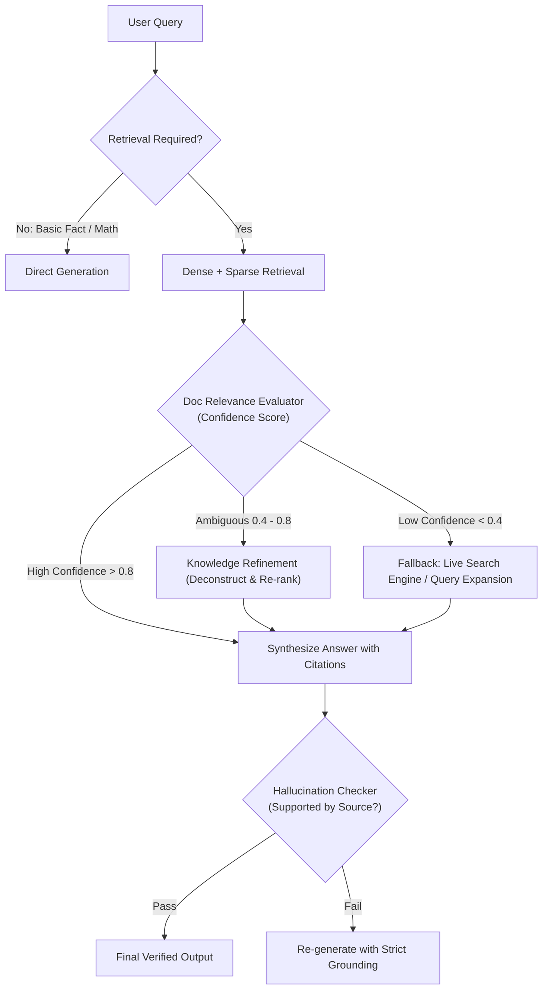

# SolsBrain — Chapter 15: Latest AI Engineering, Agentic Protocols & Advanced LLMOps

**Domain:** Model Context Protocol (MCP), GraphRAG, RAPTOR, Inference Optimization (PagedAttention, Speculative Decoding), DSPy, Multi-Agent Orchestration, SLMs on Edge & GenAI Observability  
**Target Clouds:** AWS (Bedrock, SageMaker), Azure (Azure AI Foundry, AI Search), GCP (Vertex AI), Cloudflare (Workers AI, Vectorize), Specialized AI Clouds (Together AI, Groq, Fireworks, vLLM Clusters)  
**Target Engine:** SolsArch Analyzer (Agent 6 Cloud Decider, Agent 1 Code Reader, Agent 11.5 Security & MCP Controller)  
**Version:** 2.0 (2026 State-of-the-Art Production Specification)

---

## 1. Model Context Protocol (MCP) Architecture & Security Standard

### 1.1 MCP Client-Host-Server Architecture
The Model Context Protocol (MCP) is the universal open standard for securely connecting AI applications (Hosts) with external data sources, enterprise tools, and business systems (Servers). It eliminates N×M custom integration spaghetti by standardizing context exchange via JSON-RPC 2.0.

```
┌────────────────────────────────────────────────────────────────────────┐
│                        MCP HOST APPLICATION                             │
│       (e.g., SolsArch Analyzer / Claude Desktop / IDE Extension)       │
│                                                                        │
│   ┌───────────────────────────┐     ┌──────────────────────────────┐   │
│   │    LLM / Agent Engine     │     │      MCP Client Manager      │   │
│   │  (Prompting, ReAct Loop)  │◄───►│  (Session, Security Filter)  │   │
│   └───────────────────────────┘     └──────────────┬───────────────┘   │
└────────────────────────────────────────────────────┼───────────────────┘
                                                     │
             ┌───────────────────────────────────────┴───────────────────────────────────────┐
             │ Transport 1: stdio (Local Subprocess)                                         │ Transport 2: SSE / HTTP (Remote Microservice)
             ▼                                                                               ▼
┌───────────────────────────────┐                                           ┌───────────────────────────────┐
│     Local MCP Server          │                                           │     Remote MCP Gateway        │
│   (e.g., Git, Local SQLite,   │                                           │  (Kubernetes / Cloud Run)     │
│    Filesystem, Shell Exec)    │                                           │  - Enterprise Postgres        │
└───────────────────────────────┘                                           │  - Jira, GitHub, Slack API    │
                                                                            │  - Cloud Provider Telemetry   │
                                                                            └───────────────────────────────┘
```

### 1.2 MCP Core Primitives
MCP defines three fundamental capabilities negotiated during the `initialize` handshake:

| Primitive | Direction | Purpose | Caching & Execution Dynamics |
|---|---|---|---|
| **Resources** (`resources/list`, `resources/read`) | Server $\to$ Host | Exposes read-only data, file contents, API schemas, or DB table metadata to ground model prompts. | Can be static or dynamically updated via `notifications/resources/updated`. |
| **Prompts** (`prompts/list`, `prompts/get`) | Server $\to$ Host | Pre-configured prompt templates and workflows exposed by the server with typed arguments. | Enables domain servers to publish canonical user commands (e.g., `/analyze-security`). |
| **Tools** (`tools/list`, `tools/call`) | Host $\to$ Server | Executable functions allowing the LLM to take actions, invoke APIs, mutate records, or run calculations. | Explicit JSON Schema inputs; must pass strict parameter validation and human authorization. |

### 1.3 MCP Transport Protocols & Wire Format
1. **Standard Input/Output (`stdio`):**
   - Used when host spawns server as a child process (e.g., `uvx mcp-server-postgres`).
   - Messages are single-line newline-delimited JSON-RPC 2.0 objects sent across `stdin`/`stdout`.
   - Logging must strictly write to `stderr` to prevent protocol framing corruption.
2. **Server-Sent Events (`SSE`) over HTTP:**
   - Used for remote distributed servers and containerized enterprise services.
   - Client sends commands via HTTP `POST /messages?sessionId=xyz`.
   - Server streams responses and out-of-band events via HTTP `GET /sse` chunked text stream.

```json
// Example: MCP Tool Execution Request (Host -> Server)
{
  "jsonrpc": "2.0",
  "id": "req-98214",
  "method": "tools/call",
  "params": {
    "name": "query_cloud_inventory",
    "arguments": {
      "cloud_provider": "aws",
      "region": "us-east-1",
      "resource_type": "AWS::EC2::Instance",
      "tag_filters": {"Environment": "Production"}
    }
  }
}
```

### 1.4 MCP Security Boundaries & Prompt Injection Defenses
Because MCP servers execute arbitrary tools and read untrusted external data, enterprise architectures must enforce a **Multi-Layer Zero-Trust MCP Boundary**:

```
[ External Data / API ] ──► [ Sanitization Gate ] ──► [ Token Budgeter ] ──► [ Model Context ]
                                   │
                                   ├── 1. Control Character Stripping (\x00-\x1f)
                                   ├── 2. Prompt Injection Regex Filter ("Ignore previous instructions...")
                                   ├── 3. Structured Data Encoding (XML Tag Enclosure: <tool_result>...</tool_result>)
                                   └── 4. Human-In-The-Loop Confirmation Token (for destructive mutations)
```

1. **Destructive Tool Confirmation:** Any tool mutating infrastructure (e.g., `delete_database`, `modify_security_group`, `revoke_iam_role`) MUST require an explicit cryptographic or interactive confirmation token from the human operator.
2. **Instruction Isolation:** External resource data must be quarantined inside isolated system tags (`<untrusted_content>`) to prevent indirect prompt injection attacks from overriding system behavior.
3. **Session Sandboxing:** Local `stdio` MCP processes must run with least-privilege OS permissions (e.g., rootless Docker container, Linux `cgroups`, or restricted Windows user).

---

## 2. Advanced Retrieval-Augmented Generation (Beyond Simple Vectors)

### 2.1 GraphRAG (Knowledge Graph + Community Detection)
Standard vector RAG fails on global, thematic queries such as *"What are the primary architectural vulnerabilities across our entire cloud estate?"* because vectors retrieve isolated top-$k$ snippets. **GraphRAG** solves this through hierarchical knowledge extraction:

```
[ Raw Documents / Code ]
           │
           ▼
[ Entity & Relationship Extraction ] ──► Uses LLM to extract (Subject, Relation, Object) triples
           │
           ▼
[ Knowledge Graph Construction ] ────► Builds connected graph of nodes (Services, Subnets, Roles)
           │
           ▼
[ Hierarchical Leiden Clustering ] ──► Detects topological communities at multiple granularities
           │
           ▼
[ Community Summarization ] ─────────► Pre-generates LLM summaries for each cluster (Levels 0 to N)
           │
           ▼
[ Dual Query Execution ]:
   ├── Global Queries: Vector search over Community Summaries (Holistic, multi-hop reasoning)
   └── Local Queries: Entity expansion + neighborhood subgraph traversal (Pinpoint factual lookups)
```

### 2.2 RAPTOR: Recursive Abstractive Processing for Tree-Organized Retrieval
RAPTOR addresses the context-granularity dilemma: should you chunk text into small 100-token chunks for precision, or large 2000-token chunks for semantic context?
- **Algorithm:**
  1. Embed text in small, precise chunks (e.g., 200 tokens).
  2. Perform Gaussian Mixture Model (GMM) clustering over embeddings to group semantically related chunks (allowing overlapping cluster membership).
  3. Use an LLM to generate an abstractive summary of each cluster.
  4. Recursively cluster and summarize the summaries until a tree root is formed.
  5. **Retrieval:** Traverse the tree across all layers simultaneously; query retrieves both pinpoint facts from leaf nodes and overarching structural context from root nodes.

### 2.3 ColBERT & Late-Interaction Retrieval
Traditional dense retrieval collapses an entire document chunk into a single 1536-dimensional vector, causing catastrophic information loss. **ColBERT (Contextualized Late Interaction over BERT)** keeps token-level embeddings:

$$\text{Score}(Q, D) = \sum_{i \in Q} \max_{j \in D} \left( E_Q[i] \cdot E_D[j] \right)$$

- **Mechanism:** Every token in query $Q$ performs a maximum similarity dot-product against all tokens in document $D$, followed by summation.
- **Advantage:** Preserves fine-grained keyword precision (like BM25) while maintaining deep contextual semantic alignment (like Cross-Encoders) at $100\times$ faster inference speed via vector quantization.

### 2.4 Self-RAG & Corrective RAG (CRAG)
Static RAG retrieves blindly regardless of whether retrieval is needed or if retrieved docs are relevant. Corrective RAG introduces self-reflective evaluation tokens:



---

## 3. High-Throughput Inference Engines & Serving Stack

### 3.1 PagedAttention & vLLM Architecture
In standard transformer inference, Key-Value (KV) cache memory is allocated contiguously for the maximum sequence length (e.g., 8192 tokens). Because actual output lengths vary, **60% to 80% of GPU memory is wasted on pre-allocated padding and memory fragmentation**.

- **PagedAttention Solution:** Divides the KV cache into fixed-size physical blocks (e.g., 16 or 32 tokens) stored in non-contiguous GPU RAM, mirrored by a virtual page table:

```
[ Virtual KV Cache Blocks (Logical Tokens 0-63) ]
  Block 0 (Tok 0-15)  ──► Maps to ──► Physical GPU Memory Block #4812
  Block 1 (Tok 16-31) ──► Maps to ──► Physical GPU Memory Block #102
  Block 2 (Tok 32-47) ──► Maps to ──► Physical GPU Memory Block #9234
  Block 3 (Tok 48-63) ──► Maps to ──► Physical GPU Memory Block #551
```

- **Benefits:**
  - Near-zero memory waste ($<4\%$ memory fragmentation).
  - Copy-on-Write (CoW) memory sharing: When spawning parallel beams or multi-agent branches from a single prompt, the system prompt KV cache is shared without duplicate memory allocation.
  - Increases serving throughput by $2\times$ to $4\times$ on identical GPU hardware.

### 3.2 Continuous Batching (Iteration-Level Scheduling)
Traditional static batching waits for all requests in a batch to finish generating before returning responses. If one request generates 10 tokens and another generates 1000 tokens, the GPU sits idle during the remaining 990 iterations for the short request.
- **Continuous Batching (Orca / vLLM / TensorRT-LLM):** Iteration-level scheduling. At every single forward pass step, finished requests are evicted and new incoming requests are immediately scheduled into the available KV block slots.

### 3.3 Speculative Decoding Architecture
Generating tokens sequentially with a large model (e.g., 70B parameter model) is severely memory-bandwidth bound. Most tokens (e.g., "of", "the", "and") do not require deep reasoning.
- **Speculative Decoding Pipeline:**
  1. A lightweight **Draft Model** (e.g., Llama-3.2-1B, $10\times$ faster) rapidly generates $K$ candidate tokens ($t_1, t_2, \dots, t_K$).
  2. The heavyweight **Target Model** (e.g., Llama-3.3-70B) runs a **single parallel forward pass** evaluating all $K$ tokens simultaneously.
  3. The target model accepts tokens that match its probability distribution and rejects the first divergence, sampling a replacement.
- **Performance Impact:**
  - **Latency:** $2.0\times$ to $2.8\times$ reduction in Wall-Clock latency.
  - **Quality:** Exactly mathematically identical to the target model's output distribution (zero perplexity degradation).

### 3.4 Modern Quantization Standards Matrix
| Format | Bit Width | Accuracy Retention | Hardware Acceleration | Optimal Deployment Scenario |
|---|:---:|:---:|---|---|
| **FP8 (E4M3 / E5M2)** | 8-bit | $99.5\%+$ | Native Tensor Cores on NVIDIA Ada Lovelace, Hopper (H100/H200), Blackwell (B200) | Enterprise cloud serving; maximum throughput with zero accuracy drop. |
| **AWQ (Activation-aware)** | 4-bit | $98.5\%+$ | Optimized GEMM kernels on Ampere (A10G, A100), Ada, Hopper | Best 4-bit weight compression for vLLM / TGI GPU serving. |
| **GPTQ** | 4-bit | $97.5\% - 98.5\%$ | AutoGPTQ, ExLlamaV2 | Low-cost cloud instances with fixed batch sizes. |
| **GGUF** | 2-bit to 8-bit | $95\% - 99\%$ | Apple Silicon Metal, ARM NEON, AVX-512 CPU, Vulkan | Edge devices, developer laptops, on-prem servers without dedicated GPUs (llama.cpp / Ollama). |

---

## 4. Programmatic AI Optimization: DSPy vs. Brittle Prompts

### 4.1 The Prompt Engineering Anti-Pattern
Hardcoding extensive, fragile text prompts in application code is brittle: any change in model checkpoint (e.g., upgrading from GPT-4o-mini to Claude 3.5 Sonnet or Llama-3.3) breaks prompt formatting, outputs hallucinated schemas, or degrades reasoning performance.

### 4.2 Declarative Programming with DSPy
**DSPy (Declarative Self-improving Language Programs, Pythonic)** treats LLMs not as conversational bots, but as parameterized computational graphs. Developers define typed inputs/outputs (Signatures) and computational flow (Modules), and compilation algorithms (Teleprompters) optimize prompts and few-shot exemplars automatically against a quantitative metric.

```python
import dspy

# 1. Define Declarative Signature
class AssessCloudSecurity(dspy.Signature):
    """Analyze cloud architecture configuration for CIS compliance and identify privilege escalations."""
    architecture_spec: str = dspy.InputField(desc="YAML or Terraform infrastructure specification")
    compliance_standard: str = dspy.InputField(desc="Target benchmark (e.g., CIS AWS Foundations v3.0)")
    vulnerabilities: list[str] = dspy.OutputField(desc="Identified CVEs and configuration flaws")
    remediation_plan: str = dspy.OutputField(desc="Step-by-step remediation commands")

# 2. Define Execution Module with Chain-of-Thought
class SecurityAuditor(dspy.Module):
    def __init__(self):
        super().__init__()
        self.audit = dspy.ChainOfThought(AssessCloudSecurity)

    def forward(self, architecture_spec, compliance_standard):
        return self.audit(architecture_spec=architecture_spec, compliance_standard=compliance_standard)

# 3. Automated Teleprompter Optimization (MIPROv2 / BootstrapFewShot)
# DSPy automatically evaluates combinations of candidate instructions and few-shot examples
# against a validation dataset to discover the mathematically optimal prompt for any given LLM.
```

### 4.3 DSPy Optimizer Selection
- **`BootstrapFewShot`:** Automatically selects the best demonstration examples from training runs that passed the validation metric.
- **`MIPROv2` (Multi-prompt Instruction Proposal Optimizer):** Uses Bayesian optimization to jointly optimize both the natural language instructions and the few-shot examples over multiple iterations.
- **`GEval / Metric-Driven Loss`:** Optimizes prompts against rubric-based semantic judges (e.g., accuracy, hallucination penalty, schema conformance).

---

## 5. Multi-Agent Systems & State Machine Orchestration

### 5.1 Multi-Agent Topologies
Production multi-agent architectures must avoid unbounded conversational chatter. SolsArch enforces deterministic state machines over free-form chat loops:

```
Pattern A: Supervisor / Router (Hierarchical)
             ┌─────────────────────────┐
             │    Supervisor Agent     │
             │ (State & Goal Tracking) │
             └───────────┬─────────────┘
                         │
      ┌──────────────────┼──────────────────┐
      ▼                  ▼                  ▼
[ Code Reader ]   [ Cloud Decider ]   [ Cost Evaluator ]

Pattern B: Cyclic State Graph (LangGraph)
    [ START ] ──► [ Plan Architecture ] ──► [ Generate IaC ]
                         ▲                         │
                         │ (Lint/Security Errors)  ▼
                    [ Fix Plan ] ◄─────── [ Run Validator ]
                                                   │ (Pass)
                                                   ▼
                                               [ END ]
```

### 5.2 LangGraph State Machine Architecture
LangGraph represents agentic workflows as directed cyclic graphs with explicit state management:
1. **State:** Centralized typed dictionary (`TypedDict` or Pydantic model) passed between nodes. Every node returns updates to the state.
2. **Nodes:** Python functions or runnable tools that receive the current state and perform an action.
3. **Edges (Conditional):** Dynamic routing functions that evaluate state fields and determine the next node transition (e.g., `if state["security_score"] < 80: return "remediate"`).
4. **Persistence & Checkpointing:** Every state transition is written to a transactional store (Postgres or SQLite). If an agent crashes or requires human approval, execution resumes seamlessly from the exact checkpoint.

### 5.3 Human-In-The-Loop (HITL) Execution Pattern
In mission-critical enterprise workflows (e.g., deploying cloud resources or deleting databases), agents must pause execution and await external approval:

```python
# Conceptual LangGraph HITL State Interrupt
from langgraph.checkpoint.sqlite import SqliteSaver
from langgraph.graph import StateGraph, END

# Define graph with an interrupt before the execution node
builder = StateGraph(ArchitectureState)
builder.add_node("planner", plan_deployment)
builder.add_node("deployer", execute_terraform_apply)

builder.add_edge("planner", "deployer")
builder.add_edge("deployer", END)

# Set interrupt gate before dangerous action
memory = SqliteSaver.from_conn_string(":memory:")
app = builder.compile(checkpointer=memory, interrupt_before=["deployer"])

# Run stops at "deployer" -> yields state snapshot to frontend -> waits for human approval token
```

### 5.4 Structured Output Guarantees (Constrained Decoding)
Natural language output cannot be safely parsed by downstream infrastructure systems. To guarantee $100\%$ valid JSON conforming to a Pydantic schema:
- **CFG / Grammar Masking (Outlines / llama.cpp / vLLM):** Constructs a Finite State Machine (FSM) from the JSON schema. At every decoding step, invalid tokens that violate the schema receive probability $-\infty$, making schema violations mathematically impossible.
- **OpenAI Structured Outputs (`response_format: {"type": "json_schema"}`):** Guarantees deterministic adherence to supplied JSON Schemas without schema hallucination.

---

## 6. Small Language Models (SLMs) on the Edge & Hybrid Topologies

### 6.1 SOTA Small Language Model Matrix
| Model Family | Active Parameters | Context Window | VRAM Footprint (INT4) | Architectural Strength |
|---|:---:|:---:|:---:|---|
| **Llama-3.2** | 1B / 3B | 128k tokens | 0.9 GB / 2.2 GB | Ultra-fast intent classification, summarization, mobile/edge embedding. |
| **Phi-3.5 / Phi-4** | 3.8B / 14B | 128k tokens | 2.6 GB / 8.5 GB | State-of-the-art synthetic reasoning, coding, math performance per parameter. |
| **Qwen-2.5-Coder** | 1.5B / 7B / 14B | 128k tokens | 1.2 GB / 4.8 GB / 9.2 GB | Premier local code generation, syntax tree analysis, AST parsing. |
| **Gemma-2** | 2.6B / 9B | 8k tokens | 1.8 GB / 5.8 GB | High factual precision, distillation from Gemini models. |

### 6.2 Tiered Hybrid Routing Topology (Edge + Cloud Cascade)
To minimize latency and cloud API token costs by up to $85\%$, production systems employ a multi-tier model cascade:

```
[ Incoming Request ]
         │
         ▼
[ Tier 1: Local / Edge SLM (Llama-3.2-3B on Ollama/WASM) ]
  ├── 1. Classify Intent & Extract Entities
  ├── 2. Redact PII (SSN, API keys, passwords)
  └── 3. Calculate Query Complexity Score (0 - 100)
         │
         ├── Complexity < 40 ──► [ Direct Response from Local SLM ] (15ms, $0.00 cost)
         └── Complexity ≥ 40 ──► [ Tier 2: Frontier Cloud Gateway ]
                                  (Claude 3.5 Sonnet / GPT-4o / Gemini 1.5 Pro)
                                  (Multi-hop reasoning, complex synthesis)
```

---

## 7. Production GenAI Observability & Evaluations

### 7.1 OpenTelemetry GenAI Semantic Conventions
All LLM invocations must emit vendor-neutral OpenTelemetry spans conforming to official GenAI semantic specifications:

```json
{
  "trace_id": "4bf92f3577b34da6a3ce929d0e0e4736",
  "span_id": "00f067aa0ba902b7",
  "name": "chat gpt-4o",
  "attributes": {
    "gen_ai.system": "openai",
    "gen_ai.request.model": "gpt-4o",
    "gen_ai.request.temperature": 0.2,
    "gen_ai.request.max_tokens": 4096,
    "gen_ai.response.model": "gpt-4o-2024-08-06",
    "gen_ai.usage.prompt_tokens": 1284,
    "gen_ai.usage.completion_tokens": 412,
    "gen_ai.usage.total_tokens": 1696,
    "gen_ai.response.finish_reasons": ["stop"]
  }
}
```

### 7.2 Observability & Tracing Platform Landscape
- **Langfuse:** Open-source LLM engineering platform; tracks cost, latency, token usage, nested agent spans, and user feedback scores. Self-hostable via Docker/Postgres.
- **Arize Phoenix:** OpenTelemetry-native AI observability; specializes in RAG evaluation, embedding drift detection, and automated clustering of problematic queries.
- **Helicone:** Fast, transparent API proxy for caching, rate limiting, and cost tracking with zero latency overhead.

### 7.3 Quantitative Evaluation Frameworks (LLM-as-a-Judge)
Automated testing must run on every pull request using specialized evaluation frameworks (Ragas, DeepEval, TruLens):

| Metric | Target Standard | Evaluation Methodology |
|---|:---:|---|
| **Faithfulness** | $\ge 0.95$ | Verifies that all claims made in the generation can be logically inferred directly from the retrieved context (detects hallucinations). |
| **Answer Relevance** | $\ge 0.90$ | Measures how directly the generated response addresses the original user prompt without superfluous drift. |
| **Context Precision** | $\ge 0.85$ | Evaluates whether the ground-truth relevant chunks are ranked at the top of the retrieval context window. |
| **Context Recall** | $\ge 0.90$ | Verifies that all information required to answer the prompt was successfully retrieved from the knowledge base. |
| **Toxicity & Jailbreak Resistance** | $100\%$ Pass | Tested against adversarial injection suites (Promptfoo / Garak) to ensure guardrail compliance. |
---

## 8. Enterprise Agentic Protocols & Advanced LLMOps Best Cases (from SolsRef)

### Best Case 15.1: Enterprise Hybrid Retrieval with GraphRAG & RAPTOR
- **Architecture**: Ingestion builds hierarchical multi-level summaries of enterprise documentation (RAPTOR trees) combined with an entity-relationship knowledge graph (GraphRAG using Neo4j or Amazon Neptune). Queries execute dual retrieval: global conceptual synthesis from high-level tree nodes + exact semantic entity verification from graph edges.

### Best Case 15.2: Model Context Protocol (MCP) Zero-Trust Agentic Gateway
- **Architecture**: Agents connect to tools through a hardened MCP Gateway that authenticates tool calls via OAuth 2.0 / SPIFFE identity tokens, checks parameter bounds, enforces per-tenant rate limits, and streams real-time telemetry into OpenTelemetry collectors.
---

## 9. Model Adaptation Spectrum & Bedrock Cross-Region Inference (from SolsRef)

### 9.1 Model Adaptation Spectrum: RAG vs PEFT/LoRA vs Pre-Training
```
Effort & Cost ($) ──────────────────────────────────────────────────────────────► ($$$$$)
Customization ────► Low                      Moderate                     Extreme
                   ┌──────────────────┐     ┌──────────────────┐         ┌──────────────────┐
                   │ RAG              │     │ Fine-Tuning      │         │ Continued        │
                   │ (Retrieval)      │     │ (PEFT / LoRA)    │         │ Pre-Training     │
                   └──────────────────┘     └──────────────────┘         └──────────────────┘
Knowledge Update:  Real-time / Dynamic      Periodic Retraining          Massive Datasets
Domain Style:      Uses Base Model Style    Adopts Domain Tone/Syntax    Deep Domain Encoding
Data Required:     Indexed Documents        1,000 - 100,000 labeled pairs Billions of raw tokens
Compute Required:  Zero Model Training      Single GPU Node (Hours)      100s of GPUs (Months)
```
- **Low-Rank Adaptation (LoRA)**: Parameter-Efficient Fine-Tuning (PEFT) method that freezes the pre-trained model weights and injects trainable rank decomposition matrices into each layer of the Transformer architecture, reducing trainable parameters by $10,000\times$ and GPU memory requirements by $3\times$.

### 9.2 Amazon Bedrock Cross-Region Inference
- **Architecture**: Intelligently routes high-volume inference requests across multiple AWS regions (e.g. `us-east-1`, `us-west-2`, `eu-central-1`) automatically.
- **Operational Benefits**:
  - Dynamically bypasses regional concurrency and token-per-minute (TPM) quota limits during traffic surges.
  - Automatically routes traffic around localized regional infrastructure outages, guaranteeing maximum API availability for frontier models (Claude 3.5 Sonnet, Llama 3 70B).
