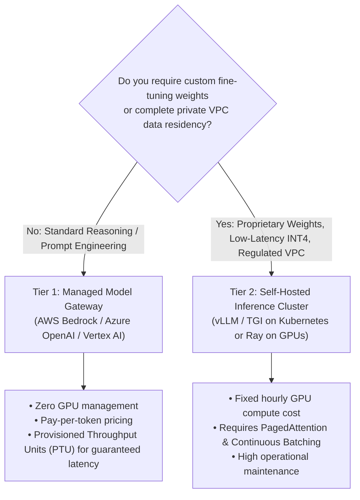
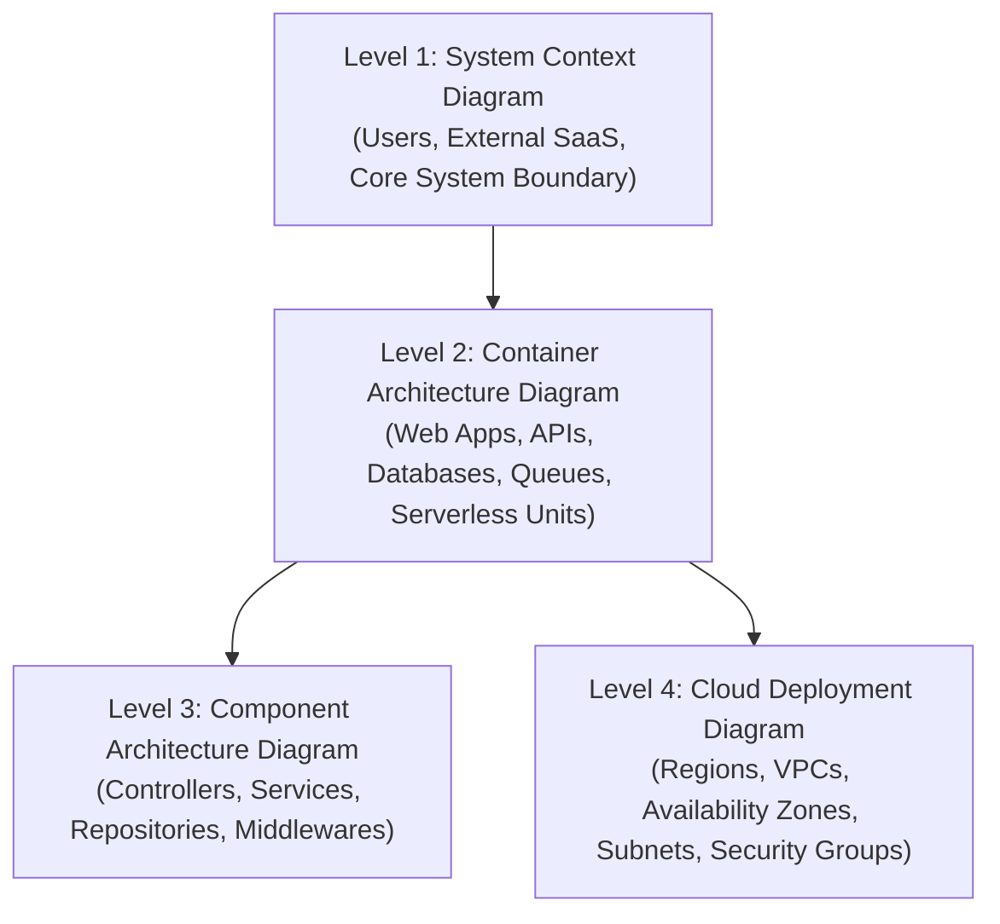
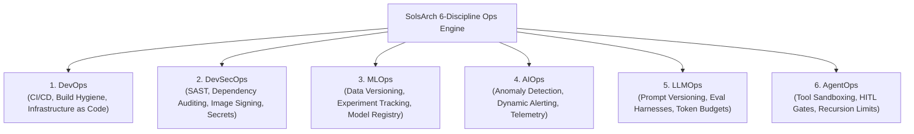
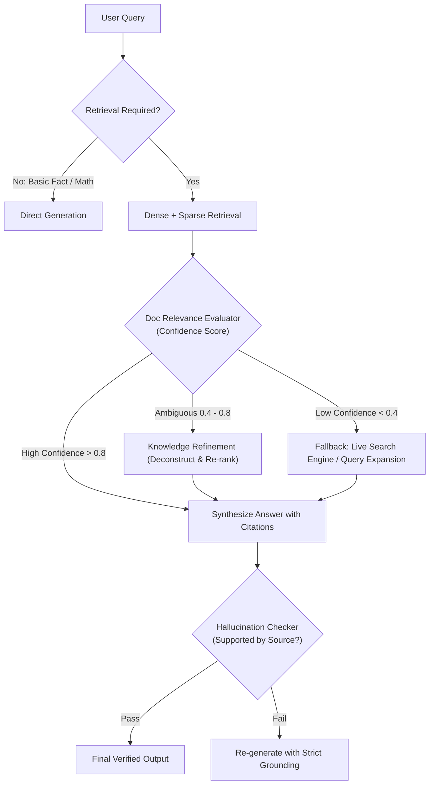

# SolsBrain — Unified Architecture, Cloud Engineering & AI Reference Manual
> **The Complete 16-Chapter Technical Architecture, Multi-Cloud Decider & AI Systems Reference Manual**
>
> - **Compiled From:** `docs/reference/solsbrain/` (Chapters 01–16)
> - **Enriched With:** Complete Solutions Architecture Knowledge Base, Blueprints & Decision Matrices from `SolsRef`
> - **Target Systems:** SolsArch Analyzer (Agents 1, 6, 8, 11.5, Core Validator, Ops Evaluator)
> - **Target Clouds:** AWS, Microsoft Azure, Google Cloud Platform (GCP), Edge & AI Specialty Clouds
> - **Version:** 12.0 Ultimate Architecture Encyclopedia

---

<a id="master-table-of-contents"></a>
## Master Table of Contents

| Chapter | Title | Primary Domain |
|:---:|:---|:---|
| **01** | [SolsBrain — Chapter 1: Security, Identity & Governance (Deep-Dive Edition)](#chapter-01) | Identity, Access Management, Cryptography, Secrets Governance & Edge Security |
| **02** | [SolsBrain — Chapter 2: Compute, Containers & Serverless (Deep-Dive Edition)](#chapter-02) | Virtual Compute, Elastic Auto Scaling, Container Orchestration & Serverless FaaS |
| **03** | [SolsBrain — Chapter 3: Storage, File Systems & Data Migration (Deep-Dive Edition)](#chapter-03) | Object Storage, Block Storage, Network File Systems, Hybrid Storage Gateways & Physical Data Transfer |
| **04** | [SolsBrain — Chapter 4: Enterprise VPC & Global Networking](#chapter-04) | Virtual Private Clouds, Subnet Hierarchies, Routing, Edge Distribution & Load Balancing |
| **05** | [SolsBrain — Chapter 5: Databases, Caching & Data Stores](#chapter-05) | Relational Databases, Distributed NoSQL, In-Memory Caching & Analytics |
| **06** | [SolsBrain — Chapter 6: Asynchronous Messaging & Event Streaming](#chapter-06) | Message Queuing, Publish/Subscribe, Event Buses & Streaming Data |
| **07** | [SolsBrain — Chapter 7: Monitoring, Telemetry & Disaster Recovery](#chapter-07) | Metrics, Centralized Logging, Distributed Tracing & High-Availability DR Strategies |
| **08** | [SolsBrain — Chapter 8: 50+ Multi-Cloud Canonical Mapping Matrix](#chapter-08) | Universal Service Taxonomy, Cross-Cloud Equivalents & Protocol Allow-Lists |
| **09** | [SolsBrain — Chapter 9: AI Architecting, LLMOps & Multi-Agent Systems](#chapter-09) | Generative AI Infrastructure, Retrieval-Augmented Generation (RAG), Agentic Systems & LLMOps |
| **10** | [SolsBrain — Chapter 10: Infrastructure as Code & Deployment at Scale](#chapter-10) | Declarative Infrastructure, Multi-Account Governance, CI/CD Strategies & Fleet Management |
| **11** | [SolsBrain — Chapter 11: FinOps & Cost Optimization Engineering](#chapter-11) | Cloud Financial Management (FinOps), Unit Economics, Breakeven Analysis & Egress Optimization |
| **12** | [SolsBrain — Chapter 12: Enterprise Diagramming & C4 Visualization Standards](#chapter-12) | Architectural Modeling, C4 Abstraction Layers, Iconography Rules & Layout Mathematics |
| **13** | [SolsBrain — Chapter 13: 6-Discipline Ops Engineering](#chapter-13) | Operational Maturity, DevSecOps, MLOps, AIOps, LLMOps & AgentOps |
| **14** | [SolsBrain — Chapter 14: Workload Memory Footprints & Capacity Sizing Guide](#chapter-14) | Runtime Memory Footprints, Language Heap Dynamics, Cache Sizing & OOM Prevention |
| **15** | [SolsBrain — Chapter 15: Latest AI Engineering, Agentic Protocols & Advanced LLMOps](#chapter-15) | Model Context Protocol (MCP), GraphRAG, RAPTOR, Inference Optimization (PagedAttention, Speculative Decoding), DSPy, Multi-Agent Orchestration, SLMs on Edge & GenAI Observability |
| **16** | [SolsBrain — Chapter 16: Modern Cloud Tech Stacks, Toolchains & Architecture Best Practices](#chapter-16) | Modern Web Runtimes, High-Performance Toolchains, Serverless Branching Databases, Real-Time OLAP, Edge Compute, Modern IPC Protocols & eBPF Zero-Trust Networking |

---

<a id="chapter-01"></a>
<a id="chapter-1"></a>

# SolsBrain — Chapter 1: Security, Identity & Governance (Deep-Dive Edition)

**Domain:** Identity, Access Management, Cryptography, Secrets Governance & Edge Security  
**Target Clouds:** AWS, Microsoft Azure, Google Cloud Platform (GCP)  
**Target Engine:** SolsArch Analyzer (Agent 11.5 Lite Security, Agent 6 Cloud Decider, Core Validator)  
**Version:** 2.0 (Exhaustive Technical Specification)

---

## 1. Identity & Access Management (IAM) Deep Dive

### 1.1 Deterministic Policy Evaluation Engine
The policy evaluation engine operates as an acyclic decision tree. Understanding this resolution order is critical for SolsArch's security analyzer to detect unintended privilege leakage:

```
[ Incoming Request: Principal + Action + Resource + Context ]
                            │
                            ▼
              ┌───────────────────────────┐
              │ 1. Is there an EXPLICIT   │ ──( YES )──> [ FINAL VERDICT: DENIED ]
              │    DENY in any policy?    │
              └─────────────┬─────────────┘
                            │ ( NO )
                            ▼
              ┌───────────────────────────┐
              │ 2. Organization SCPs:     │ ──( NO )───> [ FINAL VERDICT: DENIED ]
              │    Does parent SCP allow? │
              └─────────────┬─────────────┘
                            │ ( YES )
                            ▼
              ┌───────────────────────────┐
              │ 3. Permission Boundary:   │ ──( NO )───> [ FINAL VERDICT: DENIED ]
              │    Is boundary present?   │
              │    If so, does it allow?  │
              └─────────────┬─────────────┘
                            │ ( YES / NOT APPLIED )
                            ▼
              ┌───────────────────────────┐
              │ 4. Identity or Resource   │ ──( YES )──> [ FINAL VERDICT: ALLOWED ]
              │    Policy: Explicit ALLOW?│
              └─────────────┬─────────────┘
                            │ ( NO )
                            ▼
                [ FINAL VERDICT: DENIED ] (Implicit Deny)
```

#### Key Evaluation Rules:
1. **Explicit Deny Overrides Everything**: Even an Administrator policy with `Action: "*", Resource: "*"` is nullified if a single statement contains an explicit `Effect: "Deny"` matching the request context.
2. **Cross-Account Authorization Double-Check**: For access across distinct AWS accounts (Account A to Account B):
   - Account A must **explicitly allow** the principal to delegate/assume or call the external resource.
   - Account B must **explicitly allow** the principal via a resource-based policy or trust relationship.
   - If *either* side fails, the request is denied.

---

### 1.2 IAM Policy Grammar & Condition Key Operators

An IAM policy document contains strict semantic elements:
```json
{
  "Version": "2012-10-17",
  "Statement": [
    {
      "Sid": "EnforceMFAAndOrgBoundaries",
      "Effect": "Deny",
      "Action": "*",
      "Resource": "*",
      "Condition": {
        "BoolIfExists": {
          "aws:MultiFactorAuthPresent": "false"
        },
        "StringNotEquals": {
          "aws:PrincipalOrgID": "o-xy12345678"
        }
      }
    }
  ]
}
```

#### Essential Global Condition Keys Evaluated by SolsArch:
| Condition Key | Type | Architectural Security Purpose |
|---|---|---|
| `aws:PrincipalOrgID` | String | Restricts resource access strictly to member accounts within the specified AWS Organization, blocking external accounts even if misconfigured. |
| `aws:PrincipalArn` | ARN | Verifies the exact cryptographic identity of the calling role or user. |
| `aws:SourceArn` | ARN | Prevents the **Confused Deputy Problem** during service-to-service calls (e.g., verifying an SNS topic triggers Lambda exclusively on behalf of a specific S3 bucket). |
| `aws:SourceAccount` | String | Verifies the owning account ID of the resource initiating a service call. |
| `aws:RequestedRegion` | String | Restricts operations to authorized sovereign geographical regions (e.g., `["eu-west-1", "eu-central-1"]`). |
| `aws:VpcSourceIp` | IP CIDR | Enforces that calls originate strictly from within a designated VPC IP range. |
| `aws:SecureTransport` | Boolean | Enforces TLS (`"aws:SecureTransport": "true"`); used in S3/SQS bucket policies to reject unencrypted plaintext HTTP. |

#### Condition Operator Evaluation Types:
- **String Matching**: `StringEquals`, `StringNotEquals`, `StringEqualsIgnoreCase`, `StringLike` (supports `*` and `?` wildcards).
- **Numeric Matching**: `NumericEquals`, `NumericLessThan`, `NumericGreaterThanEquals`.
- **Date Matching**: `DateEquals`, `DateLessThan` (temporary expiring access).
- **Boolean Matching**: `Bool` (`true` or `false`).
- **IP Address Matching**: `IpAddress`, `NotIpAddress` (e.g., `{"IpAddress": {"aws:SourceIp": "203.0.113.0/24"}}`).
- **Null Check**: `Null: {"aws:TokenIssueTime": "true"}` (verifies presence of condition keys).
- **Existence Modifiers**: `...IfExists` (evaluates condition only if key is present in request context; bypasses check if missing).

---

### 1.3 Quotas, Hard Limits & Architectural Anti-Patterns

| Resource Entity | Hard / Soft Quota | Architectural Consequence |
|---|---|---|
| **Managed Policy Size** | **6,144 characters** (Hard) | Complex policies must be decomposed into multiple modular managed policies. |
| **Inline Role Policy Size** | **10,240 characters** (Hard) | Roles exceeding 10 KB must attach customer-managed policies instead. |
| **Managed Policies per Role** | **10 default / 20 max** (Soft) | Over-attaching policies indicates a monolithic role anti-pattern; split into discrete microservice roles. |
| **Role Session Duration** | **1 hour default / 12 hours max** | Application compute must handle token expiration and automatic credential refresh. |
| **Permission Boundaries** | Max 1 per entity | Must be applied to all developer-created roles to prevent privilege escalation. |

#### The Confused Deputy Prevention Blueprint:
When delegating access to a multi-tenant 3rd-party SaaS (e.g., Datadog, SolsArch Collector):
```json
{
  "Version": "2012-10-17",
  "Statement": [
    {
      "Effect": "Allow",
      "Principal": {
        "AWS": "arn:aws:iam::123456789012:root"
      },
      "Action": "sts:AssumeRole",
      "Condition": {
        "StringEquals": {
          "sts:ExternalId": "solsarch-tenant-unique-uuid-98765"
        },
        "ArnEquals": {
          "aws:SourceArn": "arn:aws:iam::123456789012:role/SolsArchWorkerRole"
        }
      }
    }
  ]
}
```

---

### 1.4 Attribute-Based Access Control (ABAC)
Rather than writing hundreds of individual RBAC policies per user, enterprise teams deploy **ABAC**, linking access dynamically to tags:
```json
{
  "Version": "2012-10-17",
  "Statement": [
    {
      "Sid": "AllowAccessIfTagsMatch",
      "Effect": "Allow",
      "Action": [
        "ec2:StartInstances",
        "ec2:StopInstances"
      ],
      "Resource": "arn:aws:ec2:*:*:instance/*",
      "Condition": {
        "StringEquals": {
          "aws:ResourceTag/Project": "${aws:PrincipalTag/Project}",
          "aws:ResourceTag/Environment": "${aws:PrincipalTag/Environment}"
        }
      }
    }
  ]
}
```
*Value*: Developers tagged with `Project: Billing` can automatically start/stop newly provisioned Billing instances without updating IAM policies.

---

### 1.5 Service Control Policies (SCPs) Governance
SCPs enforce non-bypassable guardrails at the AWS Organizations Root or Organizational Unit (OU) level. Even account root users cannot bypass an SCP.

#### Production Guardrail 1: Restrict Sovereign Regions
```json
{
  "Version": "2012-10-17",
  "Statement": [
    {
      "Sid": "DenyUnapprovedRegions",
      "Effect": "Deny",
      "NotAction": [
        "iam:*",
        "route53:*",
        "cloudfront:*",
        "wafv2:*",
        "support:*"
      ],
      "Resource": "*",
      "Condition": {
        "StringNotEquals": {
          "aws:RequestedRegion": [
            "eu-west-1",
            "eu-central-1"
          ]
        }
      }
    }
  ]
}
```

#### Production Guardrail 2: Prevent Disabling Security Services
```json
{
  "Version": "2012-10-17",
  "Statement": [
    {
      "Sid": "ProtectSecurityServices",
      "Effect": "Deny",
      "Action": [
        "cloudtrail:DeleteTrail",
        "cloudtrail:StopLogging",
        "guardduty:DeleteDetector",
        "guardduty:DisassociateFromMasterAccount"
      ],
      "Resource": "*"
    }
  ]
}
```

---

## 2. Cryptographic Key Management: AWS KMS & CloudHSM

### 2.1 Envelope Encryption Deep-Dive
Directly encrypting multi-gigabyte files using a central KMS API causes extreme network overhead and hits API rate limits. Cloud architectures utilize **Envelope Encryption**:

```
                       [ AWS KMS ]
                            │
               ( Request: GenerateDataKey )
                            │
            ┌───────────────┴───────────────┐
            │                               │
            ▼                               ▼
     [ Plaintext DEK ]              [ Ciphertext DEK ]
    (256-bit AES key in RAM)     (Encrypted under KMS CMK)
            │                               │
            ▼                               │
   [ Encrypt Data Locally ]                 │
            │                               │
            ▼                               ▼
    [ Encrypted Data ] ───────────> [ Storage: S3 / EBS ]
   (Plaintext DEK erased)       (Encrypted payload + Ciphertext DEK)
```

#### Decryption Flow:
1. Application reads the **Ciphertext DEK** and **Encrypted Data** from S3.
2. Application calls `kms:Decrypt` passing only the **Ciphertext DEK**.
3. KMS decrypts the DEK using the Customer Master Key (CMK) inside its hardware boundary and returns the **Plaintext DEK**.
4. Application decrypts the data in RAM and immediately zeroes out the Plaintext DEK in memory.

---

### 2.2 KMS Key Policy Architecture & Preventing Lockouts
A KMS key policy is the primary access control mechanism for a CMK. Unlike S3 buckets, an IAM policy alone cannot grant access to a KMS key unless the Key Policy explicitly delegates authority to the account root.

#### The Safe Key Policy Pattern:
```json
{
  "Version": "2012-10-17",
  "Id": "SafeKeyPolicy",
  "Statement": [
    {
      "Sid": "EnableRootAccountDelegation",
      "Effect": "Allow",
      "Principal": {
        "AWS": "arn:aws:iam::111122223333:root"
      },
      "Action": "kms:*",
      "Resource": "*"
    },
    {
      "Sid": "AllowAppRoleToEncryptDecrypt",
      "Effect": "Allow",
      "Principal": {
        "AWS": "arn:aws:iam::111122223333:role/PaymentsWorkerRole"
      },
      "Action": [
        "kms:GenerateDataKey*",
        "kms:Decrypt",
        "kms:DescribeKey"
      ],
      "Resource": "*",
      "Condition": {
        "StringEquals": {
          "kms:ViaService": "s3.eu-west-1.amazonaws.com"
        }
      }
    }
  ]
}
```
*Critical Rule*: If the `root` delegation block is omitted and the specific IAM user/role in the policy is deleted, **the KMS key becomes permanently orphaned and unrecoverable**. AWS Support cannot restore an orphaned KMS key.

---

### 2.3 KMS Key Rotation & Multi-Region Keys

#### Automatic Key Rotation:
- Available for Customer Managed Symmetric Keys.
- When enabled, AWS KMS automatically rotates the backing cryptographic material every **365 days** (annual).
- **The Key ARN, Key ID, and permissions do NOT change**.
- KMS retains all historical backing keys; older ciphertexts can be decrypted seamlessly without manual re-encryption.

#### Multi-Region Keys:
- Allows primary keys in Region A (e.g., `us-east-1`) to be replicated to Region B (e.g., `eu-west-1`).
- Replicas share the **exact same Key ID and cryptographic key material**.
- Enables client applications to encrypt client data in `us-east-1` and decrypt it directly in `eu-west-1` without making cross-region latency-inducing KMS calls.

---

## 3. Secrets Management & Parameter Store Architecture

### 3.1 Secrets Manager Automated Rotation Architecture
```mermaid
sequenceDiagram
  autonumber
  participant SM as AWS Secrets Manager
  participant Lambda as Rotation Function
  participant DB as Amazon Aurora / RDS

  SM->>Lambda: 1. createSecret (Generate new password; stage as AWSPENDING)
  SM->>Lambda: 2. setSecret (Connect to DB using AWSCURRENT; ALTER USER with AWSPENDING)
  SM->>Lambda: 3. testSecret (Test new connection using AWSPENDING password)
  SM->>Lambda: 4. finishSecret (Promote AWSPENDING to AWSCURRENT; demote old to AWSPREVIOUS)
```

#### Secret Version Stages:
- `AWSCURRENT`: The active password currently in use by applications.
- `AWSPENDING`: The newly generated password undergoing rotation testing.
- `AWSPREVIOUS`: The previous password preserved for rollback safety.

---

## 4. Edge Protection, Firewalls & WAF

### 4.1 AWS WAF Architecture & Web ACL Capacity Units (WCU)
- **WCU Budget**: A single Web ACL has a baseline limit of **1,500 WCUs** (can be extended to 5,000 via quota increase).
- **Rule Processing Model**: Rules evaluate in strict numeric priority order.
  ```
  Priority 1: IP Whitelist / Blacklist (1 WCU)
       ↓
  Priority 2: AWS Managed Rules - Common Rule Set (700 WCU)
       ↓
  Priority 3: AWS Managed Rules - Known Bad Inputs (200 WCU)
       ↓
  Priority 4: AWS Managed Rules - SQLi Prevention (200 WCU)
       ↓
  Priority 5: Rate-based Rule (100 req/5min on /api/login) (2 WCU)
       ↓
  Default Action: ALLOW (or BLOCK)
  ```

---

## 5. Security Audit Logging & Compliance Monitoring

### 5.1 CloudTrail, GuardDuty & Security Hub Architecture
```
[ All AWS API Calls & Console Logins ]
                  │
                  ▼
         [ AWS CloudTrail ] ──( S3 Bucket with KMS + Object Lock )
                  │
                  ▼
         [ Amazon GuardDuty ] ──> Analyzes VPC Flow Logs, DNS queries, EKS Audit Logs
                  │              using Machine Learning anomaly detection
                  ▼
        [ AWS Security Hub ] ───> Scores against CIS Benchmarks & PCI-DSS
                  │
                  ▼
    [ Amazon EventBridge ] ────> Automated Remediation (Lambda isolation)
```

---

## 6. Formal SolsArch Security Engine Rules

SolsArch's security scanner evaluates architectures against these formal deterministic rules:

| Rule Code | Severity | Condition Trigger | Remediation Guidance |
|---|:---:|---|---|
| `SEC-IAM-001` | **CRITICAL** | IAM policy statement has `Effect: "Allow"` and `Action: "*"` on `Resource: "*"` | Scope actions to specific APIs and restrict resource ARNs |
| `SEC-IAM-002` | **HIGH** | External role trust policy lacks `sts:ExternalId` or `aws:SourceArn` | Add unique tenant ExternalId condition to prevent Confused Deputy attacks |
| `SEC-NET-001` | **CRITICAL** | Database node (`relational_db`, `document_db`) has incoming edge from `client_browser` or `0.0.0.0/0` | Place database in an isolated subnet; route traffic via container/API tier |
| `SEC-NET-002` | **HIGH** | Public load balancer does not attach an edge WAF Web ACL | Attach AWS WAF / Cloudflare WAF to inspect incoming HTTP/HTTPS traffic |
| `SEC-STR-001` | **HIGH** | `object_storage` node lacks default encryption configuration | Configure default AWS KMS key (`aws/s3` or custom CMK) on the bucket |
| `SEC-STR-002` | **CRITICAL** | S3 bucket has `BlockPublicAccess: false` and lacks OAC CloudFront restriction | Enable S3 Block Public Access; attach CloudFront Origin Access Control |
| `SEC-SEC-001` | **CRITICAL** | Plaintext credential patterns (e.g., `AKIA...`, `password=`, `BEGIN RSA`) found in committed code | Remove secret immediately; revoke key; migrate to AWS Secrets Manager |
| `SEC-SEC-002` | **MEDIUM** | CloudWatch Log Group has retention period set to `Never Expire` | Configure retention policy between 30 and 365 days with archival to S3 |
---

## 4. Production Architecture Best Cases & Scenarios (from SolsRef)

### Best Case 1.1: CloudFront Origin Cloaking & Secret Rotation with AWS WAF & Secrets Manager
- **Context & Problem**: When using CloudFront as a CDN/WAF in front of an Application Load Balancer (ALB), attackers who discover the public DNS name or IP of the ALB can bypass CloudFront caching, rate limits, and AWS Shield/WAF defenses, attacking the backend directly.
- **Architecture Blueprint**:
```
[ Client Browser ]
        │
        ▼ (HTTPS)
[ Amazon CloudFront Distribution ]
   ├── AWS WAF WebACL (Rate Limiting, IP Reputation)
   └── Custom Origin Header Injection:
       Header: "X-Origin-Verify: <secret_token>"
        │
        ▼ (HTTPS)
[ Application Load Balancer (ALB) ]
   └── ALB AWS WAF WebACL Rule:
       IF Header "X-Origin-Verify" == "<secret_token>" ──► ALLOW
       ELSE ──────────────────────────────────────────► BLOCK (403 Forbidden)
        │
        ▼
[ Auto Scaling Group (EC2 / ECS / Containers) ]
```
- **Automated Secret Rotation Mechanics**:
  1. AWS Secrets Manager stores `<secret_token>`.
  2. Scheduled rotation Lambda function triggers every 30 days:
     - Step 1: Generates new token version `V2`.
     - Step 2: Updates ALB WAF rule to allow *both* `V1` and `V2` (grace period).
     - Step 3: Updates CloudFront distribution origin headers to send `V2`.
     - Step 4: After propagation delay (5 min), updates ALB WAF rule to strictly allow only `V2`, revoking `V1`.
- **SolsArch Evaluator Rule**: `SEC-WAF-003` — Any public ALB configured as an origin for CloudFront must enforce origin validation via CloudFront OAC or rotated custom verification headers in AWS WAF.

### Best Case 1.2: Multi-Account Centralized CloudTrail & Security Ingestion Engine
- **Context & Problem**: Enterprise compliance (SOC2, ISO 27001, HIPAA) requires that audit trails cannot be tampered with or deleted by compromised root or administrator credentials in any individual AWS account.
- **Architecture Blueprint**:
```
AWS Organizations (Management Account / Delegated Security Admin)
├── Member Account A (Prod)  ──► Organizational CloudTrail (All Regions) ──┐
├── Member Account B (Dev)   ──► Organizational CloudTrail (All Regions) ──┤
└── Member Account C (Sec)   ──► Organizational CloudTrail (All Regions) ──┤
                                                                           │
                                                                           ▼
                    [ Dedicated Log Archive AWS Account ]
                    ┌───────────────────────────────────────────────────────┐
                    │ S3 Central Audit Bucket                               │
                    │ ├── SSE-KMS with Customer Managed Key (CMK)           │
                    │ ├── Bucket Policy: Deny s3:DeleteObject to ALL        │
                    │ ├── S3 Object Lock (Compliance Mode, Retention: 365d) │
                    │ ├── S3 MFA Delete Enabled                             │
                    │ └── Lifecycle Rule: Day 90 -> Glacier Flexible        │
                    └───────────────────────────────────────────────────────┘
```
- **Key Policy Rules**:
  - The KMS CMK Key Policy explicitly allows `cloudtrail.amazonaws.com` to `GenerateDataKey` and restricts decryption to the dedicated Security Incident Response Team IAM role.
  - Member accounts have zero IAM permissions to stop logging or alter the bucket configuration.

### Best Case 1.3: Delegated Cross-Account IAM Role with `sts:ExternalId` (Confused Deputy Prevention)
- **Context & Problem**: In multi-tenant SaaS architectures, the SaaS provider assumes IAM roles in customer AWS accounts to monitor or manage resources. Without an `ExternalId`, a malicious customer could trick the SaaS vendor into assuming another customer's role (The Confused Deputy Attack).
- **IAM Policy Implementation**:
```json
{
  "Version": "2012-10-17",
  "Statement": [
    {
      "Effect": "Allow",
      "Principal": { "AWS": "arn:aws:iam::111122223333:root" },
      "Action": "sts:AssumeRole",
      "Condition": {
        "StringEquals": {
          "sts:ExternalId": "tenant-uuid-a8f9-4b21-8842-99014abef321"
        }
      }
    }
  ]
}
```
- **SolsArch Evaluator Rule**: `SEC-IAM-004` — Cross-account trust policies without `sts:ExternalId` or `aws:SourceArn` conditions must be flagged as Critical Severity.

### Best Case 1.4: Hardware Security Module (CloudHSM) SSL Offloading for FIPS 140-2 Level 3
- **Context & Problem**: Financial trading platforms, banking, and government workloads require SSL private key isolation complying with FIPS 140-2 Level 3 (where cryptographic keys can never exist in host RAM).
- **Architecture Blueprint**:
```
[ Incoming HTTPS Client ]
        │
        ▼ (Port 443)
[ NGINX / Apache Web Tier on EC2 ]
   └── OpenSSL Dynamic Engine (libcloudhsm_openssl.so)
        │ (Private ENI / VPC Peering)
        ▼
[ AWS CloudHSM Cluster (Multi-AZ) ]
   └── Cryptographic Asymmetric RSA/ECDSA Private Key Operations performed in Hardware
```
- **Benefits**: Relieves web server CPUs of expensive asymmetric math while guaranteeing that even root compromise of the EC2 instance cannot expose the private SSL keys.
---

## 8. Advanced Cryptography, Secrets Governance & Perimeter Defense (from SolsRef)

### 8.1 AWS KMS Cryptographic Architecture & Envelope Encryption
- **Key Taxonomy & Ownership**:
  - **AWS Owned Keys**: Free, internal to AWS services (e.g. DynamoDB default encryption). Cannot be viewed, audited, or tracked in CloudTrail.
  - **AWS Managed Keys**: Default service keys (e.g. `aws/s3`, `aws/ebs`, `aws/rds`). Key policies cannot be modified; annual automated rotation.
  - **Customer Managed Keys (CMK)**: Created by user ($1/month per key). Full control over key policy, grants, annual or on-demand rotation, cryptographic deletion scheduling (7 to 30 days wait period), and CloudTrail auditability.
- **Envelope Encryption Mechanics**:
```
[ Application Client ]
       │
       ├── 1. Requests Data Key: kms:GenerateDataKey(KeyId="arn:aws:kms:...")
       │      │
       │      ▼
       │   [ AWS KMS Service Engine ]
       │      ├── Encrypts Plaintext Data Key with Customer Master Key (CMK)
       │      └── Returns TWO keys:
       │          - Plaintext Data Key (e.g., 256-bit AES key)
       │          - Ciphertext (Encrypted) Data Key
       │
       ├── 2. Client encrypts payload locally using Plaintext Data Key (AES-256-GCM)
       ├── 3. Client securely overwrites & zeros Plaintext Data Key from memory (RAM)
       │
       ▼
[ Stored Data Object ]
  ├── Ciphertext Encrypted Data Payload
  └── Ciphertext Encrypted Data Key (stored in metadata header)
```
- **KMS Multi-Region Keys**: Primary key in one region replicated to secondary regions with identical key ID, key ARN, and key material. Enables client to decrypt encrypted data in secondary regions without making cross-region network calls to KMS.

### 8.2 Amazon Cognito: User Pools vs Identity Pools (Federated Identities)
| Dimension | Amazon Cognito User Pools (CUP) | Amazon Cognito Identity Pools (Federated Identities) |
|---|---|---|
| **Primary Purpose** | **Authentication ("Who you are")** | **Authorization ("What you can access")** |
| **User Directory** | Built-in directory for web/mobile users; manages signup, login, password resets. | No user directory; exchanges tokens from identity providers for AWS credentials. |
| **Authentication Sources** | Username/password, Social (Google, Apple, Meta), Enterprise (SAML 2.0, OIDC). | Cognito User Pools, OpenID Connect, SAML, Google, Apple, Guest/Unauthenticated users. |
| **Output Token** | OIDC-standard JWT tokens: **ID Token**, **Access Token**, **Refresh Token**. | Temporary, scoped **AWS IAM Credentials** (`AccessKeyId`, `SecretAccessKey`, `SessionToken`). |
| **Integration** | Used with API Gateway Lambda Authorizers, ALB, and AppSync GraphQL. | Used to grant mobile/web clients direct access to AWS resources (S3 uploads, DynamoDB reads). |

### 8.3 Enterprise Secrets Architecture: AWS Secrets Manager vs SSM Parameter Store
| Feature | AWS Secrets Manager | AWS Systems Manager (SSM) Parameter Store |
|---|---|---|
| **Cost Model** | $0.40 per secret/month + $0.05 per 10,000 API calls | **Standard**: Free (up to 10,000 parameters). **Advanced**: $0.05 per parameter/month. |
| **Automatic Rotation** | **Native Built-in Support**: Out-of-the-box Lambda templates for RDS, Aurora, DocumentDB, Redshift. | Manual: Must configure custom EventBridge rules and Lambda functions. |
| **Cross-Account Sharing** | Native resource-based policies allow direct cross-account access without role assumption. | Requires assuming an IAM role in the target account. |
| **Multi-Region Replication** | Automated cross-region secret replication with synchronized primary-replica rotation. | Manual replication via CI/CD or custom scripts. |
| **Recommended Fit** | Database credentials, third-party API keys requiring automated 30-day rotation. | Application configuration parameters, feature flags, license keys, AMI IDs. |

### 8.4 AWS Security Services Comparison Matrix
| Service | Primary Inspection Target | Underlying Detection Mechanism | Automated Remediation Trigger |
|---|---|---|---|
| **Amazon GuardDuty** | CloudTrail Management & S3 Data Events, VPC Flow Logs, DNS Logs, EKS Audit Logs. | Machine Learning anomaly detection, threat intelligence feeds (Proofpoint, CrowdStrike). | EventBridge -> Lambda / SSM Automation Runbook (isolate compromised EC2 instance, revoke IAM session). |
| **Amazon Macie** | Amazon S3 Buckets and Object payloads. | Pattern matching, regular expressions, and ML to identify PII, credit cards, credentials, financial data. | EventBridge -> S3 Bucket Policy update (revoke public access, enable encryption). |
| **Amazon Inspector** | EC2 Instances (SSM agent), Amazon ECR container images, AWS Lambda function code. | Automated vulnerability scanning against Common Vulnerabilities and Exposures (CVE) databases. | EventBridge -> Quarantine unpatched container image in ECR, trigger CI/CD build block. |
| **AWS Security Hub** | Aggregates findings from GuardDuty, Macie, Inspector, IAM Access Analyzer, Firewall Manager. | Evaluates infrastructure against security standards (CIS AWS Foundations Benchmark, PCI-DSS). | Centralized SecOps dashboard with 1-click Automated Response and Remediation actions. |

### 8.5 Perimeter DDoS Defense: AWS Shield Standard vs AWS Shield Advanced
- **AWS Shield Standard**: Automatically enabled for all AWS customers at no cost. Defends against 96% of common Layer 3 and Layer 4 infrastructure attacks (SYN/UDP floods, reflection attacks).
- **AWS Shield Advanced**: $3,000/month per organization (1-year commitment).
  - Specialized 24/7 access to the **AWS Shield Response Team (SRT)** for manual rule customization during attacks.
  - Comprehensive Layer 7 DDoS mitigation when paired with AWS WAF.
  - **DDoS Cost Protection**: Financial credit reimbursement for scaling charges (EC2, CloudFront, ALB, Route 53) incurred due to traffic spikes during verified DDoS attacks.
  - Proactive engagement: SRT contacts the enterprise directly if Route 53 health checks degrade during an active attack.
---

## 9. Enterprise Identity Federation, SAML 2.0 & Cross-Account Access (from SolsRef)

### 9.1 SAML 2.0 Enterprise Identity Federation Architecture
- **Context & Problem**: Enterprises with 5,000+ employees using Active Directory (ADFS, Azure AD / Microsoft Entra ID, Okta, PingFederate) must not create individual IAM users in AWS. Users must log in via existing corporate SSO with Single Sign-On and Multi-Factor Authentication (MFA).
- **Architectural Flow**:
```
[ User Browser ]
       │
       ├── 1. Accesses Corporate SSO Portal (e.g. https://sso.enterprise.com)
       │      │
       │      ▼
       │   [ Corporate Identity Provider (IdP) / Active Directory ]
       │      ├── Authenticates user credentials & verifies hardware MFA
       │      └── Generates cryptographically signed SAML 2.0 Assertion:
       │          - Claim: https://aws.amazon.com/SAML/Attributes/Role:
       │                   arn:aws:iam::123456789012:role/DeveloperRole,
       │                   arn:aws:iam::123456789012:saml-provider/CorporateAD
       │          - Claim: https://aws.amazon.com/SAML/Attributes/RoleSessionName: user@enterprise.com
       │
       ├── 2. Browser redirects & POSTs SAML Assertion to AWS Sign-In Endpoint
       │      │
       │      ▼
       │   [ AWS Security Token Service (STS) ]
       │      ├── Verifies signature against uploaded IdP SAML Metadata Document
       │      └── Invokes AssumeRoleWithSAML API
       │      │
       │      ▼ Returns Temporary AWS Credentials (1h - 12h session duration)
       │
       └── 3. Browser accesses AWS Management Console / CLI with temporary session
```
- **AWS IAM Identity Center (formerly AWS SSO)**: Provides multi-account centralized access management. Assigns **Permission Sets** (IAM policies mapped to job functions) to users and groups synchronized from corporate directories via SCIM (System for Cross-domain Identity Management).

---

## 10. AWS Organizations SCP Master Rulebook & Preventive Guardrails (from SolsRef)

### 10.1 Service Control Policy (SCP) Evaluation Logic & Inheritance
- **Evaluation Rules**:
  - SCPs specify the **maximum available permissions** for accounts in an Organization or Organizational Unit (OU).
  - An SCP **never grants permissions** by itself; permissions must still be granted by IAM policies within the account.
  - If a permission is NOT allowed by an SCP at ANY level in the hierarchy (Root -> OU -> Account), it is implicitly denied.
  - An explicit `Deny` in any SCP overrides all allows across the entire organization tree.
- **Whitelist vs Blacklist Governance Strategies**:
  - **Blacklist Strategy (Default)**: The AWS default `FullAWSAccess` SCP remains attached to all roots and OUs. Custom SCPs attach explicit `Deny` statements for prohibited actions (e.g. disabling CloudTrail, using unapproved regions).
  - **Whitelist Strategy (Strict Zero-Trust)**: `FullAWSAccess` is detached. Explicit `Allow` SCPs permit only approved services (e.g. EC2, S3, RDS) for specific OUs. Any unlisted service is strictly forbidden.

### 10.2 Production Enterprise SCP Policy Library
#### Rule 1: Deny Leaving Organization & Tampering with Security Controls
```json
{
  "Version": "2012-10-17",
  "Statement": [
    {
      "Sid": "DenyLeavingOrgAndAlteringSecurity",
      "Effect": "Deny",
      "Action": [
        "organizations:LeaveOrganization",
        "guardduty:DeleteDetector",
        "guardduty:DisassociateFromMasterAccount",
        "cloudtrail:DeleteTrail",
        "cloudtrail:StopLogging",
        "cloudtrail:UpdateTrail",
        "config:DeleteConfigRule",
        "config:StopConfigurationRecorder"
      ],
      "Resource": "*"
    }
  ]
}
```

#### Rule 2: Enforce Geographic Regional Boundaries (Data Sovereignty & Cost Defense)
```json
{
  "Version": "2012-10-17",
  "Statement": [
    {
      "Sid": "DenyUnapprovedRegions",
      "Effect": "Deny",
      "NotAction": [
        "iam:*",
        "organizations:*",
        "route53:*",
        "budgets:*",
        "waf:*",
        "cloudfront:*",
        "globalaccelerator:*",
        "support:*"
      ],
      "Resource": "*",
      "Condition": {
        "StringNotEquals": {
          "aws:RequestedRegion": ["us-east-1", "eu-west-1"]
        }
      }
    }
  ]
}
```

#### Rule 3: Enforce TLS 1.2+ and In-Transit Encryption on Amazon S3
```json
{
  "Version": "2012-10-17",
  "Statement": [
    {
      "Sid": "EnforceSSLRequestsOnly",
      "Effect": "Deny",
      "Action": "s3:*",
      "Resource": "*",
      "Condition": {
        "Bool": {
          "aws:SecureTransport": "false"
        }
      }
    }
  ]
}
```

---

## 11. Automated Security Incident Response & Remediation Pipeline (from SolsRef)

```
[ Compromised EC2 Instance / Leaked Key ]
                   │
                   ▼ (Emits suspicious telemetry: Crypto-mining, Port Scanning, Tor Exit Node)
      [ Amazon GuardDuty / Amazon Inspector ]
                   │
                   ▼ (Generates High Severity Finding: UnauthorizedAccess:EC2/TorIPCaller)
       [ Amazon EventBridge Default Bus ]
                   │
                   ▼ (Event Pattern: { "source": ["aws.guardduty"], "detail": { "severity": [7, 8.9] } })
         [ AWS Lambda Auto-Remediation Function ]
                   │
   ┌───────────────┼───────────────────────────────┐
   ▼               ▼                               ▼
[ Step 1: Isolate ] [ Step 2: Forensic Snapshot ] [ Step 3: Revoke Credentials ]
Attaches Quarantine Snapshot attached EBS         Calls sts:RevokeUserSessions
Security Group      volumes for digital           to invalidate compromised
(No In/Out traffic) evidence analysis             IAM temporary tokens
```
---

## 12. Enterprise Directory Services, Resource Access Manager (RAM) & Firewall Manager (from SolsRef)

### 12.1 AWS Directory Services Architecture & Selection Matrix
| Directory Service Type | Architectural Underlying Engine | Trust Relationships | High Availability | Recommended Production Fit |
|---|---|---|---|---|
| **AWS Managed Microsoft AD** | Actual Microsoft Windows Server Active Directory running in AWS. | Supports **Two-Way Forest Trusts** to on-premises Active Directory. | Deployed as High-Availability domain controllers across 2+ Availability Zones. | Enterprise Windows workloads, SharePoint, SQL Server Always-On, seamless AD domain joins. |
| **AD Connector** | **Directory Gateway Proxy** (does not store or cache directory data in AWS). | N/A (Proxies LDAP/Kerberos calls directly to on-premise AD over DX/VPN). | Multi-AZ proxy instances. | Authenticating AWS Console, Amazon WorkSpaces, and QuickSight directly against on-premises AD without syncing. |
| **Simple AD** | Standalone Samba 4-compatible Active Directory engine. | **No trust relationships** supported. | Multi-AZ deployment. | Lightweight Linux/Samba environments requiring basic LDAP directory service up to 5,000 users. |

### 12.2 AWS Resource Access Manager (RAM)
- **Architecture**: Allows securely sharing AWS resources across AWS accounts within an AWS Organization or with specific external accounts without duplicating infrastructure.
- **Sharable Resource Types**:
  - **VPC Subnets**: Enables multiple accounts to deploy EC2 instances into a central VPC subnet owned by a dedicated Network Account (Participants cannot view or modify resources owned by other participants).
  - **AWS Transit Gateway attachments**: Share TGW hub with spoke accounts.
  - **Route 53 Resolver Rules**: Centralized DNS forwarding rules shared with all member accounts.
  - **AWS License Manager**: Share software licenses (Microsoft, Oracle) across organizational boundaries.

### 12.3 AWS Firewall Manager
- **Centralized Security Management**: Cross-account security management tool integrated with AWS Organizations.
- Automatically rolls out, enforces, and updates security rules across all accounts:
  - **AWS WAF Rules**: Centrally deploy WebACLs to all ALBs, API Gateways, and CloudFront distributions.
  - **AWS Shield Advanced Protections**: Automatically protect all public Elastic IPs and ALBs across accounts.
  - **VPC Security Groups**: Enforce organization-wide security group baselines (e.g. audit and close port 22 on all public EC2 instances).
  - **AWS Network Firewall Policies**: Centralized stateful packet filtering.
---

## 13. Instance Metadata Service v2 (IMDSv2) & SSRF Defense Architecture (from SolsRef)

### 13.1 IMDSv1 Vulnerabilities vs IMDSv2 Defense Mechanics
- **The SSRF Threat Vector**: In modern web architectures, Server-Side Request Forgery (SSRF) vulnerabilities in web applications allow attackers to trick backend servers into issuing HTTP requests to internal IP addresses. Under **IMDSv1**, an attacker submitting `http://169.254.169.254/latest/meta-data/iam/security-credentials/` causes the web server to fetch and expose its temporary IAM role credentials in plaintext.
- **IMDSv2 Defense Protocol**:
```
[ Attacker / Client ] ──► [ Vulnerable Web Server ]
                                 │
                                 ├── 1. Attacker attempts simple GET: http://169.254.169.254/latest/meta-data/...
                                 │      │
                                 │      ▼
                                 │   [ IMDSv2 Engine (Local Hypervisor) ]
                                 │      └── BLOCKS REQUEST (HTTP 401 Unauthorized: Missing Session Token)
                                 │
                                 └── 2. Legitimate Application Token Handshake:
                                        │
                                        ▼ (Step A: Acquire Session Token via HTTP PUT)
                                     PUT http://169.254.169.254/latest/api/token
                                     Header: "X-aws-ec2-metadata-token-ttl-seconds: 21600"
                                        │
                                        ▼ (Returns Secret Session Token: "AQAEAA...")
                                        │
                                        ▼ (Step B: Query Metadata via HTTP GET with Token)
                                     GET http://169.254.169.254/latest/meta-data/iam/security-credentials/
                                     Header: "X-aws-ec2-metadata-token: AQAEAA..."
                                        │
                                        ▼
                                     [ Metadata Successfully Returned ]
```
- **Architectural Rules for SolsArch**:
  - `SEC-EC2-IMDS2`: All EC2 launch templates and running instances must strictly enforce `HttpTokens: required` and disable IMDSv1.
  - `HttpPutResponseHopLimit`: For containerized workloads (ECS/Docker), set hop limit to `1` so packets cannot escape container network namespaces to query host metadata.

---

## 14. IAM Permission Boundaries, Session Policies & Access Analyzer (from SolsRef)

### 14.1 IAM Permission Boundaries (Privilege Escalation Defense)
- **Problem**: Senior administrators want to allow developers to create IAM roles and policies for their Lambda functions and ECS tasks, but without the risk of developers granting themselves full `AdministratorAccess` (Privilege Escalation).
- **Architecture**:
  - Administrator creates an **IAM Permission Boundary** policy that defines the *maximum ceiling* of permissions an entity can possess.
  - Developer's IAM policy requires that whenever they create a role or user, they *must* attach this Permission Boundary:
    ```json
    {
      "Condition": {
        "StringEquals": {
          "iam:PermissionsBoundary": "arn:aws:iam::123456789012:policy/DeveloperBoundary"
        }
      }
    }
    ```
  - An entity can only perform actions that are allowed by **BOTH** its identity-based policy **AND** its Permission Boundary.

### 14.2 IAM Access Analyzer
- Evaluates resource-based policies (S3 buckets, KMS keys, SQS queues, IAM roles) using automated mathematical reasoning and logic proving.
- Flags any resource that allows access to external AWS accounts or public/unauthenticated internet principals, identifying unintended exposure before security audits occur.
---

## 15. AWS KMS Deep Dive: Key Policies, Grants, Asymmetric Keys & Rotation (from SolsRef)

### 15.1 KMS Key Policy vs IAM Policy Mechanics
- **The Golden Rule of KMS Access**:
  - In AWS IAM, an IAM policy alone can never grant access to a Customer Managed Key (CMK) unless the **KMS Key Policy explicitly delegates authority to the account root principal** (`Principal: {"AWS": "arn:aws:iam::123456789012:root"}`).
  - If a key policy does NOT include the root delegation statement, ONLY the principals explicitly listed in the key policy can use or administer the key, bypassing account administrators!
- **KMS Grants vs Key Policies**:
  - **Key Policy**: Declarative, permanent JSON document attached to the key defining primary administrative and usage permissions.
  - **KMS Grants**: Programmatic, temporary, and scoped permissions granted by an authorized principal using the `kms:CreateGrant` API.
  - *Internal AWS Usage*: When an EC2 instance mounts an encrypted EBS volume, the EC2 service principal calls `CreateGrant` to acquire temporary cryptographic rights to decrypt the EBS volume key, automatically retiring the grant when the instance terminates.

### 15.2 Asymmetric KMS Keys & Digital Signatures
| Key Spec | Cryptographic Algorithms | Primary Use Case |
|---|---|---|
| **SYMMETRIC_DEFAULT** | **AES-256-GCM** (Same key encrypts & decrypts) | 99% of cloud storage encryption: Amazon S3, EBS volumes, RDS databases, DynamoDB. |
| **RSA_2048 / RSA_4096** | **RSAES_OAEP_SHA_256**, **RSASSA_PSS_SHA_512** | Digital code signing, SSL certificate generation, payload encryption by third-party systems outside AWS. |
| **ECC_NIST_P256 / P384** | **ECDSA (Elliptic Curve Digital Signature Algorithm)** | High-speed, compact digital signatures for Bitcoin/Ethereum blockchain nodes, IoT microcontrollers. |

### 15.3 Key Rotation & Bring Your Own Key (BYOK)
- **Automatic Key Rotation**:
  - When enabled, AWS automatically generates new cryptographic backing material for the CMK every **1 Year** (or on-demand).
  - The Key ARN, Key ID, and Key Policy remain completely unchanged.
  - AWS KMS permanently retains all previous key versions, allowing transparent decryption of older ciphertext while all newly encrypted payloads utilize the newest key version.
- **Imported Key Material (BYOK)**:
  - Enterprise generates key material locally inside an on-premises Hardware Security Module (HSM).
  - Imports key material into an empty AWS KMS CMK wrapped with RSA-OAEP.
  - *Operational Rule*: Automatic rotation is **not supported** for imported key material; rotation must be managed manually by creating new keys and updating application aliases.
---

## 16. The 6-Stage AWS IAM Policy Evaluation Logic & Permission Boundaries (from SolsRef)

### 16.1 Deterministic IAM Policy Evaluation Logic Flow
```
                      [ Incoming API Request (Principal, Action, Resource, Context) ]
                                                    │
                                                    ▼
                                  ┌───────────────────────────────────┐
                                  │ 1. Is there an EXPLICIT DENY?    │
                                  └───────────────────────────────────┘
                                         │ YES                   │ NO
                                         ▼                       ▼
                                  [ DENY ACCESS ]   ┌───────────────────────────────────┐
                                                    │ 2. Is there an Organization SCP?  │
                                                    └───────────────────────────────────┘
                                                           │ NO ALLOW              │ ALLOW
                                                           ▼                       ▼
                                                    [ DENY ACCESS ]   ┌───────────────────────────────────┐
                                                                      │ 3. Is Resource-Based Policy OK?  │
                                                                      └───────────────────────────────────┘
                                                                             │ YES                   │ NO
                                                                             ├──► [ ALLOW ACCESS* ]   ▼
                                                                             │    (*unless boundary) ┌───────────────────────────────────┐
                                                                             │                       │ 4. Identity-Based Policy ALLOW?   │
                                                                             │                       └───────────────────────────────────┘
                                                                             │                              │ NO                    │ YES
                                                                             │                              ▼                       ▼
                                                                             │                       [ DENY ACCESS ]   ┌───────────────────────────────────┐
                                                                             │                                         │ 5. Permissions Boundary ALLOW?    │
                                                                             │                                         └───────────────────────────────────┘
                                                                             │                                                │ NO                    │ YES
                                                                             │                                                ▼                       ▼
                                                                             │                                         [ DENY ACCESS ]   ┌───────────────────────────────────┐
                                                                             │                                                           │ 6. Session Policy ALLOW?          │
                                                                             │                                                           └───────────────────────────────────┘
                                                                             │                                                                  │ NO                    │ YES
                                                                             │                                                                  ▼                       ▼
                                                                             │                                                           [ DENY ACCESS ]          [ ALLOW ACCESS ]
                                                                             └──────────────────────────────────────────────────────────────────────────────────────────┘
```
- **Evaluation Precedence**: An explicit `Deny` in any policy layer instantly terminates evaluation with access denied. If no explicit deny exists, every applicable layer must evaluate to `Allow`.

### 16.2 IAM Permission Boundaries vs Service Control Policies (SCPs)
| Architectural Control | Enforced By | Maximum Scope | Delegation Use Case |
|---|---|---|---|
| **Service Control Policy (SCP)** | AWS Organizations Management Root | Entire AWS Accounts, OUs (Root downwards). | Defines the maximum allowable permissions for all IAM users and roles across member accounts. Does not grant permissions alone. |
| **Permissions Boundary** | IAM Administrator on IAM Principals | Specific IAM User or IAM Role. | Limits the maximum permissions that an identity-based policy can grant to an IAM entity. Enables safe delegation: allows developers to create IAM roles for Lambda/EC2 while guaranteeing they cannot escalate privileges beyond the boundary. |
| **Session Policy** | Programmatic AssumeRole API caller | Temporary STS Credentials session. | Passed when assuming a role via `sts:AssumeRole` to further restrict the permissions of that specific session. |

### 16.3 AWS IAM Identity Center (Successor to AWS Single Sign-On)
- **Centralized Multi-Account Federation**: Integrates with external Identity Providers (Okta, Microsoft Entra ID, Ping, Google Workspace) via SAML 2.0 / SCIM (System for Cross-domain Identity Management) for automated user provisioning and deprovisioning.
- **Permission Sets**: Stored centrally in the Identity Center management account; defines IAM policies assigned to users or groups across target AWS accounts.

---

## 17. AWS Network Security & Automated Threat Detection Suite: Network Firewall, GuardDuty, Macie & Security Hub (from SolsRef)

### 17.1 AWS Network Firewall Architecture
- Managed Layer 3 to Layer 7 stateful inspection firewall deployed inside VPC subnets:
  - Inspects VPC-to-Internet, Internet-to-VPC, VPC-to-VPC (east-west), and Direct Connect / VPN traffic.
  - Stateful engine supports thousands of **Suricata-compatible intrusion detection/prevention (IDS/IPS) rules**.
  - Provides TLS/SSL inspection, domain name allowlists/blocklists (e.g. block `.xyz` or `badsite.com`), and application layer protocol matching (HTTP, HTTPS, SSH).
- **Deployment Models**:
  - **Distributed Model**: Network Firewall endpoints provisioned inside dedicated firewall subnets in every individual spoke VPC.
  - **Centralized Model**: Transit Gateway routes all traffic through a dedicated Central Inspection VPC containing Network Firewall endpoints.

### 17.2 Amazon GuardDuty Threat Detection Architecture
```
[ AWS Telemetry Sources (No Agent Required!) ]
├── VPC Flow Logs
├── CloudTrail Management Events & API Calls
├── CloudTrail S3 Data Events
├── Route 53 DNS Logs (detects malware beacons / DNS tunneling)
└── Optional: EKS Audit Logs, RDS Login Activity, Lambda Execution Logs
                             │
                             ▼
              ┌───────────────────────────────┐
              │      Amazon GuardDuty         │
              │  ├── Machine Learning Models  │
              │  ├── Anomaly Detection       │
              │  └── Threat Intelligence Feeds│
              └───────────────────────────────┘
                             │
                             ▼ Emits Findings (Severity: Low, Med, High)
              ┌───────────────────────────────┐
              │    Amazon EventBridge         │
              └───────────────────────────────┘
                             │
              ┌──────────────┴──────────────┐
              ▼                             ▼
   [ Automated Remediation ]       [ Security Alerting ]
   AWS Lambda / Systems Manager    Amazon SNS / PagerDuty / SOC
   (Isolate compromised EC2,
    revoke leaked IAM keys)
```
- **Capabilities**: Detects compromised EC2 instances, unauthorized cryptocurrency mining, compromised IAM credentials (API calls from Tor exit nodes), S3 bucket exfiltration, and EKS container escapes.

### 17.3 Amazon Macie & AWS Security Hub
- **Amazon Macie**:
  - Uses machine learning and pattern matching (regex, keywords) to discover and classify sensitive data (Personally Identifiable Information - PII, credit card numbers, AWS secret keys, medical records) stored in Amazon S3 buckets.
  - Generates continuous data security posture evaluations and alerts on unencrypted or publicly accessible buckets containing sensitive data.
- **AWS Security Hub**:
  - Central security posture management service that aggregates, normalizes, and prioritizes security findings from GuardDuty, Macie, Inspector, AWS Config, and third-party firewalls.
  - Automates continuous compliance checks against CIS AWS Foundations Benchmark, PCI DSS, and NIST SP 800-53 Rev. 5.
---

## 18. AWS WAF, AWS Shield & DDoS Resiliency Architectures (from SolsRef)

### 18.1 AWS WAF (Web Application Firewall) Layer 7 Protection
```
                              [ Incoming Internet Traffic (HTTP / HTTPS) ]
                                                   │
                                                   ▼
       ┌────────────────────────────────────────────────────────────────────────┐
       │                       AWS WAF Web ACL Evaluation                       │
       │                                                                        │
       │  ├── 1. IP Set Matching (Allowlist corporate VPN / Blocklist bad IPs) │
       │  ├── 2. Geo-Blocking (Block traffic from non-service countries)        │
       │  ├── 3. AWS Managed Rule Groups:                                       │
       │  │      ├── Core Rule Set (CRS / Common Vulnerabilities)               │
       │  │      ├── SQL Database Rule Set (SQL Injection - SQLi)               │
       │  │      ├── Known Bad Inputs (Log4j, Shellshock, local file inclusion)  │
       │  │      └── Amazon IP Reputation list                                  │
       │  ├── 4. Rate-Based Rules (Throttle IPs exceeding 100 reqs / 5 mins)   │
       │  └── 5. Bot Control & Account Takeover Prevention (ATP / ACFP)         │
       └────────────────────────────────────────────────────────────────────────┘
                                    │
                                    ├── BLOCKED: Returns HTTP 403 Forbidden / Custom JSON error
                                    └── ALLOWED: Forwards sanitized HTTP traffic
                                                   │
                                                   ▼
       ┌────────────────────────────────────────────────────────────────────────┐
       │             Protected Application Integration Targets:                 │
       │  ├── Amazon CloudFront CDN (Global Edge Defense)                       │
       │  ├── Application Load Balancer (ALB)                                   │
       │  ├── Amazon API Gateway (REST & HTTP APIs)                             │
       │  ├── AWS AppSync (GraphQL APIs)                                        │
       │  └── Amazon Cognito User Pools                                         │
       └────────────────────────────────────────────────────────────────────────┘
```
- **Rule Actions**:
  - `Allow`: Permitted through the inspection pipeline.
  - `Block`: Returns HTTP 403 with customizable response headers and JSON body.
  - `Count`: Non-blocking observation mode for evaluating new rule false-positive rates in production.
  - `CAPTCHA / Challenge`: Silently issues silent browser JavaScript challenges or interactive puzzles to verify non-automated human clients.

### 18.2 AWS Shield Standard vs AWS Shield Advanced
| Feature & Capability | AWS Shield Standard | AWS Shield Advanced |
|---|---|---|
| **Cost** | **Free** (enabled by default for all AWS customers). | **$3,000 / month** + data transfer usage fees. |
| **Protected Layers** | Layer 3 (Network) & Layer 4 (Transport). | Layer 3, Layer 4, and **Layer 7** (Application). |
| **Attack Mitigation** | Automatic SYN floods, UDP reflection attacks, ACK floods. | Complex sophisticated multi-vector volumetric & application DDoS attacks. |
| **Protected Resources** | Amazon Route 53, CloudFront edge network. | Elastic IPs, CloudFront, ALB, NLB, and Route 53. |
| **DDoS Cost Protection** | None (customer pays for Auto Scaling compute spike). | **100% Financial Reimbursement** for scaling costs incurred during a validated DDoS attack! |
| **Human Expert Support** | Standard AWS Support channels. | **24/7 Direct Access to the AWS DDoS Response Team (DRT)** to craft custom mitigation rules during an active attack. |
| **AWS WAF Bundling** | AWS WAF rules billed separately. | **Free AWS WAF usage** included on all Shield Advanced protected resources! |
---

## 19. AWS Cognito Deep Dive: User Pools (AuthN) vs Identity Pools (AuthZ) & JWT Lifecycle (from SolsRef)

### 19.1 User Pools (Authentication) vs Identity Pools (Authorization)
```
                                     [ Web / Mobile User Client ]
                                                   │
                                                   ▼
       ┌────────────────────────────────────────────────────────────────────────┐
       │                   Amazon Cognito User Pool (AuthN)                     │
       │  ├── User Directory (Email, Username, Custom Attributes)               │
       │  ├── Sign-up, Sign-in, Self-Service Password Reset, MFA (SMS/TOTP)    │
       │  └── Social / SAML / OIDC IdPs (Google, Apple, Facebook, Okta, Entra)  │
       └────────────────────────────────────────────────────────────────────────┘
                                                   │
                               (Returns JWT Tokens: ID, Access, Refresh)
                                                   ▼
       ┌────────────────────────────────────────────────────────────────────────┐
       │                 Amazon Cognito Identity Pool (AuthZ)                   │
       │  ├── Exchanges JWT Token / IdP Assertion for AWS Credentials           │
       │  ├── Evaluates IAM Role Mapping (e.g. AdminRole vs FreeUserRole)        │
       │  └── Supports Unauthenticated Guest Users                              │
       └────────────────────────────────────────────────────────────────────────┘
                                                   │
                               (Returns Temporary Scoped AWS STS Credentials)
                                                   ▼
       ┌────────────────────────────────────────────────────────────────────────┐
       │                    Direct Access to AWS Services                       │
       │  ├── Amazon S3 (Upload user avatar to 's3://bucket/{cognito-identity}/')│
       │  ├── Amazon DynamoDB (Query user-partitioned records)                  │
       │  └── AWS AppSync / API Gateway                                         │
       └────────────────────────────────────────────────────────────────────────┘
```

### 19.2 The Three Cognito JWT Tokens
| Token Type | Primary Purpose | Standard Expiration | Key Payload Contents |
|---|---|---|---|
| **ID Token** | Proves user identity to client application. | 1 Hour (configurable 5m – 24h) | User profile attributes: `sub`, `email`, `cognito:groups`, `custom:tier`. |
| **Access Token** | Authorizes API calls to backend endpoints (API Gateway, ALB). | 1 Hour (configurable 5m – 24h) | Scopes, client ID, `username`, user groups (does NOT contain user email/profile). |
| **Refresh Token** | Retrieves fresh ID & Access tokens without re-authenticating. | 30 Days (configurable 60m – 10 years) | Encrypted cryptographically signed long-lived token. |

[⬆ Back to Master Table of Contents](#master-table-of-contents)

---

<a id="chapter-02"></a>
<a id="chapter-2"></a>

# SolsBrain — Chapter 2: Compute, Containers & Serverless (Deep-Dive Edition)

**Domain:** Virtual Compute, Elastic Auto Scaling, Container Orchestration & Serverless FaaS  
**Target Clouds:** AWS, Microsoft Azure, Google Cloud Platform (GCP)  
**Target Engine:** SolsArch Analyzer (Agent 6 Cloud Decider, Agent 1 Code Reader, Core Validator)  
**Version:** 2.0 (Exhaustive Technical Specification)

---

## 1. Virtual Machine Compute: Amazon EC2

### 1.1 Detailed Instance Family Sizing & Selection Matrix
| Family | Sub-Type | CPU Architecture | vCPU : RAM Ratio | Network Bandwidth | Typical Production Use Case |
|---|---|---|---|---|---|
| **`m7g` / `m6g`** | General Purpose | AWS Graviton3 (ARM64) | 1 vCPU : 4 GiB | Up to 30 Gbps | Standard web APIs, backend microservices, moderate caching |
| **`m6i` / `m5`** | General Purpose | Intel Xeon (x86_64) | 1 vCPU : 4 GiB | Up to 50 Gbps | Legacy x86 binaries, Windows Server applications |
| **`c7g` / `c6i`** | Compute Optimized | Graviton3 / Intel Xeon | 1 vCPU : 2 GiB | Up to 30 Gbps | Video transcoding, algorithmic trading, batch pipelines |
| **`r7g` / `r6i`** | Memory Optimized | Graviton3 / Intel Xeon | 1 vCPU : 8 GiB | Up to 50 Gbps | In-memory Redis/Memcached, distributed Spark nodes |
| **`x2gd` / `u-12tb1`** | High Memory | Graviton2 / Intel Xeon | 1 vCPU : 16–32 GiB | Up to 100 Gbps | Enterprise in-memory databases (SAP HANA, large graph DBs) |
| **`i4i` / `i3en`** | Storage Optimized | Intel Xeon (NVMe SSD) | 1 vCPU : 8 GiB | Up to 100 Gbps | High-IOPS databases (Apache Cassandra, ScyllaDB, Kafka) |
| **`g5` / `p4d`** | Accelerated / GPU | NVIDIA A10G / A100 | GPU + vCPU | Up to 400 Gbps | Deep learning model training, LLM inference, 3D simulation |

### 1.2 Spot Instance Fleet Engineering & Termination Handling
- **Rebalance Recommendation & Interruption Warnings**:
  - AWS emits an `EC2 Spot Instance Interruption Notice` via Amazon EventBridge and instance metadata (`http://169.254.169.254/latest/meta-data/spot/instance-action`) exactly **2 minutes** before termination.
  - **Spot Instance Rebalance Recommendation**: Emitted minutes earlier when an instance is at elevated risk of interruption, allowing graceful draining before termination.
- **Graceful Draining Architecture**:
```mermaid
sequenceDiagram
  autonumber
  participant EC2 as Spot Instance
  participant EventBridge as Amazon EventBridge
  participant ALB as Target Group
  participant Drainer as Lambda Drainer

  EC2->>EventBridge: Spot Interruption Notice (2-min warning)
  EventBridge->>Drainer: Trigger Draining Function
  Drainer->>ALB: Deregister Target (Connection Draining = 90s)
  ALB->>ALB: Stop new requests; allow in-flight HTTP requests to complete
  EC2->>EC2: Flush in-flight queue jobs / save checkpoint to S3
  Note over EC2: 120 seconds elapse -> Instance Terminated
```

### 1.3 Placement Group Topology Constraints
- **Cluster**:
  - Single AZ only. Cannot span multiple AZs or VPCs.
  - SolsArch rule: Recommended for MPI / HPC, but flagged with a high-availability warning for user-facing production services.
- **Spread**:
  - Max 7 running instances per Availability Zone per group.
  - Guarantees instances do not share common power sources or network racks.
- **Partition**:
  - Up to 7 partitions per AZ. Each partition contains multiple instances.
  - SolsArch rule: Match partition count to Kafka partition or Cassandra replica count.

---

## 2. Elastic Auto Scaling Groups (ASG)

### 2.1 Cooldown, Warmup & Health Check Grace Periods
- **Default Cooldown Period (Default: 300s)**:
  - Ensures the ASG does not launch or terminate additional instances before the previous scaling activity's effects can be measured.
- **Instance Warmup**:
  - For Step Scaling and Target Tracking, specifies the time required for a newly launched instance to finish application boot and warm up its caches before it begins contributing to aggregated CloudWatch metrics.
- **Health Check Grace Period**:
  - Prevents the ASG from terminating a newly booted instance while its Docker daemon, JVM, or Node runtime is initializing.
  - *SolsArch Standard*: 300 seconds for containerized microservices; 600 seconds for heavy monolithic applications.

---

## 3. Container Orchestration: Amazon ECS & Amazon EKS

### 3.1 ECS Task Definition Deep Dive (Fargate Constraints)
Fargate enforces strict, coupled CPU and Memory sizing allocations:

| vCPU Allocation | Allowed Memory Allocations (GB) | SolsArch Microservice Sizing Guide |
|---|---|---|
| **0.25 vCPU (256 units)** | 0.5 GB, 1 GB, 2 GB | Lightweight background workers, cron dispatchers |
| **0.50 vCPU (512 units)** | 1 GB, 2 GB, 3 GB, 4 GB | Standard Node.js / Go microservices |
| **1.00 vCPU (1024 units)** | 2 GB to 8 GB (1 GB increments) | Python FastAPI, Ruby on Rails, medium traffic APIs |
| **2.00 vCPU (2048 units)** | 4 GB to 16 GB (1 GB increments) | JVM / Spring Boot services, local data parsers |
| **4.00 vCPU (4096 units)** | 8 GB to 30 GB (1 GB increments) | Memory-intensive batch compute, local embedding models |

#### Production ECS Fargate Task Definition Example:
```json
{
  "family": "solsarch-api-task",
  "networkMode": "awsvpc",
  "requiresCompatibilities": ["FARGATE"],
  "cpu": "1024",
  "memory": "2048",
  "executionRoleArn": "arn:aws:iam::111122223333:role/ECSTaskExecutionRole",
  "taskRoleArn": "arn:aws:iam::111122223333:role/AppRuntimeRole",
  "containerDefinitions": [
    {
      "name": "api",
      "image": "111122223333.dkr.ecr.eu-west-1.amazonaws.com/api:v2.4",
      "essential": true,
      "portMappings": [
        {
          "containerPort": 8000,
          "protocol": "tcp"
        }
      ],
      "healthCheck": {
        "command": ["CMD-SHELL", "curl -f http://localhost:8000/healthz || exit 1"],
        "interval": 30,
        "timeout": 5,
        "retries": 3,
        "startPeriod": 60
      },
      "secrets": [
        {
          "name": "DATABASE_URL",
          "valueFrom": "arn:aws:secretsmanager:eu-west-1:111122223333:secret:app/db_url-XyZ"
        }
      ],
      "logConfiguration": {
        "logDriver": "awslogs",
        "options": {
          "awslogs-group": "/ecs/solsarch-api",
          "awslogs-region": "eu-west-1",
          "awslogs-stream-prefix": "api"
        }
      }
    }
  ]
}
```

---

### 3.2 Amazon EKS Architecture & Karpenter Autoscaling
- **Control Plane Redundancy**: Managed across at least 3 AZs; automated etcd snapshotting and backup.
- **IAM Roles for Service Accounts (IRSA)**:
  - Links a Kubernetes `ServiceAccount` directly to an AWS IAM Role via an OpenID Connect (OIDC) identity provider.
  - Pods assume the role via temporary projection of STS tokens at `/var/run/secrets/eks.amazonaws.com/serviceaccount/token`.
  - Eliminates node-level over-permissioning.
- **Karpenter Next-Gen Autoscaler**:
  - Bypasses traditional Kubernetes Cluster Autoscaler and EC2 Auto Scaling Groups.
  - Directly launches right-sized EC2 instances in response to unscheduled pods in under 45 seconds.

---

## 4. Serverless Compute: AWS Lambda

### 4.1 Memory-to-vCPU Scaling Ratios
AWS Lambda allocates CPU power proportionally to the configured memory:
- **128 MB**: ~0.08 vCPU (ideal for lightweight event triggers).
- **1,769 MB (1.75 GB)**: Exactly **1 full vCPU thread**.
- **10,240 MB (10 GB)**: Maximum allocation (~6 full vCPUs).
- *Optimization Rule*: If a CPU-bound function runs slowly, increasing memory to 1,769 MB grants a full dedicated vCPU and often reduces execution time enough to lower total invocation cost.

### 4.2 Provisioned Concurrency vs. Cold Start Mitigation
```
                     [ Inbound HTTP Request ]
                                │
                 ┌──────────────┴──────────────┐
                 ▼                             ▼
     [ Provisioned Concurrency ]     [ Standard On-Demand ]
     • Environment pre-warmed        • Download container/zip
     • Runtime initialized in RAM    • Start Firecracker microVM
     • First-byte latency: < 15ms    • Run init code outside handler
                                     • First-byte latency: 250ms - 2,500ms
```

---

## 5. Formal SolsArch Compute Validation Rules

| Rule Code | Severity | Condition Trigger | Remediation Guidance |
|---|:---:|---|---|
| `CMP-EC2-001` | **CRITICAL** | Standalone EC2 instance declared without an Auto Scaling Group in production | Wrap compute nodes in a multi-AZ Auto Scaling Group with minimum capacity >= 2 |
| `CMP-ECS-001` | **HIGH** | ECS Task Definition omits container `healthCheck` block | Define an HTTP/CMD health check to enable automated bad-task replacement |
| `CMP-ECS-002` | **HIGH** | ECS Task Execution Role merged with Task Application Role | Separate execution role (ECR/Secrets) from runtime application role (S3/DB) |
| `CMP-LMB-001` | **HIGH** | Lambda function connected to private VPC lacks dedicated subnets across >= 2 AZs | Attach Lambda to at least two private subnets to avoid AZ outage disruptions |
| `CMP-LMB-002` | **MEDIUM** | User-facing synchronous HTTP API function has timeout > 29 seconds | Reduce timeout to <= 29s (API Gateway hard ceiling) or convert to async workflow |
---

## 4. Production Architecture Best Cases & Sizing Comparisons (from SolsRef)

### Best Case 2.1: The 9-Way Cloud Compute Topology Decision Matrix
When architecting applications, SolsArch Analyzer evaluates workloads against this canonical 9-tier compute taxonomy:

| Architecture Topology | Scaling Mechanism | High Availability | Ops Burden | Typical Production Fit |
|---|---|---|---|---|
| **1. EC2 + Elastic IP** | Manual vertical resize | Single Point of Failure (Single AZ) | High (OS, patching, backups) | Legacy monolithic dev/test, non-critical bastion hosts. |
| **2. EC2 + Route 53** | Manual DNS failover | Multi-AZ (Active-Passive) | High (DNS TTL delay on failover) | Simple legacy DR failover for stateful software. |
| **3. ALB + Auto Scaling Group (EC2)** | Target tracking (CPU, ALB Request Count) | High (Multi-AZ, auto-replace unhealthy instances) | Moderate (AMI bake pipelines, golden images) | Enterprise backend APIs, monolithic web apps, custom kernel modules. |
| **4. ALB + ECS on EC2** | ECS Service Auto Scaling + EC2 Auto Scaling | High (Multi-AZ container density) | Moderate (EC2 host fleet management) | High container density workloads requiring local NVMe storage or custom daemonsets. |
| **5. ALB + ECS on Fargate** | ECS Service Auto Scaling (Task CPU/RAM) | High (Multi-AZ serverless tasks) | Low (Zero host patching or OS management) | Standard microservices, scheduled batch jobs, REST APIs. |
| **6. ALB + AWS Lambda** | Concurrency scaling (up to account limit) | Built-in Multi-AZ | Zero | Low-latency HTTP webhooks, migrating micro-endpoints from monolithic ALBs. |
| **7. API Gateway + Lambda** | Built-in request-based autoscaling | Built-in Multi-AZ | Zero | Fully serverless REST/HTTP APIs, mobile backends, event-driven web services. |
| **8. API Gateway + AWS Service Proxy** | Built-in AWS Service integration | Built-in Multi-AZ | Zero | Ultra-high throughput data ingestion directly into SQS, Kinesis, or DynamoDB (no Lambda cold starts/costs). |
| **9. API Gateway + HTTP Backend** | Edge routing facade | Multi-AZ / Hybrid | Low | Enterprise facade, rate limiting, and mTLS termination in front of legacy on-premises HTTP APIs. |

### Best Case 2.2: Resilient Spot Fleet & On-Demand Mixed Fleets with 2-Minute Termination Drain
- **Context & Problem**: Spot instances offer up to 90% cost savings compared to On-Demand, but AWS can terminate them with a 2-minute notice when capacity is reclaimed.
- **Architecture Blueprint**:
```
[ Auto Scaling Group Mixed Instances Policy ]
├── Base On-Demand: 20% (guarantees core service capacity)
└── Spot Allocation: 80% (capacity-optimized-prioritized strategy across 4+ instance types)
        │
        ├── AWS EventBridge Rule:
        │   Pattern: { "source": ["aws.ec2"], "detail-type": ["EC2 Spot Instance Interruption Notice"] }
        │        │
        │        ▼
        │   [ AWS Lambda Termination Handler ]
        │        ├── 1. Put ASG Lifecycle Hook into 'Terminating:Wait'
        │        ├── 2. Deregister instance from ALB Target Group (Connection Draining: 60s)
        │        ├── 3. Flush in-flight job checkpoints & logs to S3/DynamoDB
        │        └── 4. Complete Lifecycle Action -> Clean EC2 Termination
        │
        ▼
[ SQS / Kinesis Worker Fleet ] (Zero dropped tasks, sub-second graceful handoff)
```
- **SolsArch Evaluator Rule**: `CMP-SPT-001` — Workloads utilizing Spot Fleets for batch or worker tiers must implement EventBridge termination notices and graceful connection draining.

### Best Case 2.3: Serverless Ephemeral Cron Jobs vs High-Throughput Batch
- **Cron Tasks (< 15 min)**: Amazon EventBridge Scheduler -> AWS Lambda with dead-letter queue (DLQ) attached. Ideal for nightly database cleanups, cache invalidation, and report generation.
- **Batch Tasks (> 15 min or GPU/HPC)**: AWS Batch with Managed Compute Environments on Fargate Spot or EC2 Spot. Automatically provisions container instances based on queue depth, executes Docker containers with retry policies, and deprovisions compute to zero upon queue drain.
---

## 7. Advanced Compute Execution Lifecycles, Concurrency & Orchestration (from SolsRef)

### 7.1 AWS Lambda Execution Lifecycle & Concurrency Engineering
- **Cold Start vs Warm Start Decomposition**:
  1. **Download Code**: AWS downloads function deployment package from internal S3 repository.
  2. **Start Runtime Environment**: AWS spins up microVM (Firecracker) with chosen runtime (Python, Node.js, Java).
  3. **Initialization (Init Code)**: Executes code outside the event handler function (imports packages, instantiates database connection pools, initializes AWS SDK clients).
  4. **Handler Execution**: Invokes the handler function with the incoming event payload.
  - *Warm Start*: Steps 1–3 are bypassed; the existing microVM is reused directly, slashing execution latency from 1,200ms to < 10ms.
- **Concurrency Controls**:
  - **Unreserved Concurrency**: Pool of execution capacity shared across all functions in an AWS account (default soft limit: 1,000 per region).
  - **Reserved Concurrency**: Guarantees a dedicated maximum execution concurrency for a critical function, while simultaneously capping it to prevent exhausting backend database connection limits.
  - **Provisioned Concurrency**: Pre-allocates and initializes execution microVMs ahead of time (executing steps 1–3 continuously), completely eliminating cold start latency for interactive web applications.
- **Lambda VPC Hyperplane ENI**: Lambda functions connected to private VPC subnets share managed Elastic Network Interfaces (Hyperplane ENIs) across executions. Functions within the same security group and subnet reuse the existing ENI tunnel, resulting in zero ENI allocation delay on invocations.

### 7.2 AWS Step Functions: Standard vs Express Workflows
| Architectural Dimension | Step Functions Standard Workflows | Step Functions Express Workflows |
|---|---|---|
| **Maximum Execution Duration** | Up to **1 Year** | Up to **5 Minutes** |
| **Execution Rate Capacity** | Over 2,000 executions per second | Over **100,000+ executions per second** |
| **Execution Semantics** | **Exactly-once** execution | **At-least-once** (Asynchronous) or **At-most-once** (Synchronous) |
| **Pricing Model** | Charged per state transition ($0.025 per 1,000 transitions) | Charged per execution count + duration + memory consumption |
| **Execution History & Audit** | Full visual execution history in AWS Console, inspectable for 90 days. | Execution details emitted to Amazon CloudWatch Logs. |
| **Optimal Production Fit** | Long-running orchestrations: Human approvals, multi-day payment workflows, ML pipelines. | High-volume IoT telemetry processing, streaming data ingestion, high-throughput microservices. |

### 7.3 AWS Elastic Beanstalk Deployment Strategies
| Deployment Policy | Deployment Mechanism | Downtime | Impact on Capacity | Rollback Speed | Recommended Production Fit |
|---|---|:---:|---|:---:|---|
| **All at Once** | Deploys new version to all instances simultaneously. | **Yes** | 0% capacity during deploy | Slow | Non-production dev/test environments only. |
| **Rolling** | Deploys in batches (e.g. 20% at a time). | No | Capacity reduced by batch size | Slow | Internal applications with spare capacity headroom. |
| **Rolling with Additional Batch** | Launches an extra batch of new instances first before deploying. | No | Full 100% capacity maintained | Slow | Production workloads with strict capacity SLAs. |
| **Immutable** | Launches a temporary parallel Auto Scaling Group with new instances. | No | Full 100% capacity maintained | **Instant** | Mission-critical production releases; zero risk to existing fleet. |
| **Traffic Splitting (Canary)** | Deploys new ASG, routes percentage (e.g. 10%) of user traffic for evaluation. | No | Full 100% capacity maintained | **Instant** | A/B testing, evaluating error metrics on new software revisions. |
---

## 8. EC2 Purchasing Strategies, Placement Groups & Capacity Planning (from SolsRef)

### 8.1 EC2 Pricing & Purchasing Models Decision Matrix
| Model | Commitment | Discount Level | Upfront Options | Best Production Workload Fit |
|---|---|:---:|---|---|
| **On-Demand** | None (per-second billing) | **0%** (Baseline) | None | Unpredictable, short-term workloads, development, spike testing. |
| **Compute Savings Plans** | 1 or 3 Years | Up to **66%** | All Upfront, Partial Upfront, No Upfront | Baseline steady-state compute. Automatically applies across EC2, AWS Fargate, and AWS Lambda regardless of instance family, OS, or AWS Region. |
| **EC2 Instance Savings Plans** | 1 or 3 Years | Up to **72%** | All Upfront, Partial Upfront, No Upfront | Consistent usage within a specific instance family (e.g. `m7g` in `us-east-1`). Allows changing instance size, OS, and tenancy within the family. |
| **Standard Reserved Instances (RI)** | 1 or 3 Years | Up to **72%** | All Upfront, Partial Upfront, No Upfront | Fixed instance attributes; can be bought and sold on the official AWS Reserved Instance Marketplace. |
| **Convertible Reserved Instances** | 1 or 3 Years | Up to **66%** | All Upfront, Partial Upfront, No Upfront | Workloads requiring flexibility to switch instance families, operating systems, or tenancies over a 3-year term. |
| **Spot Instances** | None (interruptible with 2-min warning) | Up to **90%** | None | Stateless web tiers, batch processing, video rendering, Big Data Spark workers, ML model training. |
| **Dedicated Hosts** | 1 or 3 Years / On-Demand | High | Variable | Physical servers dedicated to your use. Required for strict server-bound software licenses (BYOL: Windows Server, SQL Server, Oracle). |
| **Dedicated Instances** | None / RI | Moderate | Extra $2/hr fee | Instances running on hardware dedicated to a single customer account; other accounts never share the physical host. |
| **Capacity Reservations** | None (billed at On-Demand rates) | 0% (unless paired with Savings Plan) | None | Guarantees physical capacity in a specific Availability Zone for disaster recovery or critical launch events. |

### 8.2 EC2 Placement Groups Architecture & Selection Guide
```
1. CLUSTER PLACEMENT GROUP            2. SPREAD PLACEMENT GROUP              3. PARTITION PLACEMENT GROUP
┌───────────────────────────────┐     ┌────────────────────────────────┐     ┌────────────────────────────────┐
│ Availability Zone 1           │     │ Availability Zone 1            │     │ Availability Zone 1            │
│  ┌─────────────────────────┐  │     │ ┌──────┐   ┌──────┐   ┌──────┐ │     │ ┌────────────┐  ┌────────────┐ │
│  │ EC2   EC2   EC2   EC2   │  │     │ │Rack 1│   │Rack 2│   │Rack 3│ │     │ │Partition 1 │  │Partition 2 │ │
│  │  │     │     │     │    │  │     │ │ EC2  │   │ EC2  │   │ EC2  │ │     │ │ EC2   EC2  │  │ EC2   EC2  │ │
│  │ ─┴─────┴─────┴─────┴─   │  │     │ └──────┘   └──────┘   └──────┘ │     │ └────────────┘  └────────────┘ │
│  │ 10 - 100 Gbps Low Latency│ │     │ (Max 7 instances per AZ)       │     │ (Up to 7 partitions per AZ)    │
│  └─────────────────────────┘  │     │ Single rack failure isolates   │     │ Each partition on isolated rack│
│ Fast inter-node communication │     │ strictly 1 instance.           │     │ Distributed HDFS, Kafka, Cass. │
└───────────────────────────────┘     └────────────────────────────────┘     └────────────────────────────────┘
```

---

## 9. Elastic Load Balancing Deep Dive: ALB vs NLB vs GLB (from SolsRef)

### 9.1 Technical Comparison Matrix
| Architectural Feature | Application Load Balancer (ALB) | Network Load Balancer (NLB) | Gateway Load Balancer (GLB) |
|---|---|---|---|
| **OSI Layer** | **Layer 7** (Application: HTTP/HTTPS/gRPC) | **Layer 4** (Transport: TCP/UDP/TLS) | **Layer 3** (Network: Gateway & Route Table) |
| **Throughput & Latency** | Millions of requests/sec; ~10-25 ms latency | **Tens of millions of requests/sec; sub-millisecond latency** | Scales horizontally to inspect Gbps of fleet traffic |
| **Static IP / Elastic IP** | No (resolves to dynamic DNS A-records) | **Yes** (1 static Elastic IP per AZ) | Transparent bump-in-the-wire |
| **Routing Capabilities** | Path-based (`/api`), Host-based (`api.corp.com`), HTTP Header, Query string, Cookie | Port and IP protocol routing only | Transparent routing via **GENEVE Protocol (Port 6081)** |
| **Target Types** | EC2 Instances, ECS Tasks, Lambda Functions, Private IP addresses | EC2 Instances, ECS Tasks, Private IP addresses, ALB | Third-party Virtual Appliance Fleets (Firewalls, IDS/IPS) |
| **SSL / TLS Termination** | Supports SNI (Server Name Indication), ACM integration | High-performance TLS offloading at kernel level | Passthrough |
| **Sticky Sessions** | Duration-based (ALB generated) or Application-based cookies | Source IP Hash sticky routing | Consistent 5-tuple flow hashing |

### 9.2 Advanced ELB Engineering Features
- **Cross-Zone Load Balancing**:
  - When enabled: ALB/NLB distributes incoming traffic evenly across *all* registered instances in *all* enabled Availability Zones.
  - When disabled: Traffic is distributed evenly only across instances within the *local* Availability Zone receiving the request.
  - *Standard SolsArch Rule*: Always enable for ALB (free of charge). For NLB, cross-zone data transfer incurs inter-AZ fees, but prevents overloaded instances when traffic is unevenly distributed across AZs.
- **Connection Draining / Deregistration Delay (Default: 300s, Range: 1–3600s)**:
  - When an instance is deregistered or becomes unhealthy, the load balancer stops routing *new* requests to it while keeping existing in-flight connections open until the timeout expires.
  - Slashes HTTP 502/504 errors during rolling deployments and Auto Scaling scale-in activities.

---

## 10. CloudFront Functions vs Lambda@Edge: The Edge Compute Matrix (from SolsRef)

| Architectural Dimension | CloudFront Functions | Lambda@Edge |
|---|---|---|
| **Runtime Language** | Lightweight JavaScript (ECMAScript 5.1 compliant) | Node.js, Python |
| **Execution Locations** | **600+ CloudFront Edge Points of Presence (PoPs)** | 13 Regional Edge Caches |
| **Execution Event Triggers** | Viewer Request, Viewer Response only | Viewer Request, Viewer Response, **Origin Request, Origin Response** |
| **Max Execution Time** | **< 1 Millisecond** | 5 seconds (Viewer) / 30 seconds (Origin) |
| **Memory Allocation** | 2 MB (strictly enforced) | 128 MB to 10 GB |
| **Network & Filesystem Access** | **None** (No internet access, no external AWS API calls) | **Full Network Access**, AWS SDK access, `/tmp` storage |
| **Request Body Access** | No | Yes |
| **Pricing** | $0.10 per 1 million requests (1/6th the cost) | $0.60 per 1 million requests + compute duration fees |
| **Optimal Production Fit** | High-scale URL redirects, header manipulation, JWT signature validation. | Dynamic HTML generation, image resizing on-the-fly, complex database lookups. |
---

## 12. Edge & Hybrid Compute: AWS Outposts, Wavelength, Local Zones & App Runner (from SolsRef)

### 12.1 AWS Hybrid & Edge Compute Topology Matrix
| Service | Deployment Location | Network Latency | Target Workload Profile |
|---|---|---|---|
| **AWS Outposts** | **Customer On-Premises Data Center** (Physical 42U Rack or 1U/2U servers installed by AWS). | **< 1 Millisecond** to local on-premises hardware. | Strict data residency compliance, low-latency factory robotics, local manufacturing execution systems (MES). |
| **AWS Local Zones** | **Major Metropolitan Centers** close to population centers (e.g. London, Los Angeles, Chicago). | **Single-digit milliseconds** (1–5 ms). | Real-time video rendering, cloud gaming, high-frequency algorithmic trading, interactive CAD/CAM. |
| **AWS Wavelength** | Embedded inside **5G Telecom Carrier Data Centers** (Verizon, Vodafone, KDDI). | **Sub-10 milliseconds** to mobile 5G devices. | Autonomous driving telemetry, connected smart city sensors, AR/VR mobile streaming. |

### 12.2 Container Compute Platform Selection Guide: App Runner vs ECS vs EKS
```
Complexity / Customization ───────────────────────────────────────────────────────► High
                        ┌──────────────────┐   ┌──────────────────┐   ┌──────────────────┐
                        │ AWS App Runner   │   │ Amazon ECS       │   │ Amazon EKS       │
                        │ (Fully Managed)  │   │ (AWS Opinionated)│   │ (Open Kubernetes)│
                        └──────────────────┘   └──────────────────┘   └──────────────────┘
Infrastructure Mgmt:    Zero                   Minimal (Fargate)      Cluster Management
Underlying Tech:        AWS Fargate Engine     AWS Native Control     Upstream CNCF K8s
Ecosystem Portability:  AWS only               AWS only               Multi-Cloud (GKE, AKS)
Best Production Fit:    Web APIs, Node/Python  Microservices, batch   Enterprise K8s fleets
```
---

## 13. High-Performance Networking Silicon: ENA, ENA Express & EFA (from SolsRef)

| Network Technology | Protocol Architecture | Throughput Capacity | Latency Profile | Primary Workload Profile |
|---|---|---|---|---|
| **Elastic Network Adapter (ENA)** | Standard TCP/IP with hardware acceleration | Up to **100 Gbps** | Microsecond level | General-purpose web APIs, microservices, standard database clusters. |
| **ENA Express** | **Scalable Reliable Datagram (SRD)** protocol over custom AWS Nitro silicon | Up to **25 Gbps per flow** | **50% lower P99 latency** | Eliminates TCP head-of-line blocking; high-throughput database replication, distributed in-memory caches (Redis). |
| **Elastic Fabric Adapter (EFA)** | **OS-Bypass (Libfabric / MPI)**; bypasses Linux kernel network stack | Up to **400+ Gbps** | Sub-microsecond latency | High-Performance Computing (HPC), computational fluid dynamics, distributed deep learning model training (NCCL, PyTorch). |

---

## 14. AWS Custom Silicon Architecture: Nitro System, Graviton & AI Accelerators (from SolsRef)

### 14.1 The AWS Nitro System
- Historically, hypervisors on server hardware consumed 15–30% of CPU and RAM for management, networking, storage virtualization, and security monitoring.
- **The Nitro Architecture**: Offloads networking, local NVMe storage, remote EBS storage, and cryptographic security onto dedicated **Nitro PCIe Cards**:
  - **Nitro Card for VPC**: Hardware packet processing, ENI virtualization, security groups.
  - **Nitro Card for EBS**: Hardware NVMe controller for EBS volumes.
  - **Nitro Security Chip**: Hardware root of trust and continuous firmware verification.
  - **Result**: Virtually **100% of host CPU and memory** is allocated to customer virtual machines with near-bare-metal performance.

### 14.2 AWS Custom Silicon Portfolio
- **AWS Graviton3 / Graviton4 (ARM64)**: Custom 64-bit ARM processors delivering up to **40% better price-performance** and 60% lower energy consumption compared to comparable x86 processors.
- **AWS Trainium**: Custom silicon engineered specifically for deep learning model training; features hardware FP8/BF16 engines delivering up to 50% savings over GPU clusters.
- **AWS Inferentia2**: Custom inference accelerator delivering up to $4	imes$ higher throughput and $10	imes$ lower latency for frontier LLMs compared to standard GPU instances.
---

## 15. EC2 Hibernation, Automated Recovery & Status Checks (from SolsRef)

### 15.1 EC2 Hibernation Architecture & Lifecycle
- **Context & Problem**: Heavy monolithic applications, Java/JVM enterprise stacks, or memory-intensive analytical models require 10–20 minutes to boot, load caches, and initialize in-memory working sets from scratch when launched.
- **Hibernation Mechanics**:
```
[ Running EC2 Instance ] ──► User / ASG calls ec2:StopInstances with Hibernate=True
                                    │
                                    ├── 1. Operating system freeze: RAM contents (up to 150 GB)
                                    │      are flushed directly to root EBS Volume
                                    │
                                    ├── 2. EBS Volume must be encrypted with KMS
                                    │
                                    ├── 3. Instance enters 'Stopped' state (Zero EC2 compute charges!)
                                    │
                                    ▼ (User calls ec2:StartInstances)
[ Fast Resume: Sub-Second Boot ] ◄── RAM contents read from EBS back into memory
                                    Application resumes exactly where it stopped;
                                    caches and open OS processes intact!
```
- **Requirements**: Supported on C3, C4, C5, M3, M4, M5, R3, R4, R5 instances; instance RAM $< 150 \text{ GB}$; root volume must be encrypted with AWS KMS.

### 15.2 EC2 Status Checks & Automated CloudWatch Recovery
| Status Check Type | Underlying Cause | Automated Remediation Action |
|---|---|---|
| **System Status Check** (`StatusCheckFailed_System`) | Underlying AWS physical hardware issues: loss of power, hardware failures, physical network loss on host. | **CloudWatch Automated Recovery Action**: Automatically migrates instance to new physical hardware; preserves private IP, Elastic IP, and EBS volume attachments! |
| **Instance Status Check** (`StatusCheckFailed_Instance`) | Software issues on guest OS: kernel panic, exhausted memory/disk, corrupted file system, misconfigured networking. | CloudWatch Alarm triggers an **EC2 Reboot** action or executes an automated Systems Manager (SSM) runbook. |

---

## 16. Amazon ECS Task Placement Strategies & Amazon EKS IRSA (from SolsRef)

### 16.1 ECS Task Placement Strategies vs Placement Constraints
- **Task Placement Strategies (Best Effort)**:
  - **`binpack`**: Places tasks on instances with the *least available* CPU or memory. Maximizes container density and minimizes total EC2 instance count, slashing compute costs.
  - **`spread`**: Places tasks evenly across a specified attribute (e.g. `attribute:ecs.availability-zone` or `instanceId`). Maximizes high availability and blast radius isolation.
  - **`random`**: Random task placement.
  - *Chaining Strategies*: Best practice combines `spread(attribute:ecs.availability-zone)` followed by `binpack(memory)` to achieve cross-AZ resilience with maximum node density.
- **Task Placement Constraints (Strict Rules)**:
  - **`distinctInstance`**: Guarantees that no two tasks of the same service run on the same EC2 container instance.
  - **`memberOf`**: Enforces custom cluster expressions (e.g. `attribute:ecs.instance-type =~ m5.*` or `attribute:ecs.os-type == linux`).

### 16.2 Amazon EKS IAM Roles for Service Accounts (IRSA)
- **Problem**: Historically, all pods running on a Kubernetes worker node inherited the EC2 instance profile's broad IAM role, violating least-privilege security.
- **IRSA Architecture**:
```
[ Kubernetes Pod ] ──► Pod Spec specifies: serviceAccountName: "billing-sa"
                                │
                                ▼ (EKS OIDC Identity Provider)
                     [ Kubernetes ServiceAccount: billing-sa ]
                        Annotations: eks.amazonaws.com/role-arn: "arn:aws:iam::...:role/BillingRole"
                                │
                                ▼
                     [ AWS Security Token Service (STS) ]
                        Invokes: AssumeRoleWithWebIdentity
                        Validates: OIDC JWT token injected into pod by EKS Pod Identity Webhook
                                │
                                ▼
                     [ Scoped Temporary AWS Credentials Injected into Pod Container ]
```
- **Security Enforcement**: Pod A (Billing) only accesses Billing S3 buckets; Pod B (Analytics) on the *same physical node* cannot access Billing resources!
---

## 17. AWS Lambda Advanced Concurrency, Lifecycle & Scaling Controls (from SolsRef)

### 17.1 Lambda Concurrency Models & Blast-Radius Isolation
```
[ AWS Account Concurrency Limit: 1,000 Concurrent Executions (Default) ]
├── Allocated to Function A: [ Reserved Concurrency = 200 ]
│   ├── Guaranteed pool: Function A can always scale up to 200 concurrent executions
│   └── Hard ceiling: Throttled if invocations exceed 200 (protects downstream DB!)
│
├── Allocated to Function B: [ Reserved Concurrency = 300 ]
│   └── Isolated pool: Traffic bursts on Function B cannot starve other functions!
│
└── Remaining: [ Unreserved Concurrency Pool = 500 ]
    └── Shared dynamically by all other functions in the account (Function C, D, E...)
```
- **Provisioned Concurrency**:
  - Allocates pre-warmed execution environments that initialize the runtime, download dependencies, and execute initialization code *before* requests arrive.
  - Eliminates **cold starts** completely; guarantees consistent sub-10ms response times for latency-critical APIs.
- **Lambda Function URLs**:
  - Dedicated HTTP(S) endpoints for Lambda functions without requiring an Application Load Balancer or API Gateway.
  - Auth types: `AWS_IAM` (requires SigV4 signing) or `NONE` (publicly accessible with built-in CORS configuration).
- **Lambda Destinations vs Dead-Letter Queues (DLQs)**:
  - *DLQ*: Handles asynchronous invocation *failures only*; targets SQS queues or SNS topics; receives only raw payload.
  - *Destinations*: Handles *both success and failure* for asynchronous invocations and stream events; targets SQS, SNS, EventBridge, or another Lambda function; includes execution metadata, stack traces, and request context.
---

## 18. AWS Elastic Beanstalk Deployment Strategies: Rolling, Immutable & Traffic Splitting (from SolsRef)

### 18.1 Comprehensive Deployment Policy Comparison
| Deployment Strategy | Deployment Speed | Downtime? | Production Capacity During Deploy | Rollback Impact & Mechanics | Best Use Case |
|---|---|---|---|---|---|
| **All at Once** | **Fastest** | **Yes** (temporary service outage) | **0%** during code replacement | Re-deploy old version across entire fleet; high downtime. | Local development, non-critical test environments. |
| **Rolling** | Moderate | **No** | **Reduced capacity** (e.g. 75% if batch size is 25%) | Must roll back sequentially batch-by-batch across fleet. | Cost-sensitive environments that can tolerate temporary capacity dips. |
| **Rolling with Additional Batch** | Moderate | **No** | **100% Guaranteed Capacity** (spins up new batch before updating old) | Rolls back sequentially; existing capacity never drops below baseline. | Production environments with strict peak capacity SLAs. |
| **Immutable** | Slow | **No** | **100% Guaranteed Capacity** (launches temporary ASG with new version) | **Instant, zero-impact rollback**: simply terminates temporary ASG if health checks fail! | Mission-critical production deployments; zero blast radius on failure. |
| **Traffic Splitting (Canary)** | Slow | **No** | **100% Guaranteed Capacity** | Instant rollback; redirects traffic back to 100% old version. | Canary testing: routes 5% to 10% of real production traffic to evaluate new version. |
| **Blue / Green** | Fast cutover | **No** | **100% Guaranteed Capacity** | Instant DNS swap back to Blue environment. | Major version upgrades, database schema migrations, runtime updates. |

### 18.2 Immutable Deployment Mechanics
```
[ Production ASG: v1 Fleet (4 Instances Healthy) ] ◄── Traffic from ALB
                         │
                         ├── 1. Beanstalk launches temporary ASG with 1 instance of v2
                         ├── 2. Evaluates ELB Health Check on v2 instance
                         │      ├── FAIL: Beanstalk terminates temporary ASG (Zero impact on v1!)
                         │      └── PASS: Beanstalk scales temporary ASG to match full capacity (4 instances)
                         │
                         ├── 3. Attaches all 4 v2 instances to production ALB
                         └── 4. Gracefully drains connection and terminates original v1 ASG!
```

[⬆ Back to Master Table of Contents](#master-table-of-contents)

---

<a id="chapter-03"></a>
<a id="chapter-3"></a>

# SolsBrain — Chapter 3: Storage, File Systems & Data Migration (Deep-Dive Edition)

**Domain:** Object Storage, Block Storage, Network File Systems, Hybrid Storage Gateways & Physical Data Transfer  
**Target Clouds:** AWS, Microsoft Azure, Google Cloud Platform (GCP)  
**Target Engine:** SolsArch Analyzer (Agent 6 Cloud Decider, Agent 1 Code Reader, Core Validator)  
**Version:** 2.0 (Exhaustive Technical Specification)

---

## 1. Amazon Simple Storage Service (S3) Deep Dive

### 1.1 Storage Class Economics, Durability & Access Tiers
All S3 storage classes (except One Zone-IA) distribute data synchronously across a minimum of **3 physical Availability Zones** providing **99.999999999% (11 9s) durability**.

| Storage Class | Availability SLA | Min Billable Size | Min Storage Duration | First-Byte Latency | Retrieval Fee | Lifecycle Transition Target |
|---|:---:|:---:|:---:|:---:|:---:|---|
| **S3 Standard** | 99.99% | None | None | Milliseconds | None | Baseline ingestion tier |
| **S3 Intelligent-Tiering** | 99.9% | None (Monitoring fee/obj) | None | Milliseconds | None | Auto-tiers between Frequent, Infrequent (30d), Archive Instant (90d), Archive (90-730d) |
| **S3 Standard-IA** | 99.9% | 128 KB | 30 days | Milliseconds | $0.01 / GB | Transition active data after 30–60 days |
| **S3 One Zone-IA** | 99.5% (Single AZ) | 128 KB | 30 days | Milliseconds | $0.01 / GB | Secondary backups, easily reproducible thumbnails |
| **S3 Glacier Instant Retrieval** | 99.9% | 128 KB | 90 days | Milliseconds | $0.03 / GB | Medical imaging, quarterly statements, audit logs |
| **S3 Glacier Flexible Retrieval** | 99.99% | 40 KB | 90 days | Exp: 1–5 min<br>Std: 3–5 hr<br>Bulk: 5–12 hr | $0.01–$0.03 / GB | Long-term archival with planned retrieval |
| **S3 Glacier Deep Archive** | 99.99% | 40 KB | 180 days | Std: 12 hr<br>Bulk: 48 hr | $0.0025 / GB | 7–10 year regulatory/compliance retention ($1/TB/mo) |

---

### 1.2 Replication Architecture: CRR vs. SRR
```
                      [ Source Bucket: us-east-1 ]
                                   │
              ┌────────────────────┴────────────────────┐
              │                                         │
              ▼                                         ▼
   [ Cross-Region (CRR) ]                    [ Same-Region (SRR) ]
   • Target: eu-central-1                    • Target: us-east-1 (Secondary account)
   • Disaster Recovery & Compliance          • Log aggregation, Dev/Prod isolation
   • Lower latency for European users        • Strict in-region data residency
   • Optional KMS Key re-encryption          • Preserves original replica ownership
```
*Prerequisite*: **Bucket Versioning must be ENABLED** on both source and destination buckets before replication can be configured. Existing objects prior to enabling replication require an S3 Batch Replication job.

---

### 1.3 S3 Security, Object Lock & Access Points

#### S3 Object Lock (WORM - Write Once, Read Many):
- Blocks deletion or overwriting of specific object versions for a fixed retention period or indefinite legal hold.
- **Compliance Mode**:
  - The retention period CANNOT be decreased or bypassed by any user (including root account).
  - Essential for SEC Rule 17a-4, FINRA, and healthcare compliance.
- **Governance Mode**:
  - Specific IAM users with `s3:BypassGovernanceRetention` can override retention or delete objects.
- **Legal Hold**:
  - Indefinite retention period flag; prevents deletion until explicitly cleared via `s3:PutObjectLegalHold`.

#### S3 Multi-Region Access Points (MRAP):
- Delivers a single global endpoint (`arn:aws:s3::account:accesspoint/mrap-alias`) spanning buckets across multiple AWS regions.
- Routes user traffic through AWS Global Accelerator to the closest regional bucket dynamically, achieving up to 60% latency reduction.

---

## 2. Amazon Elastic Block Store (EBS) Deep Dive

### 2.1 Volume Types, Burst Buckets & Throughput Limits
| Volume Type | Max Size | Max IOPS | Max Throughput | IOPS : Storage Ratio | Performance Characteristics |
|---|:---:|:---:|:---:|:---:|---|
| **General Purpose (`gp3`)** | 16 TiB | 16,000 | 1,000 MB/s | Decoupled | Baseline 3,000 IOPS & 125 MB/s free; scale IOPS/throughput independently |
| **General Purpose (`gp2`)** | 16 TiB | 16,000 | 250 MB/s | 3 IOPS / GiB | Burst bucket up to 3,000 IOPS; performance tied directly to disk capacity |
| **Provisioned IOPS (`io2`)** | 64 TiB | 256,000 | 4,000 MB/s | 1,000 IOPS / GiB | Sub-millisecond latency, 99.999% durability (EBS Block Express) |
| **Throughput Optimized (`st1`)** | 16 TiB | 500 | 500 MB/s | Sequential | Magnetic HDD; cannot be used as an EC2 boot volume |
| **Cold HDD (`sc1`)** | 16 TiB | 250 | 250 MB/s | Sequential | Lowest cost magnetic storage for cold sequential log analysis |

### 2.2 Software RAID Configurations on EBS
When a single `gp3` or `io2` volume cannot provide sufficient IOPS or throughput for extreme database workloads:
- **RAID 0 (Striping)**:
  - Spans I/O across multiple EBS volumes.
  - Combines throughput (e.g., 2x `gp3` volumes delivering 2,000 MB/s aggregate throughput).
  - *Risk*: Zero fault tolerance; if one volume fails, the entire RAID array is corrupted. Must have automated EBS snapshots.
- **RAID 1 (Mirroring)**:
  - Writes identical data simultaneously to two EBS volumes.
  - Fault tolerant; expensive (2x storage cost). Rarely used since EBS already mirrors data across multiple servers in an AZ.
- *Rule*: Never use RAID 5 or RAID 6 on EBS; parity calculation overhead creates severe I/O bottlenecks.

---

## 3. Network File Systems: Amazon EFS vs. Amazon FSx

### 3.1 Amazon EFS (Elastic File System)
- **Architecture**: POSIX-compliant distributed network file system (NFSv4.1) mounted simultaneously across thousands of EC2 instances, ECS Fargate containers, and Lambda functions.
- **Throughput Modes**:
  - **Elastic Mode**: Automatically scales throughput to match active workload demands (ideal for spiky, unpredictable jobs).
  - **Provisioned Mode**: Pre-allocates dedicated throughput (e.g., 500 MB/s) independent of the amount of data stored.
- **Storage Lifecycle**:
  - Primary Storage (Standard) automatically transitions inactive files to **EFS Infrequent Access (EFS IA)** after 7–90 days, slashing storage costs by 92%.

### 3.2 Amazon FSx Family Selection
| FSx Variant | Native OS Protocol | Underline Storage | Key Features | Primary Architectural Workload |
|---|---|---|---|---|
| **FSx for Windows File Server** | SMB 2.0–3.1.1 | NTFS | Active Directory integration, DFS, shadow copies | Enterprise Windows apps, shared enterprise network drives |
| **FSx for Lustre** | POSIX / Linux | NVMe / High-Throughput HDD | Millions of IOPS, sub-ms latency, direct S3 linkage | High-Performance Computing (HPC), AI/ML training, financial modeling |
| **FSx for NetApp ONTAP** | NFS, SMB, iSCSI | Multi-protocol | Snapshot branching, deduplication, thin provisioning | Cross-cloud enterprise migration, VMware Cloud on AWS |
| **FSx for OpenZFS** | NFS (v3, v4) | ZFS | Up to 1M IOPS, 12.5 GB/s throughput, instant snapshots | Linux application modernization from on-premises ZFS |

---

## 4. Hybrid Cloud Storage: AWS Storage Gateway

Bridges on-premises environments with AWS cloud storage without refactoring existing legacy applications:

```
[ On-Premises Corporate Data Center ]                 [ AWS Cloud ]
  │
  ├── File Gateway (NFS / SMB) ──────────────────────> Amazon S3 (Standard / IA / Glacier)
  │     (Local cache of recent files)
  │
  ├── Volume Gateway:
  │     ├── Cached Volumes (Primary data in S3; ─────> Amazon S3 (EBS Snapshots for recovery)
  │     │   frequently accessed data cached locally)
  │     └── Stored Volumes (Primary data on-prem; ───> Scheduled EBS Snapshots in AWS
  │         asynchronously backed up to S3)
  │
  └── Tape Gateway (VTL - Virtual Tape Library) ─────> Amazon S3 Glacier & Glacier Deep Archive
        (Replaces physical magnetic tape infrastructure with iSCSI tape drive emulation)
```

---

## 5. Physical Bulk Data Migration: AWS Snow Family

When moving terabytes or petabytes of data over standard internet connections would take months due to bandwidth saturation:

$$\text{Transfer Time (Days)} = \frac{\text{Total Data (Bits)}}{\text{Effective Bandwidth (Bits/sec)} \times 86,400}$$

*Rule of thumb*: If network transfer of data will take **more than 7 days**, order an AWS Snow Family physical appliance.

| Appliance | Usable Storage | Onboard Compute | Clustering Support | Primary Use Case |
|---|:---:|:---:|:---:|---|
| **AWS Snowcone** | 8 TB SSD | 2 vCPUs, 4 GB RAM | No | Edge collection, drones, healthcare mobile units, offline IoT |
| **Snowball Edge Storage Optimized** | 80 TB HDD | 40 vCPUs, 80 GB RAM | Yes | Large-scale data migration (up to petabytes), S3 bucket seeding |
| **Snowball Edge Compute Optimized** | 42 TB NVMe | 104 vCPUs, 416 GB RAM | Yes (Up to 16 nodes) | Edge AI inference, tactical military edge processing, video transcoding |
| **AWS Snowmobile** | Up to 100 PB | Dedicated 45-foot container | N/A | Exabyte-scale data center evacuation (shipped via semi-truck) |

---

## 6. Formal SolsArch Storage Validation Rules

| Rule Code | Severity | Trigger Condition | Remediation Guidance |
|---|:---:|---|---|
| `STR-S3-001` | **CRITICAL** | Production S3 bucket has versioning disabled and lacks cross-region backup replication | Enable S3 Bucket Versioning and configure Cross-Region Replication (CRR) for disaster recovery |
| `STR-S3-002` | **HIGH** | S3 bucket stores unstructured objects without an automated Lifecycle Rule | Configure lifecycle policy transitioning objects to Standard-IA after 30d and Glacier after 90d |
| `STR-EBS-001` | **MEDIUM** | Boot volume uses legacy `gp2` rather than `gp3` | Migrate volume type to `gp3` to gain 20% cost savings and 3,000 baseline IOPS decoupling |
| `STR-EFS-001` | **HIGH** | Highly available multi-AZ compute cluster attaches an `EFS One Zone` storage system | Migrate to standard Amazon EFS to ensure multi-AZ redundancy and fault tolerance |
| `STR-HYB-001` | **HIGH** | On-premises data migration plan specifies network upload of > 50 TB over < 100 Mbps link | Provision an AWS Snowball Edge appliance to perform physical bulk offline transfer |
---

## 4. Production Storage & Data Transfer Best Cases (from SolsRef)

### Best Case 3.1: Pre-Signed URL Direct Upload Architecture (Bypassing API Gateway 10MB Limit)
- **Context & Problem**: Amazon API Gateway enforces a strict, non-configurable 10 MB payload size limit. Routing large file uploads (videos, high-resolution scans, logs) through API Gateway and Lambda causes HTTP 413 Payload Too Large errors and inflates Lambda execution memory costs.
- **Architecture Blueprint**:
```
[ Client Browser / Mobile App ]
      │
      ├── 1. Request Upload Ticket: GET /api/v1/upload-url?file=sample.mp4
      │      │
      │      ▼
      │   [ Amazon API Gateway + Lambda Function ]
      │      └── Generates S3 Pre-Signed PUT URL (ExpiresIn: 900s)
      │      │
      │   ◄── Returns Pre-Signed URL: https://mybucket.s3.amazonaws.com/uploads/...
      │
      └── 2. Direct Binary Upload: HTTP PUT (Payload up to 5 GB direct to S3)
             │
             ▼
      [ Amazon S3 Bucket ]
             │
             ▼ (S3 Event Notification: s3:ObjectCreated:*)
      [ EventBridge / Lambda / SQS Downstream Processing ]
```
- **Key Architectural Rules**:
  - Pre-signed URLs must specify strict content length ranges and exact MIME types in the signed policy to prevent malicious clients from uploading oversized or unauthorized files.
  - Bucket CORS must explicitly permit `PUT` operations from authorized client domains.

### Best Case 3.2: Offline Bulk Petabyte Ingestion: Snowball Edge with 0-Day S3 Glacier Transition
- **Context & Problem**: Migrating 100 TB to 10 PB of historical archives over WAN would take months and saturate corporate internet connections. Furthermore, AWS Snowball Edge cannot directly import data into Amazon S3 Glacier or Glacier Deep Archive.
- **Architecture Blueprint**:
```
[ On-Premises Data Center ]
        │ (10 Gbps Local Network Transfer)
        ▼
[ AWS Snowball Edge Storage Optimized Appliance (80 TB / 210 TB) ]
        │ (UPS / Freight Courier Shipping)
        ▼
[ AWS Cloud Ingestion Facility ]
        │
        ▼ (Loads data into Staging S3 Bucket)
[ Amazon S3 Standard Staging Bucket ]
        │
        ▼ (S3 Lifecycle Transition Rule configured for 0-Day Transition)
[ Amazon S3 Glacier Flexible Archive / Glacier Deep Archive ]
```
- **Lifecycle Configuration**:
  ```xml
  <LifecycleConfiguration>
    <Rule>
      <ID>ImmediateGlacierTransition</ID>
      <Status>Enabled</Status>
      <Filter><Prefix>archive/</Prefix></Filter>
      <Transition>
        <Days>0</Days>
        <StorageClass>DEEP_ARCHIVE</StorageClass>
      </Transition>
    </Rule>
  </LifecycleConfiguration>
  ```
- **Result**: Data is staged in S3 Standard for less than 24 hours, automatically transitioning to Glacier Deep Archive ($0.00099/GB/month) with near-zero S3 Standard storage costs.

### Best Case 3.3: Continuous Hybrid File System Migration: AWS DataSync for On-Premises NAS to EFS/FSx/S3
- **Context & Problem**: Enterprises migrating petabyte-scale file shares from NetApp/Isilon NAS systems to AWS cannot afford days of offline migration downtime.
- **Architecture Blueprint**:
```
[ On-Premises Data Center ]
  [ Enterprise NAS (NFS / SMB) ]
          │ (Local Network)
          ▼
  [ AWS DataSync Agent VM (VMware ESXi / Hyper-V) ]
          │
          ▼ (Encrypted TLS over AWS Direct Connect or Site-to-Site VPN)
[ AWS Cloud: AWS DataSync Service ]
          │
          ├── Continuous Scheduled Delta Synchronization
          ├── Preserves POSIX Metadata, Ownership, Permissions, Timestamps
          ├── Automated End-to-End Checksum Integrity Verification
          │
          ▼
  [ Target AWS Storage: Amazon EFS / FSx for Windows / Amazon S3 ]
```
- **Cutover Strategy**: Run initial synchronization while on-premises applications remain live. Run daily delta syncs. During final 1-hour maintenance window, freeze writes on-premise, run final DataSync job, and switch DNS/mount targets to AWS EFS/FSx.

### Best Case 3.4: High-Performance Distributed POSIX File Systems: EFS vs FSx for Lustre for AI/HPC
| Feature | Amazon EFS | Amazon FSx for Lustre |
|---|---|---|
| **Protocol** | NFSv4.0 / NFSv4.1 | Lustre (Parallel Distributed File System) |
| **Throughput Scaling** | Up to 10+ GB/s, millions of IOPS (Elastic Mode) | Hundreds of GB/s, millions of IOPS, sub-millisecond latencies |
| **S3 Integration** | DataSync or manual batch scripts | Native seamless bi-directional synchronization with S3 buckets |
| **Typical Fit** | Container shared storage, web serving, CMS, home directories | Deep learning model training (PyTorch/TensorFlow), financial modeling, HPC |
---

## 8. Enterprise S3 Governance, Storage Gateways & FSx Portfolio (from SolsRef)

### 8.1 S3 Access Control, Governance & Multi-Region Access Points (MRAP)
- **S3 Block Public Access (The 4 Levers)**:
  1. `BlockPublicAcls`: Prevents newly uploaded objects/buckets from granting public ACLs.
  2. `IgnorePublicAcls`: Ignores all existing public ACLs on the bucket.
  3. `BlockPublicPolicy`: Rejects any bucket policy that grants public access.
  4. `RestrictPublicBuckets`: Restricts access to public and cross-account access to only AWS services and authorized users.
- **S3 Object Lock (WORM Compliance)**:
  - **Retention Period**: Specifies the exact number of days/years an object version cannot be deleted.
  - **Governance Mode**: Protects objects from deletion; however, users with the specific IAM permission `s3:BypassGovernanceRetention` can override or delete the object.
  - **Compliance Mode**: Strictly enforces that NO user—including the AWS Account Root User—can delete or overwrite the object until the retention period expires. Mandatory for SEC Rule 17a-4, FINRA, and CFTC compliance.
  - **Legal Hold**: Indefinite freeze placed on an object without an expiration date; remains until explicitly removed.
- **S3 Multi-Region Access Points (MRAP)**: Provides a single global endpoint (`s3://mrap-...`) that routes client requests across multi-region S3 buckets using AWS Global Accelerator, dynamically routing clients to the lowest-latency healthy S3 bucket.

### 8.2 AWS Storage Gateway Portfolio Architecture
| Gateway Type | Primary Protocol | Storage Destination | Operational Mechanism & Best Fit |
|---|---|---|---|
| **Amazon S3 File Gateway** | NFS v3 / v4.1, SMB 2.0 / 3.0 | Amazon S3 Standard, S3-IA, Glacier | Maps on-premises file shares directly to S3 objects 1:1. Maintains local read/write cache for low latency. |
| **Amazon FSx File Gateway** | SMB | Amazon FSx for Windows File Server | Seamless on-premises local caching for Windows group shares hosted in AWS FSx. |
| **Volume Gateway (Cached)** | iSCSI Block Storage | Amazon S3 (as primary storage) | Retains only frequently accessed data on local storage; primary storage resides in S3. Slashes on-premises storage hardware costs. |
| **Volume Gateway (Stored)** | iSCSI Block Storage | On-Premises (as primary storage) | Entire data volume stored locally on-premises; asynchronously backed up to S3 as point-in-time EBS Snapshots. |
| **Tape Gateway (VTL)** | iSCSI VTL (Virtual Tape Library) | S3 Glacier Flexible & Glacier Deep Archive | Emulates physical tape drives and tape autoloaders (compatible with Veeam, Commvault, Veritas); eliminates physical tape handling. |

### 8.3 Amazon FSx Enterprise File System Portfolio
- **FSx for Windows File Server**: Fully managed native Microsoft Windows file system. Built on Windows Server, supports native SMB, Active Directory join, Windows NTFS permissions, Distributed File System (DFS) namespaces, and Multi-AZ automatic failover.
- **FSx for Lustre**: Parallel distributed POSIX file system designed for HPC, machine learning, financial simulation, and seismic processing. Natively synchronizes with Amazon S3 data buckets, delivering hundreds of GB/s throughput and millions of IOPS with sub-millisecond latencies.
- **FSx for NetApp ONTAP**: Enterprise multi-protocol storage supporting NFS, SMB, and iSCSI. Provides block-level deduplication, data compression, instant NetApp Snapshot technology, and cross-region replication using NetApp SnapMirror.
- **FSx for OpenZFS**: Fully managed OpenZFS file system providing high IOPS (up to 1,000,000 IOPS) and throughput for Linux and Unix workloads with instant ZFS point-in-time cloning.
---

## 9. S3 Performance Optimization & Partitioning Architecture (from SolsRef)

### 9.1 S3 Prefix Partitioning & Request Scaling Limits
- **Baseline Limits per Prefix**:
  - **3,500 PUT / POST / DELETE** requests per second per prefix.
  - **5,500 GET / HEAD** requests per second per prefix.
- **Horizontal Scaling via Prefix Architecture**:
  - In Amazon S3, a "prefix" is any string between the bucket name and the object name (e.g. `s3://mybucket/folder1/subfolder2/file.jpg` has the prefix `/folder1/subfolder2/`).
  - There is **no limit** to the number of prefixes in an S3 bucket.
  - By distributing writes across 10 prefixes, an application can achieve **35,000 PUTs/sec** and **55,000 GETs/sec**.
  - *Historical Note*: Hash prefixes (e.g. `s3://mybucket/2a8f-2026-10-05/...`) are no longer required because AWS automatically scales partitions under the hood; however, distinct logical folder paths scale partitions independently.

### 9.2 High-Throughput Transfer Patterns
- **Multipart Upload Architecture**:
  - Mandatory for objects $> 5 \text{ GB}$; strongly recommended for objects $> 100 \text{ MB}$.
  - Splits file into parallel chunks (from 5 MB to 5 GB per part).
  - Maximizes network bandwidth utilization via parallel connections and allows retrying only failed individual parts rather than restarting the entire multi-gigabyte upload.
  - *Automated Hygiene*: Configure an S3 Lifecycle Rule with `AbortIncompleteMultipartUpload` set to 7 days to eliminate hidden storage charges from orphaned upload fragments.
- **S3 Byte-Range Fetches**:
  - Parallelizes downloads of large files by requesting specific byte ranges concurrently (`Range: bytes=0-1048575`).
  - Accelerates video streaming (delivering the first 5 seconds instantly) and enables querying file headers or specific Parquet/ORC row groups without downloading entire gigabyte datasets.
- **S3 Transfer Acceleration**:
  - Accelerates global uploads by having clients send data to the nearest AWS Edge Location (over 600+ worldwide). Data is routed over the congestion-free, optimized AWS global private fiber network to the target regional bucket.

---

## 10. EBS Volume Types Sizing & Multi-Attach Matrix (from SolsRef)

### 10.1 Complete EBS Volume Types Specification
| Volume Type | API Name | Max IOPS | Max Throughput | Baseline Performance | Typical Production Fit |
|---|---|---|---|---|---|
| **General Purpose SSD** | `gp3` | **16,000 IOPS** | **1,000 MB/s** | Baseline 3,000 IOPS and 125 MB/s included free; independently provision extra IOPS/throughput. | Default volume for 90% of enterprise workloads: virtual desktops, dev/test, boot volumes, microservices. |
| **General Purpose SSD (Legacy)** | `gp2` | 16,000 IOPS | 250 MB/s | Baseline 3 IOPS/GB (e.g. 1,000 GB = 3,000 IOPS); burstable to 3,000 IOPS via I/O credits. | Legacy architectures; migrate to `gp3` for 20% lower cost and decoupled performance. |
| **Provisioned IOPS SSD** | `io2` | **64,000 IOPS** | **1,000 MB/s** | 500 IOPS per GB; **99.999% volume durability** (vs 99.8% for gp3). Sub-millisecond latency. | Mission-critical enterprise relational databases (Oracle, Microsoft SQL Server, PostgreSQL, SAP HANA). |
| **Provisioned IOPS Block Express** | `io2 Block Express` | **256,000 IOPS** | **4,000 MB/s** | 1,000 IOPS per GB; sub-millisecond latency; max volume size 64 TiB. | SAN replacement, extreme OLTP transactional databases, core banking engines. |
| **Throughput Optimized HDD** | `st1` | 500 IOPS | 500 MB/s | Magnetic storage; burstable up to 500 MB/s per volume. | Big Data HDFS clusters, Apache Kafka, data warehousing, heavy sequential log processing. *Cannot be boot volume.* |
| **Cold HDD** | `sc1` | 250 IOPS | 250 MB/s | Magnetic storage; lowest-cost block storage on AWS ($0.015/GB/month). | Cold historical data requiring block storage access; large file servers. *Cannot be boot volume.* |

### 10.2 EBS Multi-Attach Architecture
- **Mechanics**: Allows attaching a single Provisioned IOPS volume (`io1` or `io2`) to up to **16 EC2 instances simultaneously** within the *same Availability Zone*.
- **Prerequisite**: Applications must use a **cluster-aware distributed file system** (such as GFS2, OCFS2, or Veritas InfoScale) to arbitrate concurrent write locks and prevent catastrophic disk corruption. Standard ext4 or NTFS will corrupt instantly if mounted concurrently!

---

## 11. Enterprise Data Protection: AWS Backup & Vault Lock WORM (from SolsRef)

```
[ Central Backup Administrator Account ]
                    │
                    ▼ (AWS Organizations Cross-Account Backup Policy)
    ┌───────────────┼───────────────────────────────┐
    ▼               ▼                               ▼
[ Account A ]   [ Account B ]                   [ Account C ]
  EC2, RDS,       EBS Volumes,                    DynamoDB,
  Aurora          EFS File Systems                S3 Buckets
    │               │                               │
    └───────────────┼───────────────────────────────┘
                    ▼ (Centralized Encrypted Backup Vault)
        [ AWS Backup Vault Lock (Compliance Mode) ]
        ├── MinRetentionDays: 30, MaxRetentionDays: 2555 (7 Years)
        ├── WORM Enforced: Immutable snapshots
        └── ZERO DELETIONS PERMITTED (Even by AWS Account Root User)
```
---

## 12. S3 Deep Dive: Glacier Retrieval Tiers, Replication (CRR/SRR) & S3 Select (from SolsRef)

### 12.1 S3 Glacier & Glacier Deep Archive Retrieval Tiers
| Storage Class | Retrieval Option | Retrieval Latency | Relative Retrieval Cost | Optimal Production Fit |
|---|---|---|:---:|---|
| **S3 Glacier Flexible Archive** | **Expedited** | **1 to 5 Minutes** | High ($0.03/GB + $10/1k requests) | Emergency medical scans, sudden regulatory audits, active incident response. |
| | **Standard** | **3 to 5 Hours** | Low ($0.01/GB + $0.05/1k requests) | Routine historical analysis, scheduled overnight reporting. |
| | **Bulk** | **5 to 12 Hours** | **Lowest** ($0.0025/GB + $0.025/1k requests) | Large batch data restores (100+ TB), petabyte-scale machine learning training datasets. |
| **S3 Glacier Deep Archive** | **Standard** | **12 Hours** | Standard ($0.02/GB) | Retrieval of long-term compliance archives. |
| | **Bulk** | **48 Hours** | Lowest ($0.0025/GB) | Retrieval of historical data where 2-day SLA is acceptable ($0.00099/GB/mo storage). |

### 12.2 S3 Replication Architecture: CRR vs SRR
- **Cross-Region Replication (CRR)**: Asynchronously replicates objects across different AWS regions for global compliance, latency reduction, and disaster recovery.
- **Same-Region Replication (SRR)**: Asynchronously replicates objects within the same region across different accounts (e.g. replicating production logs to a centralized Log Archive account) or for development environment synchronization.
- **S3 Replication Time Control (S3 RTC)**: Enterprise SLA guaranteeing that **99.9% of newly uploaded objects are replicated within 15 minutes**, providing detailed CloudWatch metrics on replication latency and pending operations.

### 12.3 Amazon S3 Select & Glacier Select
- **Performance Optimization**: Enables applications to run serverless SQL expressions (`SELECT s.id, s.amount FROM s3object s WHERE s.status = 'PAID'`) directly on uncompressed or GZIP/BZIP2-compressed CSV, JSON, and Apache Parquet objects stored in S3.
- **Benefits**:
  - Instead of downloading a 20 GB log file to an EC2 instance or Lambda function and filtering locally, S3 Select executes filtering on the S3 storage node, returning only the 2 MB matching payload.
  - Slashes network transfer costs and client-side memory consumption by up to **90%**, accelerating query processing by up to $4	imes$.
---

## 13. Amazon S3 Event Notifications, Batch Operations & Versioning Lifecycle (from SolsRef)

### 13.1 S3 Event Notifications Architecture & EventBridge Integration
- **Direct S3 Notifications**: S3 can send notifications directly to Amazon SNS, Amazon SQS, or AWS Lambda upon events (`s3:ObjectCreated:*`, `s3:ObjectRemoved:*`, `s3:ObjectRestore:*`, `s3:Replication:*`).
  - *Limitation*: Direct notifications do not support multiple targets with identical prefixes or advanced metadata filtering.
- **Amazon EventBridge S3 Integration (Best Practice)**:
  - When enabled, S3 emits all bucket events directly onto the Amazon EventBridge default event bus.
  - Provides advanced filtering by object size (`detail.object.size > 10485760`), file extensions, user identity, and routes events to **over 20+ AWS service targets** with automated retries and dead-letter queues.

### 13.2 Amazon S3 Batch Operations Architecture
- **Functionality**: Fully managed service for executing large-scale batch operations across **billions of objects containing petabytes of data** with a single API request or console job.
- **Supported Batch Actions**:
  - **Copy Objects**: Mass replication across buckets, changing storage classes (e.g. bulk tiering to Glacier), or modifying KMS encryption keys.
  - **Replace Tag Sets**: Batch tagging of millions of objects for cost allocation or lifecycle filtering.
  - **Replace Access Control Lists (ACLs)**: Enforcing bucket-owner-full-control across all objects.
  - **Initiate Glacier Restores**: Bulk restoration of archived datasets.
  - **Invoke AWS Lambda**: Executes custom Python/Node.js logic per object (e.g. watermarking images, transcribing audio files).
- **Execution Mechanism**: Consumes an **Amazon S3 Inventory Report** (CSV/Parquet manifest of bucket objects), provisions managed serverless worker fleets, tracks completion progress in real time, and emits a detailed audit completion report.

### 13.3 S3 Versioning Mechanics, Delete Markers & MFA Delete
- **Delete Markers**: When an object is deleted in a versioned bucket without specifying a Version ID, S3 does *not* delete the data; it inserts a **Delete Marker** with a unique Version ID. The object appears deleted to GET requests. Deleting the Delete Marker instantly restores the previous object version.
- **MFA Delete**:
  - Requires a physical hardware or virtual Multi-Factor Authentication (MFA) TOTP code to:
    1. Permanently delete an object version (`s3:DeleteObjectVersion`).
    2. Suspend or change the versioning state of the bucket (`s3:PutBucketVersioning`).
  - *Operational Rule*: MFA Delete can **only be enabled via the AWS CLI or SDK using the root account credentials**; it cannot be enabled or disabled via the AWS Management Console!
---

## 14. AWS Big Data & Data Lakehouse Architecture: Glue, Athena & EMR (from SolsRef)

### 14.1 AWS Glue Data Integration Engine
- **AWS Glue Data Catalog**: Universal Apache Hive-compatible metastore that stores metadata (table schemas, partitions, data types) for data stored in S3, RDS, DynamoDB, or on-premises databases.
- **Glue Crawlers**: Automated processes that connect to source data stores, infer schema definitions and file formats (JSON, CSV, Parquet, Avro, ORC), and automatically register or update table schemas in the Data Catalog.
- **Glue ETL Jobs**: Serverless distributed data processing using Apache Spark, Python Shell, or Ray.
  - *DynamicFrames*: Glue's native distributed table abstraction that extends Apache Spark DataFrames by handling semi-structured data, messy records, and nested schemas without schema errors.
  - *Job Bookmarks*: Maintains state across recurring ETL runs to process only newly arrived S3 objects, preventing duplicate processing.

### 14.2 Amazon Athena Serverless Query Optimization
- **Execution Model**: Serverless Presto/Trino SQL query engine that queries data directly in Amazon S3 without loading or transforming it.
- **Cost & Performance Optimization Matrix**:
  $$\text{Athena Query Cost} = \$5.00 \text{ per TB of data scanned}$$
  - **Columnar Formats**: Converting CSV/JSON to Apache Parquet or ORC reduces scanned data volume by **80% to 90%**, slashing both cost and query latency proportionally.
  - **Data Partitioning**: Partitioning by date (`s3://bucket/year=2026/month=10/day=05/`) allows Athena to prune partitions, scanning only relevant prefixes.
  - **Partition Projection**: Bypasses Glue Data Catalog metadata lookups for highly partitioned tables, eliminating catalog query throttling for millions of partitions.

### 14.3 Amazon EMR (Elastic MapReduce) Fleet Topologies & Cost Optimization
```
                                ┌──────────────────────────────────────┐
                                │        Master Node (Primary)         │
                                │  Coordinates cluster, runs YARN      │
                                │  Resource Manager, NameNode.         │
                                │  * MUST BE On-Demand or Reserved!    │
                                └──────────────────────────────────────┘
                                                   │
                   ┌───────────────────────────────┴───────────────────────────────┐
                   ▼                                                               ▼
┌──────────────────────────────────────┐                       ┌──────────────────────────────────────┐
│          Core Nodes (Storage)        │                       │          Task Nodes (Compute Only)   │
│  Runs TaskTracker / DataNode.        │                       │  Executes tasks only; NO HDFS data.  │
│  Stores data in HDFS + computes.     │                       │  Safe for termination without data   │
│  * High risk if terminated!          │                       │  loss.                               │
│  * Use On-Demand or Instance Fleets! │                       │  * 100% SPOT INSTANCES! (Slashing    │
│                                      │                       │    compute costs by 70–90%!)         │
└──────────────────────────────────────┘                       └──────────────────────────────────────┘
```
---

## 15. AWS Storage Gateway Suite: S3 File, FSx File, Volume & Tape Gateways (from SolsRef)

### 15.1 Architectural Topology & Protocol Matrix
```
[ On-Premises Corporate Data Center ]                              [ AWS Cloud Storage ]
                                             Network WAN / Direct Connect
  App Servers ──► NFS / SMB Mount ──► [ S3 File Gateway VM ] ────────► Amazon S3 (Standard, IA, Glacier)
                                        (Local SSD Cache)

  Windows Clients ─► SMB Mount ─────► [ FSx File Gateway VM ] ───────► Amazon FSx for Windows File Server
                                        (Local Windows Cache)

  App Servers ──► iSCSI Block ──────► [ Volume Gateway: Stored ] ────► Scheduled Asynchronous EBS Snapshots
                                        (All data stored locally)

  App Servers ──► iSCSI Block ──────► [ Volume Gateway: Cached ] ────► Primary Data in Amazon S3
                                        (Frequently accessed cached)

  Backup App ───► iSCSI VTL ────────► [ Tape Gateway (VTL) ] ────────► S3 (Virtual Tapes) ──► Glacier Deep Archive
                                        (Replaces tape drives)
```

### 15.2 Detailed Gateway Selection Criteria
| Gateway Type | Supported Client Protocols | Local Storage Behavior | Primary Storage Location | Production Fit |
|---|---|---|---|---|
| **Amazon S3 File Gateway** | NFS v3, NFS v4.1, SMB 2.x, SMB 3.x | Frequently accessed files cached on local disk. | **Amazon S3 directly** (objects mapped 1:1 with POSIX permissions & S3 lifecycle rules). | File backup, cost-effective S3 data lakes, hybrid on-prem data ingestion. |
| **Amazon FSx File Gateway** | SMB | Local low-latency cache for Windows SMB shares. | **Amazon FSx for Windows File Server**. | Multi-site office file shares, group directory drives, Active Directory integration. |
| **Volume Gateway: Stored** | iSCSI Block Storage | **100% of data stored locally on-premise** (1 TB – 16 TB). | Local on-premises SAN/NAS; async incremental **EBS snapshots** in S3. | Ultra-low latency on-prem applications needing cloud-backed disaster recovery. |
| **Volume Gateway: Cached** | iSCSI Block Storage | Only hot working data cached locally (1 GB – 32 TB). | **Amazon S3** is the primary source of truth. | Expanding on-prem storage capacity without buying SAN hardware. |
| **Tape Gateway (VTL)** | iSCSI Virtual Tape Library (VTL) | Local cache holding virtual tapes during backup jobs. | Virtual Tapes stored in **Amazon S3**; archived to **Glacier Flexible** & **Glacier Deep Archive**. | Replacing physical tape robots, offsite tape vaulting, and tape cartridges. |

[⬆ Back to Master Table of Contents](#master-table-of-contents)

---

<a id="chapter-04"></a>
<a id="chapter-4"></a>

# SolsBrain — Chapter 4: Enterprise VPC & Global Networking

**Domain:** Virtual Private Clouds, Subnet Hierarchies, Routing, Edge Distribution & Load Balancing  
**Target Clouds:** AWS, Azure, Google Cloud  
**Purpose:** Precise network topology rules, CIDR design, and private endpoint routing.

---

## 1. Virtual Private Cloud (VPC) Topology & Subnetting

### 1.1 The 3-Tier Enterprise Subnet Design
A resilient cloud architecture strictly isolates components into three distinct subnet tiers across at least two Availability Zones (AZ-A, AZ-B):

```
                        [ Internet ]
                             │
                  [ Internet Gateway (IGW) ]
                             │
 ┌───────────────────────────┴───────────────────────────┐
 │ PUBLIC SUBNET (AZ-A)          PUBLIC SUBNET (AZ-B)    │
 │ • Route to IGW (0.0.0.0/0)    • Route to IGW          │
 │ • Public ALB                  • Public ALB            │
 │ • NAT Gateway (AZ-A)          • NAT Gateway (AZ-B)    │
 └─────────────┬───────────────────────────┬─────────────┘
               │ (Private internal route)  │
 ┌─────────────┴───────────────────────────┴─────────────┐
 │ PRIVATE APP SUBNET (AZ-A)     PRIVATE APP SUBNET (B)  │
 │ • Route to NAT Gateway (AZ-A) • Route to NAT (AZ-B)   │
 │ • ECS Tasks / EKS Pods        • ECS Tasks / EKS Pods  │
 │ • Internal Microservices      • Internal Services     │
 └─────────────┬───────────────────────────┬─────────────┘
               │ (Isolated internal route) │
 ┌─────────────┴───────────────────────────┴─────────────┐
 │ ISOLATED DATA SUBNET (AZ-A)   ISOLATED DATA SUBNET (B)│
 │ • Zero Internet Routes        • Zero Internet Routes  │
 │ • Aurora / RDS Primary        • Aurora / RDS Standby  │
 │ • ElastiCache Redis Cluster   • Redis Replica         │
 └───────────────────────────────────────────────────────┘
```

### 1.2 NAT Gateway High-Availability Rules
- **Rule**: In production, deploy **one NAT Gateway per Availability Zone**.
- *Failure Mode*: If an entire AZ experiences a hypervisor or connectivity outage, instances in AZ-B routing through a single NAT Gateway in AZ-A lose all outbound internet connectivity.
- **Egress-Only Internet Gateway (EIGW)**:
  - Designed exclusively for IPv6 traffic (`::/0`).
  - Allows outbound IPv6 traffic while blocking all inbound connections from the internet (stateful).

---

## 2. Multi-VPC Interconnectivity & Endpoints

### 2.1 VPC Peering vs. AWS Transit Gateway
| Architectural Dimension | VPC Peering | AWS Transit Gateway (TGW) |
|---|---|---|
| **Topology** | Direct Point-to-Point (Mesh) | Centralized Hub-and-Spoke |
| **Transitive Routing** | **Unsupported**: VPC A <-> B and B <-> C does NOT allow A <-> C | **Fully Supported**: Routes across all VPCs, on-prem VPNs, and Direct Connect |
| **Scale Limit** | Complex at scale: `N*(N-1)/2` peerings required | Scales cleanly up to 5,000 VPC attachments |
| **Cost** | Free connection; pay only data transfer ($0.01/GB) | Hourly attachment fee ($0.05/hr) + data processing fee |
| **Best Used For** | 2–3 VPCs with high data throughput requirements | Enterprise multi-account architectures, shared services VPCs |

### 2.2 AWS PrivateLink: Gateway vs. Interface Endpoints
```
VPC Endpoints (Keep traffic on AWS private backbone; bypass NAT Gateway)
  │
  ├── Gateway Endpoints (FREE, Route Table Entry)
  │     ├── Amazon S3
  │     └── Amazon DynamoDB
  │
  └── Interface Endpoints (Powered by AWS PrivateLink, $0.01/hr + Data Transfer)
        ├── Allocates an Elastic Network Interface (ENI) with a private IP in your subnet
        ├── Supports: Secrets Manager, SQS, SNS, ECR, CloudWatch, API Gateway, 3rd-party SaaS
        └── Controlled via Security Groups
```

---

## 3. Global Edge Distribution & DNS

### 3.1 Amazon Route 53 Routing Policies
1. **Simple Routing**: Direct mapping of domain to single/multiple IP addresses (randomized round-robin).
2. **Weighted Routing**: Distributes traffic based on assigned percentages (ideal for canary releases, A/B testing).
3. **Latency-Based Routing**: Directs global requests to the AWS region offering the lowest round-trip latency.
4. **Failover Routing**: Active-Passive disaster recovery; automatically points traffic to DR site when primary health check fails.
5. **Geolocation Routing**: Routes traffic based on the geographic origin IP of the client (compliance, localization).
6. **Multi-Value Answer**: Returns up to 8 healthy records with health-check filtering (client-side load balancing).

### 3.2 Amazon CloudFront Caching & Origin Groups
- **Origin Access Control (OAC)**: Cryptographically signs requests from CloudFront to S3 using AWS Signature Version 4 (SigV4).
- **Origin Shield**: Centralized caching layer between CloudFront edge locations and origin server; eliminates origin fetch spikes.
- **Origin Groups (Failover)**:
  - Automatically fails over from primary origin (e.g., ALB) to secondary origin (e.g., static S3 maintenance page) on HTTP 500/502/503/504 errors.

---

## 4. Elastic Load Balancing: ALB vs. NLB

| Capability | Application Load Balancer (ALB) | Network Load Balancer (NLB) |
|---|---|---|
| **OSI Layer** | **Layer 7** (Application) | **Layer 4** (Transport) |
| **Protocols** | HTTP, HTTPS, gRPC, WebSockets | TCP, UDP, TLS |
| **Latency** | ~10–18 milliseconds | < 100 microseconds (Extreme performance) |
| **Routing Logic** | Path-based (`/api/*`), Host-based (`api.domain.com`), HTTP headers, Query strings | Static IP per AZ, Port-based forwarding |
| **Static IPs** | No (resolves to dynamic DNS CNAME) | **Yes** (assigns Elastic IPs; firewall-friendly) |
| **WAF Integration** | Native direct attachment of AWS WAF | Requires ALB target or AWS Network Firewall |

---

## 5. Network Validation Rules for SolsArch

1. **RULE-NET-01**: A database subnet must NOT contain a route entry pointing to an Internet Gateway (`0.0.0.0/0 -> igw-xxx`).
2. **RULE-NET-02**: Production compute subnets must route outbound internet traffic through a NAT Gateway located in the matching Availability Zone.
3. **RULE-NET-03**: VPC peering connections between identical or overlapping CIDR blocks (e.g., `10.0.0.0/16` to `10.0.0.0/16`) must be flagged as an invalid topology.
4. **RULE-NET-04**: S3 or DynamoDB communication from private subnets must traverse a Gateway VPC Endpoint to avoid unnecessary NAT Gateway data processing fees.
---

## 4. Production Network Topology & Routing Best Cases (from SolsRef)

### Best Case 4.1: Enterprise Hub-and-Spoke Topology with AWS Transit Gateway & Centralized Egress Inspection
- **Context & Problem**: As enterprise AWS accounts scale from 5 to 100+ VPCs, full-mesh VPC peering becomes unmanageable ($N(N-1)/2$ connections). Furthermore, deploying NAT Gateways in every VPC incurs massive hourly and egress fees.
- **Architecture Blueprint**:
```
[ Spoke VPC 1: Production ] ──────┐
                                   │
[ Spoke VPC 2: Staging ]    ──────┼──► [ AWS Transit Gateway (TGW) ]
                                   │           │
[ Spoke VPC 3: Shared Svcs ] ─────┘           ▼
                                   [ Central Inspection / Egress VPC ]
                                   ┌───────────────────────────────────────┐
                                   │ ├── AWS Network Firewall / GWLB Fleet │
                                   │ │   (IDS/IPS, Domain Allow-Listing)   │
                                   │ └── Centralized NAT Gateways (Multi-AZ)│
                                   └──────────────────┬────────────────────┘
                                                      │
                                                      ▼
                                            [ Internet Gateway (IGW) ]
```
- **Cost & Security Benefits**: Eliminates 90% of redundant NAT Gateways across member VPCs while enforcing stateful deep packet inspection on all outbound internet traffic.

### Best Case 4.2: Resilient Hybrid Connectivity: AWS Direct Connect with Site-to-Site VPN Active/Passive BGP Failover
- **Context & Problem**: Mission-critical enterprise connectivity between on-premises corporate data centers and AWS requires dedicated 1G/10G bandwidth via AWS Direct Connect (DX). If the physical fiber cuts, traffic must automatically shift to a backup IPsec VPN without dropped sessions or asymmetric routing loops.
- **Architecture Blueprint**:
```
[ On-Premises Corporate Router ]
     │
     ├── 1. Primary Path: AWS Direct Connect (DX Private VIF)
     │      ├── BGP Session: Advertises On-Premises Routes (BGP Local Preference: 200)
     │      └── Advertises Normal AS-Path to AWS
     │
     └── 2. Backup Path: IPsec Site-to-Site VPN (over Public Internet)
            ├── BGP Session: Advertises On-Premises Routes (BGP Local Preference: 100)
            └── Advertises Prepend AS-Path (e.g., AS65000 AS65000 AS65000) to AWS
```
- **Routing Rules**:
  - AWS router selects Direct Connect for outbound traffic to on-premise because the VPN path has a longer AS-Path.
  - On-premises router selects Direct Connect for outbound traffic to AWS due to higher BGP Local Preference.
  - If DX link goes down, BGP withdraws the DX route; traffic automatically shifts to the VPN tunnel in under 3 seconds.

### Best Case 4.3: Private Multi-Account SaaS Sharing with AWS PrivateLink (No CIDR Overlap Risk)
- **Context & Problem**: A shared internal platform or external vendor needs to expose API endpoints to hundreds of client VPCs. VPC Peering cannot connect VPCs that share identical or overlapping CIDR blocks (e.g. `10.0.0.0/16` on both sides).
- **Architecture Blueprint**:
```
[ Service Provider VPC (CIDR: 10.0.0.0/16) ]
  ├── Backend Microservices / Containers
  └── Network Load Balancer (NLB)
        │
        ▼
  [ AWS PrivateLink VPC Endpoint Service ]
        │ (AWS Internal Private Backbone - No Internet, No Peering)
        ▼
[ Consumer VPC (CIDR: 10.0.0.0/16 - Overlapping CIDR Supported!) ]
  └── Interface VPC Endpoint (ENI placed inside Consumer Private Subnet)
        ▲
        │ (Sub-millisecond TCP/HTTPS calls to private ENI IP 10.0.1.50)
  [ Consumer Application Instances ]
```

### Best Case 4.4: Global Traffic Optimization: Route 53 Latency / Geolocation vs CloudFront vs Global Accelerator
- **Decision Matrix**:
  - **Static Web Assets & API Edge Caching**: Use **Amazon CloudFront**. Edge caches static assets, terminates TLS at 600+ PoPs, and uses Origin Access Control (OAC) to protect S3/ALB.
  - **Dynamic Non-HTTP Protocols (Gaming, VoIP, IoT, raw TCP/UDP)**: Use **AWS Global Accelerator**. Provides 2 static Anycast IP addresses, routes packets over the AWS global fiber backbone to the closest regional endpoint, eliminating public internet routing hops and packet loss.
  - **Multi-Region Disaster Recovery & DNS Routing**: Use **Route 53**. Latency-based routing directs users to the region with lowest network roundtrip time; Failover routing with Health Checks shifts traffic within 30 seconds of an outage.
---

## 7. Route 53 Complete Routing Policies, Hybrid DNS & VPC Endpoints (from SolsRef)

### 7.1 Route 53 Routing Policies Complete Engineering Matrix
| Routing Policy | Routing Mechanism | Health Check Support | Typical Production Fit |
|---|---|:---:|---|
| **Simple Routing** | Returns a single IP or multiple random IPs in a single DNS record. | No | Single-instance web servers, non-critical endpoints without failover. |
| **Weighted Routing** | Distributes traffic across resources based on relative percentage weights (e.g. 70/30). | Yes | Blue/Green deployments, Canary releases, progressive A/B testing. |
| **Latency-Based Routing** | Directs client to the AWS region that provides the lowest network latency. | Yes | Multi-region production applications serving global users. |
| **Failover Routing** | Active-Passive configuration: routes to primary unless primary health check fails, then routes to secondary. | **Mandatory** | Disaster recovery architectures with standby infrastructure. |
| **Geolocation Routing** | Routes traffic based on the geographic location of the DNS query origin (continent, country, US state). | Yes | Content localization, GDPR compliance, regional licensing restrictions. |
| **Geoproximity Routing** | Routes traffic based on geographic distance between user and resource, with adjustable **Bias** (+/- 1 to 99). | Yes | Dynamically shifting traffic boundaries between regional data centers using Route 53 Traffic Flow. |
| **Multivalue Answer** | Responds to DNS queries with up to 8 healthy records selected at random. | Yes | Basic client-side DNS load balancing without an Application Load Balancer. |

### 7.2 Hybrid Cloud DNS Resolution: Route 53 Resolver
- **Inbound Endpoints**: Allows on-premises DNS servers to resolve internal AWS Private Hosted Zones (`corp.aws.internal`) by forwarding DNS queries over Direct Connect or VPN to dedicated ENI resolver IPs in the VPC.
- **Outbound Endpoints & Resolver Rules**: Allows AWS EC2 instances and Lambda functions to resolve on-premises enterprise domain names (`datacenter.local`) by forwarding outbound DNS queries over Direct Connect or VPN to on-premises DNS servers.

### 7.3 Gateway VPC Endpoints vs Interface VPC Endpoints (PrivateLink)
```
┌───────────────────────────────────────────────┬───────────────────────────────────────────────┐
│ Gateway VPC Endpoints                         │ Interface VPC Endpoints (AWS PrivateLink)     │
├───────────────────────────────────────────────┼───────────────────────────────────────────────┤
│ • Supports ONLY: Amazon S3 & Amazon DynamoDB  │ • Supports 100+ AWS Services & Custom SaaS    │
│ • Free of charge (Zero hourly / GB costs)     │ • Hourly fee per ENI + Data processing fee    │
│ • Configured via Route Table prefix-list entry│ • Deploys an Elastic Network Interface (ENI) │
│ • Accessible ONLY from within the VPC         │ • Accessible from On-Premises via DX / VPN    │
│ • Does NOT require DNS changes                │ • Uses Private DNS to override public DNS     │
└───────────────────────────────────────────────┴───────────────────────────────────────────────┘
```
---

## 8. Enterprise CIDR Subnetting Math & VPC Reserved IP Rules (from SolsRef)

### 8.1 VPC CIDR Blocks & The 5 Reserved IPs per Subnet
- **Allowable VPC Block Sizes**: Subnet prefix sizes must range between `/16` (65,536 IP addresses) and `/28` (16 IP addresses).
- **The 5 AWS Reserved IPs**: In every VPC subnet, the first four IP addresses and the last IP address are strictly reserved by AWS and cannot be assigned to any host or network interface:
  - `x.x.x.0`: **Network Address** (Subnet identification).
  - `x.x.x.1`: **VPC Router** (Default gateway for the subnet).
  - `x.x.x.2`: **DNS Server** (Amazon-Provided DNS / Route 53 Resolver; always mapped to the base VPC CIDR $+ 2$).
  - `x.x.x.3`: **AWS Future Use** (Reserved for internal routing features).
  - `x.x.x.255`: **Network Broadcast Address** (AWS VPC networking does not support IP broadcast; address is reserved).
- **Usable Capacity Formula**:
  $$\text{Usable Host IPs} = 2^{(32 - \text{CIDR Prefix})} - 5$$
  - A `/24` subnet has $256 - 5 = \mathbf{251}$ usable IPs.
  - A `/28` subnet has $16 - 5 = \mathbf{11}$ usable IPs.

---

## 9. Network Security Layer: Stateful Security Groups vs Stateless NACLs (from SolsRef)

| Security Dimension | Security Groups (SG) | Network Access Control Lists (NACL) |
|---|---|---|
| **Operating Layer** | **Instance / ENI Level** | **Subnet Level** |
| **State Tracking** | **Stateful**: Return traffic is automatically allowed regardless of outbound rules. | **Stateless**: Return traffic must be explicitly permitted in both inbound and outbound rules. |
| **Rule Capabilities** | **Allow rules only**; cannot explicitly deny traffic. | Supports both **Allow and Deny rules**. |
| **Rule Evaluation Order** | **All rules evaluated simultaneously** (broadest match applies). | **Strict numerical order** (Rule 100 evaluated before Rule 200; first match decides verdict). |
| **Default Rules** | Denies all inbound traffic; allows all outbound traffic. | Default NACL allows all inbound/outbound; Custom NACL denies all until rules added. |
| **Ephemeral Port Requirement** | Automatically handled by stateful connection tracking table. | **Mandatory**: Outbound rules must explicitly allow Ephemeral Ports (`1024-65535`) to allow responses back to clients! |

---

## 10. NAT Gateways vs NAT Instances vs Egress-Only Internet Gateways (from SolsRef)

| Architecture Dimension | AWS Managed NAT Gateway | Self-Managed NAT Instance | Egress-Only Internet Gateway |
|---|---|---|---|
| **IP Protocol** | **IPv4 Only** | IPv4 Only | **IPv6 Only** |
| **High Availability** | Managed Multi-AZ architecture; scales from 5 Gbps up to **45 Gbps** automatically. | Single EC2 instance; single point of failure; requires custom failover scripts. | High availability built into AWS network fabric. |
| **Maintenance** | Zero maintenance; fully managed by AWS software-defined network. | User patches OS, manages AMIs, disables `Source/Destination Check`. | Zero maintenance. |
| **Security Group** | Cannot attach a Security Group to a NAT Gateway (controlled by subnet NACL). | Managed via Security Group attached to EC2 instance ENI. | Controlled via VPC Route Tables and Security Groups. |
| **Optimal Production Fit** | Enterprise production VPCs with private subnets requiring outbound internet for patching/APIs. | Legacy architectures or cost-conscious test environments. | Modern dual-stack IPv6 VPCs requiring outbound internet for private IPv6 services. |

---

## 11. AWS Direct Connect (DX) Routing Architectures & Redundancy (from SolsRef)

### 11.1 Virtual Interface (VIF) Types Deep Dive
- **Private VIF**: Connects directly to a Virtual Private Gateway (VGW) in a single VPC or to a **Direct Connect Gateway (DXGW)** to access multiple VPCs across different AWS regions. Exposes only private subnet CIDRs.
- **Public VIF**: Provides dedicated, private fiber connectivity to **public AWS service endpoints** (Amazon S3, Amazon DynamoDB, AWS KMS, SQS) without traversing the public internet. BGP session exchanges public AWS IP prefixes.
- **Transit VIF**: Connects to an **AWS Transit Gateway (TGW)** via a Direct Connect Gateway. Enables on-premises connectivity to thousands of VPCs attached to the TGW over a single BGP routing session.

### 11.2 Link Aggregation Groups (LAG) & MACsec Encryption
- **Link Aggregation Group (LAG)**: Combines multiple physical Direct Connect connections (e.g. four 10 Gbps ports into a single 40 Gbps logical connection) using Link Aggregation Control Protocol (LACP - IEEE 802.3ad). All links in a LAG must operate at the same speed and terminate at the same AWS Direct Connect endpoint device.
- **MACsec (IEEE 802.1AE)**: Provides point-to-point hardware-based Layer 2 encryption at line rate (10 Gbps and 100 Gbps). Ensures that data traveling between on-premises edge routers and AWS colocation facilities is encrypted at the physical link layer without CPU encryption overhead.
---

## 12. Amazon API Gateway Deep Dive & CloudFront Advanced Caching (from SolsRef)

### 12.1 Amazon API Gateway: REST vs HTTP vs WebSocket APIs
| Architecture Dimension | REST APIs | HTTP APIs | WebSocket APIs |
|---|---|---|---|
| **Primary Protocol** | HTTP/1.1, RESTful endpoints | HTTP/2, RESTful endpoints | **Bidirectional WebSocket (WSS)** |
| **Latency & Cost** | Standard latency; $3.50/M requests | **Sub-10ms latency; $1.00/M requests (70% cheaper)** | Stateful connection charges + message pricing |
| **Feature Set** | API Keys, Usage Plans, Request Validation, Caching, WAF, Client SSL Certificates. | OIDC/OAuth 2.0 authorization, CORS, minimal feature set. | Real-time chat, live score updates, financial tickers. |
| **Endpoint Types** | **Edge-Optimized**, **Regional**, **Private** (VPC Endpoint). | Regional only. | Regional only. |

### 12.2 API Gateway Throttling, Usage Plans & Monetization
- **Throttling Algorithm**: Implements the **Token Bucket Algorithm**.
  - **Account-Level Rate Limit**: Default 10,000 requests per second with a burst capacity of 5,000 requests.
  - When limits are exceeded, API Gateway returns **HTTP 429 (Too Many Requests)**.
- **Usage Plans & API Keys**:
  - Enables monetizing APIs or metering SaaS tiers (Bronze, Silver, Gold).
  - Associates API Keys with a Usage Plan that defines:
    - **Throttle Limits**: Rate (req/sec) and Burst (capacity).
    - **Quota Limits**: Total requests permitted per Day, Week, or Month (e.g. 100,000 requests/month).

### 12.3 CloudFront Cache Policies vs Origin Request Policies
- **Cache Policy**: Defines which request attributes (Query Strings, Headers, Cookies) are included in the **CloudFront Cache Key**. Attributes *not* in the cache key do not influence cache hits, maximizing edge caching efficiency.
- **Origin Request Policy**: Controls which headers, cookies, and query strings are forwarded to the *backend origin* when a cache miss occurs, without affecting the cache key.
- **CloudFront Origin Shield**: A centralized caching tier deployed in a specific regional edge cache (e.g. `us-east-1`). All other regional caches fetch misses from Origin Shield, collapsing origin request volumes by up to 99% and protecting backend application servers from traffic spikes.
---

## 13. Enterprise VPN Architectures: Site-to-Site VPN vs Client VPN (from SolsRef)

### 13.1 AWS Site-to-Site VPN & BGP ECMP Architecture
- **Architecture**: Connects corporate on-premises data centers to AWS VPCs or AWS Transit Gateway.
- **High-Availability Tunnel Topology**:
  - Every AWS Site-to-Site VPN connection provisions **TWO redundant IPsec tunnels** terminating at distinct AWS endpoints across different Availability Zones.
  - Best practice requires on-premises customer gateways (CGW) to establish both tunnels with BGP dynamic routing.
- **Equal-Cost Multi-Path (ECMP) Throughput Scaling**:
  - A single IPsec tunnel has a maximum throughput of **1.25 Gbps**.
  - By terminating VPN connections on an **AWS Transit Gateway (TGW)** with ECMP enabled, up to 40 VPN tunnels can be aggregated simultaneously, scaling aggregate encrypted hybrid throughput up to **50 Gbps**.

### 13.2 AWS Client VPN (Remote Workforce Access)
- Fully managed OpenVPN-compatible client VPN service for remote employees.
- Authenticates users via Active Directory, SAML 2.0 (Okta, Azure AD), or mutual certificate authentication.
- **Split-Tunnel Architecture**: Directs only corporate AWS CIDR traffic across the encrypted VPN tunnel, while public internet traffic routes directly out the employee's local ISP, reducing AWS data transfer costs by up to 80%.

---

## 14. Route 53 DNSSEC & Resolver DNS Firewall (from SolsRef)

### 14.1 Route 53 DNSSEC (Domain Name System Security Extensions)
- Protects public and private DNS routing against DNS spoofing, man-in-the-middle attacks, and cache poisoning.
- Cryptographically signs DNS records using public-key cryptography. When a client resolver requests an IP, Route 53 returns the DNS record alongside a digital cryptographic signature (RRSIG) verified against a Chain of Trust up to the root domain.

### 14.2 Route 53 Resolver DNS Firewall
- **Architecture**: Stateful firewall that inspects and filters outbound DNS queries initiated from VPC workloads (EC2, containers, Lambda).
- **Threat Protection**:
  - Enforces domain **Allow-Lists** (e.g. workloads can resolve only `*.amazonaws.com` and `api.partner.com`).
  - Enforces domain **Block-Lists** (blocks known malware domains, command-and-control servers, and dynamic DNS providers).
  - Stops **DNS Exfiltration**: Prevents malicious actors or malware from exfiltrating sensitive data by encoding stolen credentials into DNS subdomains (`stolen_data.attacker.com`).
---

## 15. VPC Flow Logs Deep Dive & Global Traffic Architecture (from SolsRef)

### 15.1 VPC Flow Logs Schema & Security Diagnostics
- **Flow Log String Format**:
  `version account-id interface-id srcaddr dstaddr srcport dstport protocol packets bytes start end action log-status`
- **Diagnosing Security Group vs NACL Rejections**:
```
Scenario A (Inbound Security Group Block):
Flow Log: 2 123456789012 eni-01234567 203.0.113.5 10.0.1.50 49152 443 6 1 40 1600000000 1600000060 REJECT OK
Diagnostic: Inbound packet rejected; missing Security Group rule allowing port 443 from source IP.

Scenario B (Stateless NACL Return Block):
Flow Log 1: 2 123456789012 eni-01234567 203.0.113.5 10.0.1.50 49152 443 6 1 40 1600000000 1600000060 ACCEPT OK
Flow Log 2: 2 123456789012 eni-01234567 10.0.1.50 203.0.113.5 443 49152 6 1 40 1600000000 1600000060 REJECT OK
Diagnostic: Inbound accepted by SG/NACL, but outbound return response to ephemeral port 49152 blocked by stateless NACL!
```

### 15.2 Architectural Comparison: AWS Global Accelerator vs Amazon CloudFront
| Dimension | AWS Global Accelerator | Amazon CloudFront |
|---|---|---|
| **OSI Layer** | **Layer 4 (Transport: TCP / UDP)** | **Layer 7 (Application: HTTP / HTTPS / WebSockets)** |
| **Edge Caching** | **No Caching**; purely network path acceleration. | **Deep Edge Caching** for static assets, videos, API responses. |
| **IP Addresses** | **2 Static Anycast IPv4 Addresses** (Fixed endpoints for firewalls). | Dynamic DNS CNAME mapping to 600+ edge PoPs. |
| **Protocol Support** | **Any TCP / UDP protocol** (Gaming, VoIP, IoT, MQTT, DNS). | HTTP, HTTPS, WebSockets only. |
| **Failover Mechanism** | Instant automated health-check failover to healthy regional endpoint in **< 1 minute** (no DNS TTL caching delays!). | Relies on DNS TTL propagation or CloudFront Origin Groups failover. |
| **Client IP Preservation** | Preserves client IP address to backend EC2/ALB targets natively. | Forwards client IP in `X-Forwarded-For` HTTP header. |
---

## 16. AWS Transit Gateway Advanced Routing: Segmentation & Appliance Mode (from SolsRef)

### 16.1 Multi-Tenant Network Segmentation via TGW Route Tables
```
[ Production Spoke VPCs ] ──► Associated with: [ Prod TGW Route Table ]
                                                   ├── Propagates: Shared Services VPC
                                                   └── CANNOT see Dev Spoke VPCs (Isolated!)

[ Development Spoke VPCs ] ──► Associated with: [ Dev TGW Route Table ]
                                                   ├── Propagates: Shared Services VPC
                                                   └── CANNOT see Prod Spoke VPCs (Isolated!)

[ Shared Services VPC ]    ──► Associated with: [ Shared TGW Route Table ]
                                                   └── Propagates: Prod VPCs + Dev VPCs
```
- **TGW Blackhole Routes**: Explicit route entries where the target is set to `blackhole`. Any traffic matching the CIDR is silently dropped at the gateway, preventing data leakage or accidental routing to unauthorized subnets.

### 16.2 Transit Gateway Appliance Mode (Stateful Firewall Symmetry)
- **Problem**: In centralized inspection architectures, east-west traffic between VPCs routes through a central Security VPC containing stateful inspection firewalls (Palo Alto Networks, Fortinet, Check Point). Without Appliance Mode, AWS Transit Gateway hashes return traffic across different Availability Zones, sending the response packet to a different firewall instance that has no record of the TCP connection handshake, causing the firewall to drop the connection!
- **Appliance Mode Solution**:
  - When enabled on the VPC attachment (`ApplianceModeSupport: enable`), TGW guarantees that all traffic for a specific bidirectional TCP flow is routed to the **exact same Network Interface (ENI) in the same Availability Zone** for the entire lifespan of the connection, maintaining stateful firewall inspection symmetry.
---

## 17. Amazon Route 53 Resolver, CloudFront Signed Assets & PrivateLink Topology (from SolsRef)

### 17.1 Amazon Route 53 Resolver (Hybrid Cloud DNS Routing)
```
[ On-Premises Corporate DC ]                                   [ AWS Virtual Private Cloud (VPC) ]
   (10.0.0.0/16)                                                      (172.31.0.0/16)

 [ Corporate DNS Server ] ──── Forward 'aws.corp' queries ────► [ Route 53 Inbound Endpoint ]
   (10.0.4.10)                    over Direct Connect / VPN             (172.31.10.5, 172.31.20.5)
                                                                                  │ Resolves against:
                                                                                  ▼
                                                                    [ Route 53 Private Hosted Zone ]
                                                                            (aws.corp)

 [ Corporate Server ]     ◄─── Query 'corp.internal' ─────────── [ Route 53 Outbound Endpoint ]
   (Resolves on-prem)              over Direct Connect / VPN             (172.31.10.99, 172.31.20.99)
                                                                                  ▲
                                                                                  │ Resolver Rules
                                                                                  │ 'corp.internal' -> 10.0.4.10
                                                                    [ EC2 / Containers in VPC ]
```
- **Inbound Endpoints**: Elastic Network Interfaces (ENIs) with private VPC IPs that receive DNS queries from on-premises resolvers to resolve AWS Private Hosted Zones.
- **Outbound Endpoints**: ENIs that forward DNS queries originating in the VPC to on-premises DNS servers based on conditional **Route 53 Resolver Rules**.
- **Route 53 Resolver DNS Firewall**: Domain-level security filtering across VPCs; inspects outbound DNS queries against domain allowlists (e.g. `*.amazon.com`) and blocklists (known malware/C2 domains).

### 17.2 CloudFront Signed URLs vs Signed Cookies & Origin Groups
| Feature / Characteristic | CloudFront Signed URLs | CloudFront Signed Cookies |
|---|---|---|
| **Resource Granularity** | Individual file / distinct URL path. | Multiple files / entire content tree / HLS video streams. |
| **Client Requirement** | Client does not need cookie support; URL query string contains signature. | Client must support HTTP cookies (e.g. standard web browsers). |
| **Caching Behavior** | Unique URL per customer disables shared edge caching. | Clean URL structure preserves high CloudFront edge cache hit ratios! |
| **Primary Use Case** | Single digital software download, secure PDF receipt. | Subscription streaming platform, protected member portal. |

- **CloudFront Origin Groups (Automatic Failover)**:
  - Configures an origin group with a **Primary Origin** and a **Secondary Origin** (cross-region S3 buckets, or S3 primary + EC2/ALB secondary).
  - Automatically fails over to the secondary origin when the primary returns configured HTTP status codes (`500`, `502`, `503`, `504`, `403`, `404`).

### 17.3 AWS PrivateLink (VPC Endpoint Services) vs Transit Gateway vs Peering
| Connectivity Option | IP Overlap Tolerance | Network Isolation Level | Scale & Transitivity | Production Best Fit |
|---|---|---|---|---|
| **VPC Peering** | **Zero tolerance** (CIDRs must not overlap). | Direct routing between VPCs; shared network layer. | Non-transitive; scales up to tens of VPCs before mesh complexity. | High-bandwidth, low-latency, point-to-point VPC data replication. |
| **Transit Gateway (TGW)** | **Zero tolerance** within the same route table. | Hub-and-spoke routed network; Layer 3 packet routing. | Highly scalable (thousands of VPCs); transitive routing. | Enterprise multi-account hub-and-spoke corporate backbone. |
| **AWS PrivateLink** | **Full tolerance!** (Consumer and Producer can share identical `10.0.0.0/16` CIDR!). | Unidirectional Layer 4 TCP proxy via NLB and Endpoint ENI; no route table modification. | Point-to-point service publishing; massive multi-tenant scale. | Exposing SaaS applications to external AWS customer accounts securely without network exposure. |
---

## 18. Amazon API Gateway Advanced Throttling, Usage Plans & VTL Mapping Templates (from SolsRef)

### 18.1 Token Bucket Algorithm & Multi-Tier Throttling
```
                                 [ Incoming API Client Requests ]
                                                │
                                                ▼
       ┌────────────────────────────────────────────────────────────────────────┐
       │               API Gateway Multi-Tier Throttling Hierarchy              │
       │                                                                        │
       │  ├── Tier 1: Client API Key / Usage Plan (e.g. 50 rps, 1,000 burst)   │
       │  ├── Tier 2: Method / Stage Level Limit (e.g. GET /orders: 500 rps)    │
       │  └── Tier 3: Regional Account Limit (10,000 rps steady-state, 5,000)   │
       └────────────────────────────────────────────────────────────────────────┘
                                                │
                                                ├── Breached: Returns HTTP 429 Too Many Requests
                                                └── Within Quota: Passes to Backend Integration
```
- **Token Bucket Algorithm**:
  - The token bucket holds up to the **Burst limit** tokens.
  - Tokens are continuously added to the bucket at the **Steady-State Rate** (requests per second).
  - Each request consumes 1 token. If the bucket is empty, requests receive HTTP 429 responses until tokens regenerate.

### 18.2 Velocity Template Language (VTL) Mapping Templates
- **Data Transformation without Lambda**:
  - Transforms incoming JSON requests into XML/SOAP for legacy backend enterprise systems.
  - Filters out sensitive parameters or strips unwanted fields before invoking compute services.
  - Injects caller identity context: `$context.identity.sourceIp`, `$context.authorizer.claims.email`.
```velocity
#set($inputRoot = $input.path('$'))
{
    "customerId": "$inputRoot.id",
    "callerIp": "$context.identity.sourceIp",
    "requestTimestamp": "$context.requestTimeEpoch",
    "sanitizedPayload": {
        "action": "$inputRoot.action",
        "parameters": "$inputRoot.details"
    }
}
```

[⬆ Back to Master Table of Contents](#master-table-of-contents)

---

<a id="chapter-05"></a>
<a id="chapter-5"></a>

# SolsBrain — Chapter 5: Databases, Caching & Data Stores

**Domain:** Relational Databases, Distributed NoSQL, In-Memory Caching & Analytics  
**Target Clouds:** AWS, Azure, Google Cloud  
**Purpose:** Storage engine selection, consistency models, read/write scaling, and caching design.

---

## 1. Relational Databases: Amazon RDS vs. Amazon Aurora

### 1.1 Amazon RDS: Multi-AZ vs. Read Replicas
| Architecture Pattern | Multi-AZ Standby | Read Replicas |
|---|---|---|
| **Primary Purpose** | **High Availability & Disaster Recovery** | **Read Scalability & Reporting** |
| **Replication Type** | **Synchronous** (zero data loss) | **Asynchronous** (eventually consistent, replication lag) |
| **Active Connections** | Standby instance is PASSIVE (no reads/writes accepted) | Read Replicas are ACTIVE for read queries (`SELECT`) |
| **Failover Mechanics** | Automatic DNS record flip (60–120 seconds) | Manual promotion to standalone DB or automated via proxy |
| **Geographic Scope** | Single region (spans 2 Availability Zones) | Cross-AZ and Cross-Region |

### 1.2 Amazon Aurora Distributed Architecture
- **Storage Subsystem**:
  - Decoupled compute from storage.
  - Automatically maintains **6 copies of data across 3 Availability Zones**.
  - Tolerates loss of 2 copies without affecting write availability; tolerates loss of 3 copies without affecting read availability.
  - Auto-expands storage up to 128 TiB without manual disk resizing.
- **Aurora Serverless v2**:
  - Scales compute instantly from **0.5 to 128 Aurora Capacity Units (ACUs)** in fine-grained increments.
  - Preserves buffer pool memory during scaling (zero connection drops).
  - *Best for*: Variable, spiky, or multi-tenant SaaS workloads.
- **Aurora Global Database**:
  - Dedicated storage-based cross-region replication latency under **1 second**.
  - Disaster recovery: can be promoted to a standalone read/write region in under 1 minute with RPO = 1s.

---

## 2. Distributed NoSQL: Amazon DynamoDB

### 2.1 Key Design & Partitioning
```
DynamoDB Primary Key Schemes
  │
  ├── Simple Primary Key: Partition Key (HASH)
  │     └── Example: UserID -> Hashes to a specific physical storage partition
  │
  └── Composite Primary Key: Partition Key (HASH) + Sort Key (RANGE)
        └── Example: OrganizationID (Partition) + Timestamp (Sort)
              ├── Groups all items with the same OrganizationID on the same partition
              └── Orders items physically by Timestamp for fast range queries
```

### 2.2 Capacity Modes & Consumption Economics
- **On-Demand Capacity Mode**:
  - Instantly accommodates unpredictable traffic spikes without capacity planning.
  - Billed strictly per million Read Request Units (RRU) and Write Request Units (WRU).
- **Provisioned Capacity Mode**:
  - Set explicit Read Capacity Units (RCU) and Write Capacity Units (WCU).
  - Can be coupled with Auto Scaling; up to 70% cheaper for steady baseline traffic.
- **Read Consistency Sizing**:
  - **Eventually Consistent Read** (Default): 1 RCU per 4 KB (2 reads per RCU).
  - **Strongly Consistent Read**: 1 RCU per 4 KB (1 read per RCU; doubles cost).
  - **Transactional Read**: 2 RCUs per 4 KB.

### 2.3 Secondary Indexes: GSI vs. LSI
| Attribute | Global Secondary Index (GSI) | Local Secondary Index (LSI) |
|---|---|---|
| **Partition Key** | Can differ from the table's partition key | **Must be identical** to table partition key |
| **Sort Key** | Can differ from table's sort key | Must differ from table's sort key |
| **Creation** | Created anytime (table creation or later) | **Only during table creation** (cannot be added later) |
| **Capacity** | Dedicated RCU/WCU (independent of table) | Consumes table's RCU/WCU |
| **Consistency** | Only Eventually Consistent | Supports Strongly Consistent reads |

---

## 3. In-Memory Caching: ElastiCache Redis vs. Memcached

### 3.1 Architectural Selection Guide
```
What are your in-memory caching requirements?
  ├── Multi-threaded, simple object key-value caching ──> Amazon ElastiCache for Memcached
  │
  └── Advanced data structures, pub/sub, persistence, High Availability ──> Amazon ElastiCache for Redis
        ├── Redis Cluster Mode Disabled: 1 Primary + up to 5 Read Replicas (Single Shard)
        └── Redis Cluster Mode Enabled: 1 to 500 Shards with automatic partition hash-slotting
```

### 3.2 Caching Strategies & Invalidation Patterns
1. **Cache-Aside (Lazy Loading)**:
   - Application checks cache; if miss, reads from DB and writes to cache with a Time-To-Live (TTL).
   - *Risk*: Stale data if DB is updated directly; cold start latency spikes.
2. **Write-Through**:
   - Application writes to cache and DB simultaneously.
   - *Advantage*: Cache is always fresh. *Disadvantage*: High write latency; caches unused data.
3. **Write-Behind (Write-Back)**:
   - Application writes immediately to cache; cache asynchronously persists to DB.
   - *Advantage*: Blazing-fast write throughput. *Risk*: Data loss if cache instance dies before flush.

---

## 4. Specialized Analytical & Search Engines

- **Amazon OpenSearch Service**:
  - Distributed search and log analysis engine (fork of Elasticsearch).
  - Cluster sizing: Minimum 3 dedicated Master nodes in Multi-AZ to prevent split-brain scenarios.
- **Amazon Redshift**:
  - Columnar Massively Parallel Processing (MPP) analytical data warehouse.
  - Redshift Serverless: Scales data warehouse capacity up and down automatically in Redshift Processing Units (RPUs).

---

## 5. Database Validation Rules for SolsArch

1. **RULE-DB-01**: Production relational databases (RDS, Aurora) must configure automated backups with a retention period of at least 7 days.
2. **RULE-DB-02**: An application service reading from an asynchronous Read Replica must tolerate eventual consistency replication lag (typically 50–500ms).
3. **RULE-DB-03**: In-memory caching layers placed in front of transactional databases must configure explicit TTL policies to prevent indefinite stale data persistence.
4. **RULE-DB-04**: DynamoDB tables utilized for high-frequency writes must select a partition key with high cardinality to prevent hot-partition write throttling.
---

## 4. Production Database & Caching Best Cases (from SolsRef)

### Best Case 5.1: Dual-Strategy Database Caching: Cache-Aside (Lazy Loading) vs Write-Through with ElastiCache
- **Context & Problem**: High-traffic relational databases (PostgreSQL/MySQL) degrade under read-heavy workloads (90%+ reads). Naive caching architectures suffer from either stale data (outdated reads) or empty cache stampedes on cold starts.
- **Comparison & Combined Architecture**:
```
[ Application Service Tier ]
  │
  ├── READ OPERATION (Cache-Aside / Lazy Loading):
  │     1. Query Redis for Key
  │     ├── HIT ──► Return cached object (Latency: 1ms)
  │     └── MISS ─► 1. Query Aurora/RDS (Latency: 25ms)
  │                 2. Write object to Redis with TTL (e.g., 300s)
  │                 3. Return object to caller
  │
  └── WRITE OPERATION (Write-Through):
        1. Write/Update record in Aurora/RDS
        2. Immediately update or invalidate corresponding Key in Redis
```
- **Resilience Rules**:
  - Deploy ElastiCache Redis in Multi-AZ configuration with Automatic Failover enabled across at least 2 Availability Zones.
  - Configure `maxmemory-policy` to `volatile-lru` or `allkeys-lru` to prevent Redis OOM crashes when memory capacity is reached.

### Best Case 5.2: Stateless Application Tier Distributed User Session Store
- **Context & Problem**: Storing user authentication sessions, shopping carts, and UI states in local web server RAM forces the use of sticky sessions (session affinity) on load balancers. This leads to unbalanced traffic distribution, breaks auto-scaling, and logs out users whenever instances are terminated or updated.
- **Architecture Blueprint**:
```
[ Incoming Requests from Users ]
        │
        ▼ (Round Robin / Least Outstanding Requests)
[ Application Load Balancer ]
        │
   ┌────┴──────────────────────────────┐
   ▼                                   ▼
[ App Instance 1 (Stateless) ]     [ App Instance 2 (Stateless) ]
   │                                   │
   └───────────────┬───────────────────┘
                   │ (Read / Write Session Data: Sub-millisecond)
                   ▼
  [ Amazon ElastiCache for Redis Cluster (Multi-AZ) / Amazon DynamoDB ]
                   │
                   └── Automatic TTL Expiration on Inactive Sessions
```

### Best Case 5.3: Cross-Region Relational Failover: Aurora Multi-AZ with Global Database
- **Context & Problem**: Enterprise RPO (Recovery Point Objective) and RTO (Recovery Time Objective) for critical transaction databases require near-zero data loss across geographic regions.
- **Architecture Blueprint**:
```
[ Primary Region: us-east-1 ]
  [ Aurora DB Cluster (Multi-AZ) ]
    ├── Primary Writer Instance (AZ-a)
    └── Reader Instances (AZ-b, AZ-c)
          │
          ▼ (Storage-Level Dedicated Physical Replication Engine, lag < 1s)
[ Secondary Region: us-west-2 ]
  [ Aurora Global Database Secondary Cluster ]
    └── Read Replicas (up to 16 cross-region read nodes)
          │
          ▼ (Automated or 1-Click Regional Failover: RTO < 1 minute, RPO < 1 second)
    [ Promoted to Standalone Read-Write Cluster during Disaster ]
```

### Best Case 5.4: S3 Object Metadata Cataloging in DynamoDB via S3 Event Notifications & Lambda
- **Context & Problem**: S3 cannot perform queries like *"Find all documents uploaded by Customer X between July and August with status 'approved'"* without scanning millions of objects via S3 Select or Athena.
- **Architecture Blueprint**:
```
[ User Uploads Object ] ──► [ Amazon S3 Bucket ]
                                    │
                                    ▼ (s3:ObjectCreated:*)
                            [ AWS Lambda Function ]
                                    │ (Extracts S3 URI, metadata tags, filesize, timestamp)
                                    ▼
                            [ Amazon DynamoDB Metadata Table ]
                            ├── Partition Key (PK): CustomerID
                            ├── Sort Key (SK): UploadDate#DocumentID
                            └── Global Secondary Index (GSI): Status#UploadDate
```
- **API Performance**: Provides sub-10ms queries for customer document portals and reporting dashboards.
---

## 7. DynamoDB Capacity Engineering, Indexes, DAX & Cloud Analytics Matrix (from SolsRef)

### 7.1 DynamoDB Capacity Planning & RCU / WCU Mathematics
- **Read Capacity Unit (RCU) Calculation**:
  - $1 \text{ RCU} = 1 \text{ Strongly Consistent Read per second for an item up to } 4 \text{ KB}$.
  - $1 \text{ RCU} = 2 \text{ Eventually Consistent Reads per second for an item up to } 4 \text{ KB}$.
  - $2 \text{ RCU} = 1 \text{ Transactional Read Request per second for an item up to } 4 \text{ KB}$.
  - *Sizing Example*: Reading 10 items/sec of size 12 KB with Strongly Consistent Reads requires:
    $$\lceil 12 \text{ KB} / 4 \text{ KB} \rceil \times 10 \text{ items/sec} = 3 \times 10 = 30 \text{ RCUs}$$
- **Write Capacity Unit (WCU) Calculation**:
  - $1 \text{ WCU} = 1 \text{ Standard Write per second for an item up to } 1 \text{ KB}$.
  - $2 \text{ WCU} = 1 \text{ Transactional Write Request per second for an item up to } 1 \text{ KB}$.
  - *Sizing Example*: Writing 50 items/sec of size 3.2 KB requires:
    $$\lceil 3.2 \text{ KB} / 1 \text{ KB} \rceil \times 50 \text{ items/sec} = 4 \times 50 = 200 \text{ WCUs}$$

### 7.2 Local Secondary Indexes (LSI) vs Global Secondary Indexes (GSI)
| Architectural Dimension | Local Secondary Index (LSI) | Global Secondary Index (GSI) |
|---|---|---|
| **Key Schema** | Must have the **same Partition Key** as base table; different Sort Key. | Can have a completely **different Partition Key and Sort Key**. |
| **Creation Timing** | Can **ONLY** be created when the table is originally created. | Can be created, modified, or deleted at **any time**. |
| **Capacity Allocation** | Shares the base table's provisioned RCU and WCU. | Requires its own **dedicated provisioned RCU and WCU** (or auto-scales). |
| **Throttling Impact** | Throttling affects the base table. | If GSI write capacity is throttled, writes to the base table are throttled! |
| **Size Constraint** | Maximum 10 GB total item size per partition key value. | No size limit per partition key. |
| **Consistency** | Supports Strongly Consistent and Eventually Consistent reads. | Supports **Eventually Consistent reads only**. |

### 7.3 DynamoDB Accelerator (DAX) vs ElastiCache Redis
- **Amazon DynamoDB Accelerator (DAX)**:
  - Microsecond response times for cached reads ($10\times$ latency improvement).
  - **Zero code changes**: Application points standard DynamoDB SDK to the DAX cluster endpoint.
  - Native write-through cache: Writes to DAX automatically update both the cache and the underlying DynamoDB table.
- **Amazon ElastiCache Redis**:
  - General-purpose distributed in-memory data store.
  - Ideal for complex aggregations, counters, pub/sub queues, sorted sets, geospatial data, and multi-database session storage.

### 7.4 AWS Cloud Analytics & Data Warehousing Matrix
| Analytics Service | Architecture Type | Primary Query Engine | Input Data Source | Optimal Enterprise Use Case |
|---|---|---|---|---|
| **Amazon Athena** | Serverless Interactive SQL | Presto / Trino | Amazon S3 Data Lake (Parquet, ORC, JSON, CSV) | Ad-hoc SQL queries on S3 data lakes, log analysis, quick exploratory data analysis. |
| **Amazon Redshift** | Columnar Data Warehouse | Massively Parallel Processing (MPP) | S3, RDS, DynamoDB, Data streams | Complex OLAP queries, petabyte-scale enterprise business intelligence, historical dashboards. |
| **Redshift Spectrum** | Lakehouse Extension | Redshift MPP cluster | Directly queries open data in Amazon S3 | Querying exabytes of cold data in S3 without loading it into Redshift local storage. |
| **Amazon EMR** | Managed Big Data Clusters | Apache Spark, Hadoop, Presto, Flink | S3, HDFS | Large-scale distributed machine learning data preparation, heavy ETL, graph processing. |
| **AWS Glue** | Serverless ETL & Catalog | Apache Spark serverless | S3, JDBC databases, DynamoDB | Automated data cataloging (Glue Crawlers), schema management, scheduled ETL workflows. |
---

## 8. Amazon Aurora Deep Dive: Storage Architecture, Replicas vs Multi-AZ (from SolsRef)

### 8.1 Distributed Log-Structured Storage Architecture
```
[ Aurora Database Compute Head (Writer / Reader) ]
                         │
                         ▼ (Generates Redo Log Records: "Log is the Database")
┌─────────────────────────────────────────────────────────────────────────────────┐
│ Aurora Distributed Storage Fleet (Shared Cluster Volume: Scales up to 128 TiB)  │
│                                                                                 │
│   Availability Zone A         Availability Zone B         Availability Zone C   │
│   ┌────────┐  ┌────────┐      ┌────────┐  ┌────────┐      ┌────────┐  ┌────────┐│
│   │ Segment│  │ Segment│      │ Segment│  │ Segment│      │ Segment│  │ Segment││
│   │   1    │  │   2    │      │   3    │  │   4    │      │   5    │  │   6    ││
│   └────────┘  └────────┘      └────────┘  └────────┘      └────────┘  └────────┘│
│   Quorum Write: 4 of 6 storage nodes must acknowledge write (Tolerates loss of 2)│
│   Quorum Read: 3 of 6 storage nodes must acknowledge read (Tolerates loss of 3) │
└─────────────────────────────────────────────────────────────────────────────────┘
```
- **Aurora Storage Characteristics**:
  - Eliminates traditional disk write bottlenecks by streaming only small database redo log records to the storage nodes.
  - Storage automatically grows in 10 GB increments up to 128 TiB without performance degradation or provisioning downtime.
  - Self-healing: Disks are divided into 10 GB protection groups; damaged or corrupt blocks are automatically detected and repaired in the background.

### 8.2 Amazon Aurora Replicas vs Traditional RDS Multi-AZ
| Feature | Amazon Aurora Replicas | Traditional RDS Multi-AZ |
|---|---|---|
| **Max Replicas** | Up to **15 Read Replicas** | Up to 15 Read Replicas (Single-AZ each) |
| **Storage Architecture** | **Shared distributed cluster storage**; all replicas read the exact same data volume. | Dedicated separate EBS storage volume per replica; replicated asynchronously. |
| **Replication Lag** | **Typically < 10 milliseconds** (near-instantaneous log synchronization). | Asynchronous replication; lag can grow to minutes/hours during heavy writes. |
| **Failover Mechanics** | Automatic failover to replica in **< 30 seconds**; no data loss; promotes existing reader. | Standby instance promoted in 60-120 seconds; requires updating DB DNS CNAME. |
| **Reader Workload Scaling** | Replicas serve read queries via the **Reader Endpoint**; auto-scales dynamically. | Standby instance in Multi-AZ **cannot serve read traffic** (idle insurance). |

---

## 9. DynamoDB Advanced Design: Single-Table Architecture & Global Tables (from SolsRef)

### 9.1 Single-Table Design & Composite Key Architecture
- **Motivation**: Relational databases use foreign keys and table JOINs, which require expensive CPU disk scans that fail at massive scale. DynamoDB solves this by consolidating all relational entities into a single table, retrieving pre-joined data in a single sub-10ms query.
- **Generic Schema Example**:
```
| PK (Partition Key) | SK (Sort Key)          | EntityType | Attribute 1       | Attribute 2       |
|--------------------|------------------------|------------|-------------------|-------------------|
| CUST#1001          | PROFILE                | Customer   | Name: Alice Smith | Email: alice@x.com|
| CUST#1001          | ORDER#2026-10-01#9942  | Order      | Total: $249.50    | Status: SHIPPED   |
| CUST#1001          | ORDER#2026-10-03#9988  | Order      | Total: $42.00     | Status: PENDING   |
| ORDER#9942         | ITEM#SKU-8821          | LineItem   | Qty: 1            | Price: $199.50    |
| ORDER#9942         | ITEM#SKU-1029          | LineItem   | Qty: 2            | Price: $25.00     |
```
- **Query Efficiency**:
  - `Query(PK="CUST#1001", SK begins_with "ORDER#")` fetches all orders for customer 1001 in a single disk read.
  - `Query(PK="ORDER#9942")` retrieves the order metadata and all associated line items in a single roundtrip.

### 9.2 DynamoDB Global Tables (Active-Active Multi-Region)
- **Architecture**: Fully managed multi-master, multi-region replication. Applications read and write to local DynamoDB tables in `us-east-1`, `eu-west-1`, and `ap-southeast-1`.
- **Replication Speed**: Asynchronous storage replication between regions typically completes in **under 1 second**.
- **Conflict Resolution**: Uses **Last Writer Wins (LWW)** timestamp arbitration.
- **Prerequisite**: DynamoDB Streams must be enabled with `NEW_AND_OLD_IMAGES` before creating a Global Table.

---

## 10. Amazon Redshift Architecture: MPP Nodes, Distribution Styles & Spectrum (from SolsRef)

### 10.1 Cluster Architecture & MPP Execution Engine
- **Leader Node**: Receives client SQL connections (PostgreSQL JDBC/ODBC), parses query syntax, creates the distributed query execution plan, and aggregates results from compute nodes.
- **Compute Nodes**: Execute parallel query fragments independently. Each compute node is partitioned into **Slices** (e.g., 2 to 16 slices per node depending on node family: `RA3`, `Dense Compute`). Each slice processes a partition of the table data in parallel.

### 10.2 Table Distribution Styles (DISTSTYLE)
| Distribution Style | Data Placement Mechanics | Best Production Fit |
|---|---|---|
| **AUTO** | Redshift automatically manages distribution; starts as `ALL` for small tables and converts to `EVEN` as rows expand. | Default for new tables; minimizes initial design complexity. |
| **EVEN** | Distributes rows evenly across all node slices in a round-robin format. | Tables without a clear join column, or tables that do not participate in frequent joins. |
| **KEY** | Distributes rows based on the hash of a specific column (e.g. `customer_id`). Matching keys reside on the same slice. | Large fact tables joined with large dimension tables on the same key; avoids expensive inter-node network data redistribution (colocated joins). |
| **ALL** | Replicates the entire table to the first slice of every node in the cluster. | Small, slowly changing dimension tables (e.g. `< 3` million rows, lookup codes, zip codes); completely eliminates network redistribution during joins. |

### 10.3 Redshift Spectrum (Lakehouse Architecture)
- Allows querying hundreds of petabytes of open-format data (Parquet, ORC, Avro, JSON) directly in **Amazon S3 data lakes** without loading data into Redshift cluster storage.
- Dynamically allocates thousands of temporary AWS-managed micro-worker nodes to scan S3 data in parallel, pushing filtered and aggregated results back to the Redshift leader node.
---

## 12. AWS Lake Formation, QuickSight SPICE & OpenSearch Sharding Architecture (from SolsRef)

### 12.1 AWS Lake Formation Governance & Security
- **Architecture**: Sits on top of Amazon S3 data lakes and AWS Glue Data Catalog.
- **Fine-Grained Access Control (FGAC)**:
  - Grants column-level, row-level, and cell-level security filters on S3 datasets.
  - Example: Analysts in the HR department can query the `Employees` table via Athena, but Lake Formation automatically masks the `SSN` and `Salary` columns while filtering rows where `Country == 'US'`.
  - Eliminates the need to maintain redundant, redacted S3 bucket copies for different departmental access tiers.

### 12.2 Amazon QuickSight & SPICE Engine
- **SPICE (Super-fast, Parallel, In-memory Calculation Engine)**:
  - In-memory calculation engine designed specifically for cloud visualization and business intelligence.
  - Automatically loads and compresses data in memory; queries and dashboard renders execute in sub-seconds.
  - Supports scheduled data refreshes from S3, Athena, Redshift, Aurora, and Salesforce.
  - Row-Level Security (RLS): Enforces data permissions at the user level, ensuring sales reps only see metrics for their assigned territory.

### 12.3 Amazon OpenSearch Service Sharding Architecture
```
[ OpenSearch Cluster Configuration ]
├── Dedicated Master Nodes: 3 Nodes (Multi-AZ) - Manages cluster state & quorum
└── Data Nodes: 6 Nodes across 3 Availability Zones
      │
      ▼ Index: 'logs-2026-10' (Primary Shards: 3, Replica Shards: 1)
      AZ-a: Primary Shard 0, Replica Shard 2
      AZ-b: Primary Shard 1, Replica Shard 0
      AZ-c: Primary Shard 2, Replica Shard 1
```
- **Storage Tiering Lifecycle**:
  - **Hot Tier**: High-performance NVMe SSDs (`gp3` / `i3en`) for active index writes and frequent searches (Retention: 7 days).
  - **UltraWarm Tier**: Backed by Amazon S3 storage with compute nodes; lowers read-only index storage costs by up to 90% (Retention: 30 days).
  - **Cold Tier**: Detaches compute entirely; stores data purely in S3, searchable on demand (Retention: 365 days).
---

## 13. Amazon RDS Proxy Architecture & Connection Pooling Deep Dive (from SolsRef)

### 13.1 Serverless Connection Exhaustion & RDS Proxy Solution
- **Context & Problem**: In microservice and serverless architectures (AWS Lambda, ECS Fargate), thousands of ephemeral compute instances spawn concurrently in response to traffic surges. Each instance attempts to establish an independent PostgreSQL or MySQL database connection. Relational databases allocate substantial memory (5–10 MB of RAM) and CPU per active connection. As connection counts exceed database limits (`max_connections`), database servers experience CPU thrashing, connection starvation, and cascade failure.
- **Architecture Blueprint**:
```
[ AWS Lambda Functions / ECS Tasks (Thousands of Concurrent Invocations) ]
                         │
                         ▼ (Fast, multiplexed client requests over TLS)
[ Amazon RDS Proxy (Managed, Multi-AZ, Auto-Scaling Connection Pooler) ]
   ├── Enforces IAM Database Authentication
   ├── Integrates with AWS Secrets Manager (caches DB credentials, handles rotation)
   └── Multiplexes thousands of client connections onto a small, warm pool of DB connections
                         │
                         ▼ (Small, steady connection pool: e.g. 50 active connections)
[ Amazon RDS / Amazon Aurora Multi-AZ DB Cluster ]
```
- **Key Architectural Benefits**:
  - **Connection Multiplexing (Pinning Avoidance)**: Pools and shares established database connections across thousands of Lambda invocations, reducing database CPU and memory overhead by up to **80%**.
  - **Accelerated Failover (Up to 66% Faster)**: During an Aurora or RDS Multi-AZ failover, RDS Proxy automatically redirects application traffic to the newly promoted standby/reader instance without dropping client connections or throwing application connection exceptions.
  - **Enhanced Security**: Eliminates database credentials from application configuration; clients authenticate to RDS Proxy via IAM roles, and RDS Proxy retrieves database passwords from AWS Secrets Manager with zero downtime rotation.
  - *Network Constraint*: RDS Proxy must reside within the same VPC as the database cluster and is never publicly accessible.

---

## 14. Amazon Managed Streaming for Apache Kafka (Amazon MSK) & Apache Flink (from SolsRef)

### 14.1 Amazon MSK Architecture & Cluster Deployment
```
[ High-Volume Producers (IoT, Event Loggers, Payment Gateways) ]
                           │ (Kafka Binary Protocol: Port 9092 / 9094 / 9096)
                           ▼
┌─────────────────────────────────────────────────────────────────────────────┐
│ Amazon MSK Cluster (Apache Kafka Managed Multi-AZ Infrastructure)           │
│                                                                             │
│   Availability Zone A         Availability Zone B         Availability Zone C│
│   ┌─────────────────┐         ┌─────────────────┐         ┌─────────────────┐│
│   │ Kafka Broker 1  │         │ Kafka Broker 2  │         │ Kafka Broker 3  ││
│   │ (EBS Storage)   │         │ (EBS Storage)   │         │ (EBS Storage)   ││
│   └─────────────────┘         └─────────────────┘         └─────────────────┘│
│   Broker Multi-AZ Topology: Minimum 3 Brokers (1 per AZ) for HA Replication  │
│   Zookeeper / KRaft Metadata Nodes managed automatically by AWS             │
└─────────────────────────────────────────────────────────────────────────────┘
                           │
                           ▼ (Consumer Groups, Kafka Connect, Apache Flink)
[ Amazon Managed Service for Apache Flink / EKS Kafka Consumer Microservices ]
```

### 14.2 MSK Provisioned vs MSK Serverless vs Amazon Kinesis
| Dimension | Amazon MSK Provisioned | Amazon MSK Serverless | Amazon Kinesis Data Streams |
|---|---|---|---|
| **Ecosystem & Protocol** | **100% Open-Source Apache Kafka API** (Native Kafka producers, consumers, Kafka Connect). | 100% Apache Kafka API. | Proprietary AWS SDK / Kinesis Client Library (KCL). |
| **Capacity Management** | Provision broker instance types (`m5.large`, `kafka.m5.4xlarge`) and EBS storage. | **Fully Serverless**; auto-scales partitions and broker capacity based on throughput. | Shard provisioning or On-Demand scaling mode. |
| **Message Size Limit** | **Up to 10+ MB** (configurable via Kafka broker settings). | Up to 1 MB per message. | **Strictly 1 MB** per record. |
| **Data Retention** | Indefinite (limited only by provisioned EBS storage or tiered S3 storage). | Up to 1 Day. | 24 Hours up to **365 Days**. |
| **Authentication & Security** | TLS in-transit, mTLS with ACM Private CA, SASL/SCRAM, AWS IAM auth. | IAM Authentication only. | AWS IAM Authentication only. |
| **Best Production Fit** | Existing Kafka enterprise migrations, multi-cloud streaming, custom Kafka plugins. | Unpredictable or bursty Kafka workloads; zero cluster management. | AWS-native serverless streaming architectures, deep integration with Firehose/S3. |
---

## 15. Amazon Redshift Serverless & Data Sharing Architecture (from SolsRef)

### 15.1 Amazon Redshift Serverless
- **Architecture**: Operates without provisioning dedicated cluster nodes or managing DC2/RA3 instances.
- **Redshift Processing Units (RPUs)**:
  - Base capacity measured in RPUs (1 RPU = 16 GB memory with corresponding CPU).
  - Automatically scales RPUs up and down dynamically based on query complexity and concurrency.
  - Automatically scales compute to zero during idle periods, billing strictly by the second for active query runtimes.
- **Optimal Production Fit**: Intermittent analytics workloads, department-level reporting dashboards, unpredictable exploratory SQL analysis.

### 15.2 Amazon Redshift Data Sharing (Data Mesh Architecture)
- **Problem**: Sharing analytical datasets between business units historically required building heavy ETL pipelines to extract, copy, and reload petabytes of data into separate data warehouses.
- **Architecture**:
```
[ Producer Redshift Cluster (Finance / Core) ]
                       │ (Managed Storage Volume in S3)
                       ├── Creates Data Share: CREATE DATASHARE SalesShare;
                       │   ADD TABLE public.sales_orders TO DATASHARE SalesShare;
                       │
                       ▼ (Zero Data Copying / Zero ETL Pipelines!)
[ Consumer Redshift Cluster 1 (Marketing) ]    [ Consumer Redshift Cluster 2 (Audit) ]
  Queries: SELECT * FROM sales_db.sales_orders   Queries: SELECT * FROM audit_db.sales_orders
```
- **Key Operational Properties**:
  - **Zero Data Movement**: Consumers query data in place from the shared storage layer with zero data duplication.
  - **Complete Isolation**: Queries executed by the Marketing or Audit clusters consume their own dedicated compute resources, causing zero CPU or memory degradation on the Producer cluster.
---

## 16. Amazon Aurora Advanced Capabilities: Cloning, Backtrack & Machine Learning (from SolsRef)

### 16.1 Aurora Fast Database Cloning (Copy-on-Write)
- **Mechanics**: Creates a completely independent clone of a multi-terabyte Aurora database cluster in **less than 5 minutes**, regardless of whether the cluster is 100 GB or 50 TB!
- **Copy-on-Write Storage**: The clone shares the exact same underlying distributed storage pages as the original database at creation time.
- **Cost & Independence**: Storage fees are only incurred for storage pages that are *modified* on either the original or the cloned cluster. Clones are fully independent and can be deleted or updated with zero impact on production database performance.

### 16.2 Aurora Backtrack
- Rewinds an Aurora database cluster to a specific second in time (e.g. *"rewind to 14:22:15 UTC"*) without restoring from snapshots.
- **Speed**: Backtracking takes **minutes** rather than hours.
- **Use Case**: Instantly undoes destructive SQL queries (`DROP TABLE customers;` or corrupting batch UPDATE statements without a WHERE clause) by resetting log pointers.

### 16.3 Aurora Global Database Write Forwarding
- Enables client applications in secondary read-only AWS regions to execute DML write queries (`INSERT`, `UPDATE`, `DELETE`) against local read replica endpoints.
- The local Aurora replica automatically forwards the write transaction over the AWS private global backbone to the primary writer cluster in the home region, maintaining local read latency while simplifying application configuration.

---

## 17. Amazon DynamoDB Advanced Partitioning, Write Sharding & ACID Transactions (from SolsRef)

### 17.1 Partition Capacity Mathematics & Adaptive Capacity
- **Physical Partition Allocation**:
  $$\text{Partitions Required} = \max \left( \left\lceil \frac{\text{Total RCU}}{3000} + \frac{\text{Total WCU}}{1000} \right\rceil, \left\lceil \frac{\text{Total Storage (GB)}}{10 \text{ GB}} \right\rceil \right)$$
  - Each physical partition is strictly capped at **3,000 RCU**, **1,000 WCU**, and **10 GB of data**.
- **DynamoDB Adaptive Capacity**: Automatically detects unbalanced workloads and instantly transfers unused throughput capacity from idle partitions to hot partitions, mitigating short-lived throttling spikes.

### 17.2 Write Sharding (Suffix Salting for High-Throughput Partitions)
- **Problem**: When a single partition key experiences write throughput exceeding 1,000 WCUs (e.g. all IoT devices writing to `Date=2026-10-05`), DynamoDB throttles writes.
- **Solution (Write Sharding)**:
  - The application appends a random integer suffix (`1` to `N`) to the Partition Key:
    `PK = 2026-10-05.1`, `PK = 2026-10-05.2`, ..., `PK = 2026-10-05.10`.
  - Distributes the write traffic across 10 distinct physical partitions, scaling write throughput to **10,000 WCUs**.
  - To read the data, the application queries all 10 partition keys in parallel and merges the results.

### 17.3 DynamoDB ACID Transactions (`TransactWriteItems` / `TransactGetItems`)
- Provides atomicity, consistency, isolation, and durability (ACID) across **up to 100 items or 4 MB of data** across multiple tables within the same AWS account and region.
- All operations within the transaction succeed together or all roll back automatically.
- Consumes **2x the capacity units** of standard reads and writes ($1 \text{ Transactional WCU} = 0.5 \text{ KB write}$; $1 \text{ Transactional RCU} = 2 \text{ KB read}$).
---

## 18. Amazon RDS Proxy & Advanced ElastiCache Caching Strategies (from SolsRef)

### 18.1 Amazon RDS Proxy Architecture & Connection Pool Sizing
```
[ Serverless Clients (AWS Lambda: 0 to 5,000 Concurrent Executions) ]
                                    │
               (Rapid ephemeral connections flood DB)
                                    ▼
       ┌─────────────────────────────────────────────────────────┐
       │                   Amazon RDS Proxy                       │
       │  ├── Multiplexes 5,000 client requests over 50 pooled   │
       │  │   persistent database connections                     │
       │  ├── Manages IAM database authentication                 │
       │  └── Enforces Secrets Manager credential rotation        │
       └─────────────────────────────────────────────────────────┘
                                    │
                    (Smooth, stable connection pool)
                                    ▼
       ┌─────────────────────────────────────────────────────────┐
       │        Amazon RDS / Aurora Multi-AZ Instance             │
       │  ├── CPU & Memory preserved (no connection churn)        │
       │  └── Failover time reduced by up to 66%!                 │
       └─────────────────────────────────────────────────────────┘
```
- **Failover Acceleration**: RDS Proxy holds client connections in an open state while Aurora or RDS fails over to a secondary standby replica, reducing application connection dropouts from 30–60 seconds down to **under 10 seconds** (up to 66% faster failover).
- **Security**: Forces IAM database authentication for client applications; credentials for the underlying database engine are securely retrieved and rotated by AWS Secrets Manager.

### 18.2 ElastiCache Caching Architecture Patterns: Cache-Aside vs Write-Through
```
[ PATTERN 1: LAZY LOADING / CACHE-ASIDE ]
  Client ──► 1. Check Cache (ElastiCache)
             ├── HIT: Return cached data immediately
             └── MISS:
                 ├── 2. Query Database (RDS/DynamoDB)
                 ├── 3. Write record into Cache (with TTL)
                 └── 4. Return data to Client
  * Advantages: Only requested data is cached; cache failures do not crash the app.
  * Disadvantages: Cache miss penalty (3 round trips); potential stale data if DB is updated directly.

[ PATTERN 2: WRITE-THROUGH ]
  Client ──► 1. Write to Database
             └── 2. Simultaneously write to Cache
  * Advantages: Cache data is never stale; read latency is consistently sub-millisecond.
  * Disadvantages: Write penalty (two writes); cache churn for data that is written but never read again.
```
- **ElastiCache Cluster Modes**:
  - **Cluster Mode Disabled**: 1 Primary (read/write) + up to 5 Read Replicas across AZs. Single shard. Maximum cache capacity bounded by a single node's RAM.
  - **Cluster Mode Enabled**: Sharded architecture. Data partitioned across up to **500 shards** using 16,384 hash slots. Maximum capacity of **petabytes of in-memory data** with horizontal scale.

[⬆ Back to Master Table of Contents](#master-table-of-contents)

---

<a id="chapter-06"></a>
<a id="chapter-6"></a>

# SolsBrain — Chapter 6: Asynchronous Messaging & Event Streaming

**Domain:** Message Queuing, Publish/Subscribe, Event Buses & Streaming Data  
**Target Clouds:** AWS, Azure, Google Cloud  
**Purpose:** Microservice decoupling, backpressure management, and event-driven patterns.

---

## 1. Message Queuing: Amazon SQS

### 1.1 Standard Queues vs. FIFO Queues
| Attribute | SQS Standard Queue | SQS FIFO Queue (`.fifo`) |
|---|---|---|
| **Throughput** | **Unlimited** transactions per second | 300 msg/sec (up to 3,000 msg/sec with batching) |
| **Delivery Guarantee** | **At-Least-Once** (duplicates possible) | **Exactly-Once** delivery guarantee |
| **Ordering** | **Best-Effort Ordering** (occasional out-of-order) | **Strict First-In-First-Out (FIFO)** order preserved |
| **Deduplication** | Application must implement idempotent handling | Content-based deduplication or `MessageDeduplicationId` (5-min window) |
| **Grouping** | Single global queue partition | `MessageGroupId` enables parallel processing per group |

### 1.2 Queue Mechanics & Tuning Parameters
- **Visibility Timeout**:
  - The duration (default 30 seconds, max 12 hours) that a message becomes invisible to other consumers after being received.
  - *Golden Rule*: Set Visibility Timeout to **6x the maximum expected processing time** of your consumer.
  - *Dynamic Extension*: If processing runs long, the worker must call `ChangeMessageVisibility` to prevent redelivery.
- **Dead Letter Queue (DLQ)**:
  - Redrive policy specifies `maxReceiveCount` (e.g., 3–5 attempts).
  - Unprocessed messages are automatically routed to a DLQ for manual inspection and alarming.
- **Long Polling (`WaitTimeSeconds = 20`)**:
  - Worker holds HTTP connection open up to 20s waiting for messages.
  - Reduces empty responses and slashes SQS API request costs by up to 90%.

---

## 2. Publish / Subscribe: Amazon SNS & Fan-Out Patterns

### 2.1 The Fan-Out Architecture Pattern
Instead of a producer sending messages directly to multiple independent downstream services, it publishes once to an SNS Topic:
```
                    [ Ordering Service ]
                             │
                  [ SNS Topic: OrderCreated ]
                             │
     ┌───────────────────────┼───────────────────────┐
     │                       │                       │
     ▼                       ▼                       ▼
 [ SQS Queue ]           [ SQS Queue ]           [ SQS Queue ]
 (Inventory)             (Billing)               (Notification)
     │                       │                       │
     ▼                       ▼                       ▼
[ Inventory Worker ]    [ Billing Worker ]      [ Email Worker ]
```
- **Advantages**:
  - Loose coupling: Adding a new subscriber service requires zero modifications to the producer.
  - Fault isolation: If the Billing service crashes, messages buffer safely in its dedicated SQS queue without impacting Inventory or Notifications.

### 2.2 SNS Message Filtering
- Subscriber queues attach JSON **Filter Policies** to their SNS subscription.
- Only messages matching the filter attributes are delivered to that queue (e.g., `{"order_type": ["premium"]}`), filtering out irrelevant traffic before it reaches the consumer.

---

## 3. Enterprise Event Bus: Amazon EventBridge

### 3.1 EventBridge vs. SNS vs. SQS
| Capability | Amazon SQS | Amazon SNS | Amazon EventBridge |
|---|---|---|---|
| **Type** | Point-to-Point Queue | Pub/Sub Topic | Enterprise Event Bus |
| **Filtering** | None | Simple message attributes | Advanced JSON payload content-based matching |
| **SaaS Integration** | None | Limited | Native ingestion from DataDog, Auth0, Shopify, GitHub |
| **Schema Registry** | No | No | Yes (Generates code bindings for Java, Python, TypeScript) |
| **Latency** | ~10–20 ms | ~10–30 ms | ~50–100 ms |

---

## 4. Real-Time Data Streaming: Kinesis vs. Kafka (MSK)

### 4.1 Amazon Kinesis Data Streams Architecture
- **Shard Capacity**:
  - **Write**: 1 MB/sec or 1,000 records/sec per shard.
  - **Read**: 2 MB/sec per shard (shared across all consumers).
- **Enhanced Fan-Out (EFO)**:
  - Allocates dedicated 2 MB/sec per shard per registered consumer using HTTP/2 push.
  - Eliminates consumer contention and drops latency to ~70 ms.
- **Kinesis Data Firehose**:
  - Fully managed, zero-code ingestion service.
  - Buffers data by size (1–128 MB) or time (60–900 seconds) and automatically loads into S3, Redshift, OpenSearch, or Splunk.

---

## 5. Messaging Validation Rules for SolsArch

1. **RULE-MSG-01**: A background worker consuming from an SQS queue must have an associated Dead Letter Queue (DLQ) configured with a CloudWatch alarm on `ApproximateNumberOfMessagesVisible > 0`.
2. **RULE-MSG-02**: A high-throughput API that triggers asynchronous background processing must place an SQS queue or EventBridge bus between the web tier and worker tier.
3. **RULE-MSG-03**: Workloads requiring strict transactional message ordering must specify FIFO SQS queues with `MessageGroupId` and must NOT exceed 3,000 msg/sec throughput.
---

## 4. Production Messaging, Decoupling & Streaming Best Cases (from SolsRef)

### Best Case 6.1: SNS-to-SQS Pub/Sub Fan-Out Architecture with Filter Policies
- **Context & Problem**: A microservice produces core business events (e.g. `OrderPlaced`) that must be ingested by multiple distinct downstream systems (Billing, Fulfillment, Fraud Detection, Analytics) without creating direct point-to-point network coupling.
- **Architecture Blueprint**:
```
[ Order Processing Service ]
              │ (Publishes once: OrderPlaced Event)
              ▼
    [ Amazon SNS Topic: Orders ]
              │
   ┌──────────┼──────────────────────┬──────────────────────┐
   │ (All)    │ (Total > $1000)      │ (All)                │ (Region: EU)
   ▼          ▼                      ▼                      ▼
[ SQS Queue ] [ SQS Queue ]          [ SQS Queue ]          [ SQS Queue ]
 Billing Svc   Fraud Detection        Fulfillment Svc        GDPR Audit Svc
   │          │                      │                      │
   ▼          ▼                      ▼                      ▼
[ Worker ]   [ Worker ]             [ Worker ]             [ Worker ]
```
- **Key Architectural Properties**:
  - **Decoupled Throughput**: A slow or crashed worker fleet on the Fulfillment queue has zero impact on the Billing queue.
  - **SNS Subscription Filter Policies**: Messages are filtered at the SNS layer, eliminating compute waste in downstream worker queues.
  - **Dedicated Dead Letter Queues (DLQ)**: Each SQS queue maintains its own DLQ and alarm for poisoned messages.

### Best Case 6.2: Asynchronous Request/Response Pattern with SQS Correlation ID & Reply Queues
- **Context & Problem**: Heavy computational tasks (generating complex PDFs, transcoding video, running machine learning inference) must be decoupled from user-facing APIs, but the requesting client must eventually receive the output.
- **Architecture Blueprint**:
```
[ API Gateway / Client ]
           │
           ├── 1. Enqueue Job: SQS Request Queue
           │      MessageAttributes:
           │      - CorrelationId: "uuid-9921-bc"
           │      - ReplyToQueueUrl: "https://sqs.us-east-1.amazonaws.com/.../client-replies"
           │
           ▼
[ Worker Fleet (EC2 / ECS / Lambda) ]
   └── Consumes message, executes heavy processing job
           │
           └── 2. Put Result: SQS Reply Queue
                  MessageAttributes:
                  - CorrelationId: "uuid-9921-bc"
                  - Payload: Result data
           │
           ▼
[ Client / WebSocket Listener ] (Correlates response via matching CorrelationId)
```

### Best Case 6.3: Consumer Message Idempotency & Deduplication Pattern with DynamoDB
- **Context & Problem**: Standard SQS queues offer *at-least-once delivery*. Network timeouts, consumer restarts, or visibility timeout expirations can cause the same message to be delivered more than once. If consumer operations involve financial transactions or order creation, duplicate executions cause severe data corruption.
- **Idempotency Algorithm**:
```
[ Consumer receives message from SQS ]
           │
           ▼
[ Extract Unique Transaction ID (e.g., transaction_id: "tx-49821") ]
           │
           ▼
[ Execute Conditional Put to DynamoDB Idempotency Table ]
  Query: PutItem {
    TableName: "ProcessedTransactions",
    Item: { "tx_id": "tx-49821", "status": "PROCESSING", "ttl": 172800 },
    ConditionExpression: "attribute_not_exists(tx_id)"
  }
           │
           ├── [ Condition Succeeded ] ──► Execute business logic (charge card, ship item)
           │                               Update status to "COMPLETED"
           │                               Delete message from SQS
           │
           └── [ ConditionalCheckFailedException ] ──► DUPLICATE DETECTED!
                                                       Log warning, skip processing
                                                       Delete duplicate message from SQS
```

### Best Case 6.4: SQS Large Payload Processing with S3 Extended Client (> 256 KB)
- **Context & Problem**: SQS message size is strictly capped at 256 KB. Workloads transmitting document blobs, DICOM medical images, or detailed telemetry packets exceed this limit.
- **Architecture**:
  - The producer utilizes the **Amazon SQS Extended Client Library for Java/Python**.
  - If the payload exceeds 256 KB, the library automatically uploads the payload to an designated S3 bucket and sends an SQS message containing an Amazon S3 pointer reference.
  - The consumer library transparently retrieves the S3 object when polling SQS, passes the full payload to the worker logic, and automatically deletes the S3 payload when the SQS message is deleted.

### Best Case 6.5: End-to-End Real-Time Big Data Streaming Pipeline: Kinesis -> Firehose -> S3 -> Athena
```
[ High-Volume IoT / Clickstream Producers ]
                    │ (Sub-second Ingestion)
                    ▼
[ Amazon Kinesis Data Streams (On-Demand Mode) ]
                    │
                    ▼
[ Amazon Kinesis Data Firehose ]
  ├── Inline Data Transformation (Lambda): Unpack JSON, enrich IP geo-data
  ├── Format Conversion: Convert raw JSON to Apache Parquet with Snappy compression
  └── Dynamic Partitioning: Group files into S3 by `year=!{timestamp:yyyy}/month=!{timestamp:MM}/`
                    │
                    ▼
       [ Amazon S3 Data Lake Bucket ]
                    │
                    ▼ (Serverless SQL Queries)
[ Amazon Athena + Amazon QuickSight / Looker BI ]
```
- **Cost & Performance Optimization**: Converting JSON to columnar Parquet cuts Athena query scan volumes and query costs by 95% while speeding up analytical query performance by 10x.
---

## 7. Advanced Messaging Mechanics, Protocols & Enterprise Integration (from SolsRef)

### 7.1 SQS Standard vs SQS FIFO Deep Dive
```
┌───────────────────────────────────────────────┬───────────────────────────────────────────────┐
│ Amazon SQS Standard                           │ Amazon SQS FIFO (First-In-First-Out)          │
├───────────────────────────────────────────────┼───────────────────────────────────────────────┤
│ • Unlimited Throughput (nearly infinite TPS)  │ • 300 msg/sec (3,000 with batching)           │
│ • At-Least-Once Delivery (occasional dupes)   │ • Exactly-Once Processing (via Deduplication) │
│ • Best-Effort Ordering                        │ • Strict First-In-First-Out Ordering          │
│ • No Message Group ID required                │ • Message Group ID enables parallel groups    │
│ • Optimal for decoupled, idempotent workers   │ • Optimal for financial ledgers, order queues │
└───────────────────────────────────────────────┴───────────────────────────────────────────────┘
```
- **FIFO High Throughput Mode**: Enables partitioning across Message Group IDs, scaling FIFO throughput up to **70,000 transactions per second**.
- **Message Deduplication ID**: Within a 5-minute deduplication window, duplicate messages sharing the same deduplication ID (or content hash via SHA-256) are silently dropped.

### 7.2 Amazon MQ: Managed Message Broker for Hybrid & Legacy Migration
- **When to Choose Amazon MQ over SQS / SNS**:
  - Legacy on-premises applications built on standard open enterprise messaging protocols:
    - **AMQP 0-9-1 / 1.0**
    - **JMS (Java Message Service)**
    - **MQTT** (IoT devices)
    - **STOMP**
    - **OpenWire**
  - Managed engines: **Apache ActiveMQ** (High-availability active-standby with shared EFS storage) and **RabbitMQ** (Multi-AZ 3-node cluster).
  - Eliminates the need to refactor existing enterprise software to proprietary AWS SDK SQS/SNS APIs.

### 7.3 Amazon AppSync: Serverless GraphQL & Real-Time Sync
- **Architecture**:
  - Exposes a unified GraphQL schema aggregating multiple backend data sources:
    - Amazon DynamoDB (Direct resolver)
    - AWS Lambda (Business logic computation)
    - Amazon OpenSearch (Full-text search)
    - Amazon Aurora Serverless / HTTP endpoints
  - Real-time client updates over WebSockets without maintaining persistent EC2 WebSocket servers.
  - Client-side offline storage with automated conflict resolution algorithms (Optimistic Concurrency Control, Automerge).
---

## 8. SQS Visibility Timeout, Long Polling & DLQ Redrive Policies (from SolsRef)

### 8.1 SQS Message Visibility Lifecycle
```
[ Message Arrives in SQS ]
           │
           ▼
[ Consumer A Polls Queue: Receives Message ]
           │
           ▼ (Message enters Visibility Timeout: Default 30s)
┌────────────────────────────────────────────────────────────────────────┐
│ Message remains in queue, but is INVISIBLE to Consumer B, C, D...       │
│                                                                        │
│ Scenario 1: Consumer A finishes processing ──► Calls DeleteMessage ──► [ Deleted ]
│                                                                        │
│ Scenario 2: Consumer A crashes / times out ──► Timeout Expires ──────► [ Becomes Visible Again ]
│                                                                        │
│ Scenario 3: Consumer A needs more time ─────► Calls ChangeMessageVisibility ──► [ Extends Timeout ]
└────────────────────────────────────────────────────────────────────────┘
```
- **Visibility Timeout Configuration**: Range is 0 seconds to **12 Hours**. If a worker fails to process the message before the timer expires, the message is released back to the queue and processed by another consumer, guaranteeing at-least-once delivery.

### 8.2 SQS Long Polling vs Short Polling
- **Short Polling (`WaitTimeSeconds: 0`)**: The receive request queries a subset of SQS storage servers and returns immediately, even if the queue is empty. Results in high empty-receive API costs and occasional empty responses when messages exist.
- **Long Polling (`WaitTimeSeconds: 1 to 20`)**: The request waits up to 20 seconds for messages to arrive across all storage servers. Slashes empty receive API calls by up to 90%, lowers costs, and reduces message delivery latency to near-zero as soon as a message is published.

---

## 9. Amazon Kinesis Family Architecture Deep Dive (from SolsRef)

| Dimension | Kinesis Data Streams | Kinesis Data Firehose | Kinesis Data Analytics |
|---|---|---|---|
| **Primary Function** | Real-time custom data stream ingestion and storage. | Near real-time data streaming and delivery to data stores. | Real-time stream processing using SQL or Apache Flink. |
| **Data Retention** | **24 Hours up to 365 Days** | **No storage** (Transient buffer only: 60s - 900s). | In-memory stream processing state. |
| **Ingestion Scaling** | **Shard-based**: 1 MB/s or 1,000 records/s in; 2 MB/s out per shard. Or On-Demand mode. | Fully serverless; automatically scales up to GBs/sec. | Automatically allocates Kinesis Processing Units (KPUs). |
| **Consumer Model** | Pull (Standard: 2 MB/s per shard) or Push (Enhanced Fan-Out: 2 MB/s per consumer). | Managed delivery targets: Amazon S3, Redshift, OpenSearch, HTTP endpoints, Splunk. | Emits processed output streams to Kinesis Data Streams or Firehose. |
| **Inline Transformation** | Custom worker code (Lambda, KCL, Flink). | **Native Lambda transformation** (JSON to Parquet conversion, data masking). | SQL windowing functions (`TUMBLING`, `HOPPING`, `SLIDING`). |

---

## 10. Big Data & Real-Time Analytics Reference Flows (from SolsRef)

### Flow 1: Big Data Batch Ingest & Lakehouse Pipeline
```
[ Operational Databases / Logs ] ──► [ AWS Glue / Dataflow ETL ]
                                               │ (Cleans, partitions, converts to Parquet)
                                               ▼
                                  [ Amazon S3 Data Lake ]
                                               │
               ┌───────────────────────────────┴───────────────────────────────┐
               ▼                                                               ▼
[ Amazon Athena (Ad-hoc SQL) ]                                 [ Amazon Redshift Spectrum ]
               │                                                               │
               └───────────────────────────────┬───────────────────────────────┘
                                               ▼
                         [ Amazon QuickSight / Looker BI Dashboards ]
```

### Flow 2: Real-Time IoT Telemetry & Anomaly Detection Pipeline
```
[ IoT Fleet / Mobile Devices ]
               │ (MQTT / HTTPS)
               ▼
      [ AWS IoT Core ]
               │ (IoT Topic Rules Engine)
               ▼
[ Amazon Kinesis Data Streams ]
               │
   ┌───────────┴───────────────────────────────────────────┐
   ▼                                                       ▼
[ Kinesis Data Analytics (Apache Flink) ]      [ Kinesis Data Firehose ]
   │ (Detects anomalous temperature spikes)                │ (Batches & converts to Parquet)
   ▼                                                       ▼
[ Amazon SNS Alert -> PagerDuty ]               [ Amazon S3 Historical Lake ]
```
---

## 11. Enterprise Event Routing & SaaS Ingestion: EventBridge Pipes & Amazon AppFlow (from SolsRef)

### 11.1 Amazon EventBridge Pipes Architecture
- **Context & Problem**: Point-to-point event streaming historically required writing and operating boilerplate AWS Lambda glue functions to consume records from DynamoDB Streams or SQS, filter them, transform the JSON schema, and forward them to targets.
- **EventBridge Pipes Blueprint**:
```
[ SOURCE ]                  [ FILTER ]                 [ ENRICHMENT ]              [ TARGET ]
┌─────────────────┐         ┌────────────────┐         ┌────────────────┐         ┌─────────────────┐
│ DynamoDB Streams│ ──────► │ Event Pattern  │ ──────► │ AWS Lambda /   │ ──────► │ AWS Step        │
│ Amazon SQS      │         │ Filtering      │         │ API Destination│         │ Functions       │
│ Amazon Kinesis  │         │ (Drop unneeded │         │ (Augment event │         │ Amazon SNS      │
│ Apache Kafka    │         │  events free)  │         │  with CRM data)│         │ Amazon EventBus │
└─────────────────┘         └────────────────┘         └────────────────┘         └─────────────────┘
```
- **Architectural Mechanics**:
  - **Zero Compute Code**: Eliminates dedicated polling Lambda functions, slashing operational overhead and runtime costs.
  - **Free Filtering**: Events filtered out at the Filter stage do not incur enrichment or target invocation charges.
  - **Strict Ordering Preservation**: Maintains strict per-partition or per-message-group ordering when streaming from DynamoDB Streams, Kinesis, or SQS FIFO.

### 11.2 Amazon AppFlow: Enterprise SaaS Data Integration
- **Functionality**: Fully managed bidirectional integration service that automates secure data transfer between Software-as-a-Service (SaaS) applications and AWS data stores.
- **Supported SaaS Sources & Destinations**:
  - **Sources**: Salesforce, ServiceNow, SAP, Slack, Zendesk, Marketo, Google Analytics.
  - **Destinations**: Amazon S3 (Data Lake), Amazon Redshift, Snowflake, Salesforce.
- **Security & Network Topologies**:
  - Natively integrates with **AWS PrivateLink**: SaaS data travels directly across private VPC endpoints rather than traversing the public internet, satisfying strict financial and healthcare compliance.
  - End-to-end data encryption using AWS KMS Customer Managed Keys (CMK).
- **Execution Triggers**: On-demand execution, scheduled execution (e.g. hourly incremental sync), or event-driven execution (triggered via Salesforce Webhooks).
---

## 12. AWS Step Functions Advanced Orchestration: Distributed Map & Callback Tokens (from SolsRef)

### 12.1 Step Functions Distributed Map (Large-Scale Parallelism)
- **Architecture**: A specialized state within Step Functions designed for extreme scale data processing:
  - Iterates over millions of objects stored in Amazon S3, CSV records, or JSON arrays.
  - Spawns up to **10,000 concurrent child workflow executions** in parallel.
  - Processes petabyte-scale data lakes with built-in concurrency rate limiting, batching, and error failure thresholds.

### 12.2 The Callback Pattern (`.waitForTaskToken`)
- **Use Case**: Pauses an automated state machine workflow to await an asynchronous external event that may take minutes, hours, or days (e.g. human manager approval, physical warehouse fulfillment).
- **Execution Flow**:
```
[ Step Functions Workflow Execution ]
                 │
                 ▼ Task: Resource: "arn:aws:states:::sqs:sendMessage.waitForTaskToken"
[ Generates Unique Task Token (Secret Token: "AAAAK...") ]
                 │
                 ▼ (Puts message in SQS with Task Token)
[ External System / Human Approval Worker / Third-Party Webhook ]
   └── Receives task token, human clicks "APPROVE" link
                 │
                 ▼ Calls: SendTaskSuccess(taskToken="AAAAK...", output="{approved: true}")
[ Step Functions Workflow Resumes Execution Immediately ]
```

### 12.3 Robust Error Handling: Retry & Catch Specifications
```json
{
  "Type": "Task",
  "Resource": "arn:aws:lambda:us-east-1:123456789012:function:ProcessOrder",
  "Retry": [
    {
      "ErrorEquals": ["DatabaseUnavailableException", "States.Timeout"],
      "IntervalSeconds": 2,
      "MaxAttempts": 5,
      "BackoffRate": 2.0
    }
  ],
  "Catch": [
    {
      "ErrorEquals": ["States.ALL"],
      "Next": "SendToDeadLetterQueue"
    }
  ]
}
```
---

## 13. Amazon SQS FIFO Architecture: Message Deduplication, Grouping & Throughput (from SolsRef)

### 13.1 FIFO Guaranteed Ordering & Deduplication Mechanics
- **Throughput Limits**: Standard FIFO queues support **300 transactions/sec** (send, receive, delete) without batching, or **3,000 messages/sec** with batching (10 messages per batch). High-throughput FIFO mode supports up to **70,000 transactions/sec**.
- **Message Deduplication ID**:
  - Every message sent to a FIFO queue must have a Deduplication ID.
  - SQS stores message IDs for a **5-minute deduplication window**. If an identical Deduplication ID is sent within 5 minutes, SQS acknowledges the send but does not deliver the duplicate message to consumers.
  - *Content-Based Deduplication*: If enabled, SQS automatically computes a SHA-256 hash of the message body to generate the Deduplication ID.
- **Message Group ID (Strict Per-Partition Ordering)**:
  - Mandatory tag for FIFO messages. All messages with the *same Message Group ID* are guaranteed to be delivered and processed in strict chronological order.
  - Messages with *different Message Group IDs* can be processed concurrently by multiple worker threads or consumers!
```
[ SQS FIFO Queue ]
├── Group "Tenant-A": [ Msg 1 ] ──► [ Msg 2 ] ──► [ Msg 3 ] ──► Worker 1 (Strict Order for Tenant A)
├── Group "Tenant-B": [ Msg 1 ] ──► [ Msg 2 ] ──► [ Msg 3 ] ──► Worker 2 (Strict Order for Tenant B)
└── Group "Tenant-C": [ Msg 1 ] ──► [ Msg 2 ] ──► [ Msg 3 ] ──► Worker 3 (Strict Order for Tenant C)
```
- **Dead-Letter Queue (DLQ) Redrive**:
  - Automatically moves poisoned messages to a DLQ after `maxReceiveCount` failures.
  - SQS DLQ Redrive allows administrators to inspect failed messages in the console, fix application bugs, and redrive the poisoned messages back to the source queue with a single click.
---

## 14. AWS AppSync GraphQL Architectures & Streaming Ingestion Decision Matrix (from SolsRef)

### 14.1 AWS AppSync Managed GraphQL Architecture
```
                                 [ Web, Mobile, IoT Client Applications ]
                                                    │
                                (HTTPS Queries / Mutations / WSS Subscriptions)
                                                    ▼
       ┌────────────────────────────────────────────────────────────────────────┐
       │                        AWS AppSync Engine                              │
       │                                                                        │
       │  ├── Unified GraphQL Schema (Types, Queries, Mutations, Subscriptions) │
       │  ├── Built-in Server-Side In-Memory Cache (Per-Resolver TTL)           │
       │  ├── Authorization: API Key, Cognito User Pools, IAM, OIDC, Lambda     │
       │  └── Real-Time Pub/Sub Subscriptions over WebSockets                   │
       └────────────────────────────────────────────────────────────────────────┘
                                                    │
                                                    ├── Direct Resolvers (Zero Lambda code required!)
                                                    ▼
       ┌────────────────────────────────────────────────────────────────────────┐
       │                       Downstream Data Sources                          │
       │  ├── Amazon DynamoDB (Single-table reads and transactional writes)     │
       │  ├── Amazon Aurora Serverless (SQL relational data via Data API)       │
       │  ├── Amazon OpenSearch Service (Full-text search queries)              │
       │  ├── AWS Lambda (Custom backend microservices / third-party REST APIs) │
       │  └── HTTP Endpoints (Legacy enterprise SOAP/REST services)             │
       └────────────────────────────────────────────────────────────────────────┘
```
- **Offline Synchronization**: Mobile clients using AWS Amplify leverage local SQLite storage to queue mutations offline and synchronize automatically upon reconnection with built-in conflict resolution (Optimistic Concurrency, Auto-Merge, Lambda Conflict Handler).

### 14.2 Streaming & Messaging Ingestion Decision Matrix
| Service | Ingestion Model | Ordering Guarantee | Replayability & Retention | Consumer Model | Best Production Fit |
|---|---|---|---|---|---|
| **Amazon SQS** | Pull (Polling) | Best-effort (Standard) or Strict FIFO ($< 70\text{k msg/s}$) | **No replay** (deleted upon acknowledgment); max 14 days retention | 1-to-1: Single consumer group processes each message | Microservice decoupling, asynchronous background job queuing. |
| **Amazon SNS** | Push | Best-effort (Standard) or Strict FIFO | **No replay** (instant fan-out push; zero storage retention) | 1-to-Many: Fan-out to thousands of HTTP/S, SQS, Email, SMS, Lambda endpoints | Event broadcast, emergency push notifications, fan-out pipelines. |
| **Amazon Kinesis Data Streams** | Pull (Standard) or Push (Enhanced Fan-Out) | **Strict per-shard chronological ordering** | **Full replayability**; retention 24 hours to **365 days** | Many-to-Many: Multiple consumer applications read identical streams independently | Real-time clickstream analytics, IoT metrics, real-time fraud scoring. |
| **Amazon Kinesis Data Firehose** | Push / Ingestion pipeline | Best-effort | **No replay**; streaming buffer (60s–900s or 1MB–128MB) | Managed delivery directly to S3, Redshift, OpenSearch, Splunk | Automated serverless data ingestion to data lakes with Parquet conversion. |
| **Amazon MSK (Apache Kafka)** | Pull | **Strict per-partition ordering** | **Full replayability**; configurable multi-year retention | High-scale Kafka Consumer Groups with partition rebalancing | Enterprise Apache Kafka workloads, multi-cloud event streaming. |
---

## 15. AWS Step Functions Standard vs Express Workflows: Throughput, Pricing & Semantics (from SolsRef)

### 15.1 Architectural Comparison Matrix
| Architectural Dimension | Standard Workflows | Express Workflows |
|---|---|---|
| **Maximum Execution Duration** | **Up to 1 Year** | **Up to 5 Minutes** |
| **Execution Rate (Scale)** | Over 2,000 executions / second | **Over 100,000 executions / second** |
| **Execution Semantics** | **Exactly-once** execution guarantee | **At-least-once** (Asynchronous) or **At-most-once** (Synchronous) |
| **Execution History & State** | Complete step-by-step visual execution history in AWS Console; stored for 90 days. | Execution details sent directly to **Amazon CloudWatch Logs**; no console visual debugger. |
| **Pricing Model** | Charged per **State Transition** ($0.025 per 1,000 transitions). | Charged per **Execution Count and Duration/Memory** (identical to Lambda pricing). |
| **Execution Modes** | Asynchronous only | **Synchronous** (returns result directly to API caller) & **Asynchronous**. |
| **Best Production Fit** | Long-running workflows, order fulfillment pipelines, human-in-the-loop approvals, payment checkouts. | High-volume IoT telemetry ingestion, real-time microservices coordination, high-throughput streaming ETL. |

### 15.2 Synchronous Express Workflow API Integration
```
[ Mobile / Web Client ] ──► [ Amazon API Gateway ] ──► (HTTP POST /checkout)
                                                        │
                                                        ▼ (Direct Native Integration)
                                         [ Synchronous Express Step Function ]
                                         ├── 1. Validate Inventory (DynamoDB)
                                         ├── 2. Process Stripe Payment (Lambda)
                                         └── 3. Generate Receipt (SES)
                                                        │
                                                        ▼ (Returns Execution Output directly!)
[ Immediate HTTP 200 OK Response ] ◄────────────────────┘
```

[⬆ Back to Master Table of Contents](#master-table-of-contents)

---

<a id="chapter-07"></a>
<a id="chapter-7"></a>

# SolsBrain — Chapter 7: Monitoring, Telemetry & Disaster Recovery

**Domain:** Metrics, Centralized Logging, Distributed Tracing & High-Availability DR Strategies  
**Target Clouds:** AWS, Azure, Google Cloud  
**Purpose:** Observability architectures, alarm hierarchies, and business continuity tiers.

---

## 1. Centralized Telemetry & Metrics: Amazon CloudWatch

### 1.1 Metrics Architecture & Resolution
- **Standard Resolution**: Data stored in 1-minute intervals (default for AWS services).
- **High-Resolution Metrics**: Data stored in intervals of **1 second, 5 seconds, 10 seconds, or 30 seconds**.
  - Essential for real-time auto-scaling and detecting fast-moving CPU/memory spikes.
- **Metric Math**:
  - Perform real-time mathematical operations across multiple metrics (e.g., calculating error rate percentage: `(HTTP_5xx / Total_Requests) * 100`).
- **Composite Alarms**:
  - Combines multiple alarms using boolean logic (`AND`, `OR`, `NOT`).
  - *Best Practice*: Prevents "alarm fatigue" by alarming only when CPU is high AND ALB 5xx errors are spiking simultaneously.

### 1.2 Centralized Logging & Logs Insights
- **Log Groups & Retention**:
  - *Anti-Pattern*: Leaving log groups at "Never Expire" (leads to indefinite compounding storage bills).
  - *Production Standard*: Configure automated retention policies (e.g., 30 days in hot storage, archive to S3 Glacier for long-term audit).
- **CloudWatch Logs Insights Query Syntax**:
  ```sql
  fields @timestamp, @message
  | filter @message like /ERROR/ or @message like /Exception/
  | stats count(*) as error_count by bin(5m)
  | sort error_count desc
  | limit 20
  ```

---

## 2. Distributed Tracing: AWS X-Ray & OpenTelemetry

### 2.1 Trace Propagation & The Service Map
- In a microservices architecture, a single user click may traverse 5–10 independent containers, queues, and databases.
- **Trace Context Header**:
  - `X-Amzn-Trace-Id: Root=1-5759e988-bd862e3fe1be46a994272793;Parent=53995cbe316dec1a;Sampled=1`
  - Injected by the Edge Load Balancer and propagated across all HTTP headers, SQS message attributes, and database connections.
- **Subsegments & Latency Bottlenecks**:
  - Measures the exact round-trip latency of individual SQL queries, Redis cache lookups, and third-party HTTP calls.

---

## 3. Disaster Recovery (DR) Strategies & Continuity Tiers

### 3.1 The 4 Industry-Standard DR Models
```
Cost & Operational Complexity: LOW ───────────────────────────────────────> HIGH
Recovery Speed (RTO / RPO):    HOURS/DAYS ────────────────────────────────> ZERO

  [1. Backup & Restore]    [2. Pilot Light]      [3. Warm Standby]    [4. Multi-Region Active-Active]
  • Periodic snapshots     • Continuous DB       • Scaled-down fleet  • Full active capacity
  • Cold start restore       replication (read)    running in Region B  in both Region A and B
  • Hours to Days RTO/RPO  • Scale compute on    • Scale up on        • Real-time DNS routing
                           • Minutes to Hours    • Under 15 min RTO   • Zero RTO, near-zero RPO
```

### 3.2 Quantitative Trade-Off Matrix
| DR Strategy | Target RTO (Recovery Time) | Target RPO (Recovery Point) | Cost Multiplier | Infrastructure in Secondary Region |
|---|---|---|---|---|
| **Backup & Restore** | 24–48 hours | 12–24 hours | 1.05x | Cold snapshots copied to secondary region |
| **Pilot Light** | 1–4 hours | < 15 minutes | 1.25x | Database replica running; AMIs / container templates ready |
| **Warm Standby** | < 15 minutes | < 5 minutes | 1.50x | Minimal running compute (e.g., 20% capacity) auto-scales up |
| **Multi-Region Active-Active** | < 1 minute (Instant) | < 1 second | 2.10x | Full 100% capacity in both regions with global database |

---

## 4. Observability & DR Validation Rules for SolsArch

1. **RULE-OBS-01**: Production services with user-facing SLAs must define high-severity CloudWatch composite alarms tied to PagerDuty or SNS topic alerts.
2. **RULE-OBS-02**: All CloudWatch Log Groups must define an explicit retention period between 14 days and 365 days.
3. **RULE-OBS-03**: Workloads claiming RTO < 15 minutes must deploy a Warm Standby or Multi-Region Active-Active topology with automated Route 53 health-check failover.
4. **RULE-OBS-04**: Distributed microservices architectures spanning 3 or more internal hops must implement OpenTelemetry / X-Ray trace propagation.
---

## 4. Production Observability & Disaster Recovery Best Cases (from SolsRef)

### Best Case 7.1: The 4 Enterprise Disaster Recovery (DR) Strategies: RTO, RPO & Cost Trade-Off Matrix
SolsArch Analyzer evaluates disaster recovery architectures against these four canonical production tiers:

```
Cost ($) ────────────────────────────────────────────────────────────────────────► ($$$$)
RTO / RPO ──► Hours/Days            10s of Minutes            Minutes             Near Zero
             ┌─────────────────┐   ┌─────────────────┐   ┌─────────────────┐   ┌─────────────────┐
             │ 1. Backup &     │   │ 2. Pilot Light  │   │ 3. Warm Standby │   │ 4. Multi-Site   │
             │    Restore      │   │                 │   │                 │   │    Active-Active│
             └─────────────────┘   └─────────────────┘   └─────────────────┘   └─────────────────┘
```

| DR Strategy | Typical RTO | Typical RPO | Relative Cost | Architectural Mechanics |
|---|---|---|:---:|---|
| **1. Backup & Restore** | 4 to 24 hours | 1 to 24 hours | **$** (Lowest) | Regular snapshots backed up to cross-region S3 / AWS Backup. No compute runs in DR region until disaster occurs. |
| **2. Pilot Light** | 10 to 30 minutes | Under 5 minutes | **$$** (Low) | Critical database is continuously replicated to DR region (e.g. RDS Read Replica, Aurora Global DB). Core compute AMIs/images are ready, but compute instances are kept off or at size 0 until failover. |
| **3. Warm Standby** | 2 to 10 minutes | Under 1 minute | **$$$** (Moderate) | Scaled-down version of full production stack is continuously running live in DR region (e.g. 2 small instances vs 20 large in Prod). On failover, ASG scales out instantly. |
| **4. Multi-Site Active-Active** | Near Zero (sub-sec) | Near Zero (real-time) | **$$$$** (Highest) | Full production capacity running concurrently across 2+ regions. Traffic split via Route 53 / Global Accelerator. If one region dies, remaining region absorbs traffic seamlessly. |

### Best Case 7.2: Automated Cross-Region Disaster Recovery Failover with Route 53 Health Checks & ARC
- **Context & Problem**: When an entire cloud region experiences an infrastructure failure, failover must occur predictably without human confusion or split-brain DNS states.
- **Architecture Blueprint**:
```
                                [ End Users ]
                                      │
                                      ▼
             [ Amazon Route 53 Application Recovery Controller (ARC) ]
             └── Failover Routing Policy with Synthetic Endpoint Health Checks
                      │                                       │
            (Primary: Healthy)                      (Secondary: DR Region)
                      │                                       │
                      ▼                                       ▼
        [ Region 1: us-east-1 ]                 [ Region 2: us-west-2 ]
        ├── Application Load Balancer           ├── Application Load Balancer
        ├── Auto Scaling Group (Production)     ├── Auto Scaling Group (Standby)
        └── Aurora Cluster (Primary Writer)     └── Aurora Cluster (Read Replica)
```
- **Automated Failover Sequence**:
  1. Route 53 health check detects 3 consecutive failed probes on Region 1 endpoint.
  2. CloudWatch Alarm triggers an automated AWS Systems Manager (SSM) Automation Runbook.
  3. SSM Runbook invokes `rds:PromoteReadReplicaDBCluster` on the Region 2 Aurora cluster, promoting it to standalone read-write master in < 45 seconds.
  4. Route 53 shifts DNS traffic to Region 2 ALB.
  5. Region 2 ASG expands to 100% capacity via Target Tracking policy.

### Best Case 7.3: Enterprise Continuous Block-Level Replication with AWS Elastic Disaster Recovery (DRS)
- **Context & Problem**: Enterprises with physical servers, VMware on-premises, or VMs in another cloud need continuous disaster recovery into AWS without buying duplicate hardware.
- **Mechanics**:
  - AWS DRS Replication Agent is installed on source operating systems (Windows/Linux).
  - Continuously captures and asynchronously replicates block-level disk changes over TLS to a low-cost staging area in AWS (EBS gp3 volumes mounted on tiny t3.nano EC2 replication servers).
  - During a DR exercise or real outage, AWS DRS automatically launches full-scale target EC2 instances in minutes with auto-configured network settings and drivers.

### Best Case 7.4: Centralized Multi-Account Observability & Distributed Tracing
- **CloudWatch Cross-Account Observability**: Link member accounts to a central Monitoring Account. SREs search log groups, analyze unified metrics, and view service maps without switching AWS account sessions.
- **AWS X-Ray Distributed Tracing**: Generates trace IDs at the edge (CloudFront/API Gateway), propagates HTTP headers (`X-Amzn-Trace-Id`) across microservices, and identifies high-latency bottlenecks and error spikes across polyglot microservices.
---

## 6. CloudWatch Metric Math, Composite Alarms & Synthetic Canaries (from SolsRef)

### 6.1 CloudWatch Metric Math & Composite Alarms
- **Metric Math**: Enables combining multiple CloudWatch metrics using mathematical expressions in real time:
  $$\text{ErrorRate} = \left( \frac{m_1 \text{ (HTTP 5xx)}}{m_2 \text{ (Total Requests)}} \right) \times 100$$
- **Composite Alarms**:
  - Evaluates boolean expressions combining multiple individual alarms to eliminate alarm fatigue:
    ```
    ALARM("HighCPUUtilization") AND ALARM("HighDiskWriteOps") AND NOT ALARM("DeploymentInProgress")
    ```
  - Prevents firing false-positive alerts when a known maintenance window or software release is actively running.

### 6.2 CloudWatch Synthetics (Canary Testing)
- Runs automated NodeJS / Python Puppeteer scripts simulating user journeys 24/7 across multiple geographic regions:
  - Canaries perform user logins, checkout flows, and API health checks.
  - Captures step-by-step screenshots, HAR network traces, and DOM execution logs.
  - Automatically raises CloudWatch Alarms when synthetic transaction latencies breach SLAs or UI elements fail to render.

---

## 7. Step-by-Step Production Disaster Recovery Runbooks (from SolsRef)

### Runbook 1: Tier 2 Pilot Light Failover (RTO: 15 min, RPO: < 1 min)
1. **Detection**: Route 53 health check triggers CloudWatch Alarm indicating Region 1 failure.
2. **Database Promotion**:
   - Invoke `aws rds promote-read-replica-db-cluster --db-cluster-identifier aurora-dr-cluster`.
   - Wait for status `available` (~30 seconds).
3. **Compute Scale-Out**:
   - Update Auto Scaling Group desired capacity from `0` to `50` instances via AWS CLI or Terraform:
     `aws autoscaling set-desired-capacity --auto-scaling-group-name api-dr-asg --desired-capacity 50`.
4. **DNS Traffic Shift**:
   - Route 53 Application Recovery Controller (ARC) switches routing control from primary to secondary region.
5. **Validation**: Synthetic Canaries verify HTTP 200 responses on secondary ALB.

### Runbook 2: Tier 4 Active-Active Multi-Site Failover (RTO: Near Zero, RPO: Near Zero)
1. **Traffic Split**: Normal operation splits traffic 50/50 via Route 53 latency routing between `us-east-1` and `us-west-2`.
2. **Zonal / Regional Shift**:
   - When `us-east-1` degrades, Route 53 ARC executes an automated regional shift.
   - 100% of global user traffic redirects to `us-west-2` within 5 seconds.
3. **Database Continuity**:
   - Aurora Global Database / DynamoDB Global Tables are already live and receiving writes in both regions; zero database promotion downtime.
---

## 8. The 6 Pillars of the AWS Well-Architected Framework & Chaos Engineering (from SolsRef)

### 8.1 The 6 Pillars of Architecture Excellence
| Pillar | Core Architectural Focus | Key Design Principles |
|---|---|---|
| **1. Operational Excellence** | Running and monitoring systems to deliver business value. | Perform operations as code (IaC); make frequent, small, reversible changes; anticipate failure; learn from all operational failures. |
| **2. Security** | Protecting information, systems, and assets. | Implement strong identity foundation (Zero Trust); enable traceability (CloudTrail); apply security at all layers; protect data in transit and at rest (KMS). |
| **3. Reliability** | Ability of a system to recover from infrastructure disruptions. | Automatically recover from failure (ASG); test recovery procedures (Chaos/FIS); scale horizontally to reduce blast radius; manage change through automation. |
| **4. Performance Efficiency** | Efficient use of computing resources to meet requirements. | Democratize advanced technologies; go global in minutes; use serverless architectures; experiment more frequently with purpose-built engines. |
| **5. Cost Optimization** | Avoiding unneeded expenditure and maximizing ROI. | Implement Cloud Financial Management (FinOps); adopt consumption models; measure overall efficiency; stop paying for data center operations. |
| **6. Sustainability** | Minimizing environmental impacts of cloud workloads. | Understand environmental impact; maximize utilization; use managed serverless services to share infrastructure overhead; adopt Graviton ARM processors. |

### 8.2 AWS Fault Injection Simulator (FIS) & Chaos Engineering
- **Architecture**: Fully managed chaos engineering service for running controlled fault injection experiments on AWS:
  - **Fault Actions**: Inject CPU stress on EC2 instances, simulate EBS disk I/O latency, kill random container pods in Amazon EKS, force RDS primary DB failover, blackhole network routes via Transit Gateway.
  - **Stop Conditions**: Built-in CloudWatch Alarms that automatically halt the chaos experiment and roll back if business error rates breach thresholds, guaranteeing safety in staging and production.
---

## 9. AWS Health Dashboard, Trusted Advisor & CloudWatch Logs Insights (from SolsRef)

### 9.1 AWS Health Dashboard Architecture
- **AWS Service Health Dashboard**: Public status dashboard reporting general availability and service interruptions across all global AWS regions and services.
- **AWS Personal Health Dashboard (PHD)**:
  - Account-specific dashboard providing personalized notifications when AWS infrastructure supporting *your specific resources* experiences disruptions or scheduled maintenance (e.g. underlying EC2 hardware degradation, impending RDS OS maintenance).
  - Integrates with Amazon EventBridge to automate immediate failover actions (e.g. triggering an SSM runbook to migrate an EC2 instance before maintenance windows occur).

### 9.2 AWS Trusted Advisor (The 5 Optimization Pillars)
| Pillar | Core Automated Scans Performed |
|---|---|
| **1. Cost Optimization** | Idle RDS instances, unattached EBS volumes, underutilized EC2 instances, Low-utilization Redshift clusters. |
| **2. Security** | S3 bucket permissions (open to world), MFA on Root Account, unrestricted Security Group ports (0.0.0.0/0 on 22/3389), IAM password policy. |
| **3. Fault Tolerance** | EBS snapshot age, Multi-AZ deployments for RDS and Aurora, ASG health check configurations, S3 versioning. |
| **4. Performance** | High utilization EC2 instances, EBS provisioned IOPS volume utilization, CloudFront CDN integration recommendations. |
| **5. Service Limits** | Proactive warning when account resource usage reaches 80% of regional service quotas (VPCs, EIPs, EC2 instances). |

### 9.3 CloudWatch Logs Insights High-Performance Querying
CloudWatch Logs Insights queries terabytes of application and VPC flow logs in seconds using specialized query commands:
```sql
fields @timestamp, @message
| filter @message like /Exception/ or @message like /Error/
| stats count(*) as errorCount by bin(5m)
| sort errorCount desc
| limit 20
```
---

## 10. AWS CloudTrail Deep Dive: CloudTrail Lake, Insights & Auditing (from SolsRef)

### 10.1 Event Classification & Logging Architecture
- **Management Events (Control Plane)**:
  - Operations performed on cloud resources: `ec2:RunInstances`, `s3:CreateBucket`, `iam:AttachRolePolicy`.
  - Stored for **90 days free of charge** in the CloudTrail Event History console.
- **Data Events (Data Plane)**:
  - High-volume resource operations: `s3:GetObject`, `s3:PutObject`, `lambda:Invoke`, `dynamodb:PutItem`.
  - Disabled by default; must be explicitly enabled per bucket/function due to high volume and cost ($0.10 per 100k events).
- **CloudTrail Insights**:
  - Machine Learning anomaly detection engine analyzing CloudTrail management events against historical baselines.
  - Fires alerts upon detecting unusual surges in write API calls or anomalous spikes in `AccessDenied` error codes.

### 10.2 AWS CloudTrail Lake (Managed Audit Lakehouse)
- Eliminates the need to maintain complex pipelines (CloudTrail -> S3 -> Athena / Glue) for security log querying.
- Provides a fully managed, immutable SQL data lakehouse with up to **7 Years of retention**.
- Enables SecOps to execute complex forensic SQL queries (`SELECT eventTime, userIdentity.arn, eventName FROM my_event_data_store WHERE errorCode = 'AccessDenied'`) across all accounts in an organization with built-in WORM compliance.
---

## 11. AWS X-Ray Distributed Tracing Deep Dive: Sampling, Annotations & Subsegments (from SolsRef)

### 11.1 X-Ray Sampling Rules & Cost Engineering
- In high-throughput microservices handling 50,000 requests per second, tracing 100% of requests generates prohibitive storage and ingestion fees.
- **X-Ray Sampling Architecture**:
  - **Reservoir**: Fixed number of requests to sample each second (e.g. 50 requests/sec guaranteed). Ensures at least a baseline trace volume even during low-traffic periods.
  - **Fixed Rate**: Percentage of requests above the reservoir that are sampled (e.g. 5% of excess traffic).
  - Can be updated dynamically from the AWS Console or API without restarting application microservices.

### 11.2 Annotations vs Metadata
| Tracing Attribute | Indexing & Search Capabilities | Encryption & Visibility | Production Fit |
|---|---|---|---|
| **Annotations** | **Indexed**; searchable in X-Ray console using filter expressions (`annotation.CustomerID = "1001"`). | Key-value pairs of string, number, or boolean. | Business identifiers, customer tier, transaction status, error categories. |
| **Metadata** | **Unindexed**; cannot be searched; visible only when inspecting the individual trace detail. | Can contain complex nested JSON objects, payloads, stack traces. | Full API response bodies, SQL query strings, raw exception traces. |

### 11.3 Subsegments (Fine-Grained Latency Isolation)
- Breaks down the execution time of a service into granular internal components:
  - Downstream HTTP REST API calls.
  - Amazon DynamoDB query and read latencies.
  - External SQL database query execution times.
  - Local disk I/O operations.
---

## 12. Amazon CloudWatch Synthetics, Anomaly Detection & Metric Math (from SolsRef)

### 12.1 CloudWatch Synthetics Canaries
- Configurable scripts running on AWS Lambda (Node.js Puppeteer or Python Selenium) that run on a schedule 24/7 to monitor user-facing application endpoints:
  - **Heartbeat Canaries**: Tests basic HTTP/S response codes and SSL certificate validity.
  - **API Canaries**: Executes full multi-step REST API workflows with token authentication and JSON response verification.
  - **UI/GUI Canaries**: Simulates user browser interactions: clicking buttons, filling out checkout forms, logging in, and capturing screenshots on UI failures.

### 12.2 CloudWatch Anomaly Detection & Composite Alarms
- **CloudWatch Anomaly Detection**:
  - Uses machine learning models trained on historical metric trends, accounting for hourly, daily, and weekly seasonality.
  - Generates dynamic upper and lower confidence bands; fires alarms only when metrics fall outside expected statistical patterns, eliminating false positives caused by expected diurnal spikes.
- **CloudWatch Composite Alarms**:
  - Evaluates rule expressions combining multiple metric alarms using boolean logic:
    `ALARM(HighCPU) AND ALARM(HighMemory) AND NOT ALARM(DeploymentInProgress)`
  - Prevents "alarm storms" and reduces pager fatigue for operations teams by notifying only on true root-cause events.
---

## 13. Enterprise Disaster Recovery (DR) Architectures: RPO/RTO Tiers & AWS Backup Vault Lock (from SolsRef)

### 13.1 The 4 Canonical Cloud Disaster Recovery Strategies
```
                ▲ Cost & Complexity
                │
                │                                                    [ 4. Multi-Region Active-Active ]
                │                                                       RPO: Near 0 | RTO: Real-Time
                │                                                       Both regions process live traffic
                │                                                       Continuous cross-region sync
                │
                │                                  [ 3. Warm Standby ]
                │                                     RPO: Seconds/Mins | RTO: Minutes
                │                                     Scaled-down minimal cluster runs 24/7
                │                                     Auto-scales to 100% on primary failure
                │
                │                    [ 2. Pilot Light ]
                │                       RPO: Minutes | RTO: Tens of Minutes
                │                       Core data synchronized continuously
                │                       Compute servers scaled to ZERO until failover
                │
                │      [ 1. Backup & Restore ]
                │         RPO: Hours | RTO: 24h+
                │         Snapshots & backups copied to secondary region
                │         Infrastructure provisioned from scratch via IaC
                │
                └─────────────────────────────────────────────────────────────────────────────► Recovery Speed (Lower RPO/RTO)
```

### 13.2 AWS Backup & AWS Backup Vault Lock Architecture
- **Centralized Cross-Account Backup Orchestration**:
  - Automatically protects Amazon S3, EBS, RDS, Aurora, DynamoDB, EFS, FSx, EC2, Storage Gateway, DocumentDB, and Neptune.
  - Automatically schedules snapshot creation, transitions snapshots to cold storage tiers, and replicates backups cross-region and cross-account.
- **AWS Backup Vault Lock (Compliance WORM Protection)**:
  - Enforces **Write Once, Read Many (WORM)** compliance rules:
  - Prevents anyone—including the **AWS Account Root User and AWS Support**—from deleting backups or shortening retention periods!
  - Protects enterprise datasets against ransomware attacks, malicious insider sabotage, and accidental deletion.
---

## 14. AWS Elastic Disaster Recovery (DRS) & Continuous Block-Level Replication (from SolsRef)

### 14.1 DRS Architecture & Minimal Staging Footprint
```
[ Source Environment: On-Premises DC / VMware / Azure / GCP ]
  ├── Windows / Linux Servers running enterprise applications (SAP, Oracle, MS SQL)
  └── AWS Replication Agent installed on each server
               │
               ▼ Continuous Asynchronous Block-Level Replication (Seconds RPO!)
               │ via Encrypted TLS over Direct Connect / Internet
               ▼
[ AWS Cloud: Dedicated Disaster Recovery Region ]
  ┌────────────────────────────────────────────────────────────────────────┐
  │                        Low-Cost Staging Subnet                         │
  │  ├── Lightweight Replication Servers (t3.small instances)              │
  │  └── Low-Cost EBS Volumes (Continuous mirror of source server disks)   │
  └────────────────────────────────────────────────────────────────────────┘
               │
               ▼ Disaster Declared / Annual DR Drill Initiated (Minutes RTO!)
               │ Automated Server Conversion & Boot Orchestration
               ▼
  ┌────────────────────────────────────────────────────────────────────────┐
  │                       Production Target Subnet                         │
  │  ├── Fully Scaled Target Instances (c5.4xlarge, r5.8xlarge)            │
  │  ├── High-Performance io2 / gp3 EBS Volumes attached                   │
  │  └── Sub-minute point-in-time state recovery (Ransomware protection)  │
  └────────────────────────────────────────────────────────────────────────┘
```
- **Operational Benefits**:
  - Eliminates the need for expensive idle duplicate compute hardware in secondary data centers.
  - Achieves **sub-second to seconds RPO** and **sub-minute to minutes RTO**.
  - Provides non-disruptive disaster recovery testing and automated failback orchestration to source infrastructure.

[⬆ Back to Master Table of Contents](#master-table-of-contents)

---

<a id="chapter-08"></a>
<a id="chapter-8"></a>

# SolsBrain — Chapter 8: 50+ Multi-Cloud Canonical Mapping Matrix

**Domain:** Universal Service Taxonomy, Cross-Cloud Equivalents & Protocol Allow-Lists  
**Target Clouds:** AWS, Azure, Google Cloud, Cloudflare, Vercel, Supabase, Neon, Render, Fly.io, Upstash, etc.  
**Purpose:** Canonical IR translation matrix for SolsArch's Cloud Decider and Deterministic Validator.

---

## 1. Unified 40-Type Canonical Service Matrix

| Canonical Primitive | AWS Service | Microsoft Azure | Google Cloud (GCP) | Specialized / Modern PaaS |
|---|---|---|---|---|
| `virtual_machine` | Amazon EC2 | Azure Virtual Machines | Compute Engine | Hetzner, DigitalOcean Droplets, Linode |
| `container_service` | AWS ECS Fargate | Azure Container Apps | Cloud Run | Render, Railway, Fly.io |
| `serverless_function` | AWS Lambda | Azure Functions | Cloud Functions | Cloudflare Workers, Vercel Functions |
| `batch_job` | AWS Batch | Azure Batch | Cloud Run Jobs | Modal, RunPod |
| `k8s_cluster` | Amazon EKS | Azure Kubernetes Service (AKS) | Google Kubernetes Engine (GKE) | DigitalOcean Kubernetes, Civo |
| `relational_db` | Amazon RDS / Aurora | Azure Database for PostgreSQL | Cloud SQL / Spanner | Neon, Supabase, PlanetScale |
| `document_db` | Amazon DynamoDB / DocDB | Azure Cosmos DB | Cloud Firestore | MongoDB Atlas |
| `key_value_cache` | ElastiCache (Redis) | Azure Cache for Redis | Memorystore for Redis | Upstash Redis, Redis Cloud |
| `data_warehouse` | Amazon Redshift | Azure Synapse Analytics | BigQuery | Snowflake, Databricks |
| `object_storage` | Amazon S3 | Azure Blob Storage | Google Cloud Storage (GCS) | Cloudflare R2, Backblaze B2 |
| `message_queue` | Amazon SQS | Azure Service Bus Queue | Cloud Tasks | Upstash QStash, RabbitMQ |
| `event_stream` | Amazon Kinesis / MSK | Azure Event Hubs / Kafka | Cloud Pub/Sub / Managed Kafka | Confluent Cloud |
| `load_balancer` | Application Load Balancer | Azure Application Gateway | Cloud Load Balancing | Cloudflare Load Balancing |
| `api_gateway` | Amazon API Gateway | Azure API Management (APIM) | Apigee / API Gateway | Cloudflare API Gateway, Kong |
| `cdn_edge` | Amazon CloudFront | Azure Front Door / CDN | Cloud CDN | Cloudflare CDN, Fastly |
| `dns_service` | Amazon Route 53 | Azure DNS / Traffic Manager | Cloud DNS | Cloudflare DNS |
| `firewall_waf` | AWS WAF | Azure WAF | Cloud Armor | Cloudflare WAF |
| `secret_manager` | AWS Secrets Manager / SSM | Azure Key Vault | Secret Manager | Doppler, HashiCorp Vault |
| `identity_auth` | Amazon Cognito | Microsoft Entra ID (B2C) | Firebase Authentication | Clerk, Auth0, Supabase Auth |
| `gpu_cluster` | Amazon EC2 (G5/P4) | Azure N-Series VMs | Compute Engine GPUs / TPU | CoreWeave, Lambda Labs, RunPod |

---

## 2. Cross-Boundary Protocol Allow-Lists & Rules

The SolsArch Deterministic Validator enforces valid protocol hops between canonical components:

```
[ Ingress / Client ]
       │  (HTTPS / WebSocket only)
       ▼
[ Edge CDN / WAF ]
       │  (HTTPS only)
       ▼
[ Load Balancer / API Gateway ]
       │  (HTTP / gRPC / TCP)
       ▼
[ Application Compute (Containers / VMs) ]
       │  ┌───────────────────────────┬───────────────────────────┐
       │  │ (PostgreSQL: 5432)        │ (Redis: 6379)             │ (HTTPS: 443)
       ▼  ▼                           ▼                           ▼
[ Relational Database ]      [ In-Memory Cache ]         [ Object Storage / S3 ]
```

### Protocol Validation Matrix
| Source Category | Target Category | Allowed Protocols | Forbidden Protocols |
|---|---|---|---|
| `client_browser` | `load_balancer` | `HTTPS`, `WSS` | `TCP`, `POSTGRES`, `REDIS` (Direct access blocked) |
| `load_balancer` | `container_service` | `HTTP`, `HTTPS`, `gRPC` | `POSTGRES`, `AMQP` |
| `container_service` | `relational_db` | `POSTGRES`, `MYSQL`, `MSSQL` | `HTTP`, `SSH` |
| `container_service` | `key_value_cache` | `REDIS`, `MEMCACHED` | `HTTP`, `POSTGRES` |
| `container_service` | `message_queue` | `HTTPS`, `AMQP`, `MQTT` | Raw unencrypted sockets |
| `relational_db` | `container_service` | **None** (Databases do not initiate connections to compute) | Any incoming |

---

## 3. Multi-Cloud Placement Optimization Heuristics

1. **High Data Egress Applications**:
   - If an application serves high outbound video, images, or large binary artifacts, place object storage on **Cloudflare R2** (Zero egress fees) rather than direct AWS S3.
2. **Serverless AI Applications with Vector Storage**:
   - Web API: Cloudflare Workers or Vercel.
   - Vector Store: Pinecone or Qdrant Cloud.
   - Relational Metadata: Neon (Serverless Postgres with branching).
3. **Enterprise Compliance & Regulated Workloads**:
   - Primary: AWS or Azure with dedicated PrivateLink, customer-managed KMS encryption, and multi-AZ synchronous replication.
---

## 4. Cloud Migration Strategies & SolsArch Migration Playbook (from SolsRef)

### Best Case 8.1: The 7 Rs Cloud Migration Framework & Decision Logic
SolsArch Analyzer evaluates enterprise workloads against the canonical AWS/Multi-Cloud 7 Rs migration methodology:

```
[ Application Portfolio Discovery & Assessment ]
                       │
       ┌───────────────┼───────────────┬───────────────┐
       ▼               ▼               ▼               ▼
  [ Retire ]      [ Retain ]     [ Repurchase ]   [ Relocate ]
  Turn off dead   Keep on-prem   Drop & Shop to   VMware Cloud
  workloads       due to debt    SaaS (Salesforce, on AWS / VMC
  (10-20% save)   or compliance  Workday, M365)
                       │
       ┌───────────────┴───────────────┐
       ▼                               ▼
  [ Rehost ]                      [ Replatform ]              [ Refactor / Re-architect ]
  "Lift & Shift"                  "Lift, Tinker & Shift"      Cloud-Native Modernization
  AWS MGN / Azure Migrate         DB to RDS / App to ECS      Serverless, Event-Driven
```

| Migration Strategy (7 Rs) | Transformation Effort | Cloud Optimization | Typical Use Case | Primary AWS Tooling |
|---|:---:|:---:|---|---|
| **1. Rehost ("Lift & Shift")** | Minimal | Low | Rapid data center exit; legacy commercial off-the-shelf software (COTS). | AWS Application Migration Service (AWS MGN) |
| **2. Replatform ("Lift, Tinker & Shift")** | Low | Medium | Migrate self-managed DB to RDS/Aurora; containerize VM into ECS/EKS without changing code. | AWS MGN + AWS DMS |
| **3. Repurchase ("Drop & Shop")** | Moderate | High | Replace customized legacy CRM/HR software with modern SaaS alternatives. | Third-party SaaS / Marketplace |
| **4. Refactor / Re-architect** | High | Maximum | Break monolith into event-driven serverless microservices for unlimited scaling. | AWS Lambda, Fargate, SQS, EventBridge |
| **5. Relocate** | Zero code change | Low | Transfer VMware vSphere clusters directly to AWS without converting VMs. | VMware Cloud on AWS |
| **6. Retain** | None | None | Workloads that are newly built on-premise or subject to strict air-gap compliance. | AWS Outposts / Local Zones |
| **7. Retire** | None (Shutdown) | Cost Saving | Decommission obsolete services discovered during portfolio scanning. | AWS Application Discovery Service |

### Best Case 8.2: Zero-Downtime Heterogeneous Database Migration: AWS DMS + Schema Conversion Tool (SCT)
- **Context & Problem**: Migrating mission-critical on-premises databases (Oracle / Microsoft SQL Server) to cloud-native open source engines (Amazon Aurora PostgreSQL / MySQL) without taking days of application downtime.
- **Architecture Blueprint**:
```
[ On-Premises Source Database (Oracle / SQL Server) ]
                     │
                     ├── 1. Schema & Object Conversion
                     │      [ AWS Schema Conversion Tool (SCT) ]
                     │      Converts tables, views, stored procedures to PostgreSQL
                     │
                     └── 2. Live Data Migration
                            [ AWS Database Migration Service (DMS) ]
                            ├── Phase A: Initial Full Load (historical data)
                            ├── Phase B: Ongoing Replication (CDC via transaction logs)
                            │
                            ▼ (Near-zero replication lag)
             [ Target Database: Amazon Aurora PostgreSQL ]
                     ▲
                     │ (Final Cutover: Redirect application connection pool in < 2 minutes)
         [ Cloud Microservices / Application Tier ]
```
---

## 5. Enterprise Migration Discovery, Evaluator & Transfer Family (from SolsRef)

### 5.1 AWS Migration Discovery & Business Case Tooling
- **AWS Application Discovery Service**:
  - **Agentless Discovery Connector**: Deployed as an OVA virtual appliance on VMware vCenter. Discovers VM inventory, CPU allocation, RAM utilization, and disk sizing without installing software on guest operating systems.
  - **Agent-Based Discovery Agent**: Installed directly inside physical servers or virtual machines. Captures detailed network connection dependencies (inbound/outbound TCP/UDP sockets) and performance profiles.
- **AWS Migration Evaluator (formerly TSO Logic)**:
  - Generates executive-level Total Cost of Ownership (TCO) financial models.
  - Analyzes historical CPU and RAM utilization patterns to project exact cloud costs with optimal rightsizing and multi-year Savings Plans.

### 5.2 AWS Transfer Family (SFTP, FTPS, FTP)
- **Architecture**: Fully managed, highly available file transfer endpoints supporting SFTP (SSH File Transfer Protocol), FTPS (FTP over SSL), and plain FTP.
- **Storage Backing**: Transparently reads and writes files directly to **Amazon S3** or **Amazon EFS**.
- **Authentication**: Native integration with Microsoft Active Directory, AWS Secrets Manager, or custom Identity Providers via API Gateway and Lambda.
---

## 6. Cloud Migration Financial Modeling & Performance Rightsizing (from SolsRef)

### 6.1 Total Cost of Ownership (TCO) Methodology
When evaluating enterprise migrations from on-premises data centers to AWS, SolsArch Analyzer evaluates TCO across direct and indirect cost vectors:
$$\text{Total Cloud ROI} = (\text{On-Prem Direct Costs} + \text{On-Prem Indirect Costs}) - (\text{AWS Compute/Storage} + \text{Migration Effort})$$
- **On-Premises Direct Costs**: Server hardware amortized over 3–5 years, storage SAN/NAS maintenance, network switch licensing, hypervisor licenses (VMware vSphere), database licenses (Oracle/SQL Server).
- **On-Premises Indirect Costs**: Data center floor space real estate, electricity and cooling (HVAC), physical security personnel, rack engineering, hardware spare parts inventory, IT administration staffing.

### 6.2 Server Rightsizing Models: Direct Match vs Performance-Based Match
```
[ On-Premises Server: 64 vCPUs, 256 GB RAM (Peak CPU: 12%, Peak RAM: 28%) ]
                       │
       ┌───────────────┴───────────────┐
       ▼                               ▼
[ Direct Sizing ("As-Is Match") ]    [ Performance-Based Rightsizing ("Best Practice") ]
Allocates: m6i.16xlarge (64 vCPU, 256 GB) Allocates: m6i.4xlarge (16 vCPU, 64 GB)
Cost: ~$2,800 / month               Cost: ~$700 / month (75% Immediate Cost Reduction!)
```
- **SolsArch Evaluator Rule**: `FIN-MIG-001` — Migration plans based on "As-Is" hardware sizing must be flagged as Critical Severity for cost inefficiency. Migrations must utilize performance-based rightsizing based on 95th percentile historical utilization metrics.
---

## 7. Enterprise Migration Decision Trees: DMS, SCT, DataSync & Snow Family (from SolsRef)

### 7.1 Database Migration: AWS DMS & Schema Conversion Tool (SCT)
```
                               [ Existing Database Migration Assessment ]
                                                   │
                                                   ▼
                                  ┌───────────────────────────────────┐
                                  │ Are Source and Target DB engines  │
                                  │ the SAME? (e.g. Oracle -> RDS     │
                                  │ Oracle, or Postgres -> Aurora PG) │
                                  └───────────────────────────────────┘
                                         │ YES                   │ NO (Heterogeneous)
                                         ▼                       ▼
                               ┌───────────────────┐   ┌─────────────────────────────────────────┐
                               │ SCT is NOT needed │   │ AWS Schema Conversion Tool (SCT) MUST   │
                               │ Native backup/    │   │ be used to convert schema, DDL, stored  │
                               │ restore or DMS    │   │ procedures, views, and functions        │
                               └───────────────────┘   └─────────────────────────────────────────┘
                                         │                       │
                                         └───────────┬───────────┘
                                                     ▼
                                       ┌───────────────────────────┐
                                       │ AWS DMS Replication Fleet │
                                       │ 1. Full Load initial data │
                                       │ 2. Change Data Capture    │
                                       │    (CDC) transaction logs │
                                       └───────────────────────────┘
                                                     │
                                                     ▼
                                     [ Near-Zero Downtime Cutover ]
```

### 7.2 Large-Scale Data Transfer: AWS DataSync vs AWS Snow Family
| Data Volume | Available Network Bandwidth | Estimated Network Transfer Duration | Architectural Choice |
|---|---|---|---|
| $< 10 \text{ TB}$ | $100 \text{ Mbps} - 10 \text{ Gbps}$ | Hours to a few days | **AWS DataSync** over internet or Direct Connect. |
| $10 \text{ TB} - 500 \text{ TB}$ | Limited ($< 100 \text{ Mbps}$) or Expensive | Weeks to months | **AWS Snowball Edge Storage Optimized** (80 TB / 210 TB per device). |
| $500 \text{ TB} - 10 \text{ PB}$ | Direct Connect unavailable or congested | Many months | **Multi-device Snowball Edge fleet** clustered together. |
| $> 10 \text{ PB}$ | Exceeds all physical WAN capacity | Years | **AWS Snowmobile** (45-foot ruggedized shipping container, up to 100 PB per container). |
| Rugged / Edge Compute | Disconnected / military / maritime | No internet connectivity | **AWS Snowcone** (8 TB / 14 TB, battery-powered) or **Snowball Edge Compute Optimized** (104 vCPUs). |

[⬆ Back to Master Table of Contents](#master-table-of-contents)

---

<a id="chapter-09"></a>
<a id="chapter-9"></a>

# SolsBrain — Chapter 9: AI Architecting, LLMOps & Multi-Agent Systems

**Domain:** Generative AI Infrastructure, Retrieval-Augmented Generation (RAG), Agentic Systems & LLMOps  
**Target Clouds:** AWS (Bedrock, SageMaker), Azure (Azure OpenAI, AI Search), GCP (Vertex AI), Specialized AI Clouds (CoreWeave, Together AI, Pinecone)  
**Target Engine:** SolsArch Analyzer (Agent 6 Cloud Decider, Agent 1 Code Reader, Ops Evaluator `ops.py`)  
**Version:** 2.0 (Exhaustive Technical Specification)

---

## 1. AI Infrastructure & Model Serving Architecture

### 1.1 Managed Foundation Model APIs vs. Self-Hosted Open Weights
When designing an AI architecture, the primary decision gate is **Managed API Gateway** vs. **Self-Hosted Infrastructure (vLLM / Triton)**:



### 1.2 GPU Sizing, VRAM Sizing & Quantization Mathematics
To calculate whether an open-source model can fit in GPU memory:

$$\text{VRAM Required (GB)} \approx \left(\frac{\text{Parameters in Billions} \times \text{Bytes per Parameter}}{\text{Model Precision Factor}}\right) \times 1.20 \text{ (KV Cache & Activations Overhead)}$$

| Precision Mode | Bytes / Param | 8B Model (Llama-3-8B) | 70B Model (Llama-3-70B) | Minimum Recommended Hardware |
|---|:---:|:---:|:---:|---|
| **FP16 / BF16** | 2.0 Bytes | ~19.2 GB VRAM | ~168 GB VRAM | 8B: 1x NVIDIA A10G (24GB) or L4<br>70B: 4x–8x A100/H100 (80GB) |
| **INT8 (Quantized)** | 1.0 Byte | ~9.6 GB VRAM | ~84 GB VRAM | 8B: 1x RTX 4090 (24GB) or T4<br>70B: 2x A100 (80GB) |
| **INT4 (AWQ / GPTQ)** | 0.5 Bytes | ~5.8 GB VRAM | ~42 GB VRAM | 8B: 1x Consumer GPU (12GB)<br>70B: 1x A100 (80GB) or 2x A10G |

---

## 2. Advanced Retrieval-Augmented Generation (RAG) Systems

### 2.1 The Production Hybrid RAG Pipeline
Naive vector search fails in production due to lack of keyword precision. SolsArch architectures mandate a **Hybrid Retrieval + Re-ranking Pipeline**:

```
                       [ User Query ]
                             │
     ┌───────────────────────┴───────────────────────┐
     │                                               │
     ▼                                               ▼
[ Dense Vector Search ]                     [ Sparse Lexical Search ]
• Embedding Model (bge-small / text-emb-3) • BM25 / Full-Text Engine
• Cosine Similarity over HNSW Index         • Exact keyword & SKU matching
     │                                               │
     └───────────────────────┬───────────────────────┘
                             │
                             ▼
              [ Reciprocal Rank Fusion (RRF) ]
              Combines dense + sparse rankings:
              Score = Σ 1 / (60 + rank_i)
                             │
                             ▼ (Top 25 Candidates)
                [ Cross-Encoder Re-Ranker ]
                (Cohere Re-rank / BGE-Reranker-Large)
                Scores deep cross-attention relevance
                             │
                             ▼ (Top 5 In-Context Chunks)
                 [ Context Injector & LLM ]
```

### 2.2 Vector Database Selection Matrix
| Vector Database | Hosting Model | Indexing Algorithms | Metadata Filtering | SolsArch Architectural Fit |
|---|---|---|---|---|
| **PostgreSQL (`pgvector`)** | Relational Add-on (RDS, Supabase, Neon) | **HNSW** (Fast, high recall), **IVFFlat** (Lower RAM) | ACID relational joins with application data | **Default Choice**: Eliminates secondary database operational overhead for workloads < 2M vectors |
| **Pinecone** | Serverless Cloud | Proprietary HNSW variant | Fast payload filtering | High-scale, zero-maintenance managed SaaS |
| **Qdrant** | Self-hosted or Cloud (Rust) | Custom HNSW with payload quantization | Real-time payload filtering during search | High performance, memory-efficient vector search with payload payload filters |
| **Milvus** | Distributed Cluster (K8s) | HNSW, DiskANN, SCaNN | Complex distributed filtering | Massive enterprise scale (> 50M vectors) |
| **AWS OpenSearch Vector** | Managed Engine | k-NN plugin (NMSLIB, FAISS, Lucene) | Integrated with log/text search | Existing OpenSearch / ELK enterprise stacks |

---

## 3. Agentic Systems & Multi-Agent Orchestration (AgentOps)

### 3.1 The ReAct Loop & State Machine Topology
Modern AI applications move beyond single prompt-response calls to **Agentic Workflows** (implemented via LangGraph, Semantic Kernel, or AutoGen):

```
              ┌───────────────────────────┐
              │      Current State        │
              │  (Memory + Conversation)  │
              └─────────────┬─────────────┘
                            │
                            ▼
              ┌───────────────────────────┐
              │    Reasoning (Planner)    │
              │    LLM Decides Next Step  │
              └─────────────┬─────────────┘
                            │
             ┌──────────────┴──────────────┐
             │                             │
    [ Action Required ]            [ Final Response ]
             │                             │
             ▼                             ▼
   [ Tool Execution Gate ]          [ Stream to User ]
   • Code Sandbox (Wasm/Docker)
   • SQL Database Query
   • Web Search / API Call
             │
             ▼
   [ Observation Fed to State ]
```

### 3.2 Agent Memory Architecture (3-Tier Model)
1. **Working Memory (In-Context / Scratchpad)**:
   - Lives entirely within the active LLM context window.
   - Cleared and trimmed after each completed goal.
2. **Short-Term Session Memory (Redis / ElastiCache)**:
   - Stores session turns, recent tool outputs, and in-flight variables.
   - Configured with a TTL (e.g., 2 to 24 hours).
3. **Long-Term Episodic & Semantic Memory (Vector Store + Relational)**:
   - Stores user preferences, historical project facts, and consolidated decisions.
   - Retrieved dynamically via hybrid search and injected into the prompt.

### 3.3 Sandboxing & Tool-Execution Guardrails
- **Risk**: Agents executing unconstrained code or SQL queries can cause data exfiltration or catastrophic state mutation.
- **Mandatory Guardrails**:
  - **Read-Only Enforced Credentials**: Databases connected to agent tools must use read-only database roles (`GRANT SELECT ON ...`).
  - **Network Isolation**: Ephemeral code execution engines (Python/Node interpreters) must run inside unprivileged **Wasm runtimes** or **isolated Firecracker microVMs** with zero outbound internet access.
  - **Human-in-the-Loop (HITL) Gate**: Actions that delete data, initiate financial transactions, or deploy production infrastructure must emit an approval request and pause execution until signed off.

---

## 4. LLMOps, Telemetry & Cost Governance

### 4.1 Production Telemetry Stack
Every LLM call in an enterprise deployment must capture structured telemetry:
- **Trace Context**: User ID, Session ID, Prompt Version, Model ID (`claude-3-5-sonnet`, `gpt-4o`).
- **Token Accounting**: Prompt tokens, Completion tokens, Cached tokens (Prompt Caching hit rate).
- **Latency Breakdown**: Time-To-First-Token (TTFT), Inter-Token Latency (ITL), Total Duration.
- **Cost Accumulation**: Real-time USD cost computed per call based on published provider pricing.
- **Recommended Telemetry Tools**: **Langfuse** (Self-hosted or cloud OpenTelemetry-native), **Arize Phoenix**, **LangSmith**.

### 4.2 Semantic Caching (Cost & Latency Optimization)
- Before querying an LLM, the request embedding is compared against a **Semantic Cache** (Redis / GPTCache).
- If the cosine similarity between the incoming query and a cached query exceeds **0.95**, the cached response is returned immediately.
- **Impact**: Drops latency from 2,000ms to < 25ms; reduces LLM API spend by 30% to 60% on repetitive user queries.

---

## 5. Security & Safety Guardrails for AI Systems

```
[ Incoming User Input ]
            │
            ▼
┌────────────────────────────────────────┐
│ 1. Prompt Injection Defense            │
│    • Isolate text in <data> tags       │
│    • Fast pre-classifier (Llama Guard) │
└───────────────────┬────────────────────┘
                    │ (Passed)
                    ▼
┌────────────────────────────────────────┐
│ 2. PII & Secret Redaction              │
│    • Scan for SSNs, emails, API keys   │
│    • Mask sensitive tokens with [MASK] │
└───────────────────┬────────────────────┘
                    │ (Sanitized)
                    ▼
          [ Model Processing ]
                    │
                    ▼
┌────────────────────────────────────────┐
│ 3. Output Hallucination & Factuality   │
│    • Check citations against RAG docs  │
│    • Scan for toxic / unsafe content   │
└───────────────────┬────────────────────┘
                    │ (Approved)
                    ▼
           [ Stream to Client ]
```

---

## 6. Formal SolsArch AI Architecture Validation Rules

| Rule Code | Severity | Trigger Condition | Remediation Guidance |
|---|:---:|---|---|
| `AI-SEC-001` | **CRITICAL** | Raw un-sanitized user input is concatenated directly into system prompt strings | Parameterize prompts and wrap user inputs in structured XML data boundaries |
| `AI-SEC-002` | **CRITICAL** | Agent tool execution engine runs with unconstrained host shell or write DB privileges | Enforce read-only tool connections and execute code inside isolated Wasm/Docker sandboxes |
| `AI-OPS-001` | **HIGH** | LLM API calls are initiated without centralized observability / tracing middleware | Instrument all LLM gateway clients with OpenTelemetry / Langfuse spans to track tokens and cost |
| `AI-PERF-001` | **HIGH** | User-facing HTTP endpoint performs synchronous LLM generation without SSE streaming | Implement Server-Sent Events (SSE) streaming (`stream: true`) to deliver acceptable Time-To-First-Token |
| `AI-RAG-001` | **MEDIUM** | Production vector database indexes > 50,000 embeddings using brute-force flat search | Migrate to an HNSW (Hierarchical Navigable Small World) index to preserve sub-50ms search latency |
| `AI-RAG-002` | **MEDIUM** | RAG retrieval relies solely on semantic dense search for code or alphanumeric identifiers | Implement Hybrid Search combining BM25 keyword matching with dense embeddings fused via RRF |
---

## 4. Production AI Architecture & Bedrock Best Cases (from SolsRef)

### Best Case 9.1: Enterprise Production RAG: Bedrock Knowledge Bases + OpenSearch Serverless
- **Context & Problem**: Naive vector search architectures suffer from context fragmentation, high ingestion latency, and security exposure of sensitive internal knowledge bases.
- **Architecture Blueprint**:
```
[ Document Data Lake (S3 Bucket) ]
  ├── PDF manuals, technical specs, policy docs
  └── SSE-KMS Encrypted, S3 Event Notification
        │
        ▼ (Scheduled / Triggered Ingestion Sync)
[ Amazon Bedrock Knowledge Bases ]
  ├── Data Preprocessing & Chunking (Hierarchical / Semantic Chunking: 512 tokens, 20% overlap)
  └── Amazon Titan Text Embeddings V2 / Cohere Embed v3 (Output: 1024-dim dense vectors)
        │
        ▼
[ Amazon OpenSearch Serverless (AOSS) Vector Engine ]
  └── Hybrid Index: k-NN Vector Search (HNSW algorithm) + BM25 Lexical Keyword Matching
        ▲
        │ (Hybrid Search Query + Cohere Rerank Top-5 Chunks)
[ Retrieval Engine ]
        │
        ▼
[ Amazon Bedrock Runtime (Claude 3.5 Sonnet / Llama 3 70B) ]
  ├── Augmented Prompt with Source Chunks & Citation Anchors
  └── Amazon Bedrock Guardrails:
      ├── PII Masking (SSNs, Credit Cards, API Keys)
      ├── Content Filtering (Hate, Violence, Misconduct)
      └── Hallucination Prevention (Grounding & Context Relevance Scoring)
        │
        ▼
[ Verified Enterprise Answer with Exact Document Citations ]
```

### Best Case 9.2: Multi-Agent Tool Orchestration with Bedrock Action Groups & Model Context Protocol (MCP)
- **Architecture**: Bedrock Agents decompose user objectives into deterministic steps, selecting and executing OpenAPI-compliant Lambda Action Groups or standardized MCP server tools with parameter validation and automated error retries.
---

## 8. Prompt Engineering, ReAct Loops, Evaluation Metrics & AWS AI Portfolio (from SolsRef)

### 8.1 Prompt Engineering Paradigms & Reasoning Loops
- **Zero-Shot Prompting**: Supplying instructions and context with zero demonstration examples.
- **Few-Shot Prompting**: Providing 2 to 5 canonical input-output examples within the prompt context, dramatically improving formatting compliance and domain terminology.
- **Chain-of-Thought (CoT)**: Instructing the model to *"Think step-by-step before answering"*, forcing intermediate token reasoning for arithmetic, logic, and multi-step tasks.
- **ReAct (Reason + Act) Loop**:
```
[ User Goal ] ──► [ Model Reason: "I need to check customer order status" ]
                         │
                         ▼ [ Model Action: call_tool("getOrder", { id: "9921" }) ]
                  [ Tool Execution: Returns JSON payload ]
                         │
                         ▼ [ Model Observation: "Order shipped via FedEx tracking #123" ]
                  [ Model Reason: "I have the answer" ]
                         │
                         ▼
                  [ Final Output to User ]
```

### 8.2 Foundation Model Hyperparameters Tuning
- **Temperature ($0.0 - 1.0$)**: Controls randomness. Low temperature ($0.0 - 0.2$) produces deterministic, focused outputs (coding, data extraction). High temperature ($0.7 - 1.0$) produces creative, diverse outputs (brainstorming).
- **Top-P (Nucleus Sampling, $0.0 - 1.0$)**: Evaluates tokens comprising the top $P$ cumulative probability mass. Setting Top-P to $0.9$ considers only the top 90% most probable next tokens.
- **Top-K (Integer $1 - 500$)**: Restricts token selection strictly to the $K$ highest-probability candidates.

### 8.3 GenAI Evaluation Metrics
- **ROUGE (Recall-Oriented Understudy for Gesticulation Evaluation)**: Measures overlap of n-grams between model output and ground truth references (**ROUGE-1** for unigrams, **ROUGE-2** for bigrams, **ROUGE-L** for longest common subsequence).
- **BLEU (Bilingual Evaluation Understudy)**: Measures precision of n-grams, common in translation tasks.
- **BERTScore**: Evaluates semantic similarity between generated text and reference text using contextual embeddings rather than exact keyword matches.

### 8.4 AWS Traditional AI Services Portfolio
| AWS AI Service | Core Machine Learning Capability | Typical Enterprise Use Case |
|---|---|---|
| **Amazon Rekognition** | Computer vision, object detection, facial analysis, text in image, content moderation. | Automating video metadata tagging, KYC identity verification, scanning uploaded imagery for inappropriate content. |
| **Amazon Transcribe** | Speech-to-Text with speaker identification, channel identification, custom vocabularies. | Customer service call transcription, audio subtitle generation, compliance audio archiving. |
| **Amazon Polly** | Text-to-Speech with neural lifelike voices, Speech Synthesis Markup Language (SSML). | Voiceovers, interactive voice response (IVR) systems, accessibility readers. |
| **Amazon Comprehend** | Natural Language Processing (NLP): sentiment analysis, entity extraction, key phrase detection, PII redaction. | Analyzing customer review sentiment, classifying support tickets, redacting PII from transcripts. |
| **Amazon Lex** | Conversational AI engine powering chatbots (same technology as Amazon Alexa). | Automated customer support chatbots, voice-activated service desks. |
| **Amazon Textract** | Intelligent Document Processing (IDP): extracts text, forms, tables, key-value pairs from PDFs/scans. | Automating invoice processing, medical claims extraction, loan application processing. |
| **Amazon Kendra** | Machine learning enterprise search engine indexing SharePoint, S3, Salesforce, Confluence. | Internal corporate knowledge search engine with natural language question answering. |
---

## 9. Complete Amazon SageMaker MLOps Architecture & Lifecycle Framework (from SolsRef)

### 9.1 End-to-End Enterprise MLOps Pipeline
```
[ 1. PREPARATION ]             [ 2. TRAINING & TUNING ]           [ 3. GOVERNANCE & DEPLOY ]
┌─────────────────────────┐    ┌─────────────────────────┐        ┌─────────────────────────┐
│ SageMaker Ground Truth  │    │ Managed Spot Training   │        │ SageMaker Model Registry│
│ (Human-in-the-Loop)     │    │ (Up to 90% cost savings)│        │ (Versioning & Lineage)  │
│           │             │    │           │             │        │           │             │
│           ▼             │    │           ▼             │        │           ▼             │
│ SageMaker Data Wrangler │───►│ Hyperparameter Tuning   │───────►│ SageMaker Clarify       │
│ (Feature Engineering)   │    │ (Automatic Model Tuning)│        │ (Bias & Explainability) │
│           │             │    │           │             │        │           │             │
│           ▼             │    │           ▼             │        │           ▼             │
│ SageMaker Feature Store │    │ Distributed Training    │        │ SageMaker Endpoints     │
│ (Online / Offline Store)│    │ (Data & Model Parallel) │        │ (Real-Time / Serverless)│
└─────────────────────────┘    └─────────────────────────┘        └─────────────────────────┘
```

### 9.2 SageMaker Feature Store: Online vs Offline Storage
| Feature Store Layer | Storage Technology | Latency | Primary Operational Use Case |
|---|---|---|---|
| **Online Store** | Ultra-low latency key-value database (DynamoDB / in-memory). | **< 10 Milliseconds** | Real-time feature lookup during live inference (e.g. customer credit score, recent transaction counts). |
| **Offline Store** | Amazon S3 (Parquet format) + AWS Glue Data Catalog. | Minutes / Batch queries | Historical feature archives for model training, backtesting, and exploratory data analysis via Athena. |

### 9.3 SageMaker Model Deployment Options Decision Matrix
| Deployment Option | Instance Availability | Billing Model | Latency Profile | Maximum Payload | Recommended Production Fit |
|---|---|---|---|---|---|
| **Real-Time Endpoints** | Persistent dedicated instances (Multi-AZ). | Per-instance-hour | **Single-digit milliseconds** | 6 MB | Interactive user-facing APIs, fraud detection, recommendation engines. |
| **Serverless Inference** | Ephemeral compute; scales to zero when idle. | Per invocation duration + memory | 100ms - 2s (Cold start possible) | 4 MB | Intermittent, bursty, or low-frequency inference workloads with tolerance for cold starts. |
| **Asynchronous Inference** | Queued requests backed by internal Amazon S3 and SQS. | Per active instance hour; scales to zero on empty queue | Seconds to minutes | **Up to 1 GB** | Heavy inference jobs (large audio/video transcription, deep LLM batch inference up to 1-hour execution). |
| **Batch Transform** | Dedicated offline compute cluster; automatically tears down. | Per batch job duration | Non-interactive (batch) | Terabytes (S3 datasets) | Nightly offline score generation, batch document sentiment processing. |

### 9.4 SageMaker Model Governance & Explainability
- **SageMaker Model Registry**: Catalogs model versions, associates metadata and training lineage (source datasets, training code, algorithms), and manages formal approval states (`Approved`, `PendingManualApproval`, `Rejected`) before deployment to production.
- **SageMaker Clarify**: Detects bias across datasets and model outputs (e.g. demographic disparity across age or gender groups) and generates feature importance explainability reports using SHAP (Shapley Additive exPlanations) values.
- **SageMaker Neo**: Compiles pre-trained models into optimized machine-code binaries tailored for target hardware architectures (Intel, ARM, NVIDIA, Apple Silicon, Ambarella), reducing memory footprint by up to $10\times$ and accelerating inference speed without accuracy loss.

---

## 10. Amazon Bedrock Agentic Execution Tracing & Multi-Agent Collaboration (from SolsRef)

### 10.1 Bedrock Agent Tracing Architecture
Every response returned by an Amazon Bedrock Agent includes an internal trace broken down into three observable phases:
1. **Pre-Processing Trace**: Evaluates the raw user input against safety filters and determines if the request requires multi-step agent reasoning or can be answered directly.
2. **Orchestration Trace**:
   - The reasoning loop: inspects available tools and OpenAPI Action Group schemas.
   - Evaluates: *"Which knowledge base should I search?"* and *"What action parameters must I extract?"*.
   - Emits intermediate thoughts, tool invocation inputs, and raw tool output observations.
3. **Post-Processing Trace**: Formulates the final natural language answer, cross-references source citations, and applies Bedrock Guardrails grounding filters to ensure zero hallucination.
---

## 11. Amazon Q Enterprise Generative AI Suite (from SolsRef)

### 11.1 Amazon Q Business Architecture
- **Functionality**: Fully managed, secure Generative AI assistant built for enterprise employees, utilizing corporate knowledge bases.
- **Enterprise Integrations**: Native connectors for 40+ enterprise data repositories:
  - Atlassian Confluence, Jira, Microsoft SharePoint, Salesforce, Google Drive, Amazon S3, ServiceNow, Zendesk.
- **Native Access Control (ACL) Enforcement**:
  - Respects source document permissions: If Employee A does not have access to an internal HR salary spreadsheet in SharePoint, Amazon Q Business will strictly omit that content when generating answers for Employee A.
- **Enterprise Plugins & Actions**: Executes routine business workflows (submitting Jira tickets, updating Salesforce CRM opportunities, scheduling calendar meetings) via pre-authenticated API plugins.

### 11.2 Amazon Q Developer
- **IDE & Console AI Assistant**:
  - Generates full code blocks, unit tests, and documentation from natural language comments across Python, Java, TypeScript, and Go.
  - **Vulnerability Scanning & Remediation**: Automatically scans code for security vulnerabilities (hardcoded secrets, SQL injection, CWE vulnerabilities) and suggests 1-click code patches.
  - **Agentic Code Transformation**: Upgrades legacy applications automatically (e.g. migrating Java 8 or Java 11 codebases directly to Java 17 and Java 21, resolving library deprecations and compiling clean builds).
---

## 12. Amazon SageMaker Inference Modes & Bedrock Autonomous Systems (from SolsRef)

### 12.1 SageMaker Inference Architecture Selection Matrix
| Inference Mode | Latency SLA | Max Payload Size | Max Timeout | Scale-to-Zero? | Cost Architecture & Best Fit |
|---|---|---|---|---|---|
| **Real-Time Inference** | **Milliseconds** (interactive) | 6 MB | 60 seconds | No (minimum 1 instance per AZ) | Continuous interactive web/mobile traffic; dedicated GPU/CPU instances. |
| **Serverless Inference** | **Milliseconds to seconds** (cold starts) | 4 MB | 60 seconds | **Yes** (scales to 0) | Intermittent or unpredictable traffic; pay only for compute duration per millisecond and processed data. |
| **Asynchronous Inference** | **Near real-time** (seconds to minutes) | **1 GB** (S3 payload) | **1 hour** | **Yes** (scales to 0) | Large payload processing (high-res images, video frames, bulk audio); automatic request queuing via managed S3 and SNS. |
| **Batch Transform** | **Offline batch** (hours) | Entire dataset (GB to TBs) | Multiple days | **Yes** (cluster destroyed on completion) | Offline scoring of entire datasets (e.g. daily customer churn scoring, overnight risk evaluations). |

### 12.2 Amazon Bedrock Autonomous Agents & Knowledge Bases (RAG)
```
                                 [ User Natural Language Prompt ]
                                                │
                                                ▼
                                   ┌──────────────────────────┐
                                   │  Amazon Bedrock Agent    │
                                   │  (ReAct Reasoning Loop)  │
                                   └──────────────────────────┘
                                         │              │
                   ┌─────────────────────┘              └─────────────────────┐
                   ▼                                                          ▼
    ┌──────────────────────────────┐                           ┌──────────────────────────────┐
    │     Knowledge Base (RAG)     │                           │        Action Groups         │
    │  Retrieves contextual facts  │                           │  Executes business actions   │
    │  from Vector DB:             │                           │  via OpenAPI Schema +        │
    │  ├── OpenSearch Serverless   │                           │  AWS Lambda functions:       │
    │  ├── Aurora pgvector         │                           │  ├── Query ERP Database      │
    │  └── Pinecone                │                           │  ├── Cancel Customer Order   │
    └──────────────────────────────┘                           │  └── Provision EC2 Resource  │
                                                               └──────────────────────────────┘
```
- **Bedrock Guardrails**:
  - **Denied Topics**: Defines natural language policies to block sensitive conversation domains (e.g. financial advice, legal counseling).
  - **Content Filters**: Multi-tier threshold filters for Hate Speech, Insults, Sexual content, and Violence.
  - **Sensitive Information Filters (PII Protection)**: Uses regex and NLP to detect and automatically mask or block Social Security Numbers, Credit Card Numbers, Email addresses, and Phone numbers in both user prompts and model responses.
  - **Contextual Grounding Check**: Evaluates model responses against source knowledge base documents to detect and block model hallucinations before returning text to users.

[⬆ Back to Master Table of Contents](#master-table-of-contents)

---

<a id="chapter-10"></a>
<a id="chapter-10"></a>

# SolsBrain — Chapter 10: Infrastructure as Code & Deployment at Scale

**Domain:** Declarative Infrastructure, Multi-Account Governance, CI/CD Strategies & Fleet Management  
**Target Clouds:** AWS, Microsoft Azure, Google Cloud Platform (GCP)  
**Target Engine:** SolsArch Analyzer (Ops Evaluator `ops.py`, Agent 6 Cloud Decider, Core Validator)  
**Version:** 2.0 (Exhaustive Technical Specification)

---

## 1. Declarative Infrastructure as Code (IaC)

### 1.1 AWS CloudFormation & StackSets
CloudFormation provides deterministic resource provisioning through declarative JSON/YAML templates.

#### Key Mechanics:
- **Change Sets**: Previews the exact resources that will be created, modified, or deleted before executing a stack update (prevents unexpected database deletions).
- **StackSets**: Deploys CloudFormation stacks across **multiple AWS accounts and multiple AWS regions** in parallel using a single master template.
- **Drift Detection**: Detects manual configuration changes ("drift") made directly via the AWS Console or CLI outside CloudFormation management.
- **DeletionPolicy**:
  - `Retain`: Preserves the underlying resource (e.g., S3 bucket or RDS database) if the CloudFormation stack is deleted.
  - `Snapshot`: Automatically creates a final backup snapshot before deleting the resource (EBS, RDS, ElastiCache).
  - `Delete` (Default): Destroys the resource on stack termination.
- **Nested Stacks**: Decomposes monolithic templates into modular sub-stacks (e.g., Network Stack -> Database Stack -> Application Stack) using the `AWS::CloudFormation::Stack` resource.

---

### 1.2 AWS Cloud Development Kit (CDK)
The AWS CDK allows software engineers to define cloud infrastructure using familiar programming languages (TypeScript, Python, Java, Go, C#) which synthesize directly into CloudFormation JSON/YAML templates (`cdk synth`).

#### Construct Levels:
1. **L1 Constructs (CFN Primitives)**:
   - Direct 1:1 mapping to raw CloudFormation resources (e.g., `CfnBucket`).
   - Requires explicit configuration of every single property; zero defaults.
2. **L2 Constructs (AWS Curated)**:
   - Encodes AWS best practices with intelligent defaults (e.g., `s3.Bucket`).
   - Automatically provisions KMS encryption, blocks public access by default, and simplifies IAM grant methods (`bucket.grantRead(role)`).
3. **L3 Constructs (Architectural Patterns)**:
   - Multi-service solution templates (e.g., `ApplicationLoadBalancedFargateService`).
   - Provisions an entire production architecture (VPC, ALB, ECS cluster, Fargate task definition, Route 53 record, ACM certificate) in under 15 lines of code.

---

### 1.3 Terraform & OpenTofu Enterprise State Architecture
When managing multi-cloud or hybrid environments with HashiCorp Terraform / OpenTofu:

```
[ Developer / CI/CD Runner ]
             │
             ├── 1. Acquire Distributed Mutex Lock (DynamoDB Table: LockID)
             │
             ├── 2. Download Current Remote State (S3 Bucket: terraform.tfstate)
             │
             ├── 3. Execute 'terraform apply' (Reconcile State against Cloud APIs)
             │
             ├── 4. Upload Updated State with Versioning (S3 Bucket)
             │
             └── 5. Release Mutex Lock (DynamoDB Table)
```

#### Production Backend Configuration:
```hcl
terraform {
  required_version = ">= 1.5.0"
  backend "s3" {
    bucket         = "corp-terraform-state-prod-eu-west-1"
    key            = "networking/vpc.tfstate"
    region         = "eu-west-1"
    encrypt        = true
    dynamodb_table = "terraform-state-lock"
  }
}
```

---

## 2. Advanced Deployment Strategies & Traffic Shifting

| Deployment Strategy | Downtime | Rollback Latency | Cost Overhead | Failure Blast Radius | Ideal Workloads |
|---|:---:|:---:|:---:|:---:|---|
| **All-at-Once (In-Place)** | Short | Slow (Redeploy previous build) | **Zero (1.0x)** | High (100% of users affected on bad deploy) | Dev/Test environments, internal tooling |
| **Rolling Deployment** | Zero | Moderate (Roll backwards batch-by-batch) | **Zero (1.0x)** | Moderate (Only users hitting the updated batch) | Standard microservices, stateless web servers |
| **Blue/Green Deployment** | **Zero** | **Near Instant** (DNS / ALB target group switch) | **High (2.0x)** | Near Zero (Old environment remains warm on standby) | Mission-critical financial apps, payment gateways |
| **Canary Deployment** | **Zero** | **Fast** (Shift traffic back to baseline) | **Low (1.1x)** | **Minimal** (e.g., 5% traffic for 10 min before full rollout) | High-scale user APIs, algorithmic search tiers |

#### AWS CodeDeploy Deployment Configurations:
- `CodeDeployDefault.LambdaCanary10Percent5Minutes`: Shifts 10% of traffic to the new Lambda version; waits 5 minutes. If CloudWatch alarms remain green, shifts the remaining 90%.
- `CodeDeployDefault.LambdaLinear10PercentEvery1Minute`: Increments traffic to the new version by 10% every minute over a 10-minute duration.

---

## 3. Fleet Management & Security: AWS Systems Manager (SSM)

### 3.1 SSM Session Manager (Eliminating Bastion Hosts)
- **Traditional Anti-Pattern**: Deploying a public EC2 "Bastion" or "Jump" host with open inbound SSH port 22 and managed SSH keys.
- **SSM Session Manager Standard**:
  - Requires zero open inbound firewall ports (`0.0.0.0/0 -> 22` is blocked).
  - Outbound communication is handled via the SSM Agent over TLS to AWS Systems Manager endpoints.
  - Authentication and authorization are governed entirely by **AWS IAM policies**.
  - All interactive terminal keystrokes and session logs are encrypted and streamed directly to **CloudWatch Logs** or an **S3 bucket** with digital signature verification.

### 3.2 Automated Fleet Maintenance
- **SSM Patch Manager**: Automatically scans and deploys OS patches, security hotfixes, and compliance baselines across mixed Windows and Linux fleets.
- **SSM Automation**: Pre-defined or custom Python/PowerShell runbooks to remediate drifted instances, restart hung containers, or isolate compromised VMs.

---

## 4. Formal SolsArch IaC & Deployment Validation Rules

| Rule Code | Severity | Trigger Condition | Remediation Guidance |
|---|:---:|---|---|
| `IAC-CFN-001` | **CRITICAL** | Production database or storage resource in CloudFormation template omits `DeletionPolicy: Retain` | Add `DeletionPolicy: Retain` to prevent catastrophic data loss during accidental stack teardown |
| `IAC-TFM-001` | **HIGH** | Terraform configuration uses local backend or remote backend without state locking | Configure remote S3 backend with AES-256 encryption and DynamoDB state locking table |
| `OPS-DPL-001` | **HIGH** | Production user-facing microservice specifies in-place deployment with downtime | Migrate to Canary or Blue/Green deployment using AWS CodeDeploy or ALB weighted target groups |
| `OPS-SSM-001` | **CRITICAL** | EC2 instance security group allows inbound SSH port 22 from `0.0.0.0/0` | Remove inbound port 22 rule; attach `AmazonSSMManagedInstanceCore` role and use SSM Session Manager |
---

## 4. Production Deployment & Release Engineering Best Cases (from SolsRef)

### Best Case 10.1: Zero-Downtime Blue/Green Deployments via Route 53 Weighted DNS & ALB Target Group Swapping
- **Context & Problem**: Updating monolithic or microservice applications in production risks breaking user sessions or exposing bugs to 100% of user traffic simultaneously.
- **Two Canonical Blue/Green Patterns**:
  1. **ALB Target Group Weight Shift**:
     - Deploy Green version instances in parallel with Blue version.
     - Configure ALB listener rule to shift traffic weighted: 10% Green / 90% Blue -> 50%/50% -> 100% Green.
     - Keep Blue instances running in standby for 1 hour. If error metrics rise, instantly revert weight to 100% Blue in 1 second.
  2. **Route 53 Weighted DNS Routing**:
     - Blue environment has dedicated ALB; Green environment has separate ALB.
     - Route 53 Weighted Records route traffic between the two ALBs.
     - Set DNS TTL to 0 or 60 seconds to ensure client resolvers reflect routing shifts promptly.

### Best Case 10.2: Progressive Canary Deployment Strategy with AWS CodeDeploy & CloudWatch Alarms
- **Architecture**:
  - AWS CodeDeploy manages automated traffic shifting for AWS Lambda and Amazon ECS services.
  - Deployment configuration: `CodeDeployDefault.LambdaCanary10Percent15Minutes` or `Linear10PercentEvery10Minutes`.
  - CodeDeploy shifts 10% of traffic to the newly deployed revision, pauses for 15 minutes, and continuously monitors CloudWatch Alarms (`HTTP 5xx Error Rate > 0.05%`, `Lambda Latency P99 > 500ms`).
  - If any alarm triggers: CodeDeploy automatically aborts deployment and rolls back 100% of traffic to the previous version instantly.

### Best Case 10.3: Centralized Multi-Account CI/CD Pipeline Architecture
```
[ Tools / DevOps AWS Account (111111111111) ]
  [ AWS CodePipeline / GitHub Actions Runners ]
    ├── Source: GitHub Enterprise / CodeCommit
    ├── Build & Test: AWS CodeBuild (runs unit tests, lints, security SAST)
    └── Deploy Step:
          │
          ├── Assumes Role 'RoleDeployToDev' ─────► [ Dev Account (222222222222) ]
          ├── Assumes Role 'RoleDeployToStage' ───► [ Staging Account (333333333333) ]
          └── Manual Approval + Multi-Region ─────► [ Prod Account (444444444444) ]
```
- **Security Rule**: The pipeline assumes cross-account IAM roles with strictly scoped policies (`Action: ["cloudformation:*", "ecs:UpdateService", "s3:PutObject"]`), ensuring credentials never leak into build runner disks.
---

## 6. Enterprise Governance, Multi-Account Landing Zones & Fleet Operations (from SolsRef)

### 6.1 AWS Control Tower & Multi-Account Landing Zone Architecture
```
[ AWS Organizations Core Organization Hierarchy ]
                       │
      ┌────────────────┴────────────────┐
      ▼                                 ▼
[ Core / Security OU ]             [ Workloads OU ]
├── Log Archive Account            ├── Production Account
│   └── Centralized S3 Logging     ├── Staging Account
│       (SSE-KMS, MFA Delete)      └── Development Account
└── Audit Account
    └── Security Hub, GuardDuty,
        AWS Config Aggregator
```
- **Guardrails Framework**:
  - **Preventive Guardrails**: Enforced via Service Control Policies (SCPs) at the Organization / OU level (e.g. `DenyLeaveOrganization`, `DenyDisablingCloudTrail`, `DenyUnapprovedRegions`).
  - **Detective Guardrails**: Enforced via AWS Config Rules and Conformance Packs (e.g. `DetectUnencryptedEBSVolumes`, `DetectPublicS3Buckets`).

### 6.2 AWS Systems Manager (SSM) Fleet Management & Session Manager
- **Elimination of SSH Bastion Hosts**:
  - Traditional architecture required bastion jump-boxes in public subnets with open inbound port 22.
  - **SSM Session Manager**: EC2 instances run the SSM Agent in private subnets with no inbound security group rules open. Connections are tunneled securely outbound via AWS Systems Manager endpoints.
  - Enforces IAM authentication, Multi-Factor Authentication (MFA), and logs 100% of shell keystrokes and session recordings directly to encrypted S3 and CloudWatch Logs.

### 6.3 The Triad of Operational Governance: AWS Config vs CloudTrail vs CloudWatch
| Operational Dimension | AWS Config | AWS CloudTrail | Amazon CloudWatch |
|---|---|---|---|
| **Core Question Answered** | **"How is my infrastructure configured right now, and how did it change over time?"** | **"Who made this API call, when, from which IP, and using what identity?"** | **"How is my application performing right now (metrics, CPU, RAM, latencies, logs, alarms)?"** |
| **Data Emitted** | Resource configuration items, relationship graphs, compliance snapshots. | JSON API call audit events (Management Events, Data Events, Insights Events). | Metrics (time series data), Log streams, composite alarms, synthetic canaries. |
| **Primary Consumer** | Compliance officers, cloud governance engineers, security auditors. | Security Incident Response Teams, forensic investigators, SOC analysts. | SREs, DevOps engineers, auto-scaling engines, alerting systems. |
---

## 7. AWS CodeSuite CI/CD Architecture & AppSpec Hooks (from SolsRef)

### 7.1 AWS CodeDeploy In-Place Deployment Lifecycle Hooks
When deploying code to EC2 instances or on-premises servers, CodeDeploy executes lifecycle hook scripts in strict sequential order:
```
1. ApplicationStop     ──► Gracefully stop existing web server / application
2. DownloadBundle      ──► CodeDeploy agent downloads new revision bundle from S3
3. BeforeInstall       ──► Pre-installation tasks (decrypt config files, backup databases)
4. Install             ──► Copies files from revision to destination folder
5. AfterInstall        ──► Post-installation tasks (configure permissions, run migrations)
6. ApplicationStart    ──► Starts web server / service daemon (systemctl start myapp)
7. ValidateService     ──► CRITICAL HOOK: Runs curl / health check tests against local port
```
- *Failure Behavior*: If the script in `ValidateService` exits with a non-zero status code, CodeDeploy immediately halts the deployment and initiates an automated rollback to the previous version.

---

## 8. CloudFormation & CDK Engineering: StackSets & Drift Detection (from SolsRef)

### 8.1 AWS CloudFormation StackSets Architecture
- **Multi-Account, Multi-Region Governance**:
  - Deploy CloudFormation stacks across **hundreds of AWS accounts and multiple AWS regions** from a central administrator account with a single template operation.
  - Automatically provisions baseline security infrastructure (IAM roles, VPC Flow Logs, GuardDuty detectors, Config rules) into newly created AWS accounts in an AWS Organization.
  - Configurable deployment parameters:
    - **Max Concurrent Accounts**: Limits the number of accounts deployed to simultaneously.
    - **Failure Tolerance**: Maximum number of account deployments that can fail before the entire StackSet operation is aborted.

### 8.2 Drift Detection & Resource Deletion Policies
- **Drift Detection**: Identifies resources that have been modified outside of CloudFormation management (e.g. an engineer manually modifying a Security Group rule in the AWS Console). Emits a detailed diff showing property-level drift.
- **DeletionPolicy Attribute**:
  - `Delete`: Default behavior; resource is deleted when stack is deleted.
  - `Retain`: Preserves the resource (and its data) when the stack is deleted. Mandatory for production S3 buckets, RDS databases, and KMS keys.
  - `Snapshot`: Creates an automated snapshot before deleting the resource (supported for Amazon RDS, Amazon Aurora, Amazon DocumentDB, Amazon Neptune, and EBS volumes).
---

## 9. AWS Service Catalog & AWS Proton Platform Engineering (from SolsRef)

### 9.1 AWS Service Catalog Architecture
- **Problem**: Developers spinning up unvetted CloudFormation/Terraform templates launch non-compliant, insecure, or oversized cloud resources, causing security violations and cost overruns.
- **Architecture**:
  - Cloud Administrators curate a **Portfolio** of standardized, pre-approved **Products** (e.g. a secure 3-tier VPC with encrypted Aurora database).
  - Products are distributed across organizational AWS accounts using AWS Organizations.
  - **Launch Constraints**: Allows end-users (developers, data scientists) to provision infrastructure using an assumed IAM service role with elevated privileges, without granting developers broad administrative permissions in the target account.
  - Enforces tag governance, approved AMI IDs, and budgetary limits automatically upon provisioning.

### 9.2 AWS Proton: Automated Infrastructure for Microservices
- **Architecture**: Separates responsibilities between Platform Engineers and Application Developers:
  - **Platform Engineers** define **Environment Templates** (VPC, ECS cluster, service mesh, observability) and **Service Templates** (task definitions, load balancer routing, CI/CD pipeline).
  - **Application Developers** deploy microservices by providing application code and service inputs via the standardized Proton console or CLI, ensuring complete organizational infrastructure standardization.

---

## 10. AWS AppConfig: Dynamic Feature Flag & Runtime Configuration Architecture (from SolsRef)

- **Context & Problem**: Modifying application configuration parameters or toggling feature flags historically required executing a full CI/CD deployment or restarting application containers.
- **AppConfig Architectural Flow**:
```
[ Developer / Release Engineer ]
               │
               ▼ Updates Feature Flag: { "new_checkout_flow": true }
     [ AWS AppConfig Service ]
               │
               ├── 1. Validation Step:
               │      ├── Syntactic Validation (JSON Schema)
               │      └── Semantic Validation (AWS Lambda Function verifies integrity)
               │
               ├── 2. Progressive Deployment Strategy:
               │      ├── Deployment Profile: Linear 10% every 5 minutes (Bake time: 10 min)
               │      └── Monitors CloudWatch Alarms: ErrorRate > 0.05%
               │
               ├── 3. Automated Rollback:
               │      If CloudWatch Alarm triggers, AppConfig instantly reverts config in 1 sec.
               │
               ▼
[ Application Instances / Lambda Functions ] (Polls local AppConfig Agent at 0ms latency)
```
---

## 11. AWS CodeArtifact & CloudFormation Custom Resources (from SolsRef)

### 11.1 AWS CodeArtifact Architecture
- **Context & Problem**: Enterprise build pipelines depend on open-source package registries (npm, PyPI, Maven, NuGet, RubyGems). Outages of public package registries halt software deployments, and direct public downloads expose build fleets to supply chain dependency attacks (typosquatting, malicious package takeovers).
- **Architecture**:
  - Managed artifact repository service that securely stores, publishes, and shares software packages within an enterprise.
  - **External Connections**: Automatically pulls, caches, and verifies packages from public registries. If a public registry goes down, build runners continue pulling cached artifacts from CodeArtifact without failure.
  - Integrates with AWS KMS for encryption at rest and IAM for granular package read/publish permissions.

### 11.2 CloudFormation Custom Resources Architecture
- **Problem**: CloudFormation templates occasionally need to provision resources or execute tasks unsupported natively by AWS CloudFormation (e.g. creating a local database user, configuring a third-party SaaS webhook, or automatically emptying an S3 bucket before deletion).
- **Execution Lifecycle**:
```
[ CloudFormation Engine ]
            │
            ├── 1. Dispatches JSON Event to Custom Resource
            │      { "RequestType": "Create", "ResponseURL": "https://...", "ResourceProperties": {...} }
            │
            ▼
[ AWS Lambda Function (Custom Resource Handler) ]
   ├── Executes custom provisioning logic (e.g. empty S3 bucket)
   └── 2. Returns JSON Result to Presigned S3 ResponseURL:
          { "Status": "SUCCESS", "PhysicalResourceId": "MyCustomID", "Data": {...} }
            │
            ▼
[ CloudFormation proceeds to next template resource ]
```
---

## 12. CloudFormation Nested Stacks, Macros & Template Transformation (from SolsRef)

### 12.1 CloudFormation Nested Stacks Architecture
- **Problem**: AWS CloudFormation limits single templates to a maximum of **500 resources** and 51,200 bytes. Large enterprise systems easily exceed these limits.
- **Architecture**:
  - Uses the `AWS::CloudFormation::Stack` resource to nest child templates inside a root master template.
  - Promotes modularity and DRY (Don't Repeat Yourself) design:
    - Root Template: Coordinates deployment order.
    - Child Stack 1: Standard VPC and Subnet topology.
    - Child Stack 2: Security Groups and IAM Roles.
    - Child Stack 3: Aurora Database cluster (passes database endpoint output to Application Stack).
    - Child Stack 4: Application Load Balancer and Auto Scaling Group.

### 12.2 CloudFormation Macros & Template Transforms
- Executes an AWS Lambda function that parses and mutates CloudFormation template syntax *prior to stack execution*.
- **Use Cases**:
  - Automatically injecting corporate tags (`CostCenter`, `Owner`) across all resources in a template.
  - Enforcing mandatory encryption by default (e.g. finding all `AWS::S3::Bucket` resources and injecting SSE-KMS encryption configurations).
---

## 13. AWS CloudFormation StackSets & Custom Resources (from SolsRef)

### 13.1 CloudFormation StackSets Architecture
- Extends CloudFormation stacks across multiple AWS accounts and multiple AWS regions in a single automated operation:
  - **Administrator Account**: Orchestrates StackSet definitions and initiates operations.
  - **Target Accounts**: Member accounts where individual stack instances are created, updated, or deleted.
  - **Permissions Models**:
    - *Service-Managed*: Integrated with AWS Organizations; automatically deploys stacks to new accounts added to target Organizational Units (OUs).
    - *Self-Managed*: Requires explicit IAM trust roles between administrator and target accounts.

### 13.2 Lambda-Backed Custom Resources Architecture
- Executes an AWS Lambda function during CloudFormation stack provisioning, update, or deletion to handle non-supported AWS APIs or third-party integrations:
  - Sends a pre-signed S3 URL to Lambda containing the request type (`Create`, `Update`, `Delete`), Resource Properties, and ResponseURL.
  - The Lambda function executes the custom Python/Node.js logic and uploads a JSON response status (`SUCCESS` or `FAILED`) back to the pre-signed S3 URL to notify CloudFormation to proceed.
---

## 14. AWS Systems Manager (SSM) Operational Suite: Session Manager, Run Command & Patch Manager (from SolsRef)

### 14.1 SSM Session Manager (Zero-Trust Bastionless Shell Access)
```
  [ DevOps / Systems Engineer ]
                │
                ▼ (AWS CLI / AWS Management Console via HTTPS Port 443)
       ┌─────────────────────────────────────────────────────────┐
       │               AWS Systems Manager Service               │
       │  ├── IAM Role Authentication & Authorization            │
       │  ├── Inbound Port 22 is COMPLETELY CLOSED!              │
       │  └── No Bastion Host, No Public IP, No SSH Keys needed! │
       └─────────────────────────────────────────────────────────┘
                │
                ▼ Outbound HTTPS (TLS) connection from agent
       ┌─────────────────────────────────────────────────────────┐
       │     Target EC2 Instance in Private Subnet / On-Prem     │
       │  └── SSM Agent installed & running                      │
       └─────────────────────────────────────────────────────────┘
                │
                ├── Full Command Audit Logs ──► Amazon S3 Bucket (Encrypted)
                └── Real-Time Keystroke Logs ─► Amazon CloudWatch Logs
```

### 14.2 SSM Run Command vs Patch Manager vs State Manager
| Tool | Core Functionality | Execution Model | Production Best Practice |
|---|---|---|---|
| **SSM Run Command** | Execute administrative shell scripts or Ansible playbooks across thousands of instances simultaneously. | On-demand or Event-driven. Rate control via concurrency limits and error abort thresholds. | Emergency fleet-wide security remediation, ad-hoc diagnostic log collection. |
| **SSM Patch Manager** | Automates OS and security patching across Linux and Windows fleets based on **Patch Baselines**. | Scheduled Maintenance Windows. | Auto-approving critical CVE security patches 7 days after vendor release. |
| **SSM State Manager** | Enforces desired configuration state (e.g. ensure antivirus is installed, firewall ports closed). | Continuous scheduled evaluation (drift remediation). | Compliance enforcement; ensures systems remain in audited state. |
---

## 15. AWS CodeDeploy & CodePipeline Enterprise CI/CD Deployment Orchestration (from SolsRef)

### 15.1 CodeDeploy Lifecycle Event Hooks (`appspec.yml`)
```
[ EC2 / On-Premises Lifecycle Flow ]
  ApplicationStop ──► DownloadBundle ──► BeforeInstall ──► Install ──► AfterInstall ──► ApplicationStart ──► ValidateService
                                                                                                               ▲
                                                                  (CloudWatch Alarms evaluate endpoint health) ┘
```
```
[ Amazon ECS Lifecycle Flow ]
  BeforeInstall ──► Install ──► AfterInstall ──► AfterAllowTestTraffic ──► BeforeAllowTraffic ──► AllowTraffic ──► AfterAllowTraffic
                                                        ▲
                                (Runs synthetic tests   │
                                 on test listener port) ┘
```
```
[ AWS Lambda Lifecycle Flow ]
  BeforeAllowTraffic ──► (Traffic Shifting: Linear / Canary) ──► AllowTraffic ──► AfterAllowTraffic
         ▲
  (Executes pre-traffic test Lambda)
```

### 15.2 Lambda Traffic Shifting Configurations
- **Canary Configurations**:
  - `Canary10Percent5Minutes`: Routes 10% of traffic to the new version, waits 5 minutes; if healthy, shifts remaining 90%.
  - `Canary10Percent15Minutes`: Routes 10% of traffic, waits 15 minutes, then shifts 90%.
  - `Canary10Percent30Minutes`: Routes 10% of traffic, waits 30 minutes, then shifts 90%.
- **Linear Configurations**:
  - `Linear10PercentEvery1Minute`: Shifts 10% every 1 minute until 100% (completes in 10 minutes).
  - `Linear10PercentEvery2Minutes`: Shifts 10% every 2 minutes (completes in 20 minutes).
  - `Linear10PercentEvery10Minutes`: Shifts 10% every 10 minutes (completes in 100 minutes).

---

## 16. AWS CloudFormation Drift Detection & Stack Policy Governance (from SolsRef)

### 16.1 CloudFormation Drift Detection Mechanics
- Detects unmanaged changes made directly to resources via the AWS Console, AWS CLI, or SDK out-of-band:
  - **Drift Statuses**:
    - `IN_SYNC`: Resource properties match the CloudFormation template specification exactly.
    - `DRIFTED`: One or more resource properties have been manually changed or deleted.
    - `NOT_CHECKED`: CloudFormation has not yet evaluated drift on this resource.
  - **Property-Level Diffing**: Identifies the exact property drifted (e.g. `SecurityGroupIngress` changed from `10.0.0.0/16` to `0.0.0.0/0`).

### 16.2 CloudFormation Stack Policies (Preventing Accidental Deletion)
- JSON policy document applied to a stack that defines explicit `Allow` or `Deny` actions on specific resources during stack updates:
```json
{
  "Statement": [
    {
      "Effect": "Deny",
      "Action": ["Update:Delete", "Update:Replace"],
      "Principal": "*",
      "Resource": "LogicalResourceId/ProductionDatabaseCluster"
    },
    {
      "Effect": "Allow",
      "Action": "Update:*",
      "Principal": "*",
      "Resource": "*"
    }
  ]
}
```
- **Rule**: Prevents catastrophic production database drops during CloudFormation updates, even if a developer updates the stack template with a new database engine or subnet configuration!

[⬆ Back to Master Table of Contents](#master-table-of-contents)

---

<a id="chapter-11"></a>
<a id="chapter-11"></a>

# SolsBrain — Chapter 11: FinOps & Cost Optimization Engineering

**Domain:** Cloud Financial Management (FinOps), Unit Economics, Breakeven Analysis & Egress Optimization  
**Target Clouds:** AWS, Microsoft Azure, Google Cloud Platform (GCP)  
**Target Engine:** SolsArch Analyzer (Cost Engine, Agent 6 Cloud Decider, Core Validator)  
**Version:** 2.0 (Exhaustive Technical Specification)

---

## 1. The FinOps Lifecycle & Cloud Unit Economics

Cloud cost optimization is not an annual accounting review; it is an active engineering discipline. SolsArch evaluates cloud architectures against the **FinOps Foundation Framework**:

```
           ┌────────────────────────────────────────┐
           │         1. INFORM (Visibility)         │
           │  • Tagging hygiene (Cost Allocation)   │
           │  • Real-time cost anomaly alerts       │
           │  • Attribution to microservices & teams │
           └───────────────────┬────────────────────┘
                               │
                               ▼
           ┌────────────────────────────────────────┐
           │        2. OPTIMIZE (Rate & Usage)      │
           │  • Right-sizing CPU & Memory           │
           │  • Spot & Savings Plans commitments    │
           │  • Storage lifecycle transitions       │
           └───────────────────┬────────────────────┘
                               │
                               ▼
           ┌────────────────────────────────────────┐
           │        3. OPERATE (Continuous Ops)     │
           │  • Automated shutdown of idle dev envs │
           │  • CI/CD pipeline cost gates           │
           │  • Unit cost tracking (Cost per User)  │
           └────────────────────────────────────────┘
```

---

## 2. Hidden Cloud Cost Traps & Network Egress Optimization

### 2.1 The Data Transfer Matrix & Egress Traps
Many cloud architectures incur massive, unexpected monthly bills not from compute, but from **invisible cross-network data transfer fees**:

| Traffic Path | Transfer Cost | Architectural Risk & Mitigation |
|---|:---:|---|
| **Same AZ (Private IP)** | **FREE ($0.00 / GB)** | Co-locate high-bandwidth service-to-service pairs in the same AZ. |
| **Cross-AZ (Inter-AZ in same Region)** | **$0.01 / GB each way ($0.02 / GB total)** | Chatty microservices distributed across AZs generate severe data transfer fees. Implement in-memory caches and keep chatty traffic local. |
| **VPC to Internet (Public Egress)** | **$0.09 / GB (tier decays at scale)** | High-resolution assets or video streamed directly from EC2/S3. **Fix**: Route through Amazon CloudFront or Cloudflare R2 (zero egress). |
| **Cross-Region (Inter-Region)** | **$0.02 / GB** | Database cross-region replication. **Fix**: Replicate compressed change logs or aggregate batches. |
| **Direct Connect / ExpressRoute** | **$0.02–$0.05 / GB** | Dedicated hybrid fiber link; cheaper than public internet VPN egress at high volume (> 10 TB/month). |

### 2.2 The NAT Gateway Cost Trap
- **The Problem**: An AWS NAT Gateway charges:
  - **Hourly Fee**: ~$0.045 / hour (~$32.40 / month per gateway, multiplied by AZ count).
  - **Data Processing Fee**: **$0.045 per GB processed**.
- **The Trap**: If container tasks in a private subnet upload 10 TB of data to Amazon S3 or DynamoDB via the NAT Gateway, the network processing cost alone is **$450.00**, plus S3 PUT request costs.
- **The Architecture Fix**:
  - Deploy **Gateway VPC Endpoints for S3 and DynamoDB** in the VPC Route Table.
  - Gateway VPC Endpoints are **100% FREE** with **ZERO data processing charges**. Traffic stays on the private AWS backbone and bypasses the NAT Gateway entirely.

---

## 3. Compute Breakeven Analysis: Serverless vs. Provisioned

### 3.1 AWS Lambda vs. ECS Fargate Crossover Mathematics
When should an architecture transition from serverless functions to long-running container tasks?

```
Monthly Cost ($)
   ▲
   │                     / (AWS Lambda: Cost scales linearly with invocation volume)
   │                    /
   │                   /
   │                  /  <-- BREAKEVEN POINT (~2.5 Million req/day or ~30 req/sec steady)
   │                 /
   │   ─────────────X────────────────────── (ECS Fargate: Fixed hourly capacity cost)
   │  /
   │ /
   └─────────────────────────────────────────► Requests per Second (RPS)
```

$$\text{Crossover Rule: If steady-state traffic exceeds 30 RPS (2.5M req/day) 24/7, ECS Fargate is more cost-effective than Lambda.}$$

- **Choose Lambda when**: Traffic is bursty, sporadic, has extended idle periods (nighttime scale-to-zero), or execution time is under 500ms.
- **Choose ECS Fargate when**: Traffic is continuous, predictable, or tasks require sustained heavy CPU/memory processing (> 15 minutes).

### 3.2 Savings Plans & Reserved Instances Commitment Hierarchy
1. **On-Demand**: 100% flexibility; 0% discount. (Target: < 15% of production compute).
2. **Compute Savings Plans (1 or 3 Years)**:
   - Up to 66% discount.
   - Automatically applies across EC2, Fargate, and Lambda anywhere in the account regardless of instance family, OS, or AWS region.
3. **EC2 Instance Savings Plans**:
   - Up to 72% discount.
   - Requires committing to a specific instance family in a specific region (e.g., `m7g` in `eu-west-1`).
4. **Spot Instances (Diversification Rule)**:
   - Up to 90% discount.
   - Mix across at least **3 to 5 distinct instance types** (e.g., `m5.large`, `m6i.large`, `c5.large`, `c6i.large`) in Auto Scaling Groups to avoid mass interruption when a single Spot pool is reclaimed.

---

## 4. Storage FinOps: Lifecycle Optimization & Minimum Billable Traps

### 4.1 The 128 KB Minimum Billable Size Trap
- S3 Standard-IA and S3 One Zone-IA enforce a **128 KB minimum billable object size**.
- *Cost Trap*: If an application stores millions of 5 KB thumbnail images or JSON payloads in S3 Standard-IA, AWS bills each file as 128 KB. The storage fee multiplies by **25.6x**, completely erasing any savings over S3 Standard.
- *Rule*: Never transition objects smaller than 128 KB to Infrequent Access tiers; concatenate or tar small files before archival.

### 4.2 Orphaned EBS Volumes & Snapshot Sprawl
- When an EC2 instance is terminated without `DeleteOnTermination: true`, its attached EBS root or data volume remains in the `available` state.
- AWS continues to bill the full provisioned GB rate and provisioned IOPS rate for orphaned volumes indefinitely.
- *SolsArch FinOps Audit Rule*: Flag all unattached EBS volumes and unreferenced snapshots older than 90 days.

---

## 5. Formal SolsArch FinOps Validation Rules

| Rule Code | Severity | Trigger Condition | Remediation Guidance |
|---|:---:|---|---|
| `FIN-NET-001` | **HIGH** | Private subnet routes S3/DynamoDB traffic through a NAT Gateway | Attach a Gateway VPC Endpoint to the Route Table for zero-cost backbone transfer |
| `FIN-CMP-001` | **HIGH** | Steady-state workload with > 80% baseline utilization runs 100% on On-Demand pricing | Apply a 1-year or 3-year Compute Savings Plan to achieve up to 66% cost reduction |
| `FIN-STR-001` | **MEDIUM** | S3 Lifecycle Rule transitions objects < 128 KB to Standard-IA | Add an `ObjectSizeGreaterThan: 131072` (128 KB) condition to the S3 Lifecycle Rule |
| `FIN-DEV-001` | **MEDIUM** | Non-production dev/staging environments run 24/7 on provisioned compute | Implement automated AWS Instance Scheduler to shut down dev instances outside business hours |
---

## 4. Production FinOps & Cost Optimization Best Cases (from SolsRef)

### Best Case 11.1: Multi-Layer Compute Commitment Strategy: Savings Plans vs Spot Fleets
SolsArch Analyzer sizes enterprise compute fleets across a tiered 3-layer financial commitment model:

```
[ 100% Total Fleet Capacity ]
  │
  ├── 1. Base Layer (60%): Compute Savings Plans (1-year or 3-year commitment, All/Partial Upfront)
  │      └── Guarantees up to 66% discount; flexible across EC2 instance families, OS, regions, and Fargate.
  │
  ├── 2. Predictable Peak Layer (20%): EC2 Instance Savings Plans or On-Demand
  │      └── Applied to specific instance families (`m7g`, `c7g`) for higher discounts (up to 72%).
  │
  └── 3. Elastic / Batch / Stateless Layer (20%): Spot Fleets
         └── Uses `capacity-optimized-prioritized` allocation strategy for up to 90% savings.
```

### Best Case 11.2: S3 Storage Cost Optimization: Intelligent-Tiering vs Explicit Lifecycle Rules
- **Decision Logic**:
  - **Predictable Access Pattern**: Use **Explicit Lifecycle Rules**.
    - Day 0: S3 Standard ($0.023/GB)
    - Day 30: Transition to S3 Standard-IA ($0.0125/GB)
    - Day 90: Transition to S3 Glacier Flexible Archive ($0.0036/GB)
    - Day 180: Transition to S3 Glacier Deep Archive ($0.00099/GB)
    - Day 365: Expire / Delete
  - **Unpredictable / Dynamic Access Pattern**: Use **S3 Intelligent-Tiering**.
    - Automatically shifts objects between Frequent, Infrequent (30d), and Archive Instant (90d) access tiers without retrieval fees or operational overhead.
    - *Cautionary Rule*: Avoid Intelligent-Tiering for files < 128 KB, as AWS bills small objects at a minimum 128 KB allocation and charges a monthly monitoring fee ($0.0025 per 1,000 objects).

### Best Case 11.3: Machine Learning Cost Anomaly Detection with EventBridge Alerts
- **Architecture**:
  - AWS Cost Anomaly Detection uses machine learning to evaluate historical spending patterns across accounts, services, and cost allocation tags.
  - When a spend spike is detected (e.g. rogue EC2 cluster launched or runaway Lambda recursion exceeding $100 anomaly threshold), an alert is pushed to an SNS Topic.
  - Amazon EventBridge routes the SNS alert to a Lambda function that formats root-cause diagnostics (service, region, account, cost impact) and posts an interactive alert to corporate Slack / PagerDuty channels for immediate SRE remediation.
---

## 7. AWS Cost Management Tooling Architecture (from SolsRef)

### 7.1 AWS Cost Explorer vs AWS Budgets vs Compute Optimizer
| FinOps Tool | Primary Functionality | Granularity & Frequency | Actionable Remediation Capabilities |
|---|---|---|---|
| **AWS Cost Explorer** | Visualizes historical cloud spending (12 months past) and projects future costs (3 months forward). | Daily and Monthly; Hourly granularity with resource-level allocations. | Identifies optimal Savings Plans and Reserved Instance purchase commitments based on actual historical usage. |
| **AWS Budgets** | Sets custom cost, usage, and reservation coverage budgets with automated alerting. | Evaluated several times daily; alerts via email, SNS, and Slack. | **AWS Budget Actions**: Automatically attaches restrictive SCPs, stops EC2 instances, or executes Lambda functions when budget thresholds breach! |
| **AWS Compute Optimizer** | Machine Learning engine that analyzes CloudWatch utilization metrics to recommend rightsizing. | Evaluates CPU, RAM, disk, and network metrics over a 14-day lookback period. | Pinpoints Under-provisioned (performance bottleneck) and Over-provisioned (wasted cost) EC2 instances, EBS volumes, and Lambda functions. |

### 7.2 Cost Allocation Tagging Governance
- **AWS-Generated Tags**: Prefixed with `aws:` (e.g. `aws:createdBy`). Automatically populated by AWS; tracks the IAM user or role that launched the resource.
- **User-Defined Tags**: Prefixed with `user:` (e.g. `Environment=Production`, `CostCenter=FinOps-99`, `Project=SolsArch`).
- *Critical Operational Rule*: Tags do **not** appear in Cost Explorer or AWS Budgets automatically! An administrator must explicitly **activate** each tag key in the AWS Billing Console under Cost Allocation Tags before it can be used for financial attribution.
---

## 8. AWS Cost Categories & Split Cost Allocation for Shared Infrastructure (from SolsRef)

### 8.1 AWS Cost Categories Organizational Modeling
- Groups billing line items across multiple AWS accounts, services, and tags into custom organizational hierarchies:
  - **Category**: `Department`
    - Rule 1: IF Account == `111122223333` THEN `Engineering`
    - Rule 2: IF Tag `Project` == `Alpha` THEN `Marketing`
    - Rule 3: IF Tag `CostCenter` IN (`CC-101`, `CC-102`) THEN `Operations`
- Cost Categories propagate automatically into AWS Cost Explorer, AWS Budgets, and AWS Cost and Usage Reports (CUR).

### 8.2 Split Cost Allocation for Shared Container Infrastructure
- **Problem**: When multiple microservices share an Amazon EKS cluster or ECS cluster on EC2, traditional billing only attributes the total EC2 compute bill to the cluster owner, concealing which microservice is driving costs.
- **Solution (Split Cost Allocation)**:
  - Analyzes the actual CPU and memory requests and runtime utilization of individual Kubernetes pods or ECS tasks.
  - Automatically splits the underlying EC2 host and EBS storage bills proportionally across the microservices running on that shared cluster, enabling true multi-tenant unit economics.
---

## 9. AWS Compute Optimizer & Cost Anomaly Detection (from SolsRef)

### 9.1 AWS Compute Optimizer Machine Learning Engine
- Analyzes historical CloudWatch execution metrics over a 14-day lookback window (or up to 3 months with enhanced infrastructure metrics) to generate rightsizing recommendations:
  - **EC2 Instances**: Identifies Under-provisioned (risk of CPU/memory saturation), Over-provisioned (wasting money), or Optimized instances. Suggests alternative instance families (e.g. migrating from `m5.large` to Graviton3 `m7g.large` for 20% cost reduction and 25% performance boost).
  - **EBS Volumes**: Identifies volumes with over-provisioned IOPS or throughput, recommending switching from `gp2` to `gp3` or adjusting IOPS allocations.
  - **AWS Lambda Functions**: Recommends optimal memory allocation (e.g. increasing memory from 128 MB to 512 MB can execute compute 5x faster, lowering total execution duration and *reducing* net cost!).
  - **Amazon ECS on AWS Fargate**: Recommends precise task-level CPU and memory request configurations.

### 9.2 AWS Cost Anomaly Detection Engine
- Uses advanced machine learning to continuously monitor cost and usage patterns across AWS accounts.
- Identifies unusual spending anomalies and isolate root causes (e.g. an unintended runaway Lambda function, an unattached high-IOPS EBS volume, or an unauthorized crypto-miner).
- Sends automated alerts via Amazon SNS or EventBridge with root-cause service attribution.

[⬆ Back to Master Table of Contents](#master-table-of-contents)

---

<a id="chapter-12"></a>
<a id="chapter-12"></a>

# SolsBrain — Chapter 12: Enterprise Diagramming & C4 Visualization Standards

**Domain:** Architectural Modeling, C4 Abstraction Layers, Iconography Rules & Layout Mathematics  
**Target Clouds:** AWS, Microsoft Azure, Google Cloud Platform (GCP), Multi-Cloud  
**Target Engine:** SolsArch Analyzer (Agent 8 Diagrammer, Browser ELK.js Canvas, Export Engine)  
**Version:** 2.0 (Exhaustive Technical Specification)

---

## 1. The C4 Model for Cloud Architectures

SolsArch rejects chaotic "box-and-line" diagrams in favor of the structured **C4 Abstraction Hierarchy**:



### 1.1 SolsArch Abstraction Mapping
| C4 Layer | Architectural Scope | Primary Audience | SolsArch Visual Representation |
|---|---|---|---|
| **Level 1: Context** | Highest-level ecosystem view | CTO, Product Managers, Auditors | Single central system box with human actors and external third-party SaaS services |
| **Level 2: Container** | High-level deployable units | Lead Architects, Engineering Managers | Microservices, web frontends, databases, messaging buses, and caches |
| **Level 3: Component** | Internal service modularity | Developers, Code Reviewers | Internal AST modules, controllers, and background task workers |
| **Level 4: Deployment** | Physical cloud infrastructure | Cloud Engineers, DevOps, SREs | Nested compound boundaries: Cloud Account -> Region -> VPC -> AZ -> Subnet -> Nodes |

---

## 2. Official Cloud Iconography & Tiered Standards

### 2.1 Multi-Cloud Icon Resolution Rules
1. **Tier A (Official Vector Icon Sets)**:
   - **AWS**: AWS Architecture Icons 2026 (Asset guidelines: purple compute, blue database, orange storage, red security).
   - **Azure**: Microsoft Azure Public Service Icons V24.
   - **Google Cloud**: Google Cloud Core and Product architecture icons.
2. **Tier B (Brand Logo + Canonical Glyphs)**:
   - For platforms without official per-service diagram libraries (Vercel, Supabase, Neon, Cloudflare, Databricks, Redis Cloud, MongoDB Atlas).
   - Displays the provider brand logo badge in the upper corner paired with the canonical service symbol (e.g., database cylinder, container box).
3. **Tier C (Neutral Canonical Glyphs)**:
   - Standardized SVG vector glyphs for generic actors (Users, Mobile clients, External APIs, On-Premises data centers).

---

## 3. Containment & Boundary Hierarchy Rules

To ensure diagrams remain readable and structurally valid, SolsArch enforces strict compound containment:

```
┌── CLOUD BOUNDARY: AWS (eu-west-1) ─────────────────────────────────────────┐
│                                                                            │
│  ┌── VIRTUAL PRIVATE CLOUD (10.0.0.0/16) ────────────────────────────────┐ │
│  │                                                                       │ │
│  │  ┌── AVAILABILITY ZONE A ──────────┐  ┌── AVAILABILITY ZONE B ─────┐  │ │
│  │  │  ┌── PUBLIC SUBNET ──────────┐  │  │  ┌── PUBLIC SUBNET ─────┐  │  │ │
│  │  │  │  [ ALB Ingress Node ]     │  │  │  │  [ ALB Ingress Node ]│  │  │ │
│  │  │  └───────────────────────────┘  │  │  └───────────────────────┘  │  │ │
│  │  │  ┌── PRIVATE APP SUBNET ─────┐  │  │  ┌── PRIVATE APP SUBNET ──┐ │  │ │
│  │  │  │  [ ECS Fargate Task ]     │  │  │  │  [ ECS Fargate Task ]│  │ │  │ │
│  │  │  └───────────────────────────┘  │  │  └───────────────────────┘ │  │ │
│  │  │  ┌── ISOLATED DATA SUBNET ───┐  │  │  ┌── ISOLATED DATA SUBNET ┐ │  │ │
│  │  │  │  [ Aurora Primary (W/R) ] │  │  │  │  [ Aurora Standby (R) ]│ │  │ │
│  │  │  └───────────────────────────┘  │  │  └────────────────────────┘ │  │ │
│  │  └─────────────────────────────────┘  └────────────────────────────┘  │ │
│  └───────────────────────────────────────────────────────────────────────┘ │
└────────────────────────────────────────────────────────────────────────────┘
```

#### Containment Invariants:
1. **Edge Services Stay Outside**: Route 53, CloudFront, and AWS WAF must sit **outside** the VPC boundary box.
2. **Subnet Homogeneity**: A subnet box must belong strictly to one Availability Zone; subnets cannot span across AZs.
3. **Multi-Cloud Swimlanes**: When architecture spans multiple providers (e.g., Vercel Frontend + AWS Backend + Neon Database), each provider is isolated in its own top-level swimlane boundary.

---

## 4. Edge Directionality & Protocol Annotations

### 4.1 Strict Dependency Flow
- **Rule**: Edges must point in the direction of the **connection initiator (Source -> Target)**, NOT the direction of return data packets.
  - *Correct*: `[Web Browser] --( HTTPS:443 )--> [ALB]`
  - *Incorrect*: `[ALB] --( HTTP Data )--> [Web Browser]`

### 4.2 Mandatory Protocol & Port Labeling
Every diagram edge connecting two nodes must carry an explicit technical label:
- Protocol: `HTTPS`, `gRPC`, `WebSocket (WSS)`, `PostgreSQL`, `MySQL`, `Redis`, `AMQP`.
- Port Number: `:443`, `:5432`, `:6379`, `:9092`.
- Security State: Encryption in transit (`TLS 1.3`, `mTLS`, `Plaintext`).

---

## 5. Formal SolsArch Diagramming Validation Rules

| Rule Code | Severity | Trigger Condition | Remediation Guidance |
|---|:---:|---|---|
| `DIA-CNT-001` | **HIGH** | CDN, WAF, or DNS nodes placed inside a private VPC boundary | Relocate edge services outside the private network boundary |
| `DIA-EDG-001` | **HIGH** | Edge connection connects two nodes without a protocol label | Add protocol and port metadata (e.g., `HTTPS:443`, `PostgreSQL:5432`) |
| `DIA-LAY-001` | **MEDIUM** | Node bounding boxes overlap or collide on the canvas | Re-run ELK.js layout engine with expanded node padding (minimum 40px) |
| `DIA-ICN-001` | **MEDIUM** | Diagram node uses an icon from Cloud A inside a boundary for Cloud B | Resolve icon via Tier A/B cascade matching the parent boundary provider |
---

## 6. Canonical Production Architecture Blueprint Visual Catalog (from SolsRef)

### Blueprint 1: High-Availability Serverless Web Application
```
[ Global Users ]
       │
       ▼ (HTTPS)
[ Amazon Route 53 (Latency Routing + Health Checks) ]
       │
       ▼
[ Amazon CloudFront CDN (Edge Caching + Origin Access Control) ]
   ├── AWS WAF WebACL (Rate Limiting, SQLi/XSS inspection)
   │
   ├── Path: /static/* ──────────────────────────► [ Amazon S3 Static Bucket (Encrypted) ]
   │
   └── Path: /api/* ─────────────────────────────► [ Amazon API Gateway (Regional HTTP API) ]
                                                            │
                                                            ▼ (Private VPC Integration)
                                                   [ AWS Lambda Compute Fleet ]
                                                            │
                                                            ▼ (IAM Database Authentication)
                                                   [ Amazon DynamoDB Global Tables ]
                                                   (Multi-Region Active-Active)
```

### Blueprint 2: Enterprise Hybrid Multi-Tier Microservices
```
[ On-Premises Corporate DC ] ──► [ Direct Connect (DX) + Backup VPN ]
                                               │
                                               ▼
                              [ AWS Transit Gateway (TGW) ]
                                               │
                                               ▼
     ┌───────────────────────────────────────────────────────────────────┐
     │ Enterprise Multi-AZ Virtual Private Cloud (VPC: 10.100.0.0/16)    │
     │                                                                   │
     │ Public Subnets:     [ Application Load Balancer (Multi-AZ) ]      │
     │                                    │                              │
     │ Private Subnets:    [ Amazon EKS Cluster with Karpenter Nodes ]   │
     │                                    │                              │
     │ Database Subnets:   [ Amazon Aurora PostgreSQL Multi-AZ ]         │
     │                     └── In-Memory Cache: [ ElastiCache Redis ]    │
     │                                                                   │
     │ Async Tier:         [ SQS FIFO Queues ] ──► [ Worker Pods ]       │
     └───────────────────────────────────────────────────────────────────┘
```

[⬆ Back to Master Table of Contents](#master-table-of-contents)

---

<a id="chapter-13"></a>
<a id="chapter-13"></a>

# SolsBrain — Chapter 13: 6-Discipline Ops Engineering

**Domain:** Operational Maturity, DevSecOps, MLOps, AIOps, LLMOps & AgentOps  
**Target Clouds:** Cross-Cloud, GitHub Actions, GitLab CI, Kubernetes, Container Registries  
**Target Engine:** SolsArch Analyzer (Ops Evaluator `core/scan/ops.py`, `pipeline/ops.py`)  
**Version:** 2.0 (Exhaustive Technical Specification)

---

## 1. The 6-Discipline Operational Maturity Framework

SolsArch evaluates source code repositories across **six core operational disciplines**, assigning a quantitative maturity grade from **Level 0 (Ad-hoc) to Level 4 (Optimizing)**:



---

## 2. Discipline Deep-Dives & Evaluation Criteria

### 2.1 Discipline 1: DevOps (Continuous Delivery & Hygiene)
- **Container Build Hygiene**:
  - Multi-stage Docker builds (separating compiler/build dependencies from runtime image).
  - Enforce non-root execution (`USER 1001` or `USER nonroot`).
  - Base image selection: Minimal distroless or Alpine Linux to minimize attack surface.
- **Git & Branching Workflow**:
  - Trunk-based development with short-lived feature branches (< 48 hours).
  - Automated CI test gates enforcing passing unit/integration suites prior to merge.
- **Infrastructure as Code (IaC) Enforcement**:
  - Zero manual console configurations; all cloud resources defined via Terraform, CloudFormation, or CDK.

### 2.2 Discipline 2: DevSecOps (Shift-Left Security)
- **Static Application Security Testing (SAST)**:
  - Automated scanning in CI pipeline (e.g., Bandit for Python, Semgrep for polyglot ASTs).
- **Software Composition Analysis (SCA) & CVEs**:
  - Scanning manifests (`package-lock.json`, `requirements.txt`, `go.sum`) with Trivy or Snyk.
  - Automated blocking of pull requests introducing `HIGH` or `CRITICAL` CVSS vulnerabilities.
- **Container Image Signing & Provenance**:
  - Cryptographic attestation of container images via **Cosign / Sigstore**.
  - Admission controllers (e.g., Kyverno) in Kubernetes rejecting unsigned container images.

### 2.3 Discipline 3: MLOps (Machine Learning Operations)
- **Data Versioning & Lineage**:
  - Tracking dataset versions and feature pipelines via **DVC (Data Version Control)** or Delta Lake.
- **Experiment Tracking & Model Registry**:
  - Systematic logging of hyperparameters, loss curves, and evaluation metrics using **MLflow** or **Weights & Biases**.
  - Production model staging: Explicit lifecycle transitions (`Staging -> Production -> Archived`).

### 2.4 Discipline 4: AIOps (Intelligent Observability)
- **Algorithmic Anomaly Detection**:
  - Moving from static metric thresholds (e.g., "CPU > 80%") to dynamic percentile baselines (e.g., CloudWatch Anomaly Detection).
- **Automated Self-Healing**:
  - EventBridge rules detecting unhealthy service states and automatically invoking remediation runbooks.

### 2.5 Discipline 5: LLMOps (Foundation Model Operations)
- **Prompt Version Control**:
  - Storing prompts as versioned code artifacts in Git or dedicated registries (Langfuse / Promptfoo).
- **Automated Evaluation Harnesses**:
  - Running continuous regression tests on prompt changes to measure:
    - Faithfulness & Hallucination Rate.
    - Context Relevance & Toxicity.
- **Model Fallbacks & Circuit Breakers**:
  - Ingress gateways automatically falling back to secondary providers (e.g., Claude -> GPT-4o -> Groq) on rate-limiting (HTTP 429) or outage (HTTP 503).

### 2.6 Discipline 6: AgentOps (Autonomous Multi-Agent Governance)
- **Tool-Call Execution Sandboxing**:
  - Isolating untrusted code execution inside unprivileged Wasm runtimes or Firecracker microVMs.
- **Recursion Limits & Loop Termination**:
  - Hard limit on agentic decision cycles (e.g., maximum 10 ReAct iterations per user query).
- **Human-in-the-Loop (HITL) Gateways**:
  - Enforced approval step before executing destructive mutations, financial transactions, or infrastructure provisioning.

---

## 3. Maturity Scoring Matrix (Level 0 to Level 4)

| Level | Classification | Operational Characteristics | SolsArch Action |
|:---:|---|---|---|
| **0** | **Ad-hoc** | Manual server deployments, raw passwords in code, no automated tests | Raises high-severity warning banners across all report sections |
| **1** | **Managed** | Basic CI pipeline present, simple Dockerfile, manual production release | Recommends automated linting and secrets scanning |
| **2** | **Defined** | Multi-stage Docker builds, IaC in Terraform, automated test gates | Baseline standard for enterprise production readiness |
| **3** | **Quantitatively Managed** | Automated canary releases, SAST/SCA security gates, distributed tracing | Commends operational resilience; enables compliance exports |
| **4** | **Optimizing** | Self-healing AIOps, continuous LLMOps evaluation, automated rollbacks | Gold standard engineering operations |

---

## 4. Formal SolsArch Ops Validation Rules

| Rule Code | Severity | Trigger Condition | Remediation Guidance |
|---|:---:|---|---|
| `OPS-DOCKER-001` | **HIGH** | Dockerfile executes as `USER root` or lacks explicit non-root user declaration | Add `USER nonroot` or create dedicated unprivileged service account in Dockerfile |
| `OPS-DOCKER-002` | **MEDIUM** | Dockerfile lacks multi-stage build; compiler tooling included in final image | Refactor into multi-stage build; copy only compiled runtime artifacts to final image |
| `OPS-LLM-001` | **HIGH** | LLM SDK imported without prompt versioning or evaluation framework | Implement prompt registry and automated evaluation harness (Promptfoo/Langfuse) |
| `OPS-AGENT-001` | **CRITICAL** | Autonomous agent tool executes code with direct host OS system privileges | Sandbox tool execution inside isolated Wasm or Firecracker microVM boundaries |
---

## 5. Enterprise Operational Governance, Auditing Triad & Patch Engineering (from SolsRef)

### 5.1 Systems Manager (SSM) Patch Manager Baselines & Maintenance Windows
- **Patch Baselines**: Defines auto-approval rules for operating system patches based on classification (Security, Critical Updates, Bugfix) and severity, with a configurable vetting grace period (e.g. auto-approve 7 days after vendor release).
- **Maintenance Windows**: Schedules zero-downtime rolling patch updates across EC2 fleets and on-premises hybrid nodes.
- **SSM Run Command**: Executes remote PowerShell / Bash scripts across 10,000+ nodes simultaneously with rate control (concurrency limits) and error thresholds, without logging onto instances via SSH or RDP.
---

## 6. Advanced Fleet Management & OS Lifecycle: SSM State Manager, Automation & Maintenance Windows (from SolsRef)

### 6.1 Enterprise Patch Baseline & Maintenance Window Architecture
```
                                 [ Patch Baseline Configuration ]
                                 ├── Auto-approval rule: Class=Security, Severity=Critical
                                 ├── Delay: 5 business days after release
                                 └── Compliance status: Critical if unpatched > 10 days
                                                │
                                                ▼
                               ┌───────────────────────────────────┐
                               │     SSM Maintenance Window        │
                               │  ├── Schedule: Every Saturday 02:00│
                               │  ├── Duration: 4 Hours            │
                               │  ├── Cutoff: 1 Hour before end    │
                               │  └── Targets: Tag:Environment=Prod│
                               └───────────────────────────────────┘
                                                │
                                                ▼ Rate Control: Concurrency 10%, Error threshold 1
                               ┌───────────────────────────────────┐
                               │   Automated Patch Execution       │
                               │  ├── 1. Snapshot root EBS volume  │
                               │  ├── 2. Apply OS vendor updates   │
                               │  ├── 3. Reboot instance if needed │
                               │  └── 4. Validate health endpoint  │
                               └───────────────────────────────────┘
```
- **Automated Rollback Safeguards**: Concurrency limits prevent simultaneous reboots across the entire fleet; if an error threshold is breached, the patch task halts immediately, isolating failures to a small canary percentage of instances.

[⬆ Back to Master Table of Contents](#master-table-of-contents)

---

<a id="chapter-14"></a>
<a id="chapter-14"></a>

# SolsBrain — Chapter 14: Workload Memory Footprints & Capacity Sizing Guide

**Domain:** Runtime Memory Footprints, Language Heap Dynamics, Cache Sizing & OOM Prevention  
**Target Clouds:** AWS, Microsoft Azure, Google Cloud Platform (GCP), Kubernetes, Containers  
**Target Engine:** SolsArch Analyzer (Agent 6 Cloud Decider, Core Validator, Memory Sizer)  
**Version:** 2.0 (Exhaustive Technical Specification)

---

## 1. Runtime Memory Footprints Across Tech Stacks

Understanding the baseline memory requirements of programming language runtimes is essential for SolsArch's Cloud Decider when selecting container sizes (e.g., Fargate 0.25 vCPU / 0.5 GB vs. 1 vCPU / 2 GB):

```
Runtime Memory Baseline (RSS at Idle / Boot):
  Rust / Go:         [ 8 – 25 MB ]
  Python (FastAPI):  [ 45 – 90 MB ]
  Node.js (Express): [ 60 – 120 MB ]
  Node.js (Next.js): [ 120 – 250 MB ]
  Java (Spring):     [ 350 – 750 MB ]
```

### 1.1 Language Runtime Memory Dynamics
| Runtime | Base Memory (RSS) | Per-Request Overhead | Primary Memory Risk | SolsArch Recommended Container Sizing |
|---|:---:|:---:|---|---|
| **Go** | ~10–25 MB | ~2 KB per goroutine | Goroutine leaks (unbounded channels) | **0.25 vCPU / 0.5 GB RAM** (Micro) |
| **Rust** | ~8–20 MB | Minimal (Zero-cost abstractions) | Memory allocation in tight loops | **0.25 vCPU / 0.5 GB RAM** (Micro) |
| **Python (FastAPI / Uvicorn)** | ~50–85 MB | ~15–30 MB per worker process | Pandas/NumPy in-memory buffers, unclosed DB sessions | **0.50 vCPU / 1.0 GB RAM** (Small) |
| **Node.js (Express / Fastify)** | ~65–110 MB | V8 heap allocations | Event emitter leaks, unhandled promise rejections | **0.50 vCPU / 1.0 GB RAM** (Small) |
| **Node.js (Next.js SSR)** | ~140–280 MB | Dynamic page rendering & cache | SSR payload caching in memory | **1.00 vCPU / 2.0 GB RAM** (Medium) |
| **Java (Spring Boot / JVM)** | ~400–800 MB | 1 MB per OS thread (`-Xss1m`) | Off-heap Metaspace, GC pause overhead | **2.00 vCPU / 4.0 GB RAM** (Large) |

---

## 2. Database Memory Architecture & Tuning

### 2.1 PostgreSQL (Amazon RDS / Aurora) Memory Allocation
PostgreSQL memory is partitioned into shared buffers and private backend memory:

```
[ Total System RAM on Database Host ]
  │
  ├── 1. Shared Buffers (25% of Total RAM)
  │     └── Primary cache for table data and index pages loaded from disk
  │
  ├── 2. OS Page Cache (50% of Total RAM)
  │     └── Cached disk blocks managed directly by the Linux kernel
  │
  ├── 3. Maintenance Work Memory (maintenance_work_mem)
  │     └── Dedicated buffer for VACUUM, CREATE INDEX, and ALTER TABLE (~512 MB to 2 GB)
  │
  └── 4. Working Memory (work_mem) * MAX CONNECTIONS
        └── Memory allocated per SORT, HASH, or JOIN operation per query backend!
```

#### The Work Memory Mathematical Trap:
$$\text{Max Potential RAM Consumption} = \text{shared\_buffers} + (\text{work\_mem} \times \text{max\_connections} \times \text{operations\_per\_query})$$
- *Anti-Pattern*: Setting `work_mem = 64 MB` with `max_connections = 500`. If 200 concurrent queries execute a complex join with 2 sort operations, peak memory demand is:
  $$\text{RAM} = 64\text{ MB} \times 200 \times 2 = 25.6\text{ GB}$$
  This exhausts server RAM and causes an immediate kernel **Out-Of-Memory (OOM) panic** and database crash.
- *Remediation*: Keep `work_mem` modest (4–16 MB) and enforce connection pooling (PgBouncer / AWS RDS Proxy).

---

## 3. In-Memory Cache Sizing: Amazon ElastiCache (Redis)

### 3.1 Redis Memory Budgeting & The 25% Reserve Rule
When Redis performs background snapshots (`BGSAVE`) or replication synchronization, the operating system forks the parent process. The child process uses **Copy-on-Write (COW)**:

```
[ Total ElastiCache Node RAM ]
  │
  ├── 75%: Active Redis Dataset (maxmemory)
  │     └── Key-value data, hash sets, lists, strings
  │
  └── 25%: Reserved Memory (reserved-memory-percent = 25)
        └── Dedicated buffer for Copy-on-Write page modifications during BGSAVE
```
*Rule*: Never configure Redis `maxmemory` to 100% of physical instance RAM. If write activity is heavy during a snapshot, Copy-on-Write memory consumption will trigger Linux OOM termination.

### 3.2 Redis Eviction Policies (`maxmemory-policy`)
| Eviction Policy | Behavior when Memory is Full | SolsArch Architectural Recommendation |
|---|---|---|
| **`volatile-lru`** | Evicts least recently used keys **with an explicit TTL** | **Default Recommendation** for shared caching layers |
| **`allkeys-lru`** | Evicts least recently used keys across **all keys** | Best for pure read-through web session caches |
| **`volatile-ttl`** | Evicts keys with the **shortest remaining TTL** | Ideal for expiring auth tokens and rate-limiting counters |
| **`noeviction`** | Returns an error on new write commands (`OOM command not allowed`) | **Mandatory** when Redis is used as an authoritative primary database |

---

## 4. Container Sizing & Linux OOM Killer Mechanics

### 4.1 Requests vs. Limits in Kubernetes and ECS
```
[ Node Physical Capacity ]
  │
  ├── Memory Request (Guaranteed Minimum)
  │     └── Kubernetes scheduler uses this to place the pod on a node with capacity.
  │
  └── Memory Limit (Hard Ceiling)
        └── If the container's Resident Set Size (RSS) exceeds this ceiling,
            the Linux kernel terminates the container immediately with OOMKilled (Exit Code 137).
```

### 4.2 SolsArch Sizing Invariant: The 25% Buffer
To prevent containers from oscillating in CrashLoopBackOff:

$$\text{Container Memory Limit} \ge \text{Peak Measured Application Memory} \times 1.25$$

---

## 5. Formal SolsArch Memory & Capacity Validation Rules

| Rule Code | Severity | Trigger Condition | Remediation Guidance |
|---|:---:|---|---|
| `MEM-JVM-001` | **HIGH** | Java / JVM container has memory limit set without `-XX:MaxRAMPercentage` or `-Xmx` | Set `-XX:MaxRAMPercentage=75.0` to prevent JVM from ignoring container memory ceilings |
| `MEM-RDS-001` | **CRITICAL** | PostgreSQL database allows `max_connections > 200` without RDS Proxy or PgBouncer | Attach AWS RDS Proxy to pool connections and prevent OOM backend exhaustion |
| `MEM-RED-001` | **HIGH** | Redis cluster has `reserved-memory-percent` set to 0% | Configure `reserved-memory-percent: 25` to reserve memory for BGSAVE Copy-on-Write |
| `MEM-CNT-001` | **CRITICAL** | Container definition specifies CPU reservation but omits hard memory limit | Define an explicit memory limit to prevent runaway memory leaks from evicting adjacent containers |
---

## 6. Comprehensive Sizing Calculation Worksheets & Production Formulas (from SolsRef)

### 6.1 Amazon ElastiCache (Redis) Memory Sizing Formula
To size Redis cluster memory accurately without triggering OOM eviction crashes:
$$\text{Total Cluster RAM} = \frac{\text{Raw Data Working Set Size} \times (1 + \text{Growth Buffer})}{\text{Usable Memory Fraction} \times (1 - \text{Reserved Memory})}$$
- **Key Production Variables**:
  - `Raw Data Working Set Size`: Total estimated volume of keys and values.
  - `Metadata Overhead`: Redis requires ~100–150 bytes of RAM per key for internal data structures (pointers, dict entries, expiry timers).
  - `Reserved Memory`: Always configure `reserved-memory-percent` to **25%** to reserve memory for Redis background snapshotting (BGSAVE) and replication buffer synchronization during node failovers.
  - `Growth Buffer`: Recommended 20% for unexpected traffic spikes.

### 6.2 Amazon Kinesis Shard Sizing Formula
$$\text{Required Shards } (S) = \max \left( \left\lceil \frac{\text{Peak Ingress Data Rate (MB/s)}}{1 \text{ MB/s}} \right\rceil, \left\lceil \frac{\text{Peak Ingress Records per Second}}{1000 \text{ records/s}} \right\rceil \right)$$
- If consumers use **Standard Consumers**, ensure total consumer egress rate does not exceed $2 \text{ MB/s}$ per shard. If multiple downstream applications consume simultaneously, deploy **Enhanced Fan-Out (EFO)** consumers (providing dedicated $2 \text{ MB/s}$ per consumer per shard).

### 6.3 Amazon DynamoDB Capacity Planning Formula
- **Read Capacity Units (RCU)**:
  $$\text{RCU} = \left\lceil \frac{\text{Item Size (KB)}}{4 \text{ KB}} \right\rceil \times \text{Strongly Consistent Reads/sec} + \left( 0.5 \times \left\lceil \frac{\text{Item Size (KB)}}{4 \text{ KB}} \right\rceil \times \text{Eventually Consistent Reads/sec} \right)$$
- **Write Capacity Units (WCU)**:
  $$\text{WCU} = \left\lceil \frac{\text{Item Size (KB)}}{1 \text{ KB}} \right\rceil \times \text{Writes per second}$$
- *Decision Threshold*: If traffic variance exceeds $4\times$ with unpredictable traffic patterns, select **On-Demand Mode**. If traffic is predictable with consistent baseline load, select **Provisioned Mode with Auto-Scaling** to achieve 50–70% cost savings.
---

## 7. Storage Gateway, Kinesis Sharding & OpenSearch Capacity Sizing Worksheets (from SolsRef)

### 7.1 Kinesis Data Streams Shard Capacity Mathematics
- **Shard Baseline Metrics**:
  - **Write Throughput**: $1 \text{ MB/sec}$ or $1,000 \text{ records/sec}$ per shard.
  - **Standard Read Throughput**: $2 \text{ MB/sec}$ shared across all standard consumers per shard.
  - **Enhanced Fan-Out (EFO) Read Throughput**: $2 \text{ MB/sec}$ *dedicated per consumer* per shard.
- **Sizing Formula**:
  $$\text{Required Shards} = \max \left( \left\lceil \frac{\text{Ingestion Rate (MB/sec)}}{1 \text{ MB/sec}} \right\rceil, \left\lceil \frac{\text{Ingestion Records/sec}}{1000} \right\rceil, \left\lceil \frac{\text{Egress Rate (MB/sec)}}{2 \text{ MB/sec}} \right\rceil \right)$$
  - *Example*: Workload ingest $12 \text{ MB/sec}$ and $8,500 \text{ records/sec}$, read by 2 standard consumers ($24 \text{ MB/sec}$ egress).
  - Shards based on MB in: $\lceil 12 / 1 \rceil = 12$.
  - Shards based on records: $\lceil 8500 / 1000 \rceil = 9$.
  - Shards based on MB out: $\lceil 24 / 2 \rceil = 12$.
  - **Result**: Cluster requires **12 shards**.

### 7.2 Amazon OpenSearch Shard & Storage Capacity Sizing
- **Recommended Shard Size Targets**:
  - Search Workloads: **10 GB to 30 GB** per shard.
  - Log Analytics Workloads: **30 GB to 50 GB** per shard.
- **Total Storage Requirement Formula**:
  $$\text{Total Disk Storage} = \text{Daily Ingest (GB)} \times \text{Retention (Days)} \times (1 + \text{Replica Count}) \times 1.45$$
  - *Note*: $1.45$ factor accounts for OpenSearch indexing overhead (10%), Linux OS reserved space (5%), and OpenSearch watermark headroom (20% to prevent read-only lock).

[⬆ Back to Master Table of Contents](#master-table-of-contents)

---

<a id="chapter-15"></a>
<a id="chapter-15"></a>

# SolsBrain — Chapter 15: Latest AI Engineering, Agentic Protocols & Advanced LLMOps

**Domain:** Model Context Protocol (MCP), GraphRAG, RAPTOR, Inference Optimization (PagedAttention, Speculative Decoding), DSPy, Multi-Agent Orchestration, SLMs on Edge & GenAI Observability  
**Target Clouds:** AWS (Bedrock, SageMaker), Azure (Azure AI Foundry, AI Search), GCP (Vertex AI), Cloudflare (Workers AI, Vectorize), Specialized AI Clouds (Together AI, Groq, Fireworks, vLLM Clusters)  
**Target Engine:** SolsArch Analyzer (Agent 6 Cloud Decider, Agent 1 Code Reader, Agent 11.5 Security & MCP Controller)  
**Version:** 2.0 (2026 State-of-the-Art Production Specification)

---

## 1. Model Context Protocol (MCP) Architecture & Security Standard

### 1.1 MCP Client-Host-Server Architecture
The Model Context Protocol (MCP) is the universal open standard for securely connecting AI applications (Hosts) with external data sources, enterprise tools, and business systems (Servers). It eliminates N×M custom integration spaghetti by standardizing context exchange via JSON-RPC 2.0.

```
┌────────────────────────────────────────────────────────────────────────┐
│                        MCP HOST APPLICATION                             │
│       (e.g., SolsArch Analyzer / Claude Desktop / IDE Extension)       │
│                                                                        │
│   ┌───────────────────────────┐     ┌──────────────────────────────┐   │
│   │    LLM / Agent Engine     │     │      MCP Client Manager      │   │
│   │  (Prompting, ReAct Loop)  │◄───►│  (Session, Security Filter)  │   │
│   └───────────────────────────┘     └──────────────┬───────────────┘   │
└────────────────────────────────────────────────────┼───────────────────┘
                                                     │
             ┌───────────────────────────────────────┴───────────────────────────────────────┐
             │ Transport 1: stdio (Local Subprocess)                                         │ Transport 2: SSE / HTTP (Remote Microservice)
             ▼                                                                               ▼
┌───────────────────────────────┐                                           ┌───────────────────────────────┐
│     Local MCP Server          │                                           │     Remote MCP Gateway        │
│   (e.g., Git, Local SQLite,   │                                           │  (Kubernetes / Cloud Run)     │
│    Filesystem, Shell Exec)    │                                           │  - Enterprise Postgres        │
└───────────────────────────────┘                                           │  - Jira, GitHub, Slack API    │
                                                                            │  - Cloud Provider Telemetry   │
                                                                            └───────────────────────────────┘
```

### 1.2 MCP Core Primitives
MCP defines three fundamental capabilities negotiated during the `initialize` handshake:

| Primitive | Direction | Purpose | Caching & Execution Dynamics |
|---|---|---|---|
| **Resources** (`resources/list`, `resources/read`) | Server $\to$ Host | Exposes read-only data, file contents, API schemas, or DB table metadata to ground model prompts. | Can be static or dynamically updated via `notifications/resources/updated`. |
| **Prompts** (`prompts/list`, `prompts/get`) | Server $\to$ Host | Pre-configured prompt templates and workflows exposed by the server with typed arguments. | Enables domain servers to publish canonical user commands (e.g., `/analyze-security`). |
| **Tools** (`tools/list`, `tools/call`) | Host $\to$ Server | Executable functions allowing the LLM to take actions, invoke APIs, mutate records, or run calculations. | Explicit JSON Schema inputs; must pass strict parameter validation and human authorization. |

### 1.3 MCP Transport Protocols & Wire Format
1. **Standard Input/Output (`stdio`):**
   - Used when host spawns server as a child process (e.g., `uvx mcp-server-postgres`).
   - Messages are single-line newline-delimited JSON-RPC 2.0 objects sent across `stdin`/`stdout`.
   - Logging must strictly write to `stderr` to prevent protocol framing corruption.
2. **Server-Sent Events (`SSE`) over HTTP:**
   - Used for remote distributed servers and containerized enterprise services.
   - Client sends commands via HTTP `POST /messages?sessionId=xyz`.
   - Server streams responses and out-of-band events via HTTP `GET /sse` chunked text stream.

```json
// Example: MCP Tool Execution Request (Host -> Server)
{
  "jsonrpc": "2.0",
  "id": "req-98214",
  "method": "tools/call",
  "params": {
    "name": "query_cloud_inventory",
    "arguments": {
      "cloud_provider": "aws",
      "region": "us-east-1",
      "resource_type": "AWS::EC2::Instance",
      "tag_filters": {"Environment": "Production"}
    }
  }
}
```

### 1.4 MCP Security Boundaries & Prompt Injection Defenses
Because MCP servers execute arbitrary tools and read untrusted external data, enterprise architectures must enforce a **Multi-Layer Zero-Trust MCP Boundary**:

```
[ External Data / API ] ──► [ Sanitization Gate ] ──► [ Token Budgeter ] ──► [ Model Context ]
                                   │
                                   ├── 1. Control Character Stripping (\x00-\x1f)
                                   ├── 2. Prompt Injection Regex Filter ("Ignore previous instructions...")
                                   ├── 3. Structured Data Encoding (XML Tag Enclosure: <tool_result>...</tool_result>)
                                   └── 4. Human-In-The-Loop Confirmation Token (for destructive mutations)
```

1. **Destructive Tool Confirmation:** Any tool mutating infrastructure (e.g., `delete_database`, `modify_security_group`, `revoke_iam_role`) MUST require an explicit cryptographic or interactive confirmation token from the human operator.
2. **Instruction Isolation:** External resource data must be quarantined inside isolated system tags (`<untrusted_content>`) to prevent indirect prompt injection attacks from overriding system behavior.
3. **Session Sandboxing:** Local `stdio` MCP processes must run with least-privilege OS permissions (e.g., rootless Docker container, Linux `cgroups`, or restricted Windows user).

---

## 2. Advanced Retrieval-Augmented Generation (Beyond Simple Vectors)

### 2.1 GraphRAG (Knowledge Graph + Community Detection)
Standard vector RAG fails on global, thematic queries such as *"What are the primary architectural vulnerabilities across our entire cloud estate?"* because vectors retrieve isolated top-$k$ snippets. **GraphRAG** solves this through hierarchical knowledge extraction:

```
[ Raw Documents / Code ]
           │
           ▼
[ Entity & Relationship Extraction ] ──► Uses LLM to extract (Subject, Relation, Object) triples
           │
           ▼
[ Knowledge Graph Construction ] ────► Builds connected graph of nodes (Services, Subnets, Roles)
           │
           ▼
[ Hierarchical Leiden Clustering ] ──► Detects topological communities at multiple granularities
           │
           ▼
[ Community Summarization ] ─────────► Pre-generates LLM summaries for each cluster (Levels 0 to N)
           │
           ▼
[ Dual Query Execution ]:
   ├── Global Queries: Vector search over Community Summaries (Holistic, multi-hop reasoning)
   └── Local Queries: Entity expansion + neighborhood subgraph traversal (Pinpoint factual lookups)
```

### 2.2 RAPTOR: Recursive Abstractive Processing for Tree-Organized Retrieval
RAPTOR addresses the context-granularity dilemma: should you chunk text into small 100-token chunks for precision, or large 2000-token chunks for semantic context?
- **Algorithm:**
  1. Embed text in small, precise chunks (e.g., 200 tokens).
  2. Perform Gaussian Mixture Model (GMM) clustering over embeddings to group semantically related chunks (allowing overlapping cluster membership).
  3. Use an LLM to generate an abstractive summary of each cluster.
  4. Recursively cluster and summarize the summaries until a tree root is formed.
  5. **Retrieval:** Traverse the tree across all layers simultaneously; query retrieves both pinpoint facts from leaf nodes and overarching structural context from root nodes.

### 2.3 ColBERT & Late-Interaction Retrieval
Traditional dense retrieval collapses an entire document chunk into a single 1536-dimensional vector, causing catastrophic information loss. **ColBERT (Contextualized Late Interaction over BERT)** keeps token-level embeddings:

$$\text{Score}(Q, D) = \sum_{i \in Q} \max_{j \in D} \left( E_Q[i] \cdot E_D[j] \right)$$

- **Mechanism:** Every token in query $Q$ performs a maximum similarity dot-product against all tokens in document $D$, followed by summation.
- **Advantage:** Preserves fine-grained keyword precision (like BM25) while maintaining deep contextual semantic alignment (like Cross-Encoders) at $100\times$ faster inference speed via vector quantization.

### 2.4 Self-RAG & Corrective RAG (CRAG)
Static RAG retrieves blindly regardless of whether retrieval is needed or if retrieved docs are relevant. Corrective RAG introduces self-reflective evaluation tokens:



---

## 3. High-Throughput Inference Engines & Serving Stack

### 3.1 PagedAttention & vLLM Architecture
In standard transformer inference, Key-Value (KV) cache memory is allocated contiguously for the maximum sequence length (e.g., 8192 tokens). Because actual output lengths vary, **60% to 80% of GPU memory is wasted on pre-allocated padding and memory fragmentation**.

- **PagedAttention Solution:** Divides the KV cache into fixed-size physical blocks (e.g., 16 or 32 tokens) stored in non-contiguous GPU RAM, mirrored by a virtual page table:

```
[ Virtual KV Cache Blocks (Logical Tokens 0-63) ]
  Block 0 (Tok 0-15)  ──► Maps to ──► Physical GPU Memory Block #4812
  Block 1 (Tok 16-31) ──► Maps to ──► Physical GPU Memory Block #102
  Block 2 (Tok 32-47) ──► Maps to ──► Physical GPU Memory Block #9234
  Block 3 (Tok 48-63) ──► Maps to ──► Physical GPU Memory Block #551
```

- **Benefits:**
  - Near-zero memory waste ($<4\%$ memory fragmentation).
  - Copy-on-Write (CoW) memory sharing: When spawning parallel beams or multi-agent branches from a single prompt, the system prompt KV cache is shared without duplicate memory allocation.
  - Increases serving throughput by $2\times$ to $4\times$ on identical GPU hardware.

### 3.2 Continuous Batching (Iteration-Level Scheduling)
Traditional static batching waits for all requests in a batch to finish generating before returning responses. If one request generates 10 tokens and another generates 1000 tokens, the GPU sits idle during the remaining 990 iterations for the short request.
- **Continuous Batching (Orca / vLLM / TensorRT-LLM):** Iteration-level scheduling. At every single forward pass step, finished requests are evicted and new incoming requests are immediately scheduled into the available KV block slots.

### 3.3 Speculative Decoding Architecture
Generating tokens sequentially with a large model (e.g., 70B parameter model) is severely memory-bandwidth bound. Most tokens (e.g., "of", "the", "and") do not require deep reasoning.
- **Speculative Decoding Pipeline:**
  1. A lightweight **Draft Model** (e.g., Llama-3.2-1B, $10\times$ faster) rapidly generates $K$ candidate tokens ($t_1, t_2, \dots, t_K$).
  2. The heavyweight **Target Model** (e.g., Llama-3.3-70B) runs a **single parallel forward pass** evaluating all $K$ tokens simultaneously.
  3. The target model accepts tokens that match its probability distribution and rejects the first divergence, sampling a replacement.
- **Performance Impact:**
  - **Latency:** $2.0\times$ to $2.8\times$ reduction in Wall-Clock latency.
  - **Quality:** Exactly mathematically identical to the target model's output distribution (zero perplexity degradation).

### 3.4 Modern Quantization Standards Matrix
| Format | Bit Width | Accuracy Retention | Hardware Acceleration | Optimal Deployment Scenario |
|---|:---:|:---:|---|---|
| **FP8 (E4M3 / E5M2)** | 8-bit | $99.5\%+$ | Native Tensor Cores on NVIDIA Ada Lovelace, Hopper (H100/H200), Blackwell (B200) | Enterprise cloud serving; maximum throughput with zero accuracy drop. |
| **AWQ (Activation-aware)** | 4-bit | $98.5\%+$ | Optimized GEMM kernels on Ampere (A10G, A100), Ada, Hopper | Best 4-bit weight compression for vLLM / TGI GPU serving. |
| **GPTQ** | 4-bit | $97.5\% - 98.5\%$ | AutoGPTQ, ExLlamaV2 | Low-cost cloud instances with fixed batch sizes. |
| **GGUF** | 2-bit to 8-bit | $95\% - 99\%$ | Apple Silicon Metal, ARM NEON, AVX-512 CPU, Vulkan | Edge devices, developer laptops, on-prem servers without dedicated GPUs (llama.cpp / Ollama). |

---

## 4. Programmatic AI Optimization: DSPy vs. Brittle Prompts

### 4.1 The Prompt Engineering Anti-Pattern
Hardcoding extensive, fragile text prompts in application code is brittle: any change in model checkpoint (e.g., upgrading from GPT-4o-mini to Claude 3.5 Sonnet or Llama-3.3) breaks prompt formatting, outputs hallucinated schemas, or degrades reasoning performance.

### 4.2 Declarative Programming with DSPy
**DSPy (Declarative Self-improving Language Programs, Pythonic)** treats LLMs not as conversational bots, but as parameterized computational graphs. Developers define typed inputs/outputs (Signatures) and computational flow (Modules), and compilation algorithms (Teleprompters) optimize prompts and few-shot exemplars automatically against a quantitative metric.

```python
import dspy

# 1. Define Declarative Signature
class AssessCloudSecurity(dspy.Signature):
    """Analyze cloud architecture configuration for CIS compliance and identify privilege escalations."""
    architecture_spec: str = dspy.InputField(desc="YAML or Terraform infrastructure specification")
    compliance_standard: str = dspy.InputField(desc="Target benchmark (e.g., CIS AWS Foundations v3.0)")
    vulnerabilities: list[str] = dspy.OutputField(desc="Identified CVEs and configuration flaws")
    remediation_plan: str = dspy.OutputField(desc="Step-by-step remediation commands")

# 2. Define Execution Module with Chain-of-Thought
class SecurityAuditor(dspy.Module):
    def __init__(self):
        super().__init__()
        self.audit = dspy.ChainOfThought(AssessCloudSecurity)

    def forward(self, architecture_spec, compliance_standard):
        return self.audit(architecture_spec=architecture_spec, compliance_standard=compliance_standard)

# 3. Automated Teleprompter Optimization (MIPROv2 / BootstrapFewShot)
# DSPy automatically evaluates combinations of candidate instructions and few-shot examples
# against a validation dataset to discover the mathematically optimal prompt for any given LLM.
```

### 4.3 DSPy Optimizer Selection
- **`BootstrapFewShot`:** Automatically selects the best demonstration examples from training runs that passed the validation metric.
- **`MIPROv2` (Multi-prompt Instruction Proposal Optimizer):** Uses Bayesian optimization to jointly optimize both the natural language instructions and the few-shot examples over multiple iterations.
- **`GEval / Metric-Driven Loss`:** Optimizes prompts against rubric-based semantic judges (e.g., accuracy, hallucination penalty, schema conformance).

---

## 5. Multi-Agent Systems & State Machine Orchestration

### 5.1 Multi-Agent Topologies
Production multi-agent architectures must avoid unbounded conversational chatter. SolsArch enforces deterministic state machines over free-form chat loops:

```
Pattern A: Supervisor / Router (Hierarchical)
             ┌─────────────────────────┐
             │    Supervisor Agent     │
             │ (State & Goal Tracking) │
             └───────────┬─────────────┘
                         │
      ┌──────────────────┼──────────────────┐
      ▼                  ▼                  ▼
[ Code Reader ]   [ Cloud Decider ]   [ Cost Evaluator ]

Pattern B: Cyclic State Graph (LangGraph)
    [ START ] ──► [ Plan Architecture ] ──► [ Generate IaC ]
                         ▲                         │
                         │ (Lint/Security Errors)  ▼
                    [ Fix Plan ] ◄─────── [ Run Validator ]
                                                   │ (Pass)
                                                   ▼
                                               [ END ]
```

### 5.2 LangGraph State Machine Architecture
LangGraph represents agentic workflows as directed cyclic graphs with explicit state management:
1. **State:** Centralized typed dictionary (`TypedDict` or Pydantic model) passed between nodes. Every node returns updates to the state.
2. **Nodes:** Python functions or runnable tools that receive the current state and perform an action.
3. **Edges (Conditional):** Dynamic routing functions that evaluate state fields and determine the next node transition (e.g., `if state["security_score"] < 80: return "remediate"`).
4. **Persistence & Checkpointing:** Every state transition is written to a transactional store (Postgres or SQLite). If an agent crashes or requires human approval, execution resumes seamlessly from the exact checkpoint.

### 5.3 Human-In-The-Loop (HITL) Execution Pattern
In mission-critical enterprise workflows (e.g., deploying cloud resources or deleting databases), agents must pause execution and await external approval:

```python
# Conceptual LangGraph HITL State Interrupt
from langgraph.checkpoint.sqlite import SqliteSaver
from langgraph.graph import StateGraph, END

# Define graph with an interrupt before the execution node
builder = StateGraph(ArchitectureState)
builder.add_node("planner", plan_deployment)
builder.add_node("deployer", execute_terraform_apply)

builder.add_edge("planner", "deployer")
builder.add_edge("deployer", END)

# Set interrupt gate before dangerous action
memory = SqliteSaver.from_conn_string(":memory:")
app = builder.compile(checkpointer=memory, interrupt_before=["deployer"])

# Run stops at "deployer" -> yields state snapshot to frontend -> waits for human approval token
```

### 5.4 Structured Output Guarantees (Constrained Decoding)
Natural language output cannot be safely parsed by downstream infrastructure systems. To guarantee $100\%$ valid JSON conforming to a Pydantic schema:
- **CFG / Grammar Masking (Outlines / llama.cpp / vLLM):** Constructs a Finite State Machine (FSM) from the JSON schema. At every decoding step, invalid tokens that violate the schema receive probability $-\infty$, making schema violations mathematically impossible.
- **OpenAI Structured Outputs (`response_format: {"type": "json_schema"}`):** Guarantees deterministic adherence to supplied JSON Schemas without schema hallucination.

---

## 6. Small Language Models (SLMs) on the Edge & Hybrid Topologies

### 6.1 SOTA Small Language Model Matrix
| Model Family | Active Parameters | Context Window | VRAM Footprint (INT4) | Architectural Strength |
|---|:---:|:---:|:---:|---|
| **Llama-3.2** | 1B / 3B | 128k tokens | 0.9 GB / 2.2 GB | Ultra-fast intent classification, summarization, mobile/edge embedding. |
| **Phi-3.5 / Phi-4** | 3.8B / 14B | 128k tokens | 2.6 GB / 8.5 GB | State-of-the-art synthetic reasoning, coding, math performance per parameter. |
| **Qwen-2.5-Coder** | 1.5B / 7B / 14B | 128k tokens | 1.2 GB / 4.8 GB / 9.2 GB | Premier local code generation, syntax tree analysis, AST parsing. |
| **Gemma-2** | 2.6B / 9B | 8k tokens | 1.8 GB / 5.8 GB | High factual precision, distillation from Gemini models. |

### 6.2 Tiered Hybrid Routing Topology (Edge + Cloud Cascade)
To minimize latency and cloud API token costs by up to $85\%$, production systems employ a multi-tier model cascade:

```
[ Incoming Request ]
         │
         ▼
[ Tier 1: Local / Edge SLM (Llama-3.2-3B on Ollama/WASM) ]
  ├── 1. Classify Intent & Extract Entities
  ├── 2. Redact PII (SSN, API keys, passwords)
  └── 3. Calculate Query Complexity Score (0 - 100)
         │
         ├── Complexity < 40 ──► [ Direct Response from Local SLM ] (15ms, $0.00 cost)
         └── Complexity ≥ 40 ──► [ Tier 2: Frontier Cloud Gateway ]
                                  (Claude 3.5 Sonnet / GPT-4o / Gemini 1.5 Pro)
                                  (Multi-hop reasoning, complex synthesis)
```

---

## 7. Production GenAI Observability & Evaluations

### 7.1 OpenTelemetry GenAI Semantic Conventions
All LLM invocations must emit vendor-neutral OpenTelemetry spans conforming to official GenAI semantic specifications:

```json
{
  "trace_id": "4bf92f3577b34da6a3ce929d0e0e4736",
  "span_id": "00f067aa0ba902b7",
  "name": "chat gpt-4o",
  "attributes": {
    "gen_ai.system": "openai",
    "gen_ai.request.model": "gpt-4o",
    "gen_ai.request.temperature": 0.2,
    "gen_ai.request.max_tokens": 4096,
    "gen_ai.response.model": "gpt-4o-2024-08-06",
    "gen_ai.usage.prompt_tokens": 1284,
    "gen_ai.usage.completion_tokens": 412,
    "gen_ai.usage.total_tokens": 1696,
    "gen_ai.response.finish_reasons": ["stop"]
  }
}
```

### 7.2 Observability & Tracing Platform Landscape
- **Langfuse:** Open-source LLM engineering platform; tracks cost, latency, token usage, nested agent spans, and user feedback scores. Self-hostable via Docker/Postgres.
- **Arize Phoenix:** OpenTelemetry-native AI observability; specializes in RAG evaluation, embedding drift detection, and automated clustering of problematic queries.
- **Helicone:** Fast, transparent API proxy for caching, rate limiting, and cost tracking with zero latency overhead.

### 7.3 Quantitative Evaluation Frameworks (LLM-as-a-Judge)
Automated testing must run on every pull request using specialized evaluation frameworks (Ragas, DeepEval, TruLens):

| Metric | Target Standard | Evaluation Methodology |
|---|:---:|---|
| **Faithfulness** | $\ge 0.95$ | Verifies that all claims made in the generation can be logically inferred directly from the retrieved context (detects hallucinations). |
| **Answer Relevance** | $\ge 0.90$ | Measures how directly the generated response addresses the original user prompt without superfluous drift. |
| **Context Precision** | $\ge 0.85$ | Evaluates whether the ground-truth relevant chunks are ranked at the top of the retrieval context window. |
| **Context Recall** | $\ge 0.90$ | Verifies that all information required to answer the prompt was successfully retrieved from the knowledge base. |
| **Toxicity & Jailbreak Resistance** | $100\%$ Pass | Tested against adversarial injection suites (Promptfoo / Garak) to ensure guardrail compliance. |
---

## 8. Enterprise Agentic Protocols & Advanced LLMOps Best Cases (from SolsRef)

### Best Case 15.1: Enterprise Hybrid Retrieval with GraphRAG & RAPTOR
- **Architecture**: Ingestion builds hierarchical multi-level summaries of enterprise documentation (RAPTOR trees) combined with an entity-relationship knowledge graph (GraphRAG using Neo4j or Amazon Neptune). Queries execute dual retrieval: global conceptual synthesis from high-level tree nodes + exact semantic entity verification from graph edges.

### Best Case 15.2: Model Context Protocol (MCP) Zero-Trust Agentic Gateway
- **Architecture**: Agents connect to tools through a hardened MCP Gateway that authenticates tool calls via OAuth 2.0 / SPIFFE identity tokens, checks parameter bounds, enforces per-tenant rate limits, and streams real-time telemetry into OpenTelemetry collectors.
---

## 9. Model Adaptation Spectrum & Bedrock Cross-Region Inference (from SolsRef)

### 9.1 Model Adaptation Spectrum: RAG vs PEFT/LoRA vs Pre-Training
```
Effort & Cost ($) ──────────────────────────────────────────────────────────────► ($$$$$)
Customization ────► Low                      Moderate                     Extreme
                   ┌──────────────────┐     ┌──────────────────┐         ┌──────────────────┐
                   │ RAG              │     │ Fine-Tuning      │         │ Continued        │
                   │ (Retrieval)      │     │ (PEFT / LoRA)    │         │ Pre-Training     │
                   └──────────────────┘     └──────────────────┘         └──────────────────┘
Knowledge Update:  Real-time / Dynamic      Periodic Retraining          Massive Datasets
Domain Style:      Uses Base Model Style    Adopts Domain Tone/Syntax    Deep Domain Encoding
Data Required:     Indexed Documents        1,000 - 100,000 labeled pairs Billions of raw tokens
Compute Required:  Zero Model Training      Single GPU Node (Hours)      100s of GPUs (Months)
```
- **Low-Rank Adaptation (LoRA)**: Parameter-Efficient Fine-Tuning (PEFT) method that freezes the pre-trained model weights and injects trainable rank decomposition matrices into each layer of the Transformer architecture, reducing trainable parameters by $10,000\times$ and GPU memory requirements by $3\times$.

### 9.2 Amazon Bedrock Cross-Region Inference
- **Architecture**: Intelligently routes high-volume inference requests across multiple AWS regions (e.g. `us-east-1`, `us-west-2`, `eu-central-1`) automatically.
- **Operational Benefits**:
  - Dynamically bypasses regional concurrency and token-per-minute (TPM) quota limits during traffic surges.
  - Automatically routes traffic around localized regional infrastructure outages, guaranteeing maximum API availability for frontier models (Claude 3.5 Sonnet, Llama 3 70B).

[⬆ Back to Master Table of Contents](#master-table-of-contents)

---

<a id="chapter-16"></a>
<a id="chapter-16"></a>

# SolsBrain — Chapter 16: Modern Cloud Tech Stacks, Toolchains & Architecture Best Practices

**Domain:** Modern Web Runtimes, High-Performance Toolchains, Serverless Branching Databases, Real-Time OLAP, Edge Compute, Modern IPC Protocols & eBPF Zero-Trust Networking  
**Target Clouds:** AWS, Azure, GCP, Modern Edge/PaaS (Cloudflare, Neon, Turso, Supabase, Vercel, ClickHouse Cloud)  
**Target Engine:** SolsArch Analyzer (Agent 6 Cloud Decider, Agent 1 Code Reader, Architecture Validator)  
**Version:** 2.0 (2026 Production Engineering Specification)

---

## 1. Modern Full-Stack Runtimes & Developer Toolchains

### 1.1 The Polyglot High-Performance Toolchain Revolution
Traditional developer tools written in JavaScript/Python (ESLint, Prettier, Webpack, Pip, Flake8) are being replaced across enterprise codebases by zero-dependency native binaries compiled in **Rust** and **Zig**, yielding $10\times$ to $100\times$ performance gains:

| Function | Legacy Tool (Slow) | Modern SOTA Tool (Fast) | Implementation Language | Speedup Factor & Capabilities |
|---|---|---|:---:|---|
| **Python Package Management** | `pip` / `poetry` / `pipenv` | **`uv`** (Astral) | Rust | **$10\times - 100\times$ faster**. Replaces pip, pip-tools, venv, pyenv; deterministic cross-platform lockfiles (`uv.lock`). |
| **Python Linting & Formatting** | `flake8` + `black` + `isort` | **`Ruff`** (Astral) | Rust | **$50\times - 100\times$ faster**. Sub-millisecond linting across millions of lines of code; drop-in Black replacement. |
| **JavaScript / TypeScript Runtime** | Node.js (V8) | **`Bun`** | Zig + JavaScriptCore | Built-in bundler, transpiler, test runner (`bun test`), and native SQLite driver; near-instant startup. |
| **Web Linting & Formatting** | `eslint` + `prettier` | **`Biome`** | Rust | Single unified tool for JS/TS/CSS/JSON; formats and lints in parallel across CPU cores in milliseconds. |
| **Monorepo Build Orchestration** | Lerna / Nx | **`Turborepo`** | Rust | Remote computation caching, hash-based task execution graphs, zero-configuration pipeline parallelization. |

### 1.2 Enterprise `uv` Workflow Specification
Modern Python microservices analyzed by SolsArch should standardize on `uv` for reproducible, isolated deployments:

```bash
# Initialize high-performance project with pin-pointed Python version
uv init --python 3.12 enterprise-service
cd enterprise-service

# Add dependencies with lightning resolution
uv add fastapi "pydantic>=2.7" httpx uvicorn

# Execute commands inside isolated virtual environments without manual activation
uv run uvicorn main:app --host 0.0.0.0 --port 8000

# Generate cryptographically reproducible lockfile for Docker builds
uv lock
```

### 1.3 Modern Frontend Architecture: React 19, Server Components & FastHTML
1. **React Server Components (RSC) & Partial Prerendering (PPR):**
   - Renders static shell HTML instantly at edge CDN while streaming dynamic personalized components via Suspense boundaries.
   - Eliminates client-side data fetching waterfalls; database queries run directly on the server without exposing public API endpoints.
2. **FastHTML (Python-First Hypermedia):**
   - For backend/AI engineers building high-performance internal tools and prototypes without npm, Webpack, or JavaScript build complexity.
   - Combines Starlette ASGI performance with HTMX hypermedia controls, producing interactive web applications entirely from pure Python functions.

---

## 2. Next-Generation Database & Storage Paradigms

### 2.1 Serverless PostgreSQL with Instant Storage Branching (Neon Architecture)
Traditional cloud relational databases (RDS, Cloud SQL) couple compute and storage onto single virtual machines, making database branching, instant autoscaling to zero, and ephemeral testing environments virtually impossible. **Neon** fundamentally decouples compute from storage:

```
[ Stateless Postgres Compute Nodes ] (Scale-to-Zero, Scales up in 100ms)
       │ (Sends Write-Ahead Log [WAL] records over network)
       ▼
┌────────────────────────────────────────────────────────────────────────┐
│                        NEON STORAGE ENGINE                             │
│                                                                        │
│   ┌───────────────────────────┐     ┌──────────────────────────────┐   │
│   │    Safekeeper Cluster     │     │      Page Server Cluster     │   │
│   │  (Distributed Consensus)  │────►│  (In-Memory Layer Cache +    │   │
│   │  (Raft-like WAL storage)  │     │   Copy-on-Write Page Store)  │   │
│   └───────────────────────────┘     └──────────────┬───────────────┘   │
└────────────────────────────────────────────────────┼───────────────────┘
                                                     │ (Flushes immutable cold layers)
                                                     ▼
                                      [ Cloud Object Store (S3 / GCS) ]
```

- **Instant Copy-on-Write (CoW) Branching:**
  - Branching a 10TB production database creates an isolated virtual branch in $<1$ second with zero storage duplication.
  - Changes to the branch write only incremental delta pages to the Page Server.
  - **Architectural Fit:** Ephemeral CI/CD database branches for every pull request, schema migration sandboxing, and instant zero-cost staging clones.

### 2.2 Embedded Distributed SQLite & Edge Replication (Turso / libSQL)
For ultra-low-latency edge architectures where sub-millisecond database queries are required at global POPs:
- **libSQL Engine:** An open-source fork of SQLite that enables network-aware replication over HTTP/WebSockets.
- **Turso Edge Topologies:**
  - **Embedded Replicas:** The SQLite database file resides directly inside the application process memory or local NVMe disk at the edge.
  - **Read Operations:** $0\text{ ms}$ network latency (local in-memory read).
  - **Write Operations:** Asynchronously forwarded to the primary region database and propagated out to global edge replicas in $<100\text{ ms}$.

### 2.3 Real-Time Columnar OLAP: ClickHouse vs. DuckDB
When querying billions of log events, financial metrics, or user clickstreams, row-oriented databases (Postgres/MySQL) collapse under sequential scan limits.

```
Row-Oriented (Postgres):    [ User1, 2026-10-01, $120.00, US ] [ User2, 2026-10-01, $45.00, UK ]
Columnar (ClickHouse):      [ User1, User2 ... ]  [ 2026-10-01, 2026-10-01 ... ]  [ 120.00, 45.00 ... ]
```

| Engine | Deployment Architecture | Hardware Footprint | Target Workload & Performance |
|---|---|---|---|
| **ClickHouse** | Distributed cluster or serverless cloud; vectorized SIMD execution engine. | Multi-node cluster or managed cloud (ClickHouse Cloud). | High-concurrency, petabyte-scale real-time telemetry, APM traces, observability analytics ($100\text{M}+$ rows/sec per core). |
| **DuckDB** | In-process analytical engine (the "SQLite for Analytics"). Zero external dependencies. | Ingests into host RAM; single C++ binary / Python package. | Embedded analytics, local Parquet/Arrow file manipulation, data science pipelines, in-browser WASM SQL. |

### 2.4 Next-Generation Message Streaming: Redpanda & NATS JetStream
- **Redpanda (Modern Kafka):**
  - Drop-in 100% compatible with Apache Kafka API, clients, and ecosystem.
  - Written in C++ using the Seastar shared-nothing asynchronous framework; eliminates JVM garbage collection pauses.
  - Eliminates ZooKeeper and complex KRaft JVM tuning; achieves $10\times$ lower p99 latencies on equivalent hardware.
- **NATS JetStream:**
  - Single 30MB lightweight Go binary providing Pub/Sub, request-reply, persistent streaming, Key-Value storage, and Object Storage.
  - Ideal for edge devices, IoT, Kubernetes cluster-internal event buses, and multi-cloud mesh communications.

---

## 3. Edge Compute & Distributed Serverless Infrastructure

### 3.1 V8 Isolates vs. Containerized MicroVMs
Traditional serverless functions (AWS Lambda, Google Cloud Functions) spin up MicroVMs (Firecracker / gVisor). While secure, MicroVMs incur a cold start penalty ($150\text{ ms} - 1500\text{ ms}$) and consume significant baseline memory (~128MB).
- **V8 Isolate Architecture (Cloudflare Workers / Deno Deploy):**
  - Multiple user functions run inside a single multi-tenant process, isolated via Google V8 engine security boundaries (similar to browser tab isolation).
  - **Cold Start:** $<5\text{ ms}$ worldwide.
  - **Memory Overhead:** $<3\text{ MB}$ per isolate.

### 3.2 Cloudflare Durable Objects (Distributed Actor Model)
Standard serverless functions are completely stateless; maintaining shared coordination or state requires polling a centralized database. **Durable Objects** introduce distributed stateful compute:
- **Concept:** A Durable Object is a single-threaded JavaScript class with private, ACID-compliant local storage running at a specific data center location.
- **Coordination:** Globally unique ID guarantees that all requests across the planet targeting that ID are routed to the exact same physical actor instance.
- **Use Cases:** Real-time multi-agent coordination, live collaborative editing (Figma-like CRDT sync), stateful WebSocket connection multiplexing, and rate-limiting counters.

---

## 4. Modern Microservice Protocols & High-Performance IPC

### 4.1 Protocol Selection Decision Matrix
Enterprise architectures must abandon REST/JSON over HTTP/1.1 for high-throughput internal microservice communication:

```
                  ┌────────────────────────────────────────────────────────┐
                  │ Does the client require direct Web Browser access      │
                  │ without proxy translation layers?                     │
                  └───────────────────────────┬────────────────────────────┘
                                              │
                    ┌─────────────────────────┴─────────────────────────┐
                    │ YES                                               │ NO
                    ▼                                                   ▼
  ┌───────────────────────────────────┐               ┌───────────────────────────────────┐
  │         ConnectRPC                │               │          Pure gRPC                │
  │ • Works natively on HTTP/1.1      │               │ • Requires HTTP/2 multiplexing    │
  │ • Supports Protobuf & JSON        │               │ • Full bidirectional streaming    │
  │ • Browser-safe (no Envoy needed)  │               │ • High-performance internal IPC  │
  └───────────────────────────────────┘               └───────────────────────────────────┘
```

| Protocol | Transport | Serialization | Browser Support | Best Architectural Scenario |
|---|:---:|:---:|:---:|---|
| **gRPC** | HTTP/2 | Protocol Buffers (v3) | Requires gRPC-Web Proxy (Envoy) | Internal backend-to-backend Kubernetes microservices; ultra-high throughput streaming. |
| **ConnectRPC** | HTTP/1.1, HTTP/2, HTTP/3 | Protobuf or JSON | **Native** (First-class browser support) | Full-stack apps needing typed contracts between web clients and backend Go/Rust/Node microservices. |
| **tRPC** | HTTP/JSON | Plain JSON | Native | Monorepo TypeScript-only stacks (Next.js $\leftrightarrow$ Node backend) with zero code generation. |
| **GraphQL Federation** | HTTP/1.1 + HTTP/2 | JSON | Native | Unified enterprise API gateways consolidating dozens of disparate domain microservices for mobile/web. |

---

## 5. Zero-Trust Cloud-Native Networking & eBPF Revolution

### 5.1 The Death of the Sidecar Proxy (Cilium Service Mesh)
Traditional service meshes (Istio with Envoy sidecars, Linkerd) inject a proxy container alongside every single application pod. This architecture incurs massive penalties:
- **Resource Tax:** Every pod consumes an extra 100MB+ RAM and 0.5 CPU core just for Envoy.
- **Latency Tax:** Network packets traverse the Linux network stack 4 times per hop (Pod $\to$ Sidecar $\to$ Node $\to$ Node $\to$ Sidecar $\to$ Pod), adding $2\text{ ms} - 5\text{ ms}$ latency.

### 5.2 Kernel-Level eBPF Architecture
**Cilium** replaces sidecar proxies by running safe, sandboxed bytecode programs directly within the Linux kernel:

```
[ Application Pod A ]                      [ Application Pod B ]
        │ (Socket Layer)                           ▲ (Socket Layer)
        ▼                                          │
════════════════════════════════════════════════════════════════════════
                     LINUX KERNEL SPACE (eBPF)
  [ eBPF Socket Layer Enforcement ] ──────► [ Direct Fast Path Routing ]
  ├── 1. Mutual TLS (mTLS) Encryption at Kernel Level
  ├── 2. L7 Traffic Filtering (HTTP path, gRPC method)
  ├── 3. Transparent Hubble Observability (Zero code instrumentation)
  └── 4. Network Policy Enforcement (Bypasses iptables connection tracker)
════════════════════════════════════════════════════════════════════════
```

- **Architectural Advantages:**
  - **Memory Reduction:** Saves up to $70\%$ cluster memory footprint by eliminating Envoy containers.
  - **Latency Reduction:** Up to $80\%$ drop in p99 inter-service communication latency.
  - **Security:** Immutable kernel-level policy enforcement that cannot be bypassed by compromised user-space containers.

### 5.3 Workload Attestation with SPIFFE / SPIRE
In zero-trust multi-cloud architectures, static API tokens and hardcoded credentials must be eliminated in favor of short-lived, cryptographically verified workload identities:
- **SPIFFE (Secure Production Identity Framework for Everyone):** Standardizes identity strings (`spiffe://prod.corp/ns/billing/sa/payment-service`).
- **SPIRE (SPIFFE Runtime Environment):** A daemonset agent that inspects node attributes (cgroups, Docker labels, Kubernetes service accounts) and issues short-lived, auto-rotating X.509 SVID certificates (valid for 1 hour).
- **Result:** Microservices authenticate mutually over mTLS across any cloud (AWS, GCP, on-prem) without shared passwords or static secrets.

---

## 6. Modern FinOps for AI & Cloud Infrastructure

### 6.1 Unit Economics of Generative AI Applications
Traditional cloud FinOps focuses on CPU and RAM utilization. AI architectures require monitoring **Unit Cost Per Thousand Tokens (CPT)** and **Cost Per Successful Task**:

$$\text{Cost Per Task} = \sum_{step=1}^{N} \left( \frac{\text{Prompt Tokens} \times P_{\text{in}}}{10^6} + \frac{\text{Completion Tokens} \times P_{\text{out}}}{10^6} \right) + \text{Tool Execution Cost}$$

### 6.2 Prompt Caching Economics
Frontier model providers (Anthropic Claude, OpenAI) offer prompt caching for static prefixes (system instructions, documentation context, repository source trees):
- **Cost Reduction:** Cached prompt tokens are billed at an $80\% - 90\%$ discount compared to uncached input tokens.
- **Latency Reduction:** Time-to-First-Token (TTFT) drops by up to $75\%$.
- **Architectural Rule:** Place all static context, schemas, and system prompts at the **very beginning** of the prompt sequence; place variable user queries at the end to maximize cache-hit rates.

### 6.3 Semantic Caching Architecture (Redis / Qdrant)
To prevent duplicate expensive model calls for semantically identical questions:

```
[ User Query ]
       │
       ▼
[ Generate Query Embedding (text-embedding-3-small, $0.02/M) ]
       │
       ▼
[ Vector DB Lookup in Semantic Cache (Cosine Similarity) ]
       │
       ├── Cosine Similarity ≥ 0.96 ──► [ CACHE HIT: Return Cached LLM Response ] (Latency: 8ms, Cost: $0.00001)
       └── Cosine Similarity < 0.96  ──► [ CACHE MISS: Forward to Frontier Model ]
                                         │
                                         ▼
                                  [ Store Query Vector + Response in Semantic Cache (TTL: 24h) ]
```

---

## 7. Cloud Migration & Modernization Playbook: Legacy to SOTA

### 7.1 Modernization Path Matrix
| Legacy Architecture Pattern | SOTA Cloud-Native Replacement | Primary Motivation |
|---|---|---|
| Monolithic VM on EC2 / Compute Engine | Containerized service on EKS / Cloud Run with Karpenter autoscaling | Resource density, zero idle costs, sub-second auto-recovery. |
| Self-managed Kafka on EC2 | Redpanda on bare metal / AWS MSK Serverless / NATS JetStream | Eliminates JVM GC pauses, lowers disk I/O, reduces ops toil. |
| Centralized RDS Single-AZ with read replicas | Neon Serverless Postgres / Aurora Serverless v2 with instant branching | Instant branch environments for PR testing, scale-to-zero dev databases. |
| Hardcoded API secrets in `.env` | HashiCorp Vault / AWS Secrets Manager + SPIFFE/SPIRE dynamic identities | Eliminates credential theft risk, enforces 30-day auto-rotation. |
| Heavy Envoy / Istio Sidecar Mesh | Cilium eBPF Service Mesh | Eliminates 100MB+ RAM per pod overhead, kernel-speed routing. |
| N+1 REST API waterfalls | ConnectRPC or GraphQL Mesh with HTTP/2 multiplexing | Reduces network roundtrips, guarantees end-to-end typed contracts. |
---

## 8. Modern Cloud Tech Stacks & Edge Architecture Best Cases (from SolsRef)

### Best Case 16.1: Edge-Terminated Compute with Serverless Branching Database
- **Architecture**: Next.js / Remix applications running at the edge on Cloudflare Workers / Vercel Edge compute communicate with Neon Serverless Postgres. Neon provides instant, copy-on-write database branches created automatically for every Git pull request, enabling full automated integration testing against production-scale data without risking production database performance or incurring idle database costs.

### Best Case 16.2: High-Performance Kernel-Level Service Mesh: Cilium eBPF replacing Heavy Envoy Sidecars
- **Architecture**: Kubernetes clusters deployed with Cilium CNI utilize eBPF programs running directly within the Linux kernel for L3-L7 traffic management, mTLS encryption, network policy enforcement, and observability. Eliminates traditional Envoy sidecar containers, saving 100+ MB RAM per pod and slashing cross-service network latency by up to 80%.
---

## 9. Modern Zero-ETL Architectures & Next-Gen Real-Time OLAP Engines (from SolsRef)

### 9.1 AWS Native Zero-ETL Architecture
- **Eliminating Custom Glue/Airflow Pipelines**:
  - **Aurora to Amazon Redshift Zero-ETL**: Natively replicates transactional writes from Aurora MySQL / PostgreSQL directly to Amazon Redshift within seconds.
  - **DynamoDB to OpenSearch Zero-ETL**: Automatically synchronizes DynamoDB table updates to Amazon OpenSearch Service without writing Lambda functions or DynamoDB Streams code.
- **Operational Benefits**: Eliminates complex ETL pipelines, reduces maintenance overhead, and delivers sub-minute data freshness for near real-time operational analytics.

[⬆ Back to Master Table of Contents](#master-table-of-contents)
