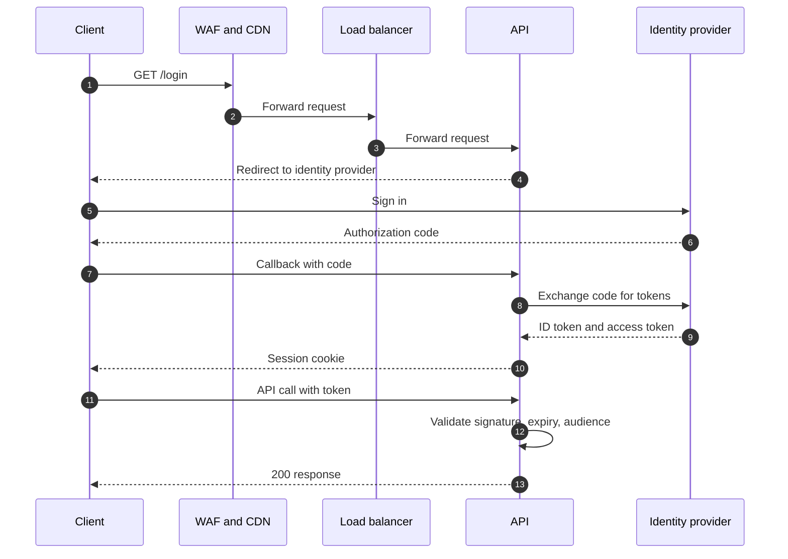
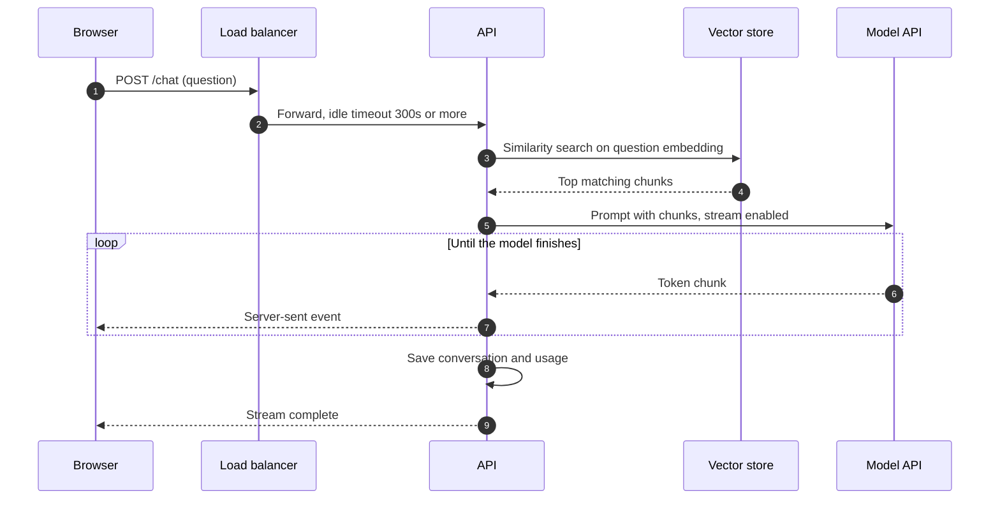
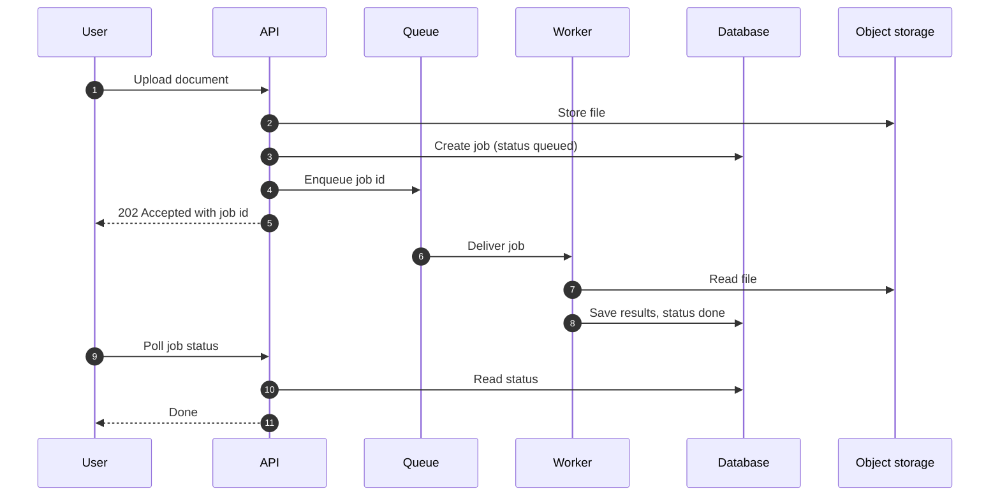
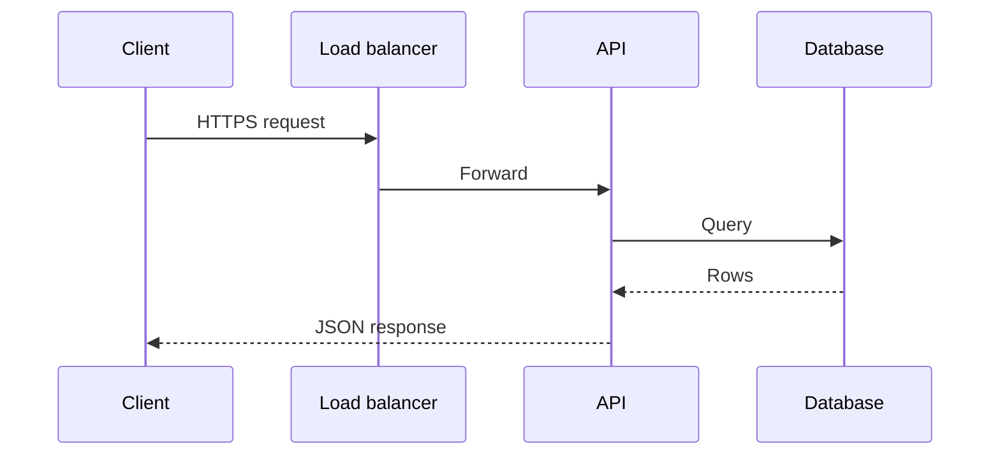

# Sequence flow patterns

Pick the pattern that matches the scan, then rename participants to the repo's own services.
Avoid semicolons in message text (the sanitizer escapes them, but plain text reads better).

## A. Authentication with an identity provider (OIDC and JWT)

Include when the scan shows an auth library (passport, next-auth, authlib, jsonwebtoken, PyJWT) or the user mentions login. Name the real identity provider if known.

## B. Streaming RAG / LLM request

Include when the scan shows an AI SDK plus a vector store. This is the diagram that SEC-004 protects: label the load balancer timeout.

## C. Asynchronous job

Include when the scan shows Celery, BullMQ, RQ, Sidekiq or a queue image. Mention retries and a dead-letter queue if the design adds them.

## D. Plain CRUD request (default when none of the above apply)

## Rules

- Draw two sequences per design: authentication (A or "no auth, public API" noted in text) and the app's core data path (B, C or D).
- Show the trust boundary: the first arrow after the internet must hit WAF, CDN or load balancer.
- Databases never start a call. Arrows from them are replies only.
- Label timeouts and protocols where they matter (SEC-004).
